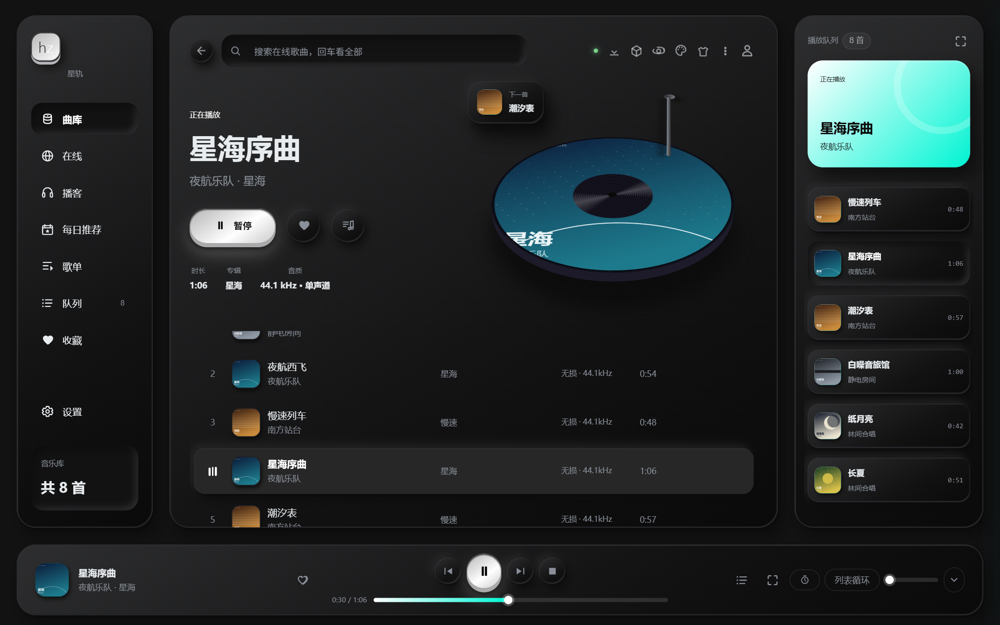
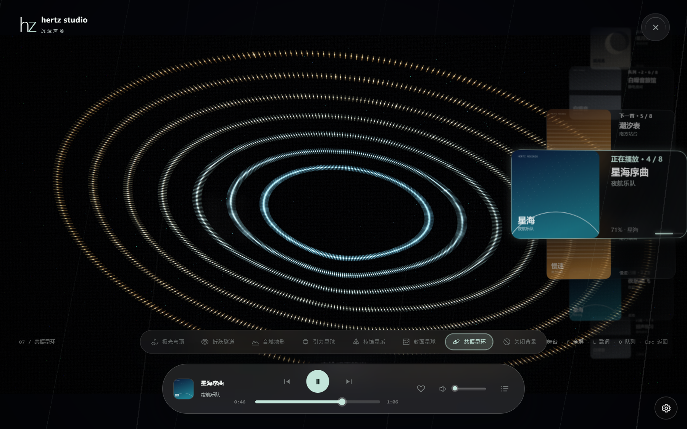
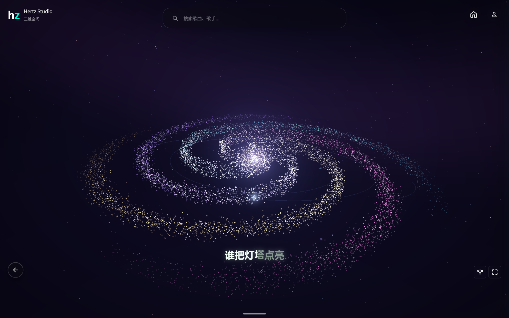
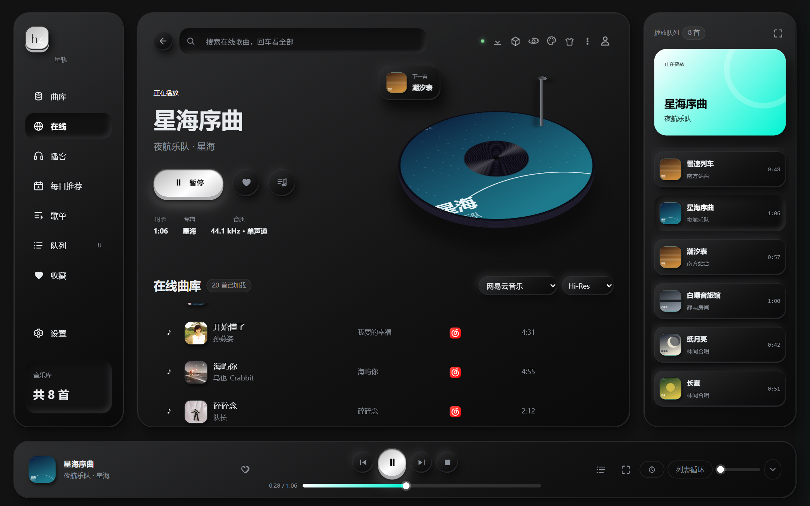
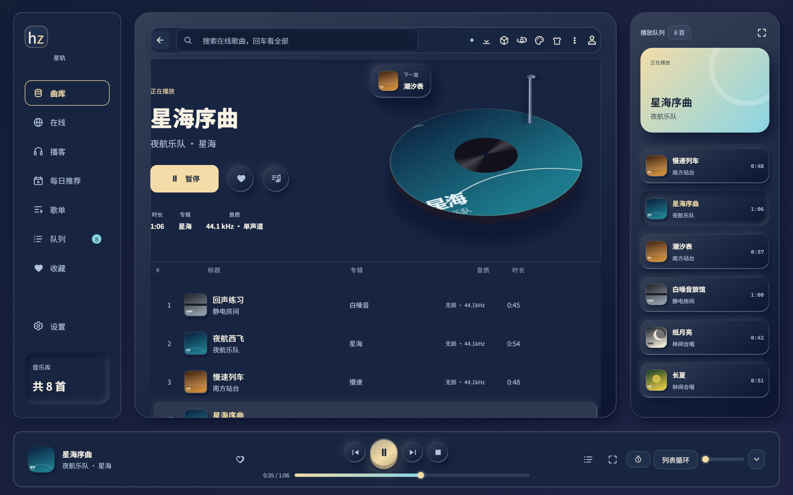
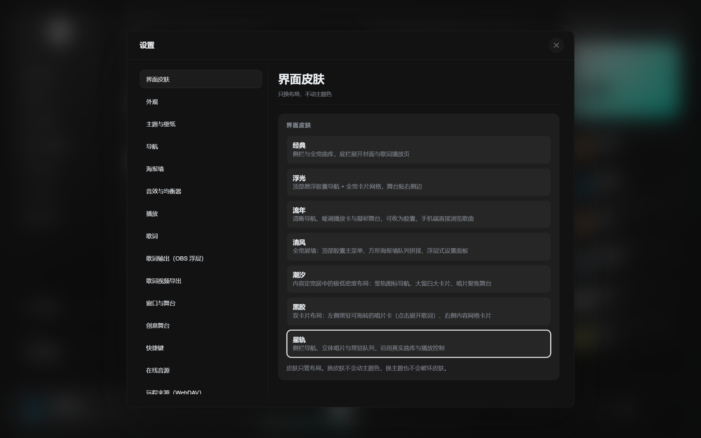

# Hertz Studio

一个本地优先（local-first）的音乐服务与播放器：单个 Rust 进程负责解码、播放、曲库与歌词，
界面是零构建的原生 JS/CSS。同一份业务逻辑与同一份前端跑在两种形态里——
独立二进制（自带 HTTP 与 WebSocket 服务，由服务自己托管界面）与 DBX 插件（stdio JSON-RPC sidecar，
界面打进 `.dbxp`）。

本地优先：播放、曲库、歌词、歌单、设置全部在你自己的机器上完成，断网也能用。
在线曲库浏览是显式启用的附加能力，由本机服务代理解析，不上传你的曲库、收听记录或任何个人数据。

从 **0.2.1** 起，同一主分支构建两个发行版并同步更新：默认 **Standard** 保留本地、WebDAV、
Jamendo、ccMixter 和公开播客；显式开启 `full` feature 的 **Full** 额外包含六个平台音源。
两版使用不同插件 ID 和默认数据目录，详见[双版本构建与发布](docs/editions.md)。



---

## 特性

### 播放与曲库

- 真实的本地播放：`symphonia` 解码 → `cpal` 输出。扫描检查 mp3 / flac / wav / m4a / aac /
  alac / ogg / aiff 等 13 种扩展名；检查不等于成功入库或可播放，Opus、APE、WMA 当前没有对应
  解码器。**扫描扩展名、读到标签、能解码、真出声是四件事**，失败明细都落在音乐目录的扫描结果里，
  详见[格式与错误说明](docs/audio-format-support.md)
- 播放控制：播放、暂停、停止、跳转、音量、上一首 / 下一首、三种播放模式（重复 / 单曲 / 随机），
  一首结束自动续播；睡眠定时到点自动暂停
- 谁在看谁在听：关掉最后一个界面页面会在宽限期后自动暂停（按一次 F5 或另开一个标签都不会误停），
  顶栏那颗电源钮则把播放、服务进程和页面一起收掉——关掉它之后要再听就重新运行服务
- 实时频谱：64 段 FFT，约 30 fps 推到界面
- 本地曲库：目录扫描、内嵌标签与封面提取、增删自动同步、标题 / 艺术家 / 专辑搜索；
  排序与分页都在服务端完成，点播用**完整筛选结果**作为队列；搜索关键词留历史
- 音乐目录管理：添加、启停、移除目录，监听文件变化自动增量扫描；支持手动扫描、取消与失败明细，
  移除目录不删音乐原文件
- 歌词：读取音频同目录 `.lrc`，支持普通歌词与**逐字时间轴**（enhanced LRC）、`[offset:]`；
  来源优先级为手动导入 > 音频内嵌标签 > 同名 `.lrc`，支持每曲 ±0.5s 偏移（持久化）。
  [歌词候选](docs/lyric-import.md)支持本地 LRC/受控 TTML 检查、预览与确认；Full 可手动检索既有
  音源并选词预览，许可与真实来源仍待验收，不自动采纳
- 自定义歌单：增删改、曲目增删与顺序维护；M3U 导入导出；可混存本地与在线曲目（元数据快照随单持久）
- 曲库管理：专辑 / 歌手筛选、曲目信息编辑（覆盖层，重扫保留）、批量编辑 / 收藏 / 加入歌单、
  替换封面、失效文件整理；缺失的歌手与专辑可以从在线音源联网补全
- 数据备份：歌单 / 收藏 / 设置 / 曲库目录一键导出导入（JSON，不含凭据，幂等恢复）
- 音效：六段 EQ、ReplayGain 响度归一化（关 / 按曲 / 按专辑，带预增益）、软限幅、
  已准备本地 / 缓存曲目的双流衔接与可调交叉淡化；不满足衔接条件时正常切歌，
  [支持边界](docs/adr/0007-playback-transitions-and-intent-ownership.md)
- 播放历史：分页、来源筛选与搜索，可回放；播客单集按稳定 ID 记住续播位置与已听完
- 远程来源（WebDAV）：登记服务器（密码进钥匙串）、目录浏览、导入曲库并以 HTTP Range 直链播放
- 系统凭据：平台 cookie 等秘密存入操作系统钥匙串，启动自动迁移旧明文数据
- 开发者选项：一键开启**播放诊断日志**（默认关闭），逐条记录音源与音质选择、缓存命中、
  每个地址的成败与原因；在线流地址只留 `host/path`，不含账号凭据。异常退出会留下编号并显示在
  设置页，这一条不受诊断开关控制

### 找歌与首页

- 首页「正在播放」卡按当下状态只给一个主动作：继续播放 / 查看队列 / 选一首继续听 /
  播放最近一首 / 添加音乐；旁边是最近播放与每日名言（可在设置里关掉）
- 命令面板 `Ctrl+K`：搜曲、播放控制、切皮肤与舞台、跳设置，可钉住、记最近使用，
  还认队列方言（例如按歌手从队列里剔除）
- 顶栏搜索默认搜在线，可切歌单 / 歌手 / 专辑；切到本地档就是曲库筛选
- 搜索走 SQLite FTS5（trigram）+ LIKE 复核，候选有界合并、来源分组渐进返回、
  单个来源失败可局部重试；[五万曲本机性能基线](docs/search-performance.md)

### 歌词舞台与沉浸声场

- 沉浸式歌词舞台：逐字染色（普通 LRC 也按字摊时间轴）、行内进度插值、按距离衰减的排版节奏、封面取色
- 全屏 3D 视角：拖拽旋转、按行景深视差、自动漂移、双击复位；纯 CSS 3D，文字仍是 DOM，清晰可点可读屏
- 五种歌词视觉：流光 classic、字形 glyph（WebGL 字形引擎）、心象 cadenza、商籁 sonnet（Pixi 电影镜头）、
  凝彩 tempera（色块分镜 MV）；**星诞 starborn** 不自己画字，只在它们之间按歌曲自动选镜；
  字幕条是独立开关，可与任一视觉共存
- 歌词情绪：把整首歌词按行 / 按段分类成情绪 Cue，再由一条纯函数「情绪场」求值成作用在字形上的曲线；
  分类只在显式授权后调用已配置的模型，可逐行手动锁定、可预览与调强度
- **沉浸声场**（按 **V** 进入）：极光穹顶、折跃隧道、音域地形、引力星球、棱镜星系、封面星球、
  共振星环七种三维背景，另有一档关闭背景；频谱驱动局部形变与节拍波纹，
  数字 **1–9** 切背景、**L** 切歌词、**Q** 队列、**B** 换布局、**F** 全屏、**K** 复位镜头、
  **空格** 播放、**Esc / V** 返回
- 舞台粒子层：封面周围的稀疏柔光随律动缓慢呼吸，节拍轻泛涟漪，为歌曲信息与歌词留出安静区域；
  可选 WebGL2 增强渲染，带代价探测与自动降级
- 3D 歌单架：CSS 3D 扇形排布，唱片封套式卡片与随频谱呼吸的舞台地面；只渲染窗口内的十几张，
  看不见的卡片不建 DOM、不取封面
- 录制歌词视频：把当前舞台导出 720p / 1080p / 竖屏，可带系统声音。仅独立形态可用——
  插件沙箱里没有本地歌词数据源，导出请改用浏览器打开的主界面；
  [支持范围、实际音轨与异常保存](docs/video-export.md)
- 歌词输出到直播 / 录屏软件：一个只读的歌词浮层页配一把只读钥匙（只能读浮层与封面，
  碰不到播放控制与曲库），三种排版，可挂自定义背景与台标。浮层页是纯轮询的旁观者，
  不算「正在看界面」的客户端，所以它不会替你挡住暂停



### 三维空间

- 按 **X** 进入一个独立的全屏三维应用，有自己的首页（搜索、最近、场景选择）与沉浸模式
- 舞台场景十种：海岸公路（默认）、星座、粒子反应堆、粒子绸带、引力星球、折跃隧道、棱镜星系、
  封面星球、粒子封面、曲面封面墙；场景库另按星空 / 封面艺术 / 频谱 / 歌词 / 材质 / 空间背景分类
- 操作：拖拽转台、滚轮推拉，**K** 回正、**L** 歌词、**Q** 队列、**F** 沉浸、**/** 或 **Ctrl+K**
  回到空间搜索、**Esc / X** 返回原界面；自由镜头在舞台控制里开启（WASD / QE 移动），不占快捷键
- 星座场景是一台观测台：十二宫轮播、HUD 与星点定位、视差控制台，可点选
- 粒子反应堆由**播放队列**驱动：队列里的曲目沿轨道排布，悬停即预览下一首
- 封面星球与曲面封面墙直接吃你的真实封面：悬停有响应，点击会换成队列里对应的那首
- 加场景的闭环写在 [tools/space-stage](tools/space-stage)：改场景源 → 打包 → 真渲染出预览图；
  每条场景自带密度档与预算上限，开帧级降级也不允许超预算



### 创意舞台与创作

- 创意舞台：手写 WebGL2 内核（零顶点缓冲、频谱走纹理、RGBA8 后处理链）+ 可寻址参数表 +
  编排 cue 轨 + 音频绑定 + 自动导演 + 创意工坊 + 手绘风格 + 自定义背景；歌词本身也是一种三维场景
- 「一句成景」用离线规则编译器把一句描述确定性地编成舞台意图，无网络、无模型、无随机数，
  编排结果可编成一段分享码交给另一个人
- [可编辑工程](docs/stage-projects.md)保存完整参数、cue 和本地媒体指纹，重开后确认媒体并继续编辑；
  [三个内置创作模板候选](docs/stage-templates.md)可先预览再应用，人工视觉验收仍待完成
- 基频候选轨迹：[本地分析与只读查看](docs/pitch-track.md)（实验性，真实音乐质量未验收）
- 场景选择插画的画法与配色记在[编排美术](docs/orchestration-art.md)，
  星座场景的逐座造型与动效在[星座视觉调优](docs/zodiac-visual-tuning.md)

### 在线曲库

- 音源注册表驱动：网易云 / QQ 音乐 / 酷狗 / 酷我 / 汽水 / 咪咕 / CCmixter / Jamendo，
  搜索、详情、歌词、试听与封面全部由本机服务代理并归一化成同一套字段；前端的选择框与分类
  由服务端的能力表生成，加一个音源不用改前端
- 登录：填入**你自己**在该站点的账号 cookie（服务端持久化、永不回显原文），或网易云 / QQ / 酷狗 / 汽水扫码；
  私人 FM 目前仅网易云
- 音质：标准 / 高品 320k / 无损 / Hi-Res 四档可选，实际取流按**这一首歌**的运行时代码上限逐级下探，
  失败自动重试下一档，并在界面上说明这首实际给到的是哪一档
- 在线歌单可读写：新建、删除、加曲、移曲，也能按名字搜平台上的歌单 / 歌手 / 专辑
- 在线缓存管理：占用统计、按音源清理、指定曲目豁免 LRU 回收
- 曲源自动接力：某首在线曲的音源失效时，按标题 + 歌手 + 时长在其它音源找到同一首并续播，
  界面说明这次换走了哪家；可在设置里关掉
- 听歌打卡：网易云在线曲有效收听满 30 秒后代你向平台上报一次收听记录，默认开启、可关，
  界面提示只代表请求已发出，不替你断定播放量已经增加
- 每日推荐：本地规则引擎 + 各平台每日推荐汇总（只取已登录平台，未登录、该平台没有这个能力、
  上游失败都记进「已跳过」而不是弹一个错误）
- 咪咕：官网登录后导入含 `pacmtoken` 的 Cookie，验证账号；支持公开歌单分页与普通音频播放，
  权限限制按平台响应显示
- 汽水：二维码使用当前手机授权入口；抖音 App 确认仍待本人验收，上游要求安全验证时可在官网登录后导入 Cookie



### 点播播客

- 独立播客栏目，通过 Apple Podcasts 目录搜索节目，可选择中国大陆、美国、英国、加拿大、澳大利亚、
  德国、法国、日本、韩国、中国香港、中国台湾及新加坡；记住上次选择，默认中国大陆。也可导入发布者公开 RSS
- 支持订阅、单集简介、分页、刷新和播放；单集进入原有队列与历史，重启或取消订阅后仍保留单集身份与收听位置
- 支持公开分发的 MP3/M4A 等有限长度音频；直播电台与平台私有付费节目不在此入口。
  每个 RSS 最多解析 16 MiB、收录 2000 个可播放单集

### 外观：主题、壁纸与界面皮肤

- 布局皮肤（界面可选五套）：**星轨 orbit（默认）** / 经典 classic / 流年 liunian /
  清风 qingfeng / 黑胶 heijiao。星轨提供单张立体黑胶、鼠标透视跟随、
  浮雕列表与常驻队列。皮肤只管布局，配色一律跟当前主题走，
  所以换皮肤不会把主题色带跑，换主题也不破坏布局
- 24 套内置主题色 + 7 套二次元主题 + 自定义配色；文字色由底色按 WCAG 反推，不是手写
- 主题工作室：壁纸背景（内置 13 张，缩略图选择与独立压暗）、自定义配色、自动压暗、背景模糊；
  自动压暗按壁纸亮度算出压暗量，保证面板文字仍然达到 AA
- 设置持久化在服务端 SQLite，不依赖浏览器 localStorage





### 模型与外部接入

- 应用内 AI 任务底座：舞台草稿与歌词情绪分类走同一套持久任务——可取消、可恢复、
  崩溃后按派发标记保守收敛，每个数据目录一个执行槽；没有可用凭据时不发起任何云请求
- Provider 由启动配置显式选择：默认 `fake`（不联网），实验性本地 Ollama，StepFun 与 OpenAI
  为固定 origin 的单次请求；密钥只进系统钥匙串，永不回显。
  [本地模型与草稿说明](docs/ai-stage-drafts.md)、[模型密钥接入准备](docs/ai-provider-credential.md)
- 用量账本：可信响应给到用量时按输入 / 输出 token 记账，费用未知就显示未知——
  不写 `$0`、不计入总额，费用与预算**不是**功能门槛
- 对外接入走标准 MCP：一个独立的 stdio 适配进程只读发现文件与专用授权凭据，
  业务仍由已运行的服务执行；授权在设置里逐把签发（名称 + 范围预设 + 分组开关），
  工具目录按连接时的授权与开关生成，撤权即刻生效，
  写操作带操作键去重、取消与断线保守返回 `unknown`。协议边界与验收状态见
  [MCP 互操作说明](docs/mcp-interoperability.md)
- 模型只能生成**候选**：草稿要人确认才落到舞台，不自动应用、不自动收藏、不改当前播放

### 工程与安全

- 默认只监听回环地址。入口链接带的是**两分钟即废的一次性票据**——这条 URL 会进浏览器历史、
  终端滚动缓冲和聊天记录，所以不把长期令牌写进去；长期令牌只留在本机文件与请求头里。
  绑到非回环地址时启动会打一行警告
- 三档设备档位（按核心数、内存与渲染像素判定，运行期只允许往下修正），歌词与舞台帧门对应
  20 / 30 / 60 fps，弱机自动降密度与刷新率
- 协议版本独立于软件版本演进；宿主握手不匹配时应拒绝连接而不是猜字段
- DBX 插件通过一层与传输无关的门面共用曲库、播放、在线账号与舞台业务，最低宿主版本为 0.6.35

---

## 快速开始

```bash
# 发布构建：Rust 1.88+、Node.js 22+（开发 cargo run 不需要 Node.js）
# 安装固定版本的发布压缩工具；仅修改暂存产物，保留 JS/CSS 开发源码可读
npm ci --prefix tools/space-stage --no-audit --no-fund
cargo build --release -p hertz-studio

# 运行独立形态（Windows 下产物是 target\release\hertz-studio.exe）
./target/release/hertz-studio

# 或者一步到位，并自动打开浏览器
cargo run --release -- --open
```

发布构建在构建期压缩 JS/CSS 并内嵌 gzip；浏览器直接接收预压缩资源，identity 客户端按资源首次访问
解压缓存。首页继续单独注入令牌。三个 3D 引擎共享同步 classic-script 包；修改场景源码后执行
`node tools/build-stages.mjs`，并运行 `node scripts/check-release-ui.js` 校验哈希与加载顺序。
诊断 HTML 保留在源码目录，发布仅带 `index.html` 与 `overlay.html`。

启动后终端会打印界面入口（Standard 默认 `http://127.0.0.1:7635/`，Full 默认端口 `7634`，后面跟着
一张一次性入口票据）、健康检查地址，以及服务发现文件的位置。

在 UI 左侧填入音乐目录 → 点「扫描」→ 点击曲目即可播放。要停掉服务：终端里 `Ctrl-C`，
或者用界面顶栏那颗电源钮。

局域网收听：每台电脑运行本机 Hertz，在左侧选择“一起听”。房主创建房间、选择分享歌曲并生成一次性邀请；接收电脑核对指纹后加入，声音由原生服务输出。设备、权限、聊天与验收说明见 [局域网一起听使用指南](docs/lan-listening-user-guide.md)。

常用参数：

| 参数               | 说明                             |
| ---------------- | ------------------------------ |
| `--bind ADDR`    | 监听地址，默认 `127.0.0.1`          |
| `--port PORT`    | 端口，`0` 表示随机空闲端口，Standard 默认 `7635`，Full 默认 `7634` |
| `--data-dir DIR` | 数据库、封面缓存、令牌的存放位置       |
| `--open`         | 启动后打开浏览器（走系统 `cmd`，只在 Windows 生效） |
| `--mcp-stdio`    | 以 MCP stdio 适配进程启动，需配 `--grant` |
| `--grant ID`     | 适配进程使用的专用授权凭据 ID           |
| `--version`      | 打印版本后退出                        |

环境变量：`VMUSIC_BIND` `VMUSIC_PORT` `VMUSIC_BACKEND`（`null` = 不出声）
`VMUSIC_LOG` `VMUSIC_DATA_DIR`；另有 `VMUSIC_SECRETS=memory` 仅用于测试 / CI（凭据只存进程内）。

### DBX 插件形态

`plugin/` 是同一套逻辑与同一套前端的插件形态：

- `plugin/backend/` 编译出 sidecar 二进制 `dbx-plugin-hertz`，经 stdio JSON-RPC 与宿主通信；
  数据目录由宿主指定，未设置时回落到独立数据目录之外的专属子目录
  （避免两个进程同时写同一个 SQLite）
- `plugin/ui/` 打进 `.dbxp`；界面靠 `plugin/ui/host.js` 这层宿主适配收敛差异
  （资源 URL 补全、opaque origin 下的 localStorage 替身），其余前端代码不感知自己跑在哪个宿主
- `plugin/manifest.json` 声明 workbench + command + 菜单项；`plugin/dbx-plugin.toml` 是打包配置
  （只带 `assets` 与 `ui`；发布脚本在暂存目录压缩 JS/CSS）
- 使用 `HERTZ_EDITION=standard bash scripts/ci-package-plugin.sh` 打包，Full 则设为 `full`；
  脚本生成对应界面和 manifest，再调用固定版本 DBX CLI，产物落在 `plugin/dist/<edition>/`

sidecar 只做传输：把宿主的调用转成与 HTTP 响应同构的返回值，服务端事件经同一条广播总线下发，
两种形态的事件口径一致，业务实现只有一份。插件形态没有独立服务进程可退，
所以界面顶栏那颗电源钮在插件里不出现。
**当前状态**：`crates/hertz-studio/src/rpc/` 已覆盖曲库、播放、歌单、推荐、播客、远程来源与设置，
与 HTTP 复用同一套服务实现；`scripts/check-plugin-sidecar.js` 验证信封、路由与事件契约。
真实平台账号和原生宿主的验收范围见[上架手册](docs/dbx-store-submission.md)。

---

## 架构

```
┌─ 表现层 ────────────────────────────────────────────────┐
│  内置 Web UI（零构建）· DBX workbench · curl · MCP 客户端 │
└───────────────┬─────────────────────────┬───────────────┘
                │                         │
┌─ 传输 ────────┴───────────┐   ┌────────────────────────┐
│ 独立形态：HTTP + WebSocket │   │ 插件形态：stdio JSON-RPC │
└───────────────┬───────────┘   └─────────┴───────────────┘
                │        rpc（JSON 门面）  │
┌─ hertz-studio 逻辑库 ─────┴─────────────┴───────────────┐
│  bootstrap  数据目录 → 可用的 AppState（两种形态同一条路）│
│  state      播放队列、事件总线、服务发现文件、观看者计数  │
│  scan       后台扫描，进度经事件总线广播                  │
│  online     音源注册表：契约 + 分发 + 落盘缓存             │
│  podcasts   中文播客目录与 RSS，用户给的地址逐跳校验       │
│  ai         持久任务、provider、凭据、账本、情绪分类       │
└───────────────────────────┬─────────────────────────────┘
                            │ 命令队列（单消费者）
┌─ audio actor（专用线程）───┴─────────────────────────────┐
│  串行执行所有播放命令，唯一的播放状态写入者                │
│  快照无锁发布，频谱在 actor 线程计算                       │
└───────────────────────────┬─────────────────────────────┘
                            │ AudioBackend trait
┌─ 后端 ────────────────────┴─────────────────────────────┐
│  CpalBackend   解码线程 → 环形缓冲 → cpal 回调 → 声卡     │
│  NullBackend   不出声，确定性时序，供测试与 CI 使用        │
└─────────────────────────────────────────────────────────┘
```

另有一条与上面并列的**外部入口**：`--mcp-stdio` 起的适配进程，只读发现文件与授权凭据，
把 MCP 工具调用转成对已运行服务的请求；它不启动播放器、音频、数据库或 HTTP 服务。

拆成逻辑库的约束很实际：`AppState` 有一批 `pub(crate)` 字段（`radio`、`online_meta`、
`downloads`、`quality`、`keep`、`protected` 等），插件的 dispatcher 必须留在本 crate 内部才碰得到，
所以 `rpc` 门面在 `crates/hertz-studio` 里而不在 `plugin/backend`。

**核心设计取舍**

| 主题     | 选择                       | 原因                                         |
| ------ | ------------------------ | ------------------------------------------ |
| 并发     | 单消费者命令队列 + 无锁快照 | 播放操作之间有严格的时序约束，用串行化代替加锁；读多写少的状态用无锁快照       |
| 音频回调   | 独立于 tokio 的 OS 线程        | 回调里 `await`、抢锁或分配内存都会爆音                    |
| 事件下发   | 广播队列满时**丢帧**而不是断开     | 状态帧每拍全量重发，缺几帧增量无所谓；断开会让客户端走指数退避，退避窗口里界面停在旧状态 |
| Web 框架 | axum                     | 类型安全 extractor、与 tokio 同源；本服务瓶颈在音频而非路由       |
| 数据访问   | sqlx 运行时校验（非 `query!` 宏） | 无需 `.sqlx/` 元数据即可离线构建，CI 更简单；所有语句由集成测试覆盖   |
| 搜索     | SQLite FTS5（trigram）+ LIKE 复核 | 三列候选有界合并，LIKE 复核保持原搜索语义；[五万曲本机性能基线](docs/search-performance.md) |
| 重采样    | 固定参数流式 sinc（Rubato）   | 解码线程转换，同率直接复制；已有离线验证，真实设备 / 听测待验，见[实现边界](docs/audio-resampling.md) |
| 前端     | 零构建原生 JS                 | `cargo run` 之后直接用；发布压缩需要 Node.js/esbuild            |
| 双形态    | 逻辑库 + 两个薄传输壳            | 传输只有三处差异（routes / ws / sidecar），业务只写一份      |
| 舞台引擎   | 手写 WebGL2 / three.js 场景包 | 三个引擎共享同一份同步 classic-script 包与同一套播放契约，不引运行时依赖 |

REST 路由清单不写在 README 里，见 [docs/api-routes.md](docs/api-routes.md)，
那份清单由脚本从路由源码生成、并在 CI 里校验一致性。

---

## 在线音源的边界

Standard 接入 ccMixter、Jamendo 两个开放曲库及公开 RSS 播客。Jamendo 需在 devportal 免费注册
client_id，在「设置 → 在线音源」保存后才启用，未配置时自动隐藏。

Full 额外接入网易云音乐、QQ 音乐、酷狗音乐、酷我音乐、汽水音乐和咪咕音乐。以下平台协议与
账号能力仅编译进 Full，Standard 不包含相应协议实现、请求签名、平台登录脚本和图标。Full 对接使用：
平台**网页端 / 自家客户端公开使用的端点**（含这些端点要求的请求签名，如酷狗的 MD5 签名、
QQ 的搜索签名与取流凭据、酷我移动端的变形 DES 载荷），和**用户自己账号的凭据**
（cookie 或扫码登录）。平台客户端签名算法是项目所有者明确授权实现的（设计决策 D7）：
仅在用户本机、以用户本人凭据发起请求，不分发平台内容、不做商业服务，全部代码为原创实现。

红线不变，具体不做的事：

- 不解密受技术保护措施保护的音频（DRM / CENC / 加密容器一律不碰）；
- 不绕过付费墙，也不模拟会员权益判定（VIP 歌曲在界面上如实置灰）；
- 不伪造设备指纹，也不实现平台未公开的私有付费内容接口；
- 不在服务里存放别人的账号，也不做账号池 / 凭据共享。

能力失败一律如实上报：某源没有的能力直接回答「不支持」，聚合搜索里失败的源进失败列表，
而不是被伪装成空结果。Jamendo 与 ccMixter 的搜索结果保留逐曲许可证及作品页链接，
许可证可能包含非商业（NC）或禁止改编（ND）等条件，应按具体作品授权使用。

凭据的处理：cookie 写入系统凭据保险库，读取设置时不回显凭据，也不接受把凭据写进设置键。
界面上的「已登录」只是本机存着凭据的提示，登录弹窗会再向平台确认账号是否仍然有效。
服务默认只监听回环地址且需要本地令牌，平台凭据只发给对应平台的官方接口。

加一个音源的成本写在[扩展指南](docs/extension-guide.md)里：一个平台源文件 + 一条注册项，
界面由能力表自动驱动。播客注册成独立的媒体种类，通过同一个播放器取流，但不参加音乐搜索、
每日推荐或歌曲换源匹配；播客目录与 RSS 是另一条服务链路。

---

## 配置

首次运行会在数据目录生成 `config.toml`（可直接编辑），环境变量优先级更高。

```toml
[server]
bind = "127.0.0.1"
port = 7635 # Full defaults to 7634

[audio]
backend = "cpal"        # 或 "null"（不出声，用于测试）
volume = 0.8
spectrum_bands = 64

[library]
extensions = ["mp3", "flac", "wav", "m4a", "aac", "ogg", "oga", "opus", "ape", "wma", "aiff", "aif", "alac"]
follow_symlinks = false

[online]
cache_max_bytes = 2147483648   # 在线音频缓存上限，默认 2 GiB

[ai]
provider = "fake"       # fake | ollama（本地实验）| stepfun（Step Plan token-only）| openai（具体模型/费率未确认，关闭）
origin = "http://127.0.0.1:11434" # StepFun: https://api.stepfun.com/step_plan/v1 或 https://api.stepfun.com/v1
model = ""              # ollama 填已安装模型名；StepFun 由配置显式指定。API key 只存钥匙串

[log]
level = "info"          # 例如 "hertz_studio=debug,vmusic_audio=info"
format = "pretty"       # pretty | json
```

（生成的文件里还有一个 `server.expose_ui`，目前没有任何代码读它，属于预留键。）

AI provider 修改后重启服务，并在工坊中另行开启生成；启动和查看状态不调用模型。Ollama 只接受
数字回环 origin，需由操作者在 Ollama 服务端禁用云功能（`OLLAMA_NO_CLOUD=1`）并选择已安装的
本地模型。配置文件语法或字段类型错误会阻止启动并报告文件位置，避免静默切回默认 provider。
StepFun Plan 采用 token-only 账目：未知费用不阻止请求，也不显示为零费用。
详见[本地模型与草稿说明](docs/ai-stage-drafts.md)与[模型密钥接入准备](docs/ai-provider-credential.md)。

Standard 数据目录默认位置：Windows `%LOCALAPPDATA%\hertz-studio-standard`，
macOS `~/Library/Application Support/hertz-studio-standard`，Linux `~/.local/share/hertz-studio-standard`。
Full 继续使用对应平台下原来的 `hertz-studio` 目录。
其中含 `vmusic.db`（曲库）、`cache/covers/`（封面）、`cache/online/`（在线音频缓存）、
`token` 与 `overlay-key`（两份彼此独立的凭据，后者只读）、`vmusicd.json`（服务发现文件，
宿主与 MCP 适配进程据此拿到端口与令牌）。开启播放诊断日志后还有 `logs/playback.log`
（单文件上限 2 MiB，超出裁掉最旧的一半）。

---

## 目录结构

```
hertz-studio/
├── migrations/              数据库迁移（启动时自动执行）
├── crates/
│   ├── vmusic-core/         领域模型、AudioBackend trait、错误分类
│   ├── vmusic-audio/        NullBackend / CpalBackend + 命令 actor
│   ├── vmusic-store/        SQLite 仓储（sqlx 运行时校验）
│   ├── vmusic-library/      目录扫描、元数据与封面、歌词文件查找
│   ├── vmusic-lyrics/       LRC 解析（含逐字时间轴）
│   ├── vmusic-beats/        离线节拍分析：STFT 频谱通量 → 峰值 / BPM / 强拍分型
│   └── hertz-studio/        服务逻辑库 + 独立形态二进制
│       ├── src/lib.rs       业务逻辑库：两种宿主共用同一份
│       ├── src/bootstrap.rs 进程装配：数据目录 → 可用的 AppState
│       ├── src/rpc/         与传输无关的 JSON 门面（DBX 插件形态走这里）
│       ├── src/routes.rs    独立形态的 REST 路由表
│       ├── src/ws.rs        独立形态的事件推送与观看者计数
│       ├── src/ai/          持久任务、provider、凭据、账本、情绪分类、MCP 适配
│       ├── src/podcasts/    播客目录、RSS 解析与订阅存储
│       ├── src/lyrics/      歌词候选的检查、预览与确认
│       ├── src/online/      音源注册表：provider（登记与能力门）· 各平台源 ·
│       │                    mod（分发与缓存）· ladder / progressive / quality（取流阶梯）
│       └── src/             edition.rs（发行版裁剪）· diag.rs（崩溃与诊断）·
│                            stage_beats / stage_pitch / stage_project.rs · complete.rs · daily.rs
├── plugin/                  DBX 插件形态：与独立形态共用逻辑库和前端
│   ├── manifest.json        插件清单（workbench + command + menus）
│   ├── dbx-plugin.toml      打包配置
│   ├── assets/plugin.svg    插件图标
│   ├── backend/             sidecar 二进制 dbx-plugin-hertz：stdio JSON-RPC 薄壳
│   ├── vendor/dbx-plugin-sdk/  DBX 官方 SDK 副本（未发布到 crates.io，出处见 NOTICE）
│   └── ui/                  零构建的前端，独立形态内嵌托管、插件形态打进 .dbxp
│       ├── host.js                宿主适配层（必须第一个加载）
│       ├── index.html / app.js / style.css
│       ├── palette.js / topsearch.js / search-history.js  命令面板与搜索
│       ├── home-dashboard.js / home-quote.js / daily*.js / favorites.js   首页、每日推荐、收藏
│       ├── now-playing.js / lyric-import.js               正在播放页、歌词导入
│       ├── stage*.js / stage*.css   歌词舞台：演出模式、控制舱、粒子、影院镜头、自由机位、歌单架
│       ├── stanza/                  歌词视觉：流光 / 字形 / 心象 / 商籁 / 凝彩 + 星诞导演
│       ├── stage3d.js               沉浸声场七种背景与三维机位
│       ├── space3d.js / space-*.js  三维空间：首页、场景、机位、图层、悬浮控件
│       ├── stage-zodiac.js / stage-coast.js  星座观测台与海岸公路
│       ├── creative-*.js / workshop.js       创意舞台：WebGL2 内核、编排、离线提示词编译、工坊、分享码
│       ├── lyric3d.js / lyric-emotion*.js    三维歌词与情绪场
│       ├── video-export.js / overlay.html    视频导出、歌词浮层
│       ├── themes.js / theme-studio.*        主题色目录与主题工作室
│       ├── skins/                           布局皮肤：orbit / classic / liunian /
│       │                                    qingfeng / heijiao
│       ├── online*.js / podcasts.js          在线音源、扫码登录、在线歌单、播客
│       └── wallpapers/                       内嵌壁纸（13 张，已按长边 1600px 预压）
├── tools/                   舞台场景源码（space-stage / zodiac-stage / coast-stage）与打包脚本
├── docs/                    扩展指南、设计记录、ADR、接口清单（api-routes.md）
├── scripts/                 契约与冒烟脚本（见「开发」）
└── .github/workflows/       CI：fmt · clippy · test · 前端契约 · smoke · 插件 sidecar
```

---

## 开发

新增皮肤、舞台场景、歌词视觉与音乐渠道请参阅[扩展指南](docs/extension-guide.md)。

```bash
cargo test --workspace        # 单元 + 集成测试
cargo clippy --workspace --all-targets -- -D warnings

# 逐包格式化，不要用 --all：它会把 vendored 的 plugin/vendor/dbx-plugin-sdk 一起重排，
# 而那份源码必须与上游字节一致（见 NOTICE）。CI 也是逐包列的。
cargo fmt -p hertz-studio -p vmusic-core -p vmusic-audio -p vmusic-store \
  -p vmusic-library -p vmusic-lyrics -p vmusic-beats -p dbx-plugin-hertz
```

验证脚本按档位分，日常只需要记第一条：

| 档位 | 入口 | 说明 |
| --- | --- | --- |
| 前端契约（CI 那一组） | `node scripts/check-frontend.js` | 只用 Node 标准库，一条命令跑完语法 → 静态 guard（资源接线、CSS 令牌、改名后的负面不变量）→ 行为回归（vm 沙箱跑真实模块）。加 `--extra` 跑本地才跑的那批，`--only <名字>` 单跑一条 |
| 接口清单 | `node scripts/api-routes.js --check` | 校验 `docs/api-routes.md` 的生成清单与路由源码一致（这条已经收进上面那一组） |
| 活体 | `node scripts/check-frontend.js --live` | 需要真浏览器与一个起着的服务：`PLAYWRIGHT_MODULE` 指向 playwright 模块，各脚本另有自己的地址变量。缺环境时它们只报环境错，不报产品错 |
| 需要二进制 | `check-plugin-sidecar.js`、`check-library-api.py` | 前者真起 sidecar 走 stdio 冒烟（找 `target/debug/dbx-plugin-hertz`，可用 `HERTZ_PLUGIN_BIN` 覆盖）；`HERTZ_SIDECAR_LAG_PROBE=1` 会额外停读 stdout 90 秒验事件恢复；后者用 python 标准库自起隔离实例 |
| 端到端 | `smoke.sh` / `smoke.ps1` / `smoke-online.ps1` | 构建 → 启动 → 调一轮服务 → 关闭；online 版对着已运行的服务打真实上游 |

**四类没有红字的失败，各自有契约脚本钉着**（坏了不报错，只会「看起来还行但不对」）：

- **换肤**：失败表现为「刷新后又变回去了」，常见成因不是忘了写 localStorage，而是**读回来的时机
  不对**——选择要指向的那套主题还没登记进目录（二次元七套与自定义配色都在启动后半程才 register），
  此刻读回来的 id 会被当成「不认识」静默忽略。`check-appearance-restore.js` 用真实模块跑真实启动
  序列，再用共享同一份 localStorage 的新沙箱模拟刷新，逐项断言「改过什么，刷新后就还在什么」
- **每日推荐的降级**：多平台汇总跑在服务端（`crates/hertz-studio/src/daily.rs`），但最容易坏的是前端
  的降级路径——某个平台没登录、某个平台没有推荐能力、整条在线链路不可达，这三种情况都**不能**弹红、
  不能挡住本地那一路。`check-favorites.js` 逐条钉住，并断言「未登录」只出现在副标题里
- **主题的文字色**：文字色不是手写的，是从底色按 WCAG 反推的；推错了界面不报错，只会让某套主题的
  正文糊在背景上。`check-theme-studio.js` 用**自己实现的**对比度公式（不复用被测代码那份，否则等于
  自证）逐套主题验 7:1 / 4.5:1，并对「每套主题 × 每张壁纸 × 每个强度」的组合验一遍自动压暗后仍然达到 AA
- **创意舞台的参数链与 GLSL**：三维舞台跑在浏览器里，CI 上起不了 WebGL；真正容易出错的是两件事——
  每帧的参数解析链（基础值 → 音频绑定 → 动画 → 钳位，任何一步算出 `undefined` / `NaN` 画面就整块
  变黑而浏览器不报错），以及 GLSL 里静态可见的那一半（未声明的 uniform、声明了却从不赋值的参数、
  顶点片元不匹配的 `out`/`in`、GLSL ES 3.00 保留字）。`check-creative.js` 对这两类各查一遍，脚本里的
  时钟是**可推进的假时钟**（用真实 `Date.now` 的话导演的 250ms 采样节流永远不触发，测试会「通过」
  但什么也没验到）。真机确认仍然必须在一个**可见的**窗口里做：后台标签页里 `requestAnimationFrame`
  完全停转

前端是零构建的原生 JS/CSS，但 `plugin/ui/` 下的 CSS 有一层约定需要守：
`style.css` 与 `stage.css` 都在 `:root` 上声明变量，后者在 `<link>` 里排在后面，
**同优先级整块覆盖**。因此共享令牌（`--glass-*`、`--hover`）只允许由 `style.css` 的 `:root`
定义，且 `--glass-border` 是 `1px solid <color>` 完整简写、`--glass-shadow` 是完整阴影列表 ——
不能再拼接 `1px solid` 或 `0 8px 28px`。违反时页面不报错、也不缺元素，只会静默丢掉描边和投影。
`scripts/check-css-tokens.js` 把这条契约变成断言。

**没有声卡也能开发**：

```bash
cargo run -- --port 0         # 后端拿不到设备自动降级为 null
VMUSIC_BACKEND=null cargo test
```

`NullBackend` 用墙上时钟驱动完整状态机，因此播放/暂停/跳转的时序逻辑无需音频设备即可验证。

端到端验证（构建 → 启动 → 调一轮服务 → 关闭）：

```bash
bash scripts/smoke.sh 7899        # macOS / Linux
pwsh -File scripts/smoke.ps1 7899 # Windows
```

---

## 路线图

路线图按**用户获得的完整结果**排序，不按模块排序。一句话概括当前状态：**代码走在了验收前面**——
「当前没有需要在缺少真实环境时继续新增的主线功能」是功能核对结论，不等于发布条件已经满足。
每条的真实状态以[路线图进度](docs/roadmap-progress.md)（最新增量 2026-10-23）为准，范围与依赖见
[产品路线图](docs/product-roadmap.md)，设计基线见[技术实施方案](docs/technical-roadmap.md)，
发布门槛见[发布验收矩阵](docs/release-validation.md)。现行契约见对应 [ADR](docs/adr/README.md)及路线最新修订；[架构复核记录](docs/architecture-review.md)保留历史评审依据，不能覆盖后续明确决定。未决冲突需记录并复核。

2026-10-23 已补核最新 master 的三 OS / 双发行版 CI 与构建结果；近期任务顺序和验收标准见[下一阶段开发计划](docs/plans/2026-10-23-next-development.md)。

**主线 R0–R6**

| 阶段 | 可感知交付 | 现在的状态 |
| --- | --- | --- |
| **R0** 质量与事实收敛 | 能力边界、性能基线、双版本发布清单可信 | 自动化检查、发行版裁剪与矩阵已就位；真实声卡、真账号、原生宿主、弱机、跨平台与候选发布证据仍缺 |
| **R1** 找歌与连续聆听 | 搜索可渐进使用、来源失败可恢复、状态一致 | 服务端共享 admission、四入口有界调度、渐进结果与失效隔离已实现；**gate 数值仍是候选**，未经真实负载与用户 SLO 冻结 |
| **R2** 外部只读与播控 | 标准 MCP 连接、最小授权、可靠结果 | Rust stdio 适配、grant / 发现 / 锁、取消与帧边界已实现并通过定向检查；正式目标客户端、其它 OS 与长时间压力待验 |
| **R3** 舞台草稿闭环 | 明确基线的 intent 导入、无副作用物化、临时预览与分享 | 十个场景契约、版本信封、导入与分享码已实现；原生宿主完整导入旅程与模板的人工视觉验收待做 |
| **R4** 应用内任务底座 | 生成任务、取消与恢复闭环 | 持久任务、恢复、预算与账本已实现（fake provider 全链路通过）；其它运行时异常与桌面宿主继续审计 |
| **R5** 指定模型试验与发布 | 一个明确选择、可受控调用的描述生成入口 | 适配与凭据链路已实现，但**当前阻塞**：没有可用 API key，StepFun 应用内真实调用返回 402；评测的人工盲审未执行，`releaseEligible=false` |
| **R6** 可保存的音乐创作 | 创作模板、导出链路加固、编排试点 | 版本化工程、cue 编辑、三个模板候选已实现；模板与基频轨迹的真实音乐质量待人工验收 |

**专项与设计记录**（各自单独排期、不互相等待；每篇文档的完整结论与待验收项在文档内）

| 专项 | 现在到哪一步 | 文档 |
| --- | --- | --- |
| R1-L 歌词候选导入 | 本地 LRC / 受控 TTML 已上线；在线候选的真实来源与许可待验收 | [lyric-import.md](docs/lyric-import.md) |
| S1 重采样 | 固定参数流式 sinc 已实现并有离线验证；真实声卡、长时间听测与其它 OS 待验 | [audio-resampling.md](docs/audio-resampling.md) |
| 音频格式与错误边界 | 13 种扩展名，四件不同的事（检查 / 标签 / 解码 / 出声）写明并如实上报 | [audio-format-support.md](docs/audio-format-support.md) |
| S2–S4 音频二期 | 升采样、参数 EQ、卷积 IR、EBU R128、真峰值限幅、噪声整形、交叉馈送、饱和，以及 Windows WASAPI 独占输出——排期在 R0–R6 之外 | 待音频专项重新定序 |
| W0–W3 桌面壁纸 | W0 稳定通过；W1-A 相机 registry/只读快照契约已实现；W1-B 首片已接 WorkerW 目标屏 surface、混合 DPI（第二屏 96/144 实测）、feed、托盘、设置页、15 秒预览租约、Explorer 重启恢复与主应用管理通道；多 profile/事件 WS/多屏同时运行未做 | [desktop-wallpaper.md](docs/desktop-wallpaper.md) |
| L0–L3 桌面歌词 | **L1 首版已实现**：服务端只读快照/文档桥、Windows 透明置顶与锁定穿透、托盘恢复、播放器启动与解锁定位、本机管理通道；L1-C 发布验收、DBX 入口与多 profile 切换未做 | [desktop-lyrics.md](docs/desktop-lyrics.md) |
| 桌面公共契约与原生验证 | 单实例、来源切换、配置/应用状态、IPC、自启与部署统一设计；L0/W0 已有实机探针结果，L1 首版按本契约落地；本机管理通道已通，来源切换与发布验收仍未完成 | [共享宿主](docs/desktop-host.md) · [原生验证计划](docs/plans/2026-10-23-desktop-native-validation.md) |
| 创意舞台二期（P8） | 基频轨迹已能本地分析与只读查看；工程、模板、分享码、视频导出已落地，人工视觉与音乐质量验收未做 | [pitch-track.md](docs/pitch-track.md) · [stage-projects.md](docs/stage-projects.md) · [stage-templates.md](docs/stage-templates.md) · [orchestration-art.md](docs/orchestration-art.md) · [video-export.md](docs/video-export.md) |
| 星座场景视觉 | 逐座造型、配色与动效按文档调过一轮，可拖拽环绕、滚轮缩放、双击复位 | [zodiac-visual-tuning.md](docs/zodiac-visual-tuning.md) |
| 搜索性能基线 | 五万曲本机 P95 与受控上游时延有基线，不替代真实来源 / 弱网 / 弱机验收 | [search-performance.md](docs/search-performance.md) |
| 资源优化 | 音频转换参数、分辨率与帧率预算不变的前提下压缩重复工作与临时分配 | [resource-optimization.md](docs/resource-optimization.md) |
| 双发行版构建 | Standard / Full 同一分支、同一版本号，feature 决定协议模块与界面裁剪 | [editions.md](docs/editions.md) |
| 扩展与平台源接入 | 内置注册表 + 一条注册项的成本，界面由能力表驱动 | [extension-guide.md](docs/extension-guide.md) |
| MCP 互操作 | 只读发现 + 专用授权凭据的独立适配进程，业务仍由服务执行 | [mcp-interoperability.md](docs/mcp-interoperability.md) |
| DBX 上架 | 规则出处、字段填法与当前提交状态 | [dbx-store-submission.md](docs/dbx-store-submission.md) |
| 参考与可行性评估 | VCPChat 对照、自研舞台引擎可行性、技术方案的独立评估（结论已回写进上面两份路线图） | [vcpchat-reference-assessment.md](docs/vcpchat-reference-assessment.md) · [stage-engine-feasibility.md](docs/stage-engine-feasibility.md) · [technical-roadmap-assessment.md](docs/technical-roadmap-assessment.md) |

明确**不做**的也写在路线图里，免得被当成待办：云同步 / 多用户 / 远程 MCP、在线热加载
SVG/GLSL/JS、新增皮肤与新增平台、通用 agent、动态代码生成、向量库、完整 DSP 图、
用模型直接改当前舞台、时间轴式 StageIntent（按 `unsupported_timeline` 拒绝）。

P1–P8 是 R0–R6 之前的历史演进记录，保留在这里便于对照旧文档：

- **P1–P3（已完成）** 可运行骨架（播放、频谱、扫描、歌词、歌单、Web UI）、在线曲库
  （注册表 / 代理归一化 / 落盘缓存 / 自有账号）、远程音源与一期音效
- **P4（主链路已完成）** DBX 插件形态：sidecar 与 JSON 门面共用服务逻辑，事件与状态口径一致；
  真实平台账号与原生宿主只验收了部分链路
- **P5–P8（部分完成）** 歌词舞台、舞台粒子层与 3D 歌单架、创意舞台（三维场景与后处理链、
  可编排的演出数据、创意工坊、手绘风格、自定义背景），三维歌词排版、「一句成景」首期与编排分享码；
  仍然是**零运行时依赖、零构建步骤**，剩余项见上面的「创意舞台二期」

---

## 许可与致谢

本项目采用 **MIT 许可**，见 [`LICENSE`](LICENSE)。每个源文件头部均带有 SPDX 许可标识。

本项目的播放器架构与舞台设计参考了 [VCPChat](https://github.com/lioensky/VCPChat) 项目的实现
（三层拆分、播放状态单一事实源、主题配色等），商籁 / 凝彩歌词视觉的行为语言参考了 VCPChat 与
folia 项目，汽水扫码登录的协议事实参考了 Mineradio 项目——均为独立实现，未复制任何源文件。
第三方依赖、vendored 源码与上述参考实现的署名和许可条款见 [`NOTICE`](NOTICE)。
