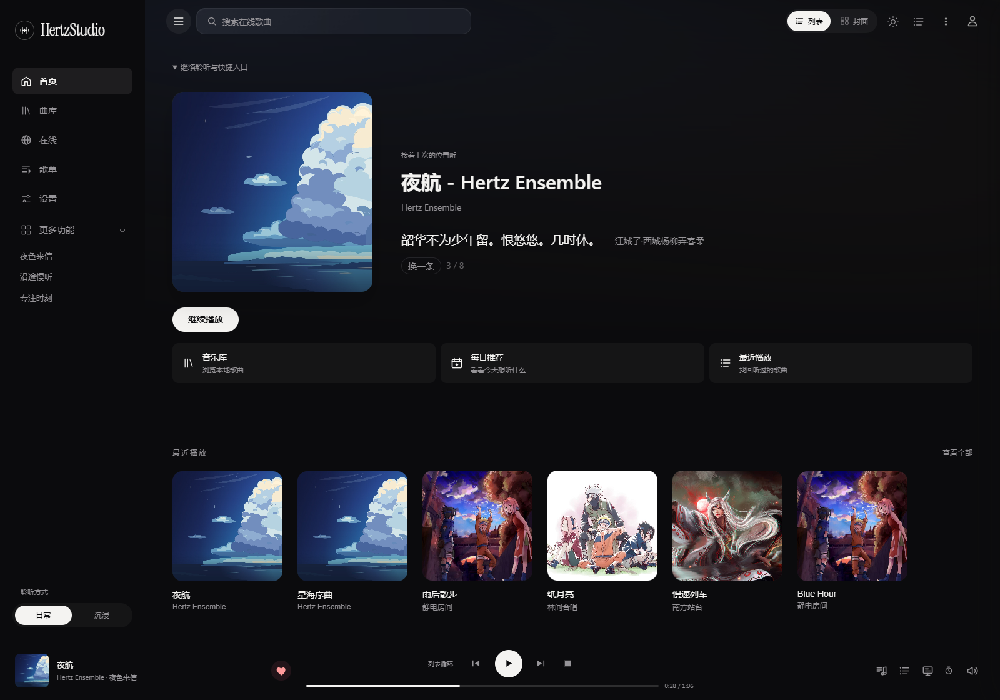
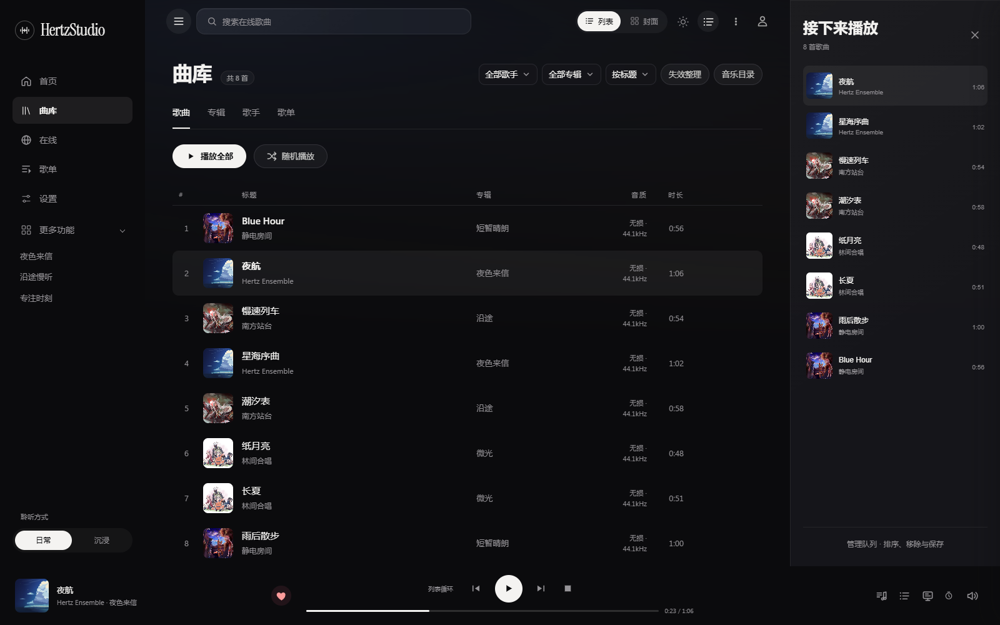
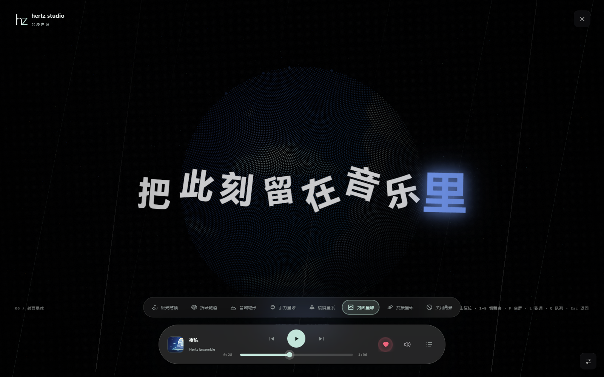
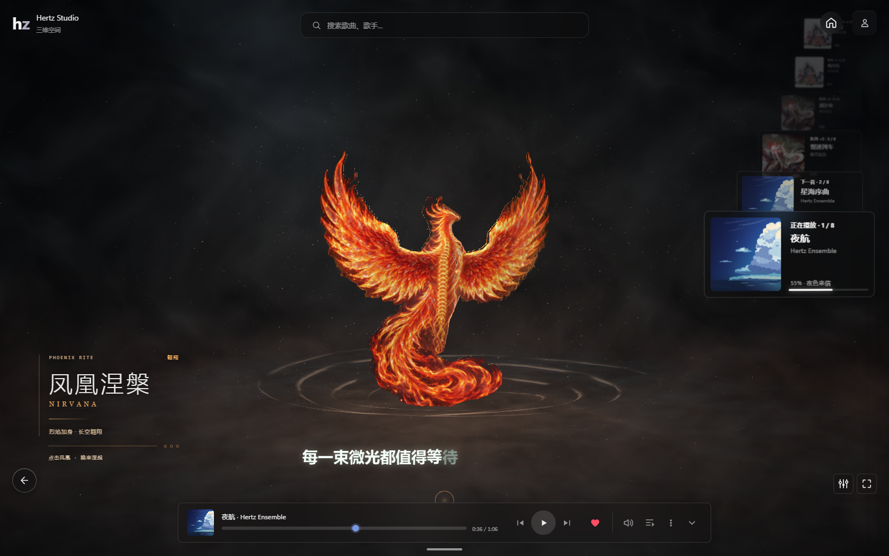
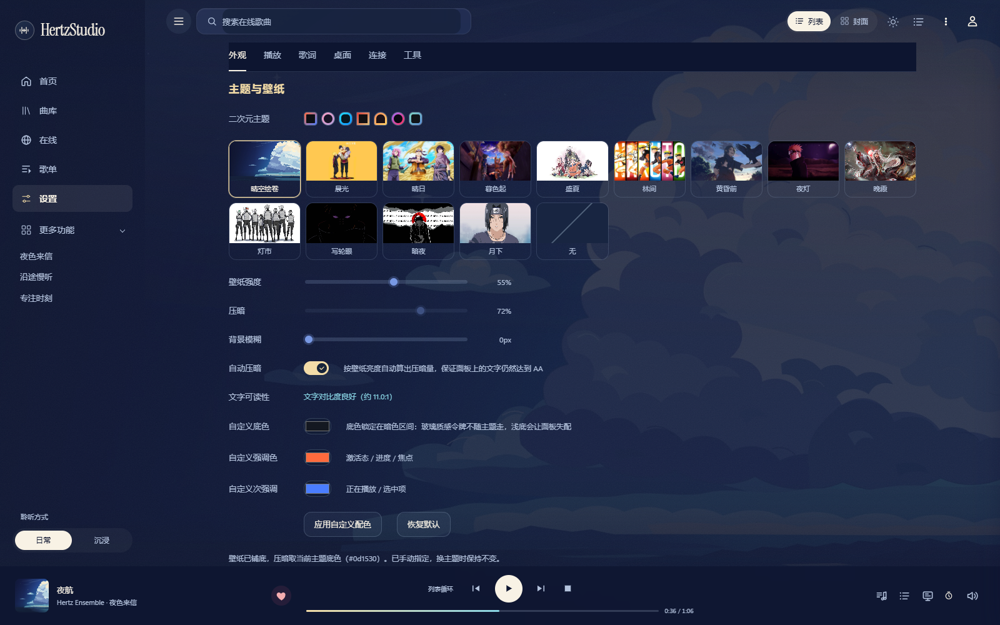
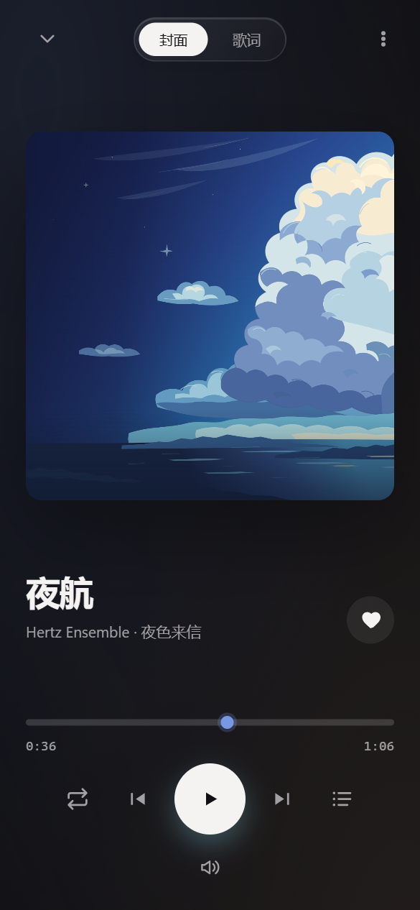

# Hertz Studio

**音乐播放器、歌词舞台与桌面壁纸。**

Hertz Studio 以你的本地音乐为中心，把曲库、歌单、歌词和播放控制放在一起。日常听歌时保持简洁，想沉浸其中时，可以打开歌词舞台与三维空间，让画面跟着音乐变化。

[下载播放器](https://github.com/onceMisery/hertz-studio/releases) · [一起听使用指南](docs/lan-listening-user-guide.md) · [反馈问题](https://github.com/onceMisery/hertz-studio/issues)

*截图使用演示曲库，展示当前开发界面；已发布版本的功能以下载页说明为准。*

## 开始听歌

1. 在[下载页](https://github.com/onceMisery/hertz-studio/releases)选择与你的系统对应的播放器。Windows 推荐安装版，也可以下载免安装压缩包。
2. 安装后，从桌面或开始菜单打开 Hertz Studio。免安装版完整解压后，双击 **Hertz Studio.cmd**。
3. 打开「曲库 → 音乐目录」，添加存放音乐的文件夹，等待扫描完成。
4. 点击一首歌曲即可播放。你也可以创建歌单、收藏喜欢的曲目，或打开歌词舞台。

Windows 桌面版面向 **Windows 11 64 位**。如果启动时提示缺少微软运行组件，按提示安装后重新打开即可。macOS 和 Linux 包解压后运行播放器，再打开启动时显示的页面地址。

## 管好自己的音乐

- **本地曲库**：添加多个音乐文件夹，按歌曲、歌手和专辑浏览、搜索与筛选。文件变动后会自动更新；移除音乐目录不会删除原文件。
- **常用格式**：支持 MP3、FLAC、WAV、AAC、M4A、ALAC、Ogg Vorbis、AIFF 等；不支持或无法读取的文件会给出原因。
- **歌单与收藏**：创建歌单、调整顺序、批量添加曲目，也能导入和导出歌单。播放历史帮助你找回最近听过的歌。
- **歌词管理**：读取歌曲自带或同目录的歌词，支持手动导入、逐字歌词、译文和时间校准。
- **声音调整**：均衡器、音量平衡、曲目衔接和交叉淡化，按自己的听感设置。
- **资料备份**：备份和恢复歌单、收藏、设置及音乐目录。备份文件不包含音乐原文件。

音乐库、歌单和设置保存在本机，本地音乐可以离线播放。也可以连接自己的远程音乐目录。

## 看见音乐

**歌词舞台**把歌词、封面与音乐律动融入同一个画面。可以选择流光、字形、心象、商籁、凝彩等视觉风格，调整排版、背景与动态强度。

**三维空间**提供海岸公路、星座、粒子反应堆、凤凰、封面星球等场景。拖动旋转、滚轮推拉，切换歌词或队列，找到适合这首歌的视角。

还可以导入自己的背景图片和视频、调整舞台参数、保存可继续编辑的作品，并用分享码分享舞台。独立播放器支持录制舞台视频，也可以把歌词加入直播画面。

## 把音乐带到桌面

独立播放器在 Windows 上提供桌面功能：

- **桌面歌词**：透明悬浮显示，支持行数、字号、译文与外观调整。锁定后鼠标可以穿过歌词，托盘入口可随时找回窗口。
- **桌面壁纸**：导入图片、视频和壁纸作品，设置显示器与轮播，预览满意后再应用。可调整亮度、运动强度、音乐响应与暂停规则。
- **迷你播放窗**：收起主窗口后，保留封面、歌词与常用播放控制；也能贴在屏幕边缘，需要时再展开。
- **日常控制**：支持系统媒体控制与睡眠定时。想关闭主窗口后继续听歌，可以在设置中选择隐藏到托盘。

## 在线音乐、播客与阅读

**在线音乐**提供音源选择、歌曲搜索、歌单浏览、歌词和音质选择。Full 版包含网易云音乐、QQ 音乐、酷狗、酷我、汽水、咪咕，并支持 Jamendo 与 ccMixter。账号功能与可播放音质取决于各音源的支持情况和你的账号权限。

**播客**可以搜索节目、订阅公开播客、查看单集简介，并记住上次收听的位置。

**阅读**用于订阅博客与新闻，在应用里阅读源内提供的正文，管理已读、未读与收藏；只有摘要时，可以直接打开原文。

## 和朋友一起听

在同一局域网内，每台电脑打开 Hertz Studio。房主创建房间、添加歌曲并分享邀请，朋友加入后可以共同听歌、点歌、管理队列和聊天。

房间与日常播放器共用熟悉的操作方式，回到主界面也不会退出房间。具体步骤见[一起听使用指南](docs/lan-listening-user-guide.md)。

## 按自己的喜好创作

- **主题与背景**：多套内置配色、自定义主题、背景图片，以及压暗与模糊设置。桌面与小屏界面使用同一套外观偏好。
- **一句成景**：输入一段描述，生成舞台草稿，先预览，再调整和保存。
- **创作辅助（试用）**：尝试生成场景与组合草稿。结果先交给你预览，由你决定是否保存和应用；相关功能仍在持续完善。

## 桌面与小屏

桌面界面保留侧栏、曲库与队列；小屏界面将常用操作放在更容易触达的位置。播放页、歌词、搜索和房间页面都会随窗口尺寸调整。

## 选择使用方式

| 使用方式 | 适合的场景 |
| --- | --- |
| **Windows 独立播放器** | 日常听歌，以及桌面歌词、壁纸和迷你窗；提供安装版与免安装版 |
| **macOS / Linux 播放器** | 在浏览器界面中使用曲库、播放、歌词和舞台等功能 |
| **DBX 插件** | 在 DBX 内使用音乐播放、曲库、普通歌词和舞台；桌面功能使用独立播放器 |

独立播放器提供 **Full** 版。DBX 插件提供 **Standard** 和 **Full** 两版：Standard 包含本地与远程音乐、开放音源及播客；Full 额外提供上述六个平台音源。安装插件时，选择与系统对应的插件包。

## 常用快捷键

快捷键在没有输入文字时使用；舞台和三维空间内的操作也会在界面中提示。

| 按键 | 操作 |
| --- | --- |
| **空格** | 播放 / 暂停 |
| **Ctrl + K** | 打开搜索与命令面板 |
| **V** | 进入或退出沉浸声场 |
| **X** | 进入或退出三维空间 |
| **Esc** | 关闭当前面板或返回 |

## 更新与反馈

更新前，从托盘正常退出播放器，再运行新安装器或完整解压新版本。重要的音乐资料请保留备份；卸载会保留个人资料。

遇到问题，可以在[问题反馈](https://github.com/onceMisery/hertz-studio/issues)中说明系统版本、操作步骤与出现的现象，附上报错或界面截图。

## 许可与致谢

项目自有代码采用 **MIT 许可**，见 [LICENSE](LICENSE)。第三方内容遵循各自条款，完整说明见 [NOTICE](NOTICE)。二维流体效果使用的第三方内容保留 **MIT + Commons Clause** 条款，见[许可文件](tools/stage-fluid/LICENSE.md)。

感谢 [VCPChat](https://github.com/lioensky/VCPChat)、folia、Mineradio 等项目提供的灵感与参考。
