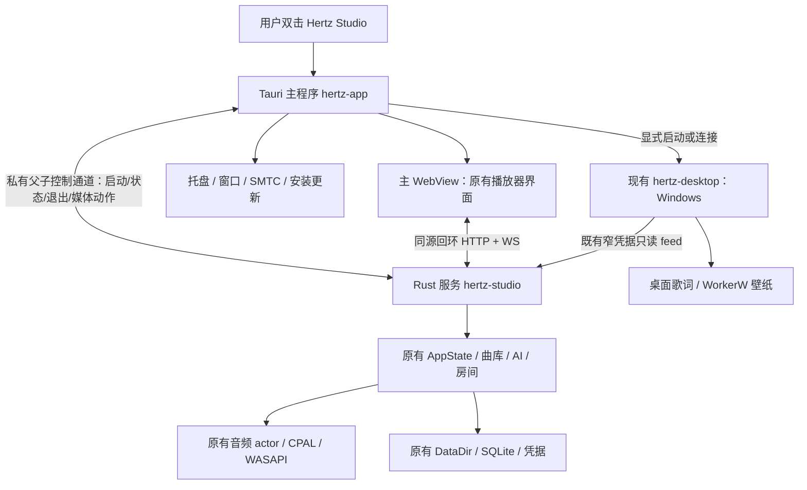

# Hertz Studio 完整桌面客户端技术方案

日期：2026-10-28。依据：`0330508` 及当日工作树；工作树包含其他进行中的代码与文档修改，因此本文不是该提交单独的实现清单。状态：**技术方案，尚未开始桌面主程序实现或原生验收**。

## 1. 结论与产品边界

**采用 Tauri 2 新建桌面主程序，复用现有 Web UI 和 Rust 音乐服务；现有 `hertz-desktop` 继续专门承担歌词与壁纸。** 不重写播放器、曲库、在线源、AI、一起听和舞台，不另建第二套业务模型。

用户安装后直接打开 Hertz Studio 窗口，无需启动命令行、复制本地地址、打开浏览器或依赖 DBX。桌面主程序负责启动服务、窗口、托盘、系统媒体控制、安装和升级，服务继续负责音乐及数据。

必须区分两个目标：

- **不依赖外部浏览器**：推荐方案满足。WebView 是应用内部的渲染组件，不显示浏览器地址栏，也不要求普通浏览器常驻。
- **完全不使用 WebView/HTML/CSS**：推荐方案不满足。必须走第 15 节的 Qt/QML 原生渲染重写，既有 Three.js 等视觉代码不能直接复用。

本方案按第一个目标落定；没有把“套上窗口”当作完整桌面产品。全部新增行为、协议和数值均为实施目标，不是当前已经提供的功能。

### 首发范围

| 项目 | 决定 |
| --- | --- |
| 首发系统 | Windows 11 x64；其他 Windows 版本、Windows ARM64 不先作支持承诺 |
| 后续系统 | macOS ARM64、Linux x64；共用主程序架构，分别完成原生验收后发布 |
| 发行版 | Standard / Full 同代码、同版本；差异继续由服务的 Cargo feature 决定 |
| 保留形态 | 原浏览器独立版、DBX 插件均保留，不强迫现有用户迁移 |
| 新增运行入口 | `hertz-app`，显示产品名 Hertz Studio；避免占用已有 `hertz-desktop` 的组件身份 |
| 关闭窗口 | 默认收起到托盘并继续播放，第一次明确提示；原生菜单提供真正退出 |
| 开机启动 | 默认关闭；显式开启后启动托盘，不自动开始播放 |
| 首发不做 | UI 框架重写、云账号、新音频引擎、移动端、跨机数据同步、自动接管其他服务进程 |
| 能力边界 | 日常播放与现有页面为主；录屏/系统音频采集等浏览器相关能力逐项验证，不预先承诺完全等价 |

### 硬约束：DBX 单独使用无行为变化

**用户已确认：不需要为了桌面化改变 DBX；实施时必须保证“DBX 单独使用无行为变化”。** 验收场景为未安装、未启动 `hertz-app` 及配套桌面组件，仅通过 DBX 使用插件；检查插件自身的功能与使用体验。

- DBX 继续由宿主启动原 sidecar，使用现有 SDK/stdio RPC、事件通道和共用 UI；不依赖桌面主程序、受管服务握手、新增 HTTP listener 或桌面 token。DBX stdout 继续专用于 SDK 协议。
- 启动、播放/队列/seek、现有页面和舞台、媒体键、睡眠定时、设置持久化、页面关闭/重开、插件停用及 DBX 退出均保持实施前的行为和权限边界。DBX 页面生命周期以真实宿主基线为准，不套用普通浏览器的三秒离场规则。
- 桌面播放 owner、原生 SMTC、窗口可见性通知、托盘关闭策略和原生退出确认只在实际受管模式启用。共用前端通过明确的能力区分；DBX 不进入这些分支，缺失新增能力字段时保持原有行为。
- 共用 `bootstrap`、DataDir 锁、播放与退出代码可以做必要的内部调整，但不得增加 DBX 的桌面安装/连接前置、改动其数据目录与存储语义，或顺带迁移其定时和媒体控制。需要改变 DBX 行为的需求另立任务，本方案不授权这类改动。
- Tauri 依赖保留在新主程序边界，DBX 包继续沿用原打包链；不新增桌面框架运行依赖或要求用户安装独立客户端。

本约束是各阶段共用代码改动与最终发布的验收门槛，具体回归见第 14.1 节。桌面能力通过不能代替 DBX 回归通过。

## 2. 当前代码真正具备什么

| 已核实事实 | 源码依据 | 对桌面化的意义 |
| --- | --- | --- |
| Rust 服务内嵌 UI，并提供 HTTP / WebSocket | [main.rs:214](../crates/hertz-studio/src/main.rs#L214) | 整套现有页面可以直接复用，不必先改 React/Vue |
| `--open` 执行 `cmd /C start` 打开外部浏览器 | [main.rs:310](../crates/hertz-studio/src/main.rs#L310) | 现有入口不是完整播放器桌面窗口 |
| 业务装配已有公共 `bootstrap::boot` | [bootstrap.rs:68](../crates/hertz-studio/src/bootstrap.rs#L68) | 音频、曲库、队列、数据库不需要另写一份 |
| 服务与 DBX 已有不同传输，共用业务 | [plugin/backend/src/main.rs:229](../plugin/backend/src/main.rs#L229)、[rpc/mod.rs:189](../crates/hertz-studio/src/rpc/mod.rs#L189) | 将来可以扩展传输，但桌面首版没有必要再造全量 IPC API |
| 前端已有 `ServerTransport` 与宿主适配层 | [app.js:425](../plugin/ui/app.js#L425)、[host.js:235](../plugin/ui/host.js#L235) | 桌面可保留现有 HTTP/WS，仅补宿主能力与窗口状态 |
| 封面同步 URL、WS、动态资源依赖当前 origin | [app.js:449](../plugin/ui/app.js#L449) | 不直接改为 `file://` 或 Tauri 本地资源协议，避免大面积改资源寻址 |
| 现有桌面组件直接依赖 Tao/Wry，Windows 专用 | [hertz-desktop/Cargo.toml:17](../crates/hertz-desktop/Cargo.toml#L17) | 歌词/壁纸原生经验可复用，但不是已有跨平台主客户端 |
| 页面归零后有 3 秒离场暂停；活动房间豁免 | [state.rs:915](../crates/hertz-studio/src/state.rs#L915)、[state/viewers.rs:67](../crates/hertz-studio/src/state/viewers.rs#L67) | 后台听歌必须显式加入桌面进程所有权，不能靠虚构页面观众 |
| 睡眠定时目前在页面 `setInterval` 中执行 | [app.js:6231](../plugin/ui/app.js#L6231) | WebView 被挂起后可能延迟，桌面运行中的定时需要服务端负责 |
| 系统媒体接入目前是浏览器 MediaSession | [app.js:5933](../plugin/ui/app.js#L5933) | 原生媒体键和系统媒体卡片不能直接宣称已完成 |
| 现有锁约束 AI runner，不是整个服务的排他锁 | [bootstrap.rs:267](../crates/hertz-studio/src/bootstrap.rs#L267) | 桌面托管前必须解决同一 DataDir 多个音频/数据库 owner |
| 现有统一退出会先关闭房间、再停本地音频 | [state.rs:942](../crates/hertz-studio/src/state.rs#L942) | 桌面退出应进入这个屏障，不另造粗暴结束流程 |
| 独立发布包仅复制服务及说明，没有完整桌面安装器 | [release.yml:88](../.github/workflows/release.yml#L88) | 安装器、主程序与组件配套、签名更新都是新增交付 |

已有歌词/壁纸的现行职责仍以[共享宿主](./desktop-host.md)为准；[DBX 桌面连接](./desktop-dbx.md)是另一专项，D0–D2 已实现、D3 完整发布验收待完成，不作为本方案前置，也不顺手改变其传输选择。

## 3. 框架比较与选择理由

| 路线 | 复用程度 | 真正新增的成本 | 结论 |
| --- | --- | --- | --- |
| **Tauri 2 + 现有 Rust 服务** | 页面、音频、数据和舞台保留 | 主程序生命周期、少量平台适配、安装更新、宿主能力验收 | **采用：长期独立桌面产品的成本较均衡** |
| 在现有 Wry/Tao 组件里加主窗口 | 页面可复用；Windows 窗口代码现成 | 大组件继续增长；需自己组织安装更新、服务托管及跨平台事件循环 | 只做 Windows 快速入口时可选，不作为主线 |
| 新建独立 Wry/Tao 主程序 | 同样能完整复用页面和服务 | 生命周期仍需做，且分发和平台插件需自行组合 | Tauri 被实证阻塞时的备选，不是运行期自动回退 |
| Electron + Rust sidecar | 页面保留，Chromium 版本可控 | 捆绑 Chromium/Node，双运行时维护、体积和升级面增大 | 仅在录屏/浏览器兼容性为硬目标且 Tauri 验证失败时重选 |
| Qt 6/QML + Rust 服务 | Rust 业务保留；UI 重写 | QML 前端、事件/资源适配、舞台重写、许可与分发核查 | 仅适合明确要求不使用 WebView，见第 15 节 |
| Flutter / Slint | Rust 能保留，界面需重写 | 绑定、复杂编辑交互和 GPU 场景迁移均需新做 | 不能降低本项目当前最大成本，不优先 |

Tauri 自身也使用平台 WebView，并不因为换框架就降低 Three.js 的绘制成本。选择它是为了窗口、菜单、跨平台打包和更新生态，不是为了宣称内存立刻下降或所有平台渲染完全一致。

不直接把服务嵌进 Tauri 主进程：虽能少一个业务进程，但会把音频、托盘、WebView 宿主的崩溃边界合并，并增加与当前 Wry/Tao 依赖的耦合。首版保留独立服务，先获得清晰的所有权和复用边界；没有性能证据不再改成进程内版。

## 4. 目标架构与唯一职责



这不是只有三个操作系统进程：WebView 还会创建 renderer、GPU 等子进程。资源统计必须计入整个专属进程树。

| 所有者 | 只负责 | 不负责 |
| --- | --- | --- |
| `hertz-app` | 单实例入口、主窗口、托盘、托管服务、系统媒体、升级协调 | 不维护第二套播放队列，不直接修改业务 SQLite |
| `hertz-studio` | 唯一业务状态、音频、持久化、HTTP/WS、桌面运行策略 | 不推断窗口是否还可见，不执行任意宿主 shell 命令 |
| `plugin/ui` | 原有页面、用户操作、视觉呈现、能力判断 | 不负责保活业务服务，不负责操作系统进程清理 |
| `hertz-desktop` | 现有歌词、壁纸、组件托盘和配置 | 不启动第二个播放器，不获得主服务全权 token |

首版业务页面继续通过 `ServerTransport` 访问自身 origin。Tauri 只内嵌一个不含凭据的启动/故障页；服务就绪后原生层导航到经认证的本机页面。不复制一份播放器 HTML 到 Tauri，避免 UI 与服务资源版本错配。

## 5. 启动、单实例与进程托管

### 5.1 启动时序

1. 原生入口确定发行版与用户选定的 DataDir；单实例键包含当前用户、发行版和规范化 DataDir。重复启动只激活对应窗口，不再启动服务。
2. 校验随包组件清单、架构、构建身份及安装位置；只运行应用安装目录内的固定服务文件，不从 PATH、下载目录或 UI 参数选择 exe。
3. 显示本地启动页。创建私有父子通道并启动服务，传入拟新增的 `--desktop-managed` 和明确的目录/监听参数，不传 `--open`。
4. 服务在初始化数据库、音频及后台任务前取得 DataDir 排他锁；将锁持有到完整退出。独立 HTTP 与 DBX 启动入口都使用同一锁规则；DBX 接入只承担目录互斥，不进入桌面受管启动或握手流程，且须满足第 1 节的行为硬约束。AI runner 锁继续保留其独立职责。
5. 受管模式只监听 IPv4 回环地址。读取该 profile 的稳定端口设置，创建服务并完成身份握手；不能因环境变量意外绑定 `0.0.0.0`。
6. 服务通过私有通道返回 `ready`，包含协议版本、构建身份、发行版、规范 DataDir、server instance、实际端口及首跳票据。父进程逐项验证后导航，不解析人类日志获取地址。
7. UI 经现有首跳鉴权加载，再建立现有 WS。原生窗口就绪与业务服务就绪分开显示；音频实际后端为 Null 时提示设备不可用，不将 HTTP 就绪等同于有声。
8. 已启用的歌词/壁纸按现有配置恢复；首次运行不自动开启，不抢走已有组件的 activeProfile。

`vmusicd.json` 继续服务既有消费者，但不能代替新父子通道的归属证明，也不能因为文件存在就判断服务在线。

### 5.2 固定 origin 与端口冲突

继续尊重当前独立版默认端口：Standard 为 7635，Full 为 7634；每个 profile 使用稳定的显式配置端口。**不为 UI 每次随机选端口**，因为 localStorage 等按 origin 隔离，随机端口会造成“设置又丢了”。Cookie 不按端口隔离，不能把不同端口当作凭据隔离；桌面各 profile 必须使用独立 WebView 用户数据目录。

端口被占用时展示进程/来源可核验的信息，允许用户关闭冲突程序、明确更换并保存端口后重试；不杀占用者，不静默跳到另一发行版。更换端口属于 origin 迁移，先导出界面偏好，再在新 origin 导入；没有导出时明确提示哪些纯界面设置不会自动跟随。

首版只托管自己启动的服务，不附着并管理手动启动、DBX 或远端服务。同一 DataDir 已有服务时提示先退出；不同 DataDir 可另开独立 profile，但不能共享可写 WebView 缓存目录。

新增锁只能约束采用该规则的新程序。旧版不会遵守新锁：迁移和安装前必须验证旧进程已退出，不能宣称新锁可以阻止用户后来手工运行旧 exe 共写同库。禁止以删除锁文件解决占用。

### 5.3 私有父子控制通道

采用继承的 stdin/stdout 管道，独立于业务 HTTP/WS；stdout 在受管模式下只写协议，日志全部写 stderr 或脱敏日志文件。该协议仅用于 `hertz-studio --desktop-managed`，不接管 DBX sidecar 的 stdin/stdout，也不改变 DBX SDK 的宿主协议。

建议冻结为 `desktop-control/1`，UTF-8 NDJSON，每帧最多 64 KiB，最多 16 个待处理请求；超长、非法版本和半帧超时明确失败。每条回复关联 requestId 与 server instance；父进程启动时经私有通道发送随机握手 nonce，避免将陈旧输出当作当前会话。

| 消息 | 方向 | 语义 |
| --- | --- | --- |
| `init` / `ready` / `startup_error` | 双向 | 配对身份、启动结果；票据不写日志或业务配置 |
| `issue_entry_ticket` | 主程序 → 服务 | 页面重建或显式打开浏览器时申请新首跳票据 |
| `media_action` / `media_state` | 双向 | 有限播放意图与可合并状态；不作为页面观众订阅 |
| `desktop_component` | 服务 → 主程序 | 请求固定组件的有限管理动作，禁止任意命令或路径 |
| `shutdown_requested` | 服务 → 主程序 | 业务页请求退出，交给原生 owner 确认，不直接结束服务 |
| `shutdown` / `stopped` | 双向 | 进入并等待既有退出屏障，最终仍以进程退出为准 |

控制通道不承载音频、图片、全量歌词或频谱。媒体状态可合并为最新值；回复和退出消息不得被无限事件积压阻塞。读取、写入、排队都异步有界，不能阻塞 Tauri UI 线程。stderr 必须持续排空；管道仅继承必要端点，父子双方及时关闭多余句柄，后续子进程不得继承控制管道，避免 EOF 永不到达。

初始工程预算：握手 10 秒、整体启动 30 秒、普通控制请求 5 秒、正常退出 10 秒；有可观察的迁移进度时允许用户等待或安全取消启动，不以超时为由破坏正在提交的数据。数值在 D0 原型后冻结。响应丢失时先查真实状态，不自动重发“下一首”等非幂等动作。

### 5.4 退出与故障

- 正常退出：禁止新操作 → 结束或确认正在进行的导出 → 服务进入既有 `AppState::shutdown` → 等待房间/output lease 与音频退出 → 释放窗口和自身资源。队列/进度增加退出前的有界保存屏障，不能假设当前 `shutdown` 已包含这一步。
- 既有页面电源按钮也要接入：当前 [app.js:9512](../plugin/ui/app.js#L9512) 直接请求 `/v1/system/shutdown`。受管模式下，该路由改为向主程序发 `shutdown_requested`，回复“待确认”及请求标识；原生确认后才发 `shutdown`，取消则恢复页面按钮。桌面页与旁开的浏览器使用同一可查询的请求状态，不再立即 `window.close()` 或用固定 8 秒探测误报。普通服务保留原退出语义；已确认退出标记为正常收尾，不能落入服务崩溃故障页。
- 超时：保留退出失败事实与诊断，必要时只结束自己持有句柄的服务进程；不按 `hertz-studio` 或 WebView2 进程名批量结束。
- Windows：服务加入专属 Job Object，使用 kill-on-job-close 防止主程序异常消失后留下音频进程。原生启动器须确保子进程执行业务前已加入 Job，例如挂起创建、加入后恢复；失败立即结束本次候选子进程，不放任继续。Job 句柄不可继承给子进程。Tauri 负责 sidecar 打包，不要求照搬不能满足此顺序的通用 spawn 示例。正常退出先走协议；Job 是异常收尾保险，不代替业务退出。
- macOS/Linux：持有 Child 句柄并使用父通道 EOF 触发服务关闭；后续平台验收必须覆盖父进程崩溃、进程组及权限边界。不能把 Tauri 的 sidecar 打包能力当作所有 OS 的自动孤儿回收保证。
- 服务异常退出：回到本地故障页，展示错误编号，允许明确重试。**不自动恢复播放，不重放上一次付费生成或写操作。**
- renderer 崩溃：主程序和服务可继续存在；重建页面后从服务拉取全量状态，不把页面内缓存当作播放事实。
- 更新和启动取消都进入同一状态机：`starting → running → stopping → stopped`，故障为单独终态，不能在旧子进程仍退出时再启动第二个。

## 6. 后台播放：必须修改的业务边界

不能仅仅隐藏窗口并希望 WS 永远不掉，也不能开一条假的播放器 WS 保活。

在服务增加**仅由受管启动建立的桌面 owner 状态**，不保存为全局永久开关，不由网页自行声明。其生存期绑定私有父子通道；普通浏览器服务与 DBX 插件不建立这项 owner，本任务不改变它们的播放保活策略。

离场判定仍在原 `play_commit` 锁内完成：活动房间、真实页面或有效桌面 owner 至少存在一项时，不执行无人播放暂停；三者都没有时，按现有规则取消未提交播放意图、推进 generation，再暂停。owner 丢失时先禁止新提交，随后进入受管服务关闭，不留下一个已失去宿主但持续播放的服务。

| 用户行为 | 桌面窗口 | 服务与播放 |
| --- | --- | --- |
| 最小化 | 不绘制不必要舞台 | 继续 |
| 点击 X，默认设置 | 隐藏到托盘 | 继续，且不依赖隐藏 WS 的存活 |
| 托盘“显示主窗口” | 恢复位置并刷新快照 | 不创建第二个服务、不重新开始当前曲 |
| 菜单“退出 Hertz Studio” | 关闭 | 停止房间/播放并退出受管服务 |
| 普通浏览器独立版最后一页关闭 | 与当前行为一致 | 仍保留现有 3 秒规则及房间例外 |
| 在受管服务上另开浏览器后关闭网页 | 主程序仍存在 | 由桌面 owner 保持播放；界面明确显示桌面托管状态 |
| 歌词/壁纸组件仍存在，但主程序退出 | 组件按自身设置决定存活 | 不保活音乐；歌词清空/冻结按原契约，壁纸可保持环境动画 |

睡眠定时也是后台行为。受管服务提供运行期定时状态和取消入口，前端只显示剩余时间；刷新/renderer 重建不会取消倒计时，服务退出会取消，重启不自动续播。普通独立版与 DBX 现有页面定时语义在本任务中保持原样；不顺带将 DBX 页面定时迁至服务端，既有房间定时仍由原房间 owner 管理。通过服务 capability 明确区分，不能同时运行两份到点暂停逻辑。计算采用可检测系统休眠与唤醒的截止时间策略，到期后在恢复出声前检查；系统时间调整和房间模式分别测试。

一起听的系统媒体动作必须进入当前房间的权限与播放 owner；不能直接调用本地 actor 绕过房间，也不能让托盘和页面同时发送两次下一首。

## 7. UI 复用与桌面体验

### 7.1 前端改动只放在正确边界

- `host.js` 增加桌面能力描述和原生窗口可见性输入，不把“桌面”伪装成 `isDbx=true`；保留 DBX 的 SDK 检测、存储适配与 hydrate 顺序。
- `app.js` 保留 `ServerTransport`、`DbxTransport`、现有错误体、短写幂等和请求取消；桌面运行状态、服务端定时和媒体控制分流仅在对应能力明确启用时生效。DBX 保持原有 MediaSession 注册/降级与页面可见性语义。
- 主程序使用原生标题栏、菜单和任务栏行为作为首版；不为无边框外观引入一整套窗口按钮和拖拽 IPC。
- 原生层可向已核验的本机页面执行固定、无用户字符串拼接的可见性通知；它不是网页反向调用原生的权限入口。
- 窗口隐藏/最小化时停止高开销 rAF/WebGL 绘制、非必要频谱刷新和动画定时器，恢复时按当前服务状态重新对齐。不能只相信 `document.hidden` 或 WebView 的隐藏调用已经停止 GPU 工作。
- 首版保留隐藏的主 WebView，避免重建导致未保存工坊草稿丢失；“销毁隐藏 WebView 省内存”不在本次交付。音频继续依赖服务 owner，而非这个保留窗口。

### 7.2 桌面能力清单

| 能力 | 首版实施方式 | 验收重点 |
| --- | --- | --- |
| 窗口恢复 | 保存正常窗口矩形与最大化状态 | 断开显示器后仍在可见工作区；100/150/200% DPI |
| 托盘 | 显示、播放/暂停、上一首/下一首、退出 | 单实例；页面未显示时仍可操作；房间权限一致 |
| 系统媒体卡片/媒体键 | Windows SMTC，由原生层消费服务状态 | 受管服务的所有客户端，包括旁开的浏览器与房间 MediaSession 分支，都按 capability 停用重复注册；进度/封面去重 |
| 导入目录 | 首版可沿用现有原生文件夹对话框；按目标平台补齐 | 取消无副作用、中文长路径、实际文件权限 |
| 文件拖入 | 原生拖放接收本地路径，交给原有导入业务 | 不根据扩展名执行文件，不把路径交给 shell 拼命令 |
| 导出/保存 | 现有浏览器下载需在 WebView 原生下载事件接保存目标 | 取消、重名、无权限和大文件；blob URL 路径单独验证 |
| 外部链接 | 阅读正文继续复制链接；确需外跳的明确动作走原生安全打开 | 不让主窗口导航到第三方站点，不顺手改变 DBX 外链行为 |
| 通知 | 原生有限通知，默认克制 | 点击聚焦现有窗口，不启动新服务；不显示密钥/正文隐私 |
| 开机自启 | 当前用户范围，默认关闭 | 查询实际系统状态，不把偏好保存成功当作注册成功 |
| 更新 | 原生菜单检查、用户确认后下载安装 | 播放/导出中不直接替换运行文件；失败不破坏旧版 |

SMTC 可用合适 Rust 封装或 `windows` 绑定实现，具体依赖在 D0 核验 HWND 接入、许可、MSRV 后锁版本。macOS 后续对应 Now Playing/Remote Command Center，Linux 对应 MPRIS；它们是独立适配任务，不是 Tauri 自动提供的音乐业务。

现有 `window.open` 也需要接线：OBS 只读预览只能创建使用既有只读凭据、无原生能力的受控辅助窗口；M3U 等导出走原生下载处理，不导航主窗口。`about:blank` 后延迟导航的既有路径一并覆盖，每个辅助窗口及其后续导航都要校验，禁止由第三方正文任意弹窗。辅助窗口不申请桌面播放 owner，主程序退出时统一关闭。

### 7.3 不预先承诺等价的浏览器能力

现有视频导出涉及 MediaRecorder、canvas、屏幕选择和系统音频权限。D0 在实际 WebView 中分别验证，不以 Chrome 里可用作为结论。某项不支持时由 capability 禁用并说明；不把有按钮但不能用交付出去。

首发可不提供与浏览器完全等价的系统音频录屏，但日常播放、视觉舞台、歌词和导入导出基础能力必须闭环。若“现有录屏全能力原样可用”被确定为首发硬要求，而 Tauri 环境不能满足，按第 16 节重选 Electron 或另立原生录制专项，不能假称已兼容。

## 8. 安全模型

### 8.1 不给网页通用原生执行权

业务页面从自家回环 HTTP 服务加载，Tauri 主程序的原生能力尽量由原生菜单、系统事件和父子控制通道触发。首版**不注册供业务页任意调用的自定义 `invoke_handler`，不授予远程页面 shell/fs/process 通用权限**。

Tauri 的 capabilities 并不自动替应用设计权限。官方文档指出，注册的自定义 commands 默认可被应用窗口调用；以后确需新增命令时，必须使用应用 command manifest/permissions 显式约束，审核窗口 label、origin、参数与副作用。不能仅设置 `withGlobalTauri=false` 就宣称禁用了 IPC。

Tauri 官方还提示 Linux 等环境对 iframe 与窗口来源区分有限，因此本方案不对回环业务页授予广泛原生 capability。升级、任意 exe 执行、任意读写文件及脚本执行不向业务页开放；现有桌面组件入口仅允许经过鉴权的固定动作，经服务与父进程校验后启动随包匹配组件，不能扩展为通用执行器。

### 8.2 回环不等于免鉴权

- 保留既有 Bearer、入口票据和 WS 票据，不改为“本机不用 token”。首跳票据来自私有通道，消费后清理地址，禁止把长期 token 写进 URL、命令参数、崩溃报告或更新清单。
- **现有主页面仍会获得业务 token**，本方案不谎称它完全不进 renderer。安全承诺是不给它额外的通用 OS 权限；防正文 XSS 仍然重要。
- 配置目录、token 和发现记录限制当前用户访问；Unix 模式与 Windows ACL 分别核查。相同用户下具有完整本机文件权限的恶意进程不在此隔离承诺内。
- 受管 HTTP 只绑 `127.0.0.1`，HTTP Host 与 WS Origin 增加明确校验；不为解决跨域设置 `Access-Control-Allow-Origin: *`。非浏览器调用继续凭有效凭据认证。
- 对 UI 响应设置 CSP、Referrer-Policy 与防嵌入策略。远程 HTTP 页面不会自动继承 Tauri 内嵌资源的 CSP，必须在服务响应上实际生效；inline token 注入使用受控 nonce/hash，资源策略以当前脚本/图片清单验证。
- 主窗口顶层导航仅允许已握手的本机 origin；外部页面不得带着应用上下文进入。出站打开只接受明确用户操作的允许协议与规范 URL，不接受 `file:`、`javascript:`、任意自定义协议或 shell 字符串。
- 阅读正文、歌词、封面元数据和外部内容继续视为不可信输入；增加脚本、事件属性和导航注入用例。不要因为“来自本机服务”就取消现有清洗。

## 9. 数据、配置与迁移

业务数据继续只有一份，桌面主程序不复制数据库来制造“双版本”。所有目录通过现有平台目录逻辑或显式用户选择解析，不写死某个开发者路径。

| 数据类别 | 唯一位置/所有者 |
| --- | --- |
| 曲库、队列、歌单、缓存、AI 任务 | 既有发行版 DataDir，由服务写 |
| 平台账号与密钥 | 既有凭据机制；不搬到 Tauri store/localStorage |
| 主窗口、托盘和主程序自启偏好 | 新的主程序配置，带 schema；只存主程序职责 |
| 页面主题、视图和舞台局部偏好 | 独立 WebView 用户数据目录，按发行版/profile 隔离 |
| 歌词/壁纸配置 | 继续由现有组件配置唯一持有，不复制到主程序 |
| 运行期端口、会话、Child/Job 句柄 | 当前运行状态；不会当作持久服务身份 |

迁移步骤：

1. 首次启动检测同发行版旧 DataDir，明确展示“使用现有资料”或“新资料目录”；不默认清空，也不跨 Full/Standard 或 DBX 猜目录。
2. 停止旧服务，核实同目录不再有活写者；需要数据库升级时使用一致性备份，不在 SQLite/WAL 活跃写入时直接复制单个数据库文件。
3. 由现有服务执行数据库迁移。原生主程序只协调，不手工修改 settings 表或账号存储。
4. 浏览器、DBX 与新 WebView 的 localStorage 不是同一存储。增加受控界面偏好导出/导入，按已知键、schema、类型、容量验证，排除 token/凭据；不扫描浏览器 profile，不复制整个 Chrome/WebView 数据目录。
5. 安装升级保持应用身份和 WebView 数据目录稳定。缓存随资源指纹更新；不靠每次删除用户数据“修复旧页面”。
6. 程序回退和数据库回退分开：新 schema 不支持旧程序时必须恢复升级前备份；提示回退会失去备份之后的数据变更，不能只换旧 exe。

主程序与组件的自启配置分别反映不同用户意图。桌面安装器不得擅自删掉现有 `HertzDesktop` 启动项；若两项均启用，组件单实例仍应避免重复窗口。统一到一个启动项只能作为后续显式迁移，不在本次暗改。

## 10. 现有歌词与壁纸怎样接进来

Windows 桌面发行包携带配套 `hertz-desktop.exe`，默认不启用。播放器原来的“桌面歌词与壁纸”入口保留；组件仍通过现有管理管道、来源身份和窄 feed 工作。

有一个必须处理的进程树细节：**服务加入 Windows Job 后，从服务直接 spawn 的歌词/壁纸组件也可能继承 Job，导致退出主程序时把本应独立的壁纸一起结束。**

因此受管模式下，现有组件 launch 门面将固定动作转发给主程序；由不在服务 Job 内的主程序启动组件，再按既有协议管理。普通浏览器独立版保留原 launch 路径。不能以允许任意进程脱离 Job 作为简单补丁。

已有组件正在运行时只连接并查询；来源不同时要求用户显式切换，不抢绑、不结束别的 profile。主程序退出只停止自己的音乐服务；组件是否保留环境壁纸继续遵守原方案。两个托盘使用清晰的“播放器”和“桌面歌词与壁纸”名称，第一版允许共存，不再创建第三个组件配置 owner。

组件升级必须确认没有被另一个服务使用并正常退出；不能直接覆盖被占用文件。主程序、服务和组件不匹配时提示更新，不静默运行不兼容版本。旧组件在包外运行且不能自动升级时保持原状，说明冲突，不能抢占其单实例。

## 11. 构建、安装、更新与发布

### 11.1 建议工程布局

以下为拟新增布局，不表示文件已存在：

```text
crates/hertz-app/
  Cargo.toml
  build.rs
  tauri.conf.json
  src/main.rs
  src/service_process.rs
  src/window_state.rs
  src/media_controls.rs
  bootstrap/index.html
  binaries/                  构建期放入按 target 命名的 sidecar
scripts/build-desktop.js
scripts/check-desktop-client.js
.github/workflows/desktop-release.yml
```

模块按实际代码量拆分，不预建抽象平台框架。`crates/*` 已在 workspace 中，新 crate 会影响 workspace 检查；Tauri 的 GTK/WebKitGTK 构建依赖、Tao/Wry 的重复版本和原生 `links` 依赖必须在 D0 就验证。现有 Rust 下界是 1.88，不能因为安装了最新 Tauri 就静默提高整个仓库 MSRV。

依赖方向保持 `hertz-app → 桌面框架` 与 `DBX sidecar → 共用业务库`；共用业务库和 DBX sidecar 不反向依赖 `hertz-app` 或 Tauri。`.dbxp` 不加入新主程序及其 sidecar 打包资源，插件的单独构建与运行不增加 Tauri/GTK/WebKitGTK 前置；workspace 构建新增的系统依赖由桌面 CI 配齐。

Windows 同一应用版本目录内包含 `hertz-app.exe`、`hertz-studio.exe`、配套 `hertz-desktop.exe`、构建清单与许可材料；安装器可另有资源目录，但现有相邻组件定位要同步接通。其他 OS 按 bundle 资源路径解析，不假设与 Windows 相同。

### 11.2 构建链

1. 沿用现有 UI/Three.js 构建与 Standard/Full 资源裁剪；Node 只用于开发和构建，不成为用户运行时依赖。
2. 使用 `--locked` 构建目标发行版服务；Windows 同时构建配套歌词/壁纸组件。
3. 生成同一构建输入的清单：产品版本、edition、target、服务/UI/组件身份、协议版本和文件摘要。开发脏树不能仅拿 commit SHA 充当完整 build identity。
4. 按 Tauri `externalBin` 规则准备 `name-<target-triple>`；Windows 文件需 `.exe`。区分构建期带 triple 的文件名与安装后的名称，真实安装包验收定位结果。
5. 构建 Tauri 主程序与安装包，核对 edition、架构和全部依赖；不能把 Linux/macOS 服务二进制装进 Windows 包。
6. 运行包内启动、升级、卸载和故障测试后输出 artifacts。延续当前仓库“先产候选、人工验收再发布”的规则，不擅自改变发布权限。

### 11.3 分发决策

| 平台 | 产物 | 依赖与限制 |
| --- | --- | --- |
| Windows 首发 | NSIS 当前用户安装包；便携 ZIP 作为补充 | WebView2 Evergreen；小安装包可在线补运行时，离线包须携带运行时安装材料 |
| macOS 后续 | 签名、公证的 `.app` / DMG | WKWebView；分别验证 Apple Silicon、隐私权限与音频 |
| Linux 后续 | AppImage 与按明确发行版构建的 deb | WebKitGTK、GTK、音频/DBus 和托盘环境；不能宣称任意 Linux 即装即用 |

Windows 若运行时缺失，在线安装需要用户许可与联网；离线发行包必须在断网净系统测试，不能因为开发机已有 WebView2 就宣称免依赖。安装路径、DataDir、卸载保留数据选项分别展示。

Windows Authenticode、macOS 签名/公证与 Tauri 更新签名不是同一种东西。正式更新必须验证更新签名与对应版本/edition/target；SHA256 清单只能核对完整性，不能单独证明发布者身份。签名私钥仅放受控发布环境，不进仓库、不进应用包。

更新策略：主程序原生菜单触发检查 → 用户确认 → 下载与验签 → 取得安装目录级升级互斥 → 正常停止需要替换的本安装实例与组件 → 安装 → 以原 profile 启动。更新失败保持旧安装可恢复；不会自动降级数据库、跨 edition 更新、替换正被另一实例使用的组件或在后台重放任务。便携包不承诺就地自动覆盖更新，提供完整新包和明确的迁移流程。

DataDir 锁不能保护共享安装文件。允许同安装多个 profile，就必须同时维护安装级实例登记与升级闸门：升级期间拒绝新实例启动，列出所有使用待替换版本的实例，用户确认影响范围后通过各自 owner 正常退出。不能确认归属、其他实例拒绝退出、旧进程或外部服务仍占用时拒绝安装，不越权结束它们。安装失败后解除闸门并保留旧版可启动；普通启动与安装器都要遵守该闸门，不能只在更新 UI 中检查一次。

安装器回退能力必须实际测试；本方案没有把 Tauri updater 等同于“自动完成数据库备份和整套 sidecar 回滚”。更新源尚未配置，不在文档虚构发布地址。

## 12. 具体改动落点与实施顺序

| 落点 | 本次需要做什么 | 明确不做什么 |
| --- | --- | --- |
| 新 `crates/hertz-app` | Tauri 主程序、Child/Job 所有权、启动页、原生菜单/托盘/媒体控制 | 不引用服务内部状态来再维护一套队列 |
| `crates/hertz-studio/src/main.rs` | 受管启动分流、私有控制通道、监听与握手、退出协调 | 不替换原 CLI、MCP 或评测入口 |
| `bootstrap.rs` 及必要的小型锁模块 | AppState 启动前的目录排他所有权，生命周期持有 | 不误把现有 AI 锁当整个服务锁 |
| `state/viewers.rs` / `state.rs` | 桌面 owner 与原播放提交锁衔接、退出保存屏障 | 不删除浏览器的 3 秒规则，不改变房间 owner |
| `routes.rs` / 对应业务门面 | 管理能力、桌面运行期定时、受管组件启动转发、安全响应头 | 不挂通用原生命令执行 API |
| `plugin/backend/src/main.rs` | 必要的 DataDir 排他接线并回归原退出屏障，满足 DBX 单独使用无行为变化 | 不增加桌面握手/安装前置，不转用桌面 HTTP，不在本任务实现 DBX 桌面管道方案 |
| `plugin/ui/host.js` | 桌面能力/可见性、受控偏好迁移入口 | 不改 DBX 的宿主检测、opaque-origin 存储适配及 hydrate 语义 |
| `plugin/ui/app.js` 及实际舞台生命周期入口 | 按受管能力接入媒体键分流、定时状态、隐藏停绘与恢复 | 不改变 DBX 的媒体控制、定时及页面生命周期，不整体重写 UI，不清理无关页面 |
| `crates/hertz-desktop` | 仅必要的配套版本/组件协作验证 | 不加入完整播放器主窗口，不重写 WorkerW |
| `scripts`、CI 和独立桌面发布 workflow | 构建、包校验、原生验收、签名产物 | 不替换或顺带发布 DBX 商店候选 |

新增 API/能力时更新现有 API 清单生成物及前端契约；新增 workspace 包时补 CI 的显式 fmt 包列表。严禁使用 `cargo fmt --all` 重排 vendored SDK。

## 13. 里程碑、工期与退出条件

估算前提：1 名熟悉项目的开发者、Windows 首发、复用现有 UI；是净工程日区间，不是已完成工作或承诺发布日期。真实账号、硬件、签名资质等待不计入开发时间。

| 阶段 | 工程日 | 可交付结果 | 退出条件 |
| --- | --- | --- | --- |
| D0 技术门槛 | 3–5 | Tauri 实际加载现有 UI，播放/舞台/输入/下载的薄原型 | MSRV 与依赖可解；真实 WebView 核心旅程可用；产出与浏览器同场景对照 |
| D1 运行闭环 | 5–8 | 自启动服务、DataDir 互斥、身份握手、受管退出、故障页 | 重复启动/占用/崩溃/半启动/退出超时不会产生双服务或孤儿音频 |
| D2 桌面行为 | 6–10 | 后台播放、睡眠定时、托盘/SMTC、停绘恢复、基础文件操作 | 隐藏窗口正常听歌，媒体动作一次生效，恢复不丢状态，浏览器/DBX 无回归 |
| D3 配套与迁移 | 4–7 | 歌词/壁纸组件接入、窗口配置、旧资料与界面偏好导入 | 不抢来源、不共写目录、不误杀独立壁纸；资料可恢复 |
| D4 发布候选 | 5–8 | 安装、签名更新、净环境/升级/故障/性能验收 | Windows 首发矩阵通过；可发布的真实包而非开发目录截图 |

合计 **23–38 净工程日**；预留约 30% 集成缓冲后按 **30–50 工程日（约 6–10 个全职周）**规划。D0 之后按实际问题修订，不用固定工期掩盖原生能力差异。

macOS ARM64 后续预留约 8–15 工程日，Linux x64 约 10–18 工程日，前提是 Windows 核心已经稳定；不包括重写壁纸/歌词系统集成。核心代码可共用不代表现有 Windows WorkerW 在其他系统可移植。

最短演示只需要“窗口 + 服务 + 现有 UI”，但不能把它作为 D4 的替代品。先完成 D0，再实现 D1；D2 的视觉停绘与原生媒体可分开开发，数据迁移/组件发布仍需在统一 owner 规则上集成。

各阶段触及共用代码前记录相关 DBX 行为基线，阶段结束验证对应行为保持一致；不将回归全部推迟到 D4。无法满足第 1 节硬约束的改动应调整到受管模式边界或撤回该改动。D4 还须使用实际 Standard/Full 插件候选完成第 14.1 节的单独使用回归。

## 14. 验收矩阵与性能目标

### 14.1 必须完成的功能/故障用例

| 组别 | 至少验证 |
| --- | --- |
| 日常核心 | 断网本地导入/播放/切歌/seek/队列恢复；在线源失败不影响本地能力；Full/Standard 能力准确 |
| 窗口 | 开关/最小化/托盘恢复各 50 次；刷新不暂停；renderer 重建不重启歌曲；显示器断开后窗口可找回 |
| 所有权 | 重复启动、同目录不同端口、不同 edition、旧版占用、假发现文件、父进程异常、服务异常、退出后重开；原页面电源键与原生退出结果一致 |
| 播放竞争 | owner 释放与在线加载提交交错；暂停后迟到结果不能起播；原浏览器无人 3 秒暂停仍生效 |
| 后台 | 主窗口隐藏超过 10 分钟仍连续播放；睡眠定时生效；媒体键在无焦点时有效；受管浏览器、房间与原生媒体控制不重复执行 |
| 房间 | 房主/成员媒体权限、退房/退出时音频 lease 释放；桌面 owner 不干预同听所有权 |
| 图形 | 每类舞台真实截图/帧率、进入退出、隐藏停绘、恢复、DPI、设备丢失；歌词/壁纸同时运行另计资源 |
| 数据 | 同库互斥、升级前备份、迁移失败保留原数据、端口变更偏好迁移、未来 schema 拒绝覆盖 |
| 安全 | 非回环绑定拒绝、无凭据访问拒绝、跨站/iframe 无原生能力、恶意正文/导航、错误 target/构建配对拒绝 |
| 发布 | 净系统安装、无 WebView2、断网安装、中文/空格路径、非管理员运行、更新取消/断电/验签失败/磁盘不足、卸载保留资料；多 profile 更新确认、升级时新启动被拒绝、外部占用时拒绝替换 |
| DBX 单独使用（硬门槛） | 不安装/启动新客户端及配套组件，仅在真实 DBX 宿主运行 Standard/Full 插件；与实施前基线比较启动、播控/队列/seek、既有页面与舞台、MediaSession、睡眠定时及刷新/重开语义、设置持久化、页面关闭/重开、插件停用与 DBX 退出；支持能力与原有限制均保持一致 |

DBX 回归还须验证：新增能力字段缺失时走原分支；不创建桌面播放 owner、不等待 `desktop-control` 握手、不新增本机 HTTP listener；SDK/stdio 与事件通道正常，存储 hydrate 不变，退出不新增原生确认或卡住收尾。独立检查插件依赖与 `.dbxp` 内容，确认未引入 Tauri 依赖或新客户端产物。按实际 DBX 版本、OS、edition 与候选身份记录结果；宿主原本不支持的能力沿用原限制，未测项不能记为通过。该门槛未通过不得交付对应桌面候选。

自动化分层：Rust 状态机/协议/并发测试，现有 JS 契约测试，真实浏览器页面回归，最后是真实 Tauri/WebView 与 OS 验收。新增关键断言要用反例或受控故障证明能够失败；并发测试需实际覆盖交错，不能只重复跑正常路径。

Windows 原生可结合 tauri-driver/WebDriver、WebView2 调试接口与 UIA；只在测试构建启用调试通道。macOS 官方没有同等桌面 WebDriver 支持，需规划平台原生自动化和人工验收，不把普通 Playwright 通过算作 macOS 窗口测试通过。

沿用当前前端聚合检查、edition 检查以及 Rust Standard/Full 的 test、clippy 和 MSRV 矩阵；加 Tauri 后补齐平台构建依赖。`VMUSIC_BACKEND=null` 适合 CI 状态测试，但原生验收必须确认实际声卡出声。

### 14.2 性能目标是待验证门槛，不是当前测量

在同一台 Windows 11 机器、相同 UI/曲库/舞台/分辨率、release 构建下对比现有浏览器形态，记录服务、shell、所有专属 WebView 进程及可选组件的总资源。

| 指标 | 初始目标 |
| --- | --- |
| 冷启动到窗口可操作 | 基准资料、无迁移时 P95 ≤ 5 秒；较大库/迁移单列 |
| 暖启动到可操作 | P95 ≤ 2 秒；不以隐藏旧进程冒充新启动 |
| 托盘恢复可交互 | P95 ≤ 500 ms |
| 无舞台、无播放、已稳定空闲 | 专属进程树 CPU 约 ≤ 1% 机器总量；统计窗口与硬件写明 |
| 窗口隐藏 | 主窗口连续渲染 draw/frame 计数停止增长；GPU 接近该机器非渲染空闲基线 |
| 相同舞台前台运行 | 帧率及交互不得较相同引擎版本的浏览器基线退化超过 10%；达不到先定位 |
| 反复启停/长稳 | 无孤儿进程、音频设备或 renderer 数量累积；稳定后不存在持续内存上涨趋势 |

不预设“整个程序低于 100 MB”一类无证据数字。D0 实测完整内存/安装体积基线，D4 以同口径复测；壁纸开启导致的独立绘制不算主窗口停绘失败。补做本次新主程序的 8 小时播放/隐藏/恢复长稳，已有壁纸长稳不能代替新进程组合验证。

## 15. 如果要求彻底去掉 WebView

替代路线定为 **Qt 6/QML 主程序 + 既有 Rust 音乐服务**。QML 是 Qt 自己的场景图，不是浏览器页面，但也不代表每个控件都是操作系统原生控件。保留 sidecar 边界比一开始引入 Rust/C++ 进程内绑定更易隔离故障；复用既有 HTTP/WS，Qt 侧建立一个状态投影与命令适配，不重写后端业务。

迁移顺序：基础窗口/列表/队列/设置 → 歌词 → 在线曲库/播客/阅读 → 创作编辑与 GPU 场景。旧版继续维护，直到新端完成对应能力验收，不能一次切走全部用户。

| 资产 | 去 WebView 后的处理 |
| --- | --- |
| Rust 音频、数据库、Provider、房间、AI | 基本保留；按原协议连接 |
| HTML/CSS/JS 页面、皮肤、表单、交互 | 需要 QML 重写，不能直接搬过去 |
| Three.js/WebGL 舞台、视觉编辑器 | 需重建 Qt Quick 3D/自定义图形渲染与物化逻辑；不是换一个 WebView 容器就完成 |
| 阅读 HTML | 需限定富文本渲染能力或实现排版；若用 Qt WebEngine，便不再满足“完全去 WebView” |
| 当前歌词/壁纸组件 | 内部同样使用 WebView；彻底去除时也要替换，不能把它们排除在承诺之外 |
| 视频导出 | 原浏览器采集链需替换；编码器分发与许可另验 |

基础音乐桌面端可先按约 60–100 工程日估算；接近现有全部页面和复杂创作能力再预留约 60–120 工程日，需按场景盘点重新估算，不能承诺功能等价只需几周。Qt 各模块的 LGPL/GPL/商业许可、动态链接与重链接义务必须逐项确认，尤其不能把 Qt Quick 3D 或附加模块一概当成相同授权条件。

这条路线适合“非 WebView 是硬要求”或产品主动缩减到原生音乐播放器；不适合仅仅为了双击打开、托盘听歌、安装更新而重写已有前端。

## 16. 决策门槛与下一步

当前推荐已经收敛为 Tauri 2，不需要先把 UI 改成 React/Vue，也不需要先把 `hertz-desktop` 重构成通用窗口框架。

**下一步从 D0 做可运行原型，范围只包含：主窗口加载现有完整页面、原 Rust 服务托管、一次真实播放与舞台/导出兼容性验证。** 原型结果用于确认后续落地，不直接对外发布，也不修改其他进行中任务的范围。

只有出现明确证据才改变路线：

1. Tauri/MSRV/原生依赖或必需的 WebView 能力无法在合理范围内解决，且首发仅 Windows：评估独立 Wry/Tao 主程序。
2. 必须保留的录屏/渲染能力被系统 WebView 限制、而固定 Chromium 验证通过：重新评估 Electron，接受随包引擎成本。
3. 用户确认不接受任何 WebView：进入第 15 节的 Qt 重写，不再把加壳作为答案。

以上是工程选型的停止/重选条件，不是运行时降级链。实施时只维护一条桌面主线。

## 17. 外部框架依据

以下是选型核查时使用的官方文档；具体依赖版本需在 D0 根据锁文件、MSRV 与平台构建结果冻结。

- [Tauri 平台前置条件与 WebView 依赖](https://v2.tauri.app/start/prerequisites/)
- [Tauri sidecar 打包与调用](https://v2.tauri.app/develop/sidecar/)
- [Tauri capabilities、安全边界与自定义 command 注意事项](https://v2.tauri.app/security/capabilities/)
- [Windows 安装器与 WebView2 部署模式](https://v2.tauri.app/distribute/windows-installer/)
- [Tauri updater 与更新签名](https://v2.tauri.app/plugin/updater/)
- [Tauri 测试与桌面 WebDriver 平台限制](https://v2.tauri.app/develop/tests/)
