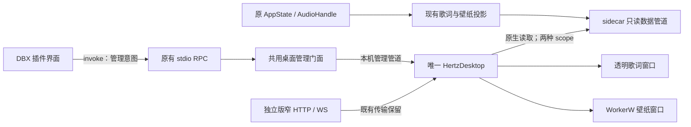

# DBX 接入桌面歌词与壁纸：后续设计

日期：2026-10-27；设计复核与实施：2026-10-28–29，基线为 `1d042b8` 与当前工作树，包含已落地的歌词工具条。状态：**D0–D2 已实现并通过两阶段审查，D3a 同源配套候选和交付材料已准备；D3b 完整发布验收待完成**。独立组件启动方式固定为 manual，不能据分项通过宣称正式交付。实施进度与证据见[实施记录](./plans/2026-10-28-dbx-desktop-implementation.md)、[验证记录](./plans/2026-10-28-dbx-desktop-evidence.md)及[D-A01–D-A18 验收审计](./plans/2026-10-29-dbx-desktop-acceptance-audit.md)。

最新进度（10 月 30 日，非八小时专项）：最终两版当前宿主核心无授权图形差分、已授权/未授权生命周期、12 次原生伪造播控拒绝、指定独立 Standard 三来源切换/播控恢复、GUI 保存失败/重试、zip 升级/备份恢复、实际旧 build 拒绝、重复点击/撤销重连与卸载重装均有最终产物证据。renderer crash 后约 10.6 秒自动重建并恢复同来源；CDP frozen 注入的未及时重建仍待查。三端已正常退出，22 个实际归属进程实例回收、宿主全局文件无差异。索引 `shutdown-discovery/final-nonsoak-verification.json` 绑定 15 份通过报告，保留 17 份失败尝试。原长稳约 87.75 分钟后按优先级正常结束，不计八小时通过。目录移动/自启、其余故障与系统恢复、最低宿主图形差分、资源预算和身份/平台等缺项见验收表；D3b 保持未完成。

历史配套候选已在最低 0.6.35、当前 0.6.47 和隔离 0.6.39 宿主覆盖核心图形流程；单行、无边框默认值阶段另有当前宿主提交基线差分及独立 Standard HTTP/native 回归。用户报告设置白条后，歌词窗口补上了非客户区计算、绘制与激活重绘处理。`output/dbx-desktop-d3/nonclient-repaint/` 的 `433e…` 配套候选通过构建/验包、最低/当前真实运行时八组、原 stdio、两版原生联调、在线歌词及 104 项包内隔离检查；其两版独立服务的 HTTP、房间/管理 EOF 亦已通过。真实 WebView2 的两种样式共 12 轮设置开关、29 次 Win32 检查正常，但没有稳定复现间歇白条的原始触发条件，不能承诺所有系统情形均已覆盖。

后续发现共用 Cargo target 的构建脚本可能保留旧源码目录，已修正三项构建文件；A→B→A 不清缓存、复用同一已编译脚本的实际 RPC 身份和返回 A 的程序字节均验证通过。仅含该增量的 `build-root-fix/` 新候选 `07d87e…` 已单独冻结，组件/两版包、51 项 native、MSRV 1.88、Windows cpal 原 stdio 314/314 与 298/298、Linux 两版回归、最低/当前真实运行时八组及独立身份复算通过。新包自身的 104 项隔离检查、两版管理 EOF 六例、新配套独立服务 HTTP 与双 scope 阻塞下房间 EOF 亦通过。另补两版共 6 项真实授权替换/发现发布/来源锁失败后的强杀、重启与显式重连检查，原空闲状态/队列/设置未变。索引为 `acceptance-progress.json`；图形/native launch/control 尚待复验。组件采用同会话固定单实例，不能靠换文件名或目录并行验证；相关失败尝试已归档，检查器保护恢复。原 `433e…` 证据保留原身份，不能自动覆盖新构建或共享工作区后续的在线/搜索 UI 修改。

15:55 补验发现暂停旧 FFT 被当新壁纸频谱刷新；现只在播放中刷新桌面投影，让暂停时最后有效帧自然过期，保留原频谱广播。17:30 更新：`paused-spectrum/` 的两版服务和 `.dbxp` 已构建/验包，构建后 72/547 项实际源输入仍为 `596f2543…` / `ab2eee4b…`；桌面输入与 `07d…` 组件字节未变。新包 Windows cpal 原 stdio 314/314、298/298，最低/当前真实 PluginHost 八组、独立实际 RPC 身份复算、104 项包内隔离检查、管理 EOF 六例及实际激活失败/强杀恢复六例均通过。新两版服务原 HTTP/WS、暂停后频谱自然过期和两版 21 项房间合同通过；Full PCM 第三次在构建结束后通过 60 秒、三采样率/自然切曲、零 underrun/resync，前两次连接中断/欠载失败保留，未确认其原因。新 Linux x64 两版原 stdio 311/311、295/295、四组 unsupported 和实际身份复算通过；不是 macOS/ARM64 或 Windows 图形资格。

授权阻塞下的房间 EOF 仍不合格：Full 首轮异常退出、一次复跑成功；再用三个交错对照轮次，暂停频谱修正前的 `build-root-fix` Full 失败 1/3、新 Full 失败 2/3，均保留实际退出码 `3221226505` 和 SDK worker 的 Tokio timer shutdown panic。另以提交 `1d042b8` 的准确 Full 包和新 Full 运行未改的原无授权/无阻塞 EOF 检查，各三次正常，不能据此认定提交基线也有该 panic，或完整已授权故障矩阵无变化。最初提交基线对照因夹具路径错误未启动，已单列作废，不能充作产品失败。新候选图形、原生管理播控/三来源切换、此退出缺陷和完整长稳仍待完成；没有修改 SDK、原音频或退出实现迁就检查。

18:36 接续：房间 `Discover` 已复用既有 `RoomManager::starting` 退出取消入口。原发现主体、其他房间分支、SDK、进程退出屏障及音频实现均未改；只在退出信号到达后停止轮询挂起的发现计时器。新冻结 `output/dbx-desktop-d3/shutdown-discovery/` 的插件 547 项指纹为 `171524606d174dbe68eaf07ee8b30478d98bb6a36f1197069c9b604275329daf`，桌面 72 项输入与 `07d87e…` 组件字节保持不变。`shutdown-timer-verified.json` 独立核对发现主体去空白完全相同、分支外源码完全相同。真实旧→新探针保留同样的挂起请求、第二请求 busy、服务 shutdown、销毁 runtime 后再轮询：旧实现确定性 panic，新实现返回 `room_shutting_down`。探针为 Linux debug/unwind，Windows release 实测另列。

补查保留 stderr 后，修正此前“原无授权 EOF 六次正常”的解释：准确提交 `1d042b8` 的 Full 在 **1/3** 次、暂停频谱候选在 **2/3** 次写出同一 Tokio shutdown panic，尽管六次退出码均为 0。新交错对照中旧暂停频谱 Full 也有 **3/5** 次后台 panic、五次退出码均为 0。旧报告和日志保持原样，不能只凭 exit=0 判定无 panic。该补证确认未授权的原提交也存在此退出竞态。新 Full 共 11 次 Windows 退出实测（五次交错及配套授权/未授权各三次）、新 Standard 配套授权/未授权各三次均无该 panic，授权、Host End 与 guest membership 原断言保持；索引保留原失败与日志 hash。

新两版 `.dbxp` 和配套独立服务已实际构建/验包，72/547 项 Windows、Linux 源输入前后复算一致。Windows cpal 原 stdio **314/314、298/298**、最低 0.6.35/当前 0.6.47 真实 PluginHost 八组、104 项包内隔离检查、管理 EOF 六项、激活失败/强杀恢复六项及实际 RPC 独立身份复算通过；Linux x64 原 stdio **311/311、295/295**、四组 unsupported 与实际身份通过。房间模块原有 12 项测试、两版原 HTTP/WS、暂停频谱自然过期、各 21 项房间权限及 60 秒静音 WASAPI PCM/三采样率/自然切曲/零 underrun-resync 通过。文件和 SHA 见 `shutdown-discovery/acceptance-progress.json`，状态仍为 partial-acceptance、`graphicalNativeVerified=false`、`d3bComplete=false`。

最终组件 GUI、成功 WebView 清理、独立版原生管理/播控恢复和三来源切换待验。原 `433e…` 第四轮仍保留同一进程、时钟和不合格采样缺口，不能代替本候选的完整八小时，原结束点仍为 18:48:30。CPU/GPU 绝对发布预算、物理身份/平台/桌面恢复等 D-A01–18 缺项继续保留。

原 `433e…` 第四轮长稳的 2/4/6 小时干预已全部通过；六小时 seek 在北京时间 16:48:51 将原播放跳到 5000ms，约一秒后实际进度 6020ms，继续播放且原二进制不变。17:30 原三个 PID live，738 样本/401.48 分钟、累计 26 次观察失败；两个原采样缺口继续使该轮不能合格。末段资源、正常退出和专属进程回收继续原控制器，预计原结束点仍为 18:48:30；新候选没有运行 GUI/长稳，不能借用该轮身份或累计时间。 三轮采样工具对照和五分钟短验只供下一轮使用，不修复原采样缺口。CPU/GPU 绝对发布预算、物理媒体键、跨用户/会话、桌面恢复及其余 D-A01–18 缺项继续保留。

本文承接[共享宿主](./desktop-host.md)、[桌面歌词 L3](./desktop-lyrics.md)与[桌面壁纸的 DBX 扩展](./desktop-wallpaper.md)，只定义 DBX 形态新增的连接、身份、管理与分发契约。窗口、场景、桌面配置提交、预览租约和恢复策略继续以原设计为准；本文的协议与数值是目标契约，实现并验证后才能进入现行 ADR 和 API 清单。D0 是可行性门槛，D1/D2 是功能交付，D3 是发布门槛，不用任一阶段代替其余阶段。

18:58 接续：原第四轮于 18:48:50 按原控制器结束，实际 28820568.7423ms、890 个样本、2/4/6 小时干预全部通过；26 次观察失败和两个原采样缺口保持，`measuredEightHours=true` 但 `passed=false`，不能作为完整长稳资格。DBX 与 native 均正常 exit=0，native forced=false；DBX 窗口状态恢复、globalFilesChanged=[]，末样本的 20 个原归属进程实例经只读 Win32 查询已不存在。原内存窗口比较在原阈值内，但不据此宣称无增长或发布预算通过。报告为 `nonclient-repaint/fourth-soak-completion.json`，仍归原 `433e…` 身份。

随后最终 `07d87e…` / exe SHA `4d2906f4195c0b55cdd6df31b616225de2f30099d97acae3096e3a69ea60874a` 组件通过真实 WebView2 复验：两种样式各六轮设置开关、29 次 Win32 样式/几何/激活重绘检查；深浅主题截图经查看，单行、无边框及滚动条正确。检查器成功路径通过自己创建的 WebView 请求退出，并实际等待正常退出；`cleanup.json` 确认 forced=false、exit=0，不借用共用控制管道。证据 `output/playwright/desktop-lyrics-native-1793270931402/`，索引 `shutdown-discovery/native-regression.json`。新两版配套服务也通过真实原生启动、重复启动保持单实例、原 status/font/wallpaper-status 管理、非法命令拒绝和正常退出，原检查脚本断言未改。

这些补齐最终组件 fixture/成功清理及原独立版管理子项，不代替最终两版 DBX 图形联调、三来源切换后的原生播控恢复，或新候选完整八小时。`shutdown-discovery/acceptance-progress.json` 已绑定准确 hash、截图与报告，`graphicalNativeVerified=false`、`d3bComplete=false` 保持。

## 1. 目标与范围

用户在 Windows 11 x64 的 Hertz DBX 插件中，能够打开现有「桌面歌词与壁纸」中心，把当前插件实例选作音乐来源，分别启用歌词、壁纸，并在插件重启后恢复同一来源的连接。独立版和 DBX 共用一个 HertzDesktop 进程、一套托盘及配置；不新增播放器或桌面渲染器。

| 范围 | 本期约定 |
| --- | --- |
| 支持形态 | Windows 11 x64 的 Standard / Full DBX 插件；两种发行版共用无账号能力的桌面组件 |
| 歌词 | 复用当前快照、已校准文档和时间插值；包括暂停、缓冲、无词、修订及断连 |
| 歌词播控 | 本期 DBX 数据桥仍只读；新歌词工具条的播放/暂停、上一句/下一句及对应快捷键在 DBX 来源下禁用并说明原因，独立版原有窄播控保留 |
| 壁纸 | 复用宿主返回的合格场景、单目标显示器及真实 64 段频谱；固定 / 跟随选择沿用既有语义 |
| 设置 | 复用原生中心、草稿、revision 冲突、预览租约、定位、穿透与恢复 |
| 生命周期 | 插件停用、崩溃或 DBX 退出后清空歌词与音乐响应；壁纸可继续环境动画 |
| 不在本期 | macOS / Linux / ARM64、Windows 10、多屏同时运行、系统音频采集、外部 MCP、后台播放新策略、房间专用歌词或播放时钟 |

桌面连接不增加页面观众数，不替 DBX UI 维持事件订阅，也不产生播放 / 暂停命令。关闭插件工作台是否销毁 sidecar、是否触发离场调用，必须记录真实宿主行为；不能把独立版 `/ws` 的三秒离场暂停直接宣称为 DBX 已有保证。音频仍由原播放与房间 owner 决定，桌面只呈现得到的事实。

### 1.1 基础插件行为不变是硬约束

沿用已确认的[桌面客户端硬约束](./desktop-client.md#硬约束dbx-单独使用无行为变化)：不安装或运行 `hertz-app`、不安装配套组件、未显式连接桌面时，DBX 插件的启动、原有页面、播放/队列/seek、媒体键、睡眠定时、设置、工作台关闭/重开及插件退出均与实施前一致。本专项只增加用户主动选择的连接/撤销与桌面呈现能力，不借接入顺带统一定时、注册原生媒体控制、修改房间权限或引入桌面播放 owner。

未授权时不创建数据 listener、窄凭据或发现记录，也不启动组件、迁移桌面宿主配置或在插件启动路径等待组件探测。已授权后的授权恢复、管道建立、发现发布或组件检测失败，只使桌面连接失败；返回可查询错误，不能拖垮原 SDK/stdio RPC、原播放或插件启动。未来 schema、坏授权记录均保留原文件并停用桥，不用默认值重新授权。DataDir 确有其他业务 owner 等原业务安全冲突仍按对应启动契约处理。

运行依赖保持 `DBX sidecar → 共用业务库`；可选原生组件由用户单独安装。基础插件不依赖 Tauri 主程序、完整独立播放器、新增 HTTP listener 或桌面控制握手。启用后只读请求的 I/O、额度与退出清理也应隔离，不能占住音频回调、主播放提交锁或 SDK 工作线程等待慢客户端。

## 2. 当前缺口与方案选择

### 2.1 实施前基线与补齐项

下表记录本专项开始时的缺口。D0–D2 已按对应边界补齐，当前交付及未验范围以实施记录为准，不把实施前基线当作当前代码状态。

| 事实 | 源码依据 | 需要补什么 |
| --- | --- | --- |
| sidecar 只启动 stdio RPC，启动时传入空的桌面窄凭据；没有本机 HTTP 服务 | `plugin/backend/src/main.rs::boot_plugin/main` | 给原生桌面组件提供独立于 DBX stdio 的只读数据入口 |
| 桌面两个 feed 依赖 `vmusicd.json`、窄凭据与回环 HTTP / WS | `crates/hertz-desktop/src/bridge.rs`、`feed.rs`、`wallpaper_feed.rs` | 在原生读取层识别来源传输，复用同一数据校验与呈现逻辑 |
| 歌词原型已通过 `feed::control` 调用窄 POST，页面按快照启用工具条 | `crates/hertz-desktop/src/feed.rs::control`、`app.rs`、`assets/desktop-lyrics.js` | 显式按来源能力禁用 DBX 播控；原生层同样拒绝，不能误走 HTTP 或借 DBX RPC 扩权 |
| 桌面 launch / control 在 HTTP 路由中，RPC 路由未映射 | `crates/hertz-studio/src/routes.rs`、`crates/hertz-studio/src/rpc/mod.rs` | 提取共用桌面管理业务入口，并明确 DBX 启动组件的位置 |
| DBX 下主动隐藏桌面入口 | `plugin/ui/app.js` 的桌面设置初始化 | 改成能力判断与可操作的缺失 / 不兼容状态 |
| profile 目前只有 `dataDir`、`edition`，配置为 schema v2 | `crates/hertz-desktop/src/config.rs` | 显式区分独立版与 DBX，避免用目录或端口猜传输 |
| `.dbxp` 打包仅包含插件 sidecar、assets、ui | `plugin/dbx-plugin.toml`、`scripts/prepare-edition.js` | 定义配套桌面产物、安装位置、版本检查和升级路径 |

### 2.2 路线选择

| 路线 | 收益 | 代价与边界 | 结论 |
| --- | --- | --- | --- |
| A. sidecar 增加仅回环的窄 HTTP / WS 服务 | 桌面现有客户端改动较少 | 插件新增网络监听与端口、凭据和路由生命周期；需修改当前市场披露，不能挂出完整管理 router | 本期不采用；仅在 D0 证实管道受限且 HTTP 可行后重新评审 |
| **B. sidecar 提供本机只读命名管道，原生 feed 适配** | 保持插件无网络监听；与 Windows 桌面支持范围一致；不依赖工作台常驻 | 需要实现并验证有界管道协议、身份检查与取消 | **本期选定，D0 通过后实施** |
| C. 插件网页经 `invoke/onEvent` 转发给桌面窗口 | 可使用现有 UI 事件 | 网页生命周期变成数据链必要条件；凭据和同步工作进入沙箱，易形成第二套缓存与重连 | 不采用 |

选择 B 的依据是「桌面能读取当前插件的真实数据」只需要本机只读连接。DBX 浮动胶囊不具备现成的 WorkerW 挂载和透明穿透契约，也不能据其可拖动就替代 HertzDesktop。新适配只负责字节与连接；歌词解析、播放代际、频谱和配置均保留原 owner。

重选须区分阻塞来源：命名管道受限、而本机网络监听已获准时，携证据重审 A；辅助进程启动或独立生存受限时，换成 HTTP 并不能解决，应先验证用户独立启动配套组件后仅连接的方式。若两种启动方式都无法满足宿主/发布规则，则停止交付并修订产品范围。不在运行期静默切换传输或自动启动独立播放器。

## 3. 所有权与数据流



| 层 | 唯一职责 | 禁止新增的归属 |
| --- | --- | --- |
| 原服务业务 | 构造歌词 snapshot / document、壁纸 snapshot，管理播放与缓存 | 桌面专用播放队列、第二个 FFT、从窗口反推播放状态 |
| sidecar 数据桥 | 用户授权记录、管道、发现记录、scope 鉴权、连接额度和 shutdown | 复制歌词正文缓存、订阅完整业务事件再落第二份状态、拥有播放生命周期 |
| 共用管理门面 | capability、配套组件定位、launch、有限命令转发 | 写桌面配置、替用户切源、通用执行路径 |
| HertzDesktop 原生层 | 选择传输、认证来源、取消旧工作、向页面提供校验后的数据 | 向 WebView JS 提供钥匙、管道句柄或任意文件访问 |
| HertzDesktop `config.rs` | 两种来源的样式 / enabled / activeProfile、revision 和自启 | 插件另存一份桌面启用配置 |

实施时，建议在服务 crate 提取 `desktop` 管理模块和 Windows 专用 `desktop_bridge` 模块；`routes.rs`、`rpc`、`plugin/backend` 仅适配调用。桌面侧在 `bridge.rs` 下按 HTTP / pipe 分发，`feed.rs` 与 `wallpaper_feed.rs` 保留各自同步语义。模块名是落点建议，不要求预建通用插件传输框架。

歌词 native → 页面桥另投影来源能力。DBX v1 明确 `lyricsControl=false`，禁用工具条播控和空格/方向键播控；拖动、样式、锁定及找回照常可用。原生处理器在接受命令时也复核来源能力，不能仅隐藏按钮，更不能对 DBX profile 尝试读取 `vmusicd.json` 或退回主播放器 API。后续若需 DBX 歌词播控，另行评审显式授权、传输协议和房间权限，本期不扩展只读 scope。

## 4. 来源身份、发现与配置迁移

### 4.1 持久身份与运行身份分开

配置已在 D1b 升级为 **schema v3**，profile 使用明确的来源类型。DBX 示例：

```json
{
  "kind": "dbx",
  "edition": "standard",
  "dataDir": "C:\\profiles\\dbx-standard",
  "pluginId": "io.github.oncemisery.hertz-studio"
}
```

示例目录只表示 sidecar 实际解析后的目录；必须从 `resolve_data_dir()` 与 `absolute_data_dir()` 的结果生成，不拼接假定的 DBX 安装路径。Full 的 ID 为 `io.github.oncemisery.hertz-studio.full`，不得与 Standard 混用。

当前 `absolute_data_dir()` 只解析相对路径，未消除 junction、`..` 或 Windows 扩展路径前缀；桌面 `normalize_profile()` 则会 canonicalize。实施时须让 sidecar 身份、锁键、发现记录和原生 profile 比较使用同一 Windows 目录规范化结果，避免同目录被判为两个来源；这只统一身份表达，不迁移或改选 DBX 的实际存储目录。

- 独立版 profile 为 `{kind:"standalone", edition, dataDir}`；DBX profile 额外要求合法 `pluginId` 与发行版匹配。
- profile 等价关系为来源类型、发行版、按既有 Windows 规则规范化的数据目录以及 DBX 插件 ID 均一致。session、端口、PID、管道名和版本均不属于持久身份。
- `custom` 等现有独立版发行版标记仍按原规则迁移，不变成绕过 DBX ID 校验的入口。
- 同一用户仍只允许一个桌面宿主与一个 activeProfile，歌词和壁纸同时跟随这个来源；第二个实例只能提供候选，不能抢绑。

迁移时把 schema v1 / v2 的所有旧 profile 显式标记为 `standalone`，完整保留各域与偏好。不根据目录名含有 `dbx` 猜测其类型。迁移和普通保存共用宿主的串行配置提交入口：从旧 revision 增加一次，将完整新配置原子保存成功后才替换内存状态；失败保留原文件和 revision，不启用新来源。继续执行 64 KiB / 8 个 profile 上限，包含补入 activeProfile 后的总数检查；重复来源、未来 schema 或 revision 溢出均拒绝改写。

v1 还有 `activeProfile=null`、偏好仍在顶层的合法形态；当前 `config.rs::load` 为此延迟保存，不能按“没有 profile”丢弃。v3 将这份域保存在仅用于迁移的可选 `unboundStandalone` 字段；它不是候选来源、不启动窗口、不计作已绑定 profile。第一次显式绑定独立版时原子归入该来源并移除此字段；先连接 DBX 时保留它，新 DBX 域仍使用关闭状态和默认样式，不继承旧 enabled。无需维护第二份可写 v2 配置。

旧宿主遇到 v3 应拒绝改写。升级前正常退出旧宿主并保留迁移前备份；若要降级，只能显式恢复备份，且会失去之后的配置修改。不要求旧宿主读懂新来源，也不为 DBX 写一份 v2 影子配置。

### 4.2 DBX 专用发现记录

DBX 在自己的实际 DataDir 发布 `desktop-source.json`；**不伪造带端口的 `vmusicd.json`**。独立版继续使用已有发现方式。拟议记录：

```json
{
  "discoveryProtocol": 1,
  "source": {
    "kind": "dbx",
    "edition": "standard",
    "dataDir": "C:\\profiles\\dbx-standard",
    "pluginId": "io.github.oncemisery.hertz-studio"
  },
  "serverInstanceId": "9a994748-b53b-4a2e-8347-4e1f754cb533",
  "pid": 1234,
  "windowsSessionId": 1,
  "buildId": "plugin-standard-build-example",
  "desktopBuildId": "desktop-build-example",
  "bridgeProtocol": 1,
  "desktopLyricsProtocol": 1,
  "wallpaperProtocol": 1,
  "pipes": {
    "lyrics": "\\\\.\\pipe\\hertz-desktop-data-example-lyrics",
    "wallpaper": "\\\\.\\pipe\\hertz-desktop-data-example-wallpaper"
  }
}
```

真实记录的 `source` 必须与选中 profile 完全一致。示例构建标识不代表当前已有产物：`buildId` 唯一标识当前插件产物及资源输入；`desktopBuildId` 指定它配套的桌面组件构建，Standard / Full 可以不同 `buildId` 指向同一 `desktopBuildId`。完整规则见第 8 节，不能仅靠 Git 版本判断兼容。`serverInstanceId` 必须直接取 `AppState::server_instance_id()`，与歌词、壁纸投影的 `server.session` 同源；数据桥重建 listener 不再生成另一套服务会话。

一个 profile 同时只能有一个桥发布者和授权写者。恢复时先只读确认有效授权，再取得规范 DataDir 对应的桥排他锁、复读授权与钥匙，建立 listener 后原子发布发现记录；首次显式 connect 在该锁保护下提交授权。锁持有至桥退出清理结束；冲突只报告 `desktop_source_conflict`，不得覆盖活实例文件或使基础插件启动失败。未授权普通启动不争抢桥锁；已有业务级 DataDir 互斥继续遵守原契约，本专项不为桥发现引入新的播放器启动前置。配置目录搬迁必须显式重新选择来源，不自动搜索替代目录。

记录最多 64 KiB，读入、JSON 解析与路径校验前都要有界；不能先 `read` 整个文件再检查长度。授权记录与窄凭据同样先限长再解析。管道名从当前用户、Windows 会话、profile 摘要、随机 server session 与 scope 生成，不把目录或凭据直接放进名字。数据 listener 显式限制为当前用户 SID，并拒绝远程客户端；服务端检查真实客户端的用户与交互会话。原生端校验本机管道命名空间、当前用户 / 会话，以及实际管道服务端 PID 与发现记录的对应关系；PID 只是运行期交叉检查，不代替 profile 或 session。不把现有管理管道的默认安全描述符当成新数据管道已验证的 ACL 证据。

配置不保存管道名、PID、session 或钥匙。断连后仅重读选中 profile 的记录，以新握手确认新 session；不扫描端口、插件目录或其他用户数据。退出时先停止接收、关闭现存连接，再仅清理仍属于自己的 session 的发现记录，避免旧进程误删新记录。崩溃遗留文件不视为在线证据。

## 5. 数据管道协议与资源边界

### 5.1 权限与启用

管理管道继续由 HertzDesktop 持有；新增数据管道由 sidecar 持有，二者不复用。歌词、壁纸各有一个 listener，只接受对应 scope 的只读请求。

首次用户执行「连接桌面组件」时，sidecar 在自身 DataDir 建立独立 `desktop-lyrics-key`、`wallpaper-key`，并原子保存 `desktop-authorization.json`。授权记录为小型版本化文件，包含 `schemaVersion:1`、递增 `revision` 与已授权的 `scopes`；上限 8 KiB。新增授权和凭据文件按当前用户 ACL 保存，不改写已有 DBX DataDir 的权限；无法满足时只停用桥。不存在记录即未授权，钥匙文件仅作为凭据，不能单独代表同意。未知/重复 scope、非法 revision 或 revision 溢出均拒绝改写。浏览 capability、进入普通播放器或仅探测组件不创建凭据、不启动桌面窗口。钥匙仅供原生层使用；不经 `invoke` 结果、页面消息、URL、进程参数或日志传出。

后续 sidecar 启动仅在记录有效、scope 已授权且对应钥匙有效时恢复 listener 和发现记录，不必等待工作台再次打开。这个授权只决定数据可读性，不表示歌词 / 壁纸 enabled；后者仅存于 HertzDesktop 配置。一个 scope 的钥匙不允许读另一个 scope。发现记录仅列出成功授权并已监听的 scope；缺失的 scope 明确不可读，不用空钥匙启动，也不自动补建被删除的钥匙。首次连接的授权说明覆盖两种只读数据；初始化不开放部分授权，失败状态按实际已提交的授权与监听分别报告，窗口启用仍分别控制。

DBX 设置提供「撤销桌面连接」。连接、撤销和恢复发布共用一个 sidecar 生命周期串行入口，包含单调的授权代际：

1. 先关闭内存授权闸门、推进授权代际，取消在途请求并停止接收，阻止旧 connect / 恢复工作提交。
2. 原子保存 `scopes:[]` 与新 revision；只有持久禁用成功，才可报告重启后仍撤销。
3. 有界关闭现存连接、停止 listener、撤下本 session 的发现记录，并清理两把钥匙。钥匙删除失败单独报告清理未完成，但有效的禁用记录仍阻止下次启动恢复。

若第 2 步落盘失败，当前进程闸门保持关闭，返回“本次已断开、持久撤销未完成”，允许重试，并明确重启可能按旧记录恢复。若禁用已落盘而清理尚未完成，不将它误报成未撤销；两种状态可分别查询。只有撤销后新的显式 connect 可以准备有效钥匙、提交新授权再重新开放。响应发送登记与关闭闸门串行化，撤销后不准登记新的旧代际发送，并取消已登记的 I/O；已经交给系统或送达原生端的字节无法收回，宿主仍按独立新鲜度计时清理，不承诺跨进程瞬时擦除。

授权写入与 listener / 发现发布不是跨资源原子事务。崩溃可能留下已授权但未监听的状态，重启仅按有效记录恢复并报告真实结果；已持久禁用即使仍留钥匙或发现文件也不恢复。退出清理不得重新发布或重新授权。再次连接不删除宿主样式，也不停止绑定其他来源的窗口；坏钥匙、坏记录或未来 schema 明确报错，不在后台自动重新授权。当前用户下仅有本地文件权限的恶意进程仍不在此隔离承诺内。

### 5.2 请求与应答

每个请求使用独立的短连接，采用 **4 字节无符号小端长度 + UTF-8 JSON**，不借用 DBX 的 stdin / stdout。拟议歌词快照请求：

```json
{
  "bridgeProtocol": 1,
  "requestId": "18",
  "serverInstanceId": "9a994748-b53b-4a2e-8347-4e1f754cb533",
  "scope": "lyrics",
  "key": "<仅原生层持有的窄凭据>",
  "op": "snapshot",
  "params": {}
}
```

应答固定为 `{bridgeProtocol, requestId, serverInstanceId, status, body}`；`status/body` 沿用现有 API 错误信封，正常 body 直接使用既有投影结果，不再 JSON 字符串化或复制正文。允许的方法只有：

| 管道 scope | op | 参数 | 业务 owner |
| --- | --- | --- | --- |
| lyrics | `snapshot` | 空对象 | `desktop_lyrics::snapshot` |
| lyrics | `document` | `{key: documentKey}` | `desktop_lyrics::document` |
| wallpaper | `snapshot` | 空对象 | `wallpaper::snapshot` |

每次请求必须先检查 envelope、session、scope 与钥匙，再进入业务投影；确认持久授权、内存闸门及钥匙均有效，删除或轮换后旧钥匙立即失效。业务结果写出前再次复核授权代际和 session，检查期间不持锁等待客户端 I/O。歌词文档沿用过期 documentKey 返回 409、2 MiB 上限、取词不阻塞快照和偏移只应用一次的规则。快照仍包含数据协议版本与 `server.session`，必须与外层 session 一致；source 身份由已验证的发现记录与真实管道对端绑定，不能只看曲名判断来源。

桥协议、歌词协议、壁纸协议和桌面管理协议独立协商。未知 op / 字段 / 协议明确拒绝；不提供任意 HTTP path、RPC method、文件路径、播放或设置写接口。权限失败不返回歌词或当前曲目信息。

### 5.3 首版同步选择与数值

DBX 桥协议 v1 明确只提供请求 / 应答：歌词最多 2 Hz，壁纸最多 4 Hz；文档仅对已成功取得的 `(serverSession, documentKey)` 去重，新 key 或新 session 必须重新获取。壁纸仍使用原频谱新鲜度与衰减、原页面视觉时钟，不通过提高 IPC 频率代替插值。独立版继续使用现有 WS / HTTP；DBX 不先尝试 WS 再等失败，也不新增一条旁路事件总线。后续只有实测证明快照方式不足时才单独设计事件版本。

上述频率是上限：两项停用且设置关闭时不保留数据轮询；用户隐藏、锁屏、全屏及电源策略沿用各 surface 的观察/绘制规则。仅无词、无曲或暂时断连不能停止必要的有界发现与重连，否则下一首无法恢复。未授权的 sidecar 不进行桥轮询或定期组件探测。

| 拟议边界 | 数值 | 行为 |
| --- | --- | --- |
| 请求帧最大 JSON 字节 | 8192 | 读长度后、分配正文前检查；不接受部分 JSON |
| 应答帧最大 JSON 字节 | 4194304 | 包含信封；超限用完整错误替换，不截断歌词 |
| 连接期限 | 1000 ms | 无 listener / pipe busy 时有界返回 |
| 建连成功后单请求总期限 | 2000 ms | 覆盖鉴权、业务等待、读写与 flush；不是每阶段各等两秒 |
| 桥退出清理期限 | 2000 ms | 与原业务退出并行开始；到限取消并关闭本桥句柄，不延迟原房间/音频关闭屏障 |
| sidecar 同时处理的连接 | 每 scope 2 个，全局 4 个 | 不排等待队列；超额拒绝连接，不为每次过载另起任务 |
| 单种快照未完成请求 | lyrics / wallpaper 各 1 个 | 上一快照未完成不叠加下一拍 |
| 歌词文档未完成请求 | 1 个，独立于歌词快照 | 慢文档不阻塞后续快照；key 或绑定改变时取消旧请求 |
| 无成功快照时的来源失效阈值 | 3000 ms | 不再外推歌词位置，清空歌词与音乐响应；显示等待来源 |
| 失败重连间隔 | 1、2、4、8、16、30 s，之后 30 s | 可取消；成功后复位；用户重试可触发一次即时尝试 |

一个宿主常态最多三个在途请求：两种快照各一份、歌词文档一份，不超出每 scope 两个 / 全局四个的服务额度。歌词快照先投递给窗口，文档另行补齐；完成时必须再次匹配绑定代际、server session 与当前 documentKey。文档瞬时失败保留“未取得”状态，按表中间隔独立退避重试同 key，快照成功不重置文档退避；换 key、换 session、撤销或切源取消旧重试。409 只触发重新取快照，不能递归重试旧 key。歌词文档失败不刷新快照成功时间，也不清空另一 scope 的有效数据。

期限使用单调时钟。传输 deadline 到达时必须取消底层 I/O、关闭句柄；不能只让调用方超时、后台阻塞读写继续占槽。并发额度一直持有到工作和资源回收实际结束；数据桥退出不等待无期限的慢读客户端。输入长度、输出序列化和慢读测试必须在接入业务前完成。序列化写入有上限的缓冲器，不先无界分配再检查；超过应答预算发送完整的小错误信封。客户端同样先验长度再分配，并拒绝多帧、截断帧和应答身份不匹配。

三秒新鲜度检测由宿主定时器独立执行，不等待请求结束或下一轮重连。两个 scope 分别记录最后成功快照：歌词失效清空歌词，壁纸失效清零音乐响应；确认整个来源失效或 session 改变时两者一起作废。授权 / 身份失败立即清除对应数据，不继续显示到退避结束。配置中的 enabled 不因这些运行期故障而改变。

新鲜度包含传输与页面投递时间。原生端记录请求发起的单调时刻 `t0` 与收齐/验收的 `t1`，成功快照以 `t0` 作为保守新鲜度起点，投递给 UI 时继续扣除排队时间；不能让耗时两秒的旧响应在到达时重新获得完整三秒寿命。壁纸频谱有效年龄保守计为服务 `ageMs + (t1-t0) + 接收后经过时间`；不能把重复的旧 bands 重置为刚采样。歌词保留原有位置插值规则，不按 RTT/2 猜测 seek 或补造进度，超过来源/页面新鲜度预算就停止外推。每 scope 独立校验 `seq` 严格递增，绑定代际、session 或 documentKey 改变立即作废旧文档与时间锚。

这些约束需要改到真实调度落点：当前 `feed::poll` 将快照和文档串行读取、`spawn_feed` 读取结束后再 sleep，管理通道也存在同步 `FlushFileBuffers`。DBX 路径须分别调度快照与文档、采用可取消 I/O，并以固定节拍合并错过的 tick，不补发积压轮询；不能只给原阻塞函数外包一层 timeout。独立版读取与原管理合同同时回归，未覆盖分支仍标为待验。

## 6. 管理入口与用户流程

### 6.1 能力查询与共用门面

已实现 `GET /v1/desktop/capabilities`，由 HTTP 和 DBX RPC 映射到同一业务门面。字段包括：`supported`、`reason`、`source`、`transport`、`buildId`、`requiredDesktopBuildId`、`launchMode`、`component`、`authorization`、`managementProtocol`、`bridgeProtocol`。`component` 区分 `unknown / missing / incompatible / ready`；`ready` 仅表示发现兼容组件，不代表已运行或来源已认证。`authorization` 分别报告持久 scope / revision、当前闸门、持久撤销和清理结果；不返回钥匙或管道地址。`requiredDesktopBuildId` 是组件构建要求，不能与插件产物的 `buildId` 混为一谈。

`supported` 表示该平台与运行形态实现了桌面适配；组件缺失仍可展示安装入口，不能因此隐藏整个功能。未实现的旧后端、非支持平台以及组件不兼容分别显示原因。读取失败显示「暂时无法确认」，不伪装成未安装。普通插件启动不等待组件探测；打开设置可发起一次有界检测并缓存结果，用户「重新检测」或 connect 再刷新，不常驻扫描。D0 已将 `launchMode` 固定为 `manual`：由用户独立启动组件，sidecar 仅连接；不运行期轮流尝试启动手段。

设置检测接在实际打开入口：普通导航的 `setView('settings')`，以及流年/清风直接打开浮层时已有的显式 `settings-enter` 事件，同次打开去重。启动或换肤恢复已保存的默认设置视图、全局 Escape 重置通过窄跳过标记保留原落点，不触发桌面检测。不挂 `loadSettings`、启动刷新、DOM 观察器或定时轮询；不为桌面功能改动原皮肤的导航与浮层职责。底栏桌面按钮先打开并聚焦此设置区，首次授权仍须用户阅读说明后明确点击连接。

已实现逻辑 `POST /v1/desktop/connect` 和 `POST /v1/desktop/disconnect`：前者表示本插件允许桌面读取并请求打开原生中心，后者撤销本插件数据授权。本期仅通过 DBX RPC 暴露这两个动作，方法名去掉前导斜杠、信封携带 `op:POST`；不管理独立版的钥匙。这两项不是 HTTP 路由，不加入生成的 REST 清单。已有 `desktop/lyrics/launch`、`desktop/wallpaper/launch`、`desktop/control` 的业务提取到共用门面；旧入口保留原用途，DBX 连接流程统一走 connect，不在前端拼两套启动逻辑。

connect 顺序：检查能力并优先验证已运行宿主；没有兼容宿主时才检查固定安装位置，返回缺失、不兼容、暂时无法确认或需要手动启动，此时不创建授权。确认兼容宿主后，按第 5.1 节准备钥匙、提交持久授权、建立 listener 并发布发现记录，再用管理 v2 传入本插件 profile 候选并打开中心。DBX 不执行组件或 `--describe`。有效授权的重复 connect 复用当前凭据与 listener，不无故轮换钥匙。失败分阶段返回；授权已建立但后续管理请求失败时保留实际授权事实，提供查询、重试与撤销入口，不宣称事务整体回滚。

管理转发继续用命令白名单；不增加 `exec`、任意可执行路径、通用读文件或强杀进程命令。`status` 增补管理协议能力与构建信息，D2b 原生已实现支持 DBX profile 的管理版本 2，D2c 已接入对应设置流程。新客户端面对缺少能力字段的旧宿主不提交 DBX profile。旧客户端的无目标命令仅在 activeProfile 为独立版时维持兼容；宿主绑定 DBX 时拒绝旧式窗口 / 配置变更，只允许查询或打开中心，防止绕过目标校验。

### 6.2 用户可见流程

1. Windows DBX 插件设置中显示「桌面歌词与壁纸」。组件未装时解释其用途，提供配套发布页和「重新检测」；不自动下载或安装。
2. 点击「连接桌面组件」，明确授权本插件向原生组件提供歌词和音乐响应数据，随后打开现有中心。仅连接、打开设置不启用歌词或壁纸；首次进入的新 DBX profile 两项 enabled 均为 false，样式用宿主默认值，不改写旧 profile 的已保存偏好。
3. 中心显示「DBX · Standard / Full」及可区分实例的来源名称；详细目录仅放诊断。已有其他 activeProfile 时把当前插件加入候选，用户显式选择，按原草稿与 revision 规则提交；不因调用方变化自动切源。
4. 用户分别启用歌词或壁纸并应用。分别显示「设置已保存」「等待插件」「正在运行」等事实。另一项停用不影响当前项。
5. 点击解锁定位、显示或隐藏时，必须确认当前活动来源。插件 A 对绑定 B 的宿主，只能打开中心并提示选择 A；不能直接改动 B 的窗口。

配置变更继续使用 `expectedRevision`。已实现的管理 v2 对作用于窗口 / 配置的命令增加目标 profile 校验，提供只读查询和打开中心不要求改绑；目标不匹配返回 `desktop_source_mismatch`。显示 / 隐藏采用明确目标命令；`wallpaper-toggle` 只保留旧调用兼容，新流程不自动重放 toggle。

D2b 原生管理 v2 保留 `command/value`，必填 `managementProtocol:2`、`requestId`、`targetProfile` 和 `requiredDesktopBuildId`。`requestId` 为 1–128 字节可见 ASCII（不含空格）；`targetProfile` 直接使用共享严格 tagged `Profile`，复用既有身份、发行版/pluginId 与现存绝对目录规范化规则；`requiredDesktopBuildId` 必须等于正在运行组件的实际 `component::BUILD_ID`，不能取插件 `buildId` 或只信安装清单。信封、Profile 和已接受命令的 value 均拒绝未知字段；未知版本、缺字段、非法目标或构建不符绝不退回 legacy 执行。共用门面仍须从本服务真实身份构造 target，不接受网页冒充来源。

例如请求 `{"managementProtocol":2,"requestId":"center-1","requiredDesktopBuildId":"<实际组件构建>","targetProfile":{"kind":"dbx","edition":"standard","dataDir":"D:\\DBX\\Hertz","pluginId":"io.github.oncemisery.hertz-studio"},"command":"open-center","value":{"tab":"runtime"}}`。有效 v2 的成功和业务错误都回显相同 `requestId`、自身实际 `desktopBuildId` 与 `managementProtocol:2`；缺失/非法 ID 返回 `requestId:null`。v2 装饰后的响应超出 8 KiB 时返回保留上述关联字段的 `management_response_too_large`；唯一 GUI pending 被占用时，v2 的 `control_busy` 同样保留关联字段，legacy 保持原 `control busy` 形状，不在 worker 内进行目标规范化。不泄露凭据、管道地址或歌词正文。入口拒绝码为 `unsupported_management_protocol`、`invalid_request_id`、`invalid_management_request`、`invalid_target_profile`、`desktop_build_mismatch`；非法命令/参数分别为 `unsupported_command`、`invalid_value`。

| 原生 v2 命令 | value 形状 | 目标 / 提交规则 |
| --- | --- | --- |
| `status`、`wallpaper-status` | 省略、`null` 或 `{}` | 可查不同 target；实际绑定不变 |
| `open-center`、`wallpaper-settings` | 省略、`null`、`{}` 或 `{tab:"wallpaper"\|"lyrics"\|"runtime"}` | 可展示不同 target 的候选；不改绑、不启用歌词/壁纸，禁止 `value.profile` |
| `hide`、`wallpaper-show`、`wallpaper-hide`、`wallpaper-retry`、`wallpaper-preview-close`、`wallpaper-preview-renew` | 省略、`null` 或 `{}` | 调用业务前必须 target 等于实际 `activeProfile` |
| `wallpaper-preview` | 原 `WallpaperCandidate`：`enabled/fps/musicResponse`，可选 `monitor/source/scene` | 同上；仅运行期预览，不提交配置 |
| `wallpaper-apply` | `{expectedRevision,config:<WallpaperCandidate>}` | 同上；必填当前 revision，拒绝尚有待保存修改，沿唯一 disk-first config commit |

`profile-switch`、`wallpaper-toggle`、`show/locate/lock/unlock`、`layout/secondary/font/opacity` 和 `quit` 本期 v2 明确返回 `unsupported_command`。标量样式未发明新的批量 API，DBX 产品流程只需 status/open-center；来源变更只由现有原生中心 `switch-source + expectedRevision` 显式提交，保存失败后同一候选可重试。所有已接受 v2 变更在业务调用前不匹配目标均返回 `desktop_source_mismatch`；缺少/非法 revision 返回 `invalid_expected_revision`，过期或有待保存修改返回 `desktop_revision_conflict`。位置调整期间原有变更限制继续生效。

无版本的 legacy `command/value` 在独立版继续保留原 scalar value 与错误形状，旧 `{edition,dataDir}` 候选也只在此边界兼容。实际 DBX 来源拒绝 legacy 变更，仅查询或打开中心可用，打开中心时忽略 `value.profile`，不能引入候选/改绑。未绑定配置的 `activeProfile/profile` 始终为 `null`，检测候选不能充当实际活动来源；新 DBX 域的歌词与壁纸默认关闭，旧域偏好保留。

管理管道仍是独立的 raw JSON，不走上节数据帧。D2a 已实现请求/应答各 8 KiB、连接最多一秒、建连后总期限两秒、实际可取消 I/O、最多一个 GUI pending 和 expired guard；D2b 不替换这些机制。管理能力现为 2，数据桥仍为 1，`--describe` 继续无 UI/配置副作用。

原生 status 保留 legacy 字段，并报告 `managementProtocol`、`bridgeProtocol`、实际 `desktopBuildId`、`activeProfile`（兼容别名 `profile`）、`revision`、已实现的 `capabilities`、本次规范化 `targetProfile`、`sourceConnected` 和 `sourceScopes:{lyrics,wallpaper}`。`sourceConnected` 仅在请求 target 等于实际绑定，且任一 scope 通过已有 feed 接受了仍新鲜的真实认证数据时为 true；两 scope 分别记录单调 `Instant`，快照请求使用请求起点，独立版持续事件流使用收到该事件的时点，以独立 3 秒 stale 窗口判断。空曲目仍可连接，来源 B 已认证不能使 target A 在线，候选/listenerReady/曾经连接/开窗均不算在线；scope 失败、切源或新 session 清除对应旧事实，不复制播放真值。

管理应答另带 `sourceSession`，表示原生最近实际接受的认证数据会话。DBX 门面仅在它等于当前 sidecar 的 `serverInstanceId` 时确认在线；字段缺失或会话不同均返回未确认，防止新 sidecar 沿用旧会话三秒内的新鲜度。

原生 v2 当前没有返回每 scope 的已消耗年龄，服务门面不能给收到的 true 再追加三秒缓存寿命。因此 DBX 门面的 `sourceConnected=true` 只随本次验证通过的实时 v2 应答返回；`refresh=false` 的缓存查询保守返回 false，含义为没有本次在线确认，不单独代表连接失败或撤销。两条 scope 也遵守同一规则；当前授权闸门关闭或代际已变化时，即使收到迟到 true 仍必须返回 false。

管理应答必须区分 `launchRequested`、`managementReady`、`sourceConnected`；DBX 的 `launchRequested` 始终为 false，打开中心成功不等于数据已认证。最后一项只表示本次请求的 profile 已认证，不把宿主仍连接来源 B 报作插件 A 已连接。同一 sidecar 合并并发 connect；检测与管理等待合用最多五秒预算，每次查询须服从剩余总期限，超时返回结果待确认。两项 surface 停用且中心关闭时允许没有新鲜认证事实，不为等待 `sourceConnected=true` 持续轮询。生命周期串行入口只提交授权/发布状态，不持锁执行管理 I/O、文件校验或等待。connect 入场即捕获意图代际，并在提交授权时验证，撤销期间的旧探测不能重新授权；授权后的管理结果还须验证当前授权代际，晚到结果不能继续发布、更新在线缓存或改绑。沿用 requestId 关联，配置提交仍靠 revision 防止重复写入，不承诺通用跨进程 exactly-once。

### 6.3 拟议错误码

| 错误码 | 用户可采取的动作 |
| --- | --- |
| `desktop_platform_unsupported` | 使用受支持的 Windows 11 x64 环境 |
| `desktop_component_missing` | 安装对应构建的桌面组件，然后重新检测 |
| `desktop_component_incompatible` | 正常退出旧组件，换用匹配组件；不覆盖正在运行的进程 |
| `desktop_component_start_required` | 按当前发布说明独立启动组件，再重试连接 |
| `desktop_source_mismatch` | 在中心确认并切换音乐来源 |
| `desktop_source_conflict` | 关闭同 DataDir 的重复 sidecar，再连接；基础插件仍可按原规则使用 |
| `desktop_bridge_unauthorized` | 检查是否已撤销授权，显式重新连接 |
| `desktop_bridge_protocol_mismatch` | 更新匹配插件与组件，不切回其他来源 |
| `desktop_bridge_unavailable` | 启动 / 启用插件后重试；保留已保存配置 |
| `desktop_authorization_invalid` | 保留授权文件并修复/升级匹配版本；不静默重置为已授权 |
| `desktop_revocation_incomplete` | 本次已断开但持久禁用未保存，重试撤销；重启可能恢复旧授权 |
| `desktop_result_unknown` | 查询实际状态，确认后再操作 |

畸形帧、未知字段、过载及业务 documentKey 冲突分别按协议错误、忙、现有业务冲突处理，不全部翻译成「组件未安装」。

## 7. 退出、重启、切源与自启

| 事件 | 必须呈现的结果 | 所有权限制 |
| --- | --- | --- |
| 关闭 DBX 工作台，sidecar 仍在 | 桌面继续读原播放真值；若原播放 owner 暂停则歌词冻结 | 不虚构页面观众，不自行续播 |
| 插件停用、sidecar EOF / 崩溃、DBX 退出 | 确认断开或三秒无有效快照后清空歌词和音乐数据；壁纸进入环境动画 | 不清掉 enabled 偏好；不停止另一来源 |
| 同一插件重新启动 | 只读选中 DataDir 的新记录，认证新 session，拉完整快照及新 documentKey 后恢复 | 清旧 seq / generation / 文档锚；不接受旧在途结果 |
| Standard / Full 或独立版 / DBX 切换 | 原子提交 activeProfile 后递增绑定代际、取消旧请求、换上目标域 | 不复制另一来源的 enabled，不把端口重用当同源 |
| 用户退出桌面功能 | 按现有规则停对应窗口与 feed；两项及设置均关闭可退出宿主 | 不退出 DBX、不停播放器、不撤销插件数据授权 |
| 用户撤销 DBX 桌面连接 | 关闭本次数据闸门，持久禁用成功后重启仍无 listener；清理失败单独可见 | 落盘失败不得声称永久撤销；不自动重建钥匙、不删除宿主配置 |
| 用户登出 / 进入另一 Windows 会话 | 遵守现有会话与单实例限制 | 不跨会话重绑或操作窗口 |

sidecar 收到原 SDK EOF / shutdown 时，先关闭桥接收闸门并取消其工作，原 `AppState::shutdown()` 屏障按原顺序推进；桥清理在自身期限内完成，不作为房间离场、音频关闭或 SDK 结束的新增前置。普通退出只清运行期发现与 listener，保留用户有效授权；撤销才提交持久禁用。

独立 exe 不代表必然脱离 DBX 的 Windows Job 或子进程回收策略。D0 的真实运行时已确认：宿主停用会终止 sidecar 及后代，独立启动的组件存活。因此发布固定为用户独立启动组件、sidecar 仅连接，不使用 Job breakaway 或静默换传输。D3 已用最终候选在最低 0.6.35 / 当前 0.6.47 实测两版工作台关闭和重开：原 sidecar PID 与播放保持，主题及定时预设保留，内存倒计时按原约定清除；正常退出 DBX 后两版宿主均在三秒内清空原生音乐数据，组件保留环境动画。当前 0.6.47 的 Full 原生来源另经真实强制宿主退出，约 1.05 秒清空音乐数据，DBX/sidecar 回收而组件存活；隔离 0.6.39 另覆盖撤销和闭工作台后的插件停止。工作台仍打开时，后续 UI RPC 可按宿主原语义重新激活被 `stop_plugin` 停止的 sidecar；不能据一次 stop 宣称插件持续停用。物理桌面恢复等未覆盖项继续按 D3 验收。

HertzDesktop 的全局自启仍只有一个入口。活动来源是 DBX 而 DBX 未运行时，可恢复已启用的环境壁纸，歌词等待；不自动启动 DBX、插件或独立播放器。DBX 后来启动且仍有有效授权时，通过同一 profile 的发现记录恢复连接。恢复源连接不隐式恢复音乐播放。

房间模式只消费现有桌面投影。如果原投影没有某种房间歌词或时钟，显示真实空态，不能借 DBX 接入增加第二条房间数据 owner 或声学同步承诺。

## 8. 组件分发、版本与升级

首版采用**显式安装的配套 Windows 组件包**，不把第二个 exe 塞进所有平台 `.dbxp`。理由是桌面本来就是可选组件，且当前固定版 DBX 打包器与市场对辅助 exe 的布局 / 更新行为尚未验证。`.dbxp` 的跨平台矩阵继续保留。

- 产物拟为 `hertz-desktop-<version>-windows-x64.zip`，含 `hertz-desktop.exe`、`desktop-component.json`、许可证与安装说明；不含账号、插件数据或钥匙。JSON 记录目标平台、完整 `desktopBuildId`、文件 SHA-256、管理 / 数据协议版本及本次构建的启动方式说明。
- DBX 配套安装位置固定为 `%LOCALAPPDATA%/Hertz/Desktop/bin/`，配置仍在已有 `Desktop/config.json`。首次由用户按说明解压到该目录；sidecar 只查这个固定位置，不扫描 PATH、不从网页接收任意执行路径。独立版保留当前相邻组件定位规则。
- `buildId` 标识单个插件产物的源码、发行版与资源输入，Standard / Full 可不同；两者编译时固定同一个配套 `desktopBuildId`，由同源构建的共享组件和其内嵌资源报告。首版仅接受插件要求的 `desktopBuildId` 与清单、真实组件握手一致，且协议及目标平台均受支持；不要求不同产物的 `buildId` 相等，不仅凭版本号或 Git 提交相同认定匹配，也不引入跨提交兼容表。
- 启动前检查清单与文件哈希；实际组件的 `--describe` / 管理 status 握手还须报告自身 `desktopBuildId` 与协议。`--describe` 最多输出 64 KiB、两秒内退出，不创建窗口、不改配置；超限或超时均判为无法确认兼容。独立启动模式不由 sidecar 执行探针 exe，仅检查文件与已运行宿主握手。清单不能单独证明程序兼容；哈希用于完整性检查，不替代发布来源和市场签名。
- 已运行的全局宿主优先复用；不兼容时提示用户从托盘正常退出并升级，不启动第二套争抢配置，也不覆盖运行中的 exe。退出并备份配置后更新配套目录，验证成功再启动；失败保留旧包与备份，由用户显式恢复。
- 一个宿主无法同时为两个不兼容 build 提供服务。双发行版候选需来自同一兼容构建；版本不同可正常使用基础播放器，桌面中心明确说明需要升级哪一端。
- 自启记录始终指向经确认的组件路径；独立版相邻路径与 DBX 固定目录竞争时不悄悄改自启路径，由用户在中心确认修复。卸载插件不自动删除共用组件、另一来源的配置或自启项。

发布工作需同时覆盖 `release.yml`、`plugin-release.yml` 与现有打包脚本：生成配套 zip 和可验证清单，将准确的组件获取方式写进候选说明，按市场不可变版本规则发布。不得在已发布候选上原地补 exe。市场材料需披露「Windows 可选桌面组件 + 本机只读命名管道」，保留「没有网络监听口」的准确表述；目前文档仍只描述现行插件能力。

DBX 最低版本目前为 `>=0.6.35`。本设计不据此声称桌面适配已兼容该版本：必须实测最低声明版本与当前候选宿主；若需要更高版本，由能力与验证证据共同确定，再更新 manifest / 市场材料。

## 9. 实施阶段与退出条件

| 阶段 | 交付 | 退出条件 |
| --- | --- | --- |
| D0：宿主与传输验证 | 基础 DBX 行为基线；真实 DBX 管道、组件启动/Job 归属、停用 / EOF / 崩溃 / 重启报告；配套 zip 与构建身份试产物 | 最低及当前宿主、发布规则、会话 ACL、取消回收、来源独占有证据；确定组件独立存活的启动模式，不通过则重审路线 |
| D1：数据接入 | 有界只读桥、持久授权；schema v3 迁移；HTTP / pipe 分发；歌词和壁纸真实投影及播控能力隔离 | 权限、撤销重启、新鲜度、旧结果失效与桥故障隔离通过；原生与 UI 均拒绝 DBX 播控；仍可关闭 UI 入口联调 |
| D2：管理与产品闭环 | 共用管理门面、capability、组件检测、连接 / 撤销、目标 profile 校验、DBX UI 入口 | 缺组件、升级、来源冲突、部分成功、持久撤销失败、待确认结果、自启等待与设置草稿均可走通；撤销不被启动等待阻塞 |
| D3：候选发布 | Standard / Full 及共用桌面组件的配套产物、签名候选说明、真实 DBX 和原生资源报告 | 下表及桌面 L1-C / W1-C 对应项通过；真实双发行版无组件/未授权单独使用回归是硬门槛，才可声明 DBX 支持 |

D0 不依赖先完成所有桌面长稳；D3 必须继承现有原生验收要求。已有独立版 WorkerW / 透明窗口证据可复用其平台结论，不能替代 DBX 生命周期、来源隔离和实际安装升级的验证。实施顺序不等于发布日期承诺。

## 10. 验收矩阵

| 编号 | 场景 | 通过依据 |
| --- | --- | --- |
| D-A01 | Standard / Full DBX 各播本地曲；Full 再覆盖已有在线取词 | 歌词 snapshot / document 与原投影一致；偏移只应用一次，当前发行版能力不扩张 |
| D-A02 | 暂停、seek、快切歌、缓冲、同曲歌词修订与无词 | 真值一致；文档不串曲；旧 key 冲突后重新读快照 |
| D-A03 | 壁纸音乐响应、暂停和频谱过期 | 真 64 段输入；无新增 FFT；过期不重复播放旧峰值 |
| D-A04 | 同时运行独立 Standard、DBX Standard、DBX Full；另测自定义 DataDir | 明确切源；两 surface 同源；旧异步结果无法覆盖新绑定 |
| D-A05 | 新 DBX profile、v1 / v2 迁移、无 activeProfile 的 v1 先连 DBX、超限、坏文件、写盘失败、旧宿主降级 | 旧域含未绑定偏好完整保留；迁移只提交一次 revision；新 DBX 两项默认关闭；失败不替换文件或内存配置 |
| D-A06 | scope 互用、错误钥匙、session 不符、坏/未来授权记录、撤销与 connect / 响应交错、钥匙删除/禁用落盘失败、各步骤崩溃重启；远程/跨用户/跨会话访问 | 越权无业务数据；持久禁用后残留钥匙不恢复；落盘失败明确可重启恢复；旧代际不再提交授权或登记发送；清理未完成可区分 |
| D-A07 | 超长/半帧、非法 UTF-8 / JSON、慢读写、超额并发、慢文档期间切歌、同 key 文档超时恢复；管理 flush 阻塞 | 编解码均有界；deadline 后 I/O、句柄与额度实际回收；快照不被文档阻塞，旧文档不串曲，同 key 可恢复；管理通道可再服务 |
| D-A08 | sidecar kill、stdin EOF、DBX 正常/强制退出、重启及旧实例迟到清理；组件 Job 归属及独立启动模式 | 三秒内不再显示过时音乐数据；组件按确定模式存活、环境壁纸继续；新 session 重取同 key 文档；旧实例不删新发现；原业务退出不等待桥 |
| D-A09 | 工作台关闭 / 重开、主窗口最小化、浮动胶囊与插件停用 | 记录实际音频生命周期；桌面读取不改变观众数 / 播放意图；无网页转发依赖 |
| D-A10 | 未装组件、错误 build、运行中的旧宿主、连续点击连接、响应丢失 | 单宿主；不重复 spawn / 自动 toggle；结果可查询，错误可行动 |
| D-A11 | 自启早于 DBX、DBX 数据目录移动、插件升级 / 卸载、不同 build 并存 | 等待正确来源；不扫描或启动另一播放器；不误删共用配置 |
| D-A12 | 正式 zip 安装、升级失败恢复、Standard / Full 配套候选，含不同插件 buildId 指向同一桌面组件 | 校验真实产物的清单/hash；requiredDesktopBuildId 与组件/发现的 desktopBuildId 一致；错误组件拒绝且基础插件可用 |
| D-A13 | Windows 原生歌词穿透 / 找回、WorkerW 重建、显示器变化、锁屏与八小时运行 | 真实 DBX + 配套组件进程树报告；保持原桌面资源预算，退出无专属进程残留 |
| D-A14 | macOS / Linux / ARM64 以及无新 capability 的旧后端 | 基础插件正常；不提供不可用启用动作；给出准确平台 / 版本说明 |
| D-A15 | 独立版原 HTTP / WS、原桌面管理、原 DBX stdio 请求 / 事件与房间播放 | 原合同回归通过；新增数据不污染 stdout，不改变房间音频归属 |
| D-A16 | 真实 Standard / Full 不安装主客户端/组件且未授权；另测已授权后 listener、授权读写、发现发布和组件探测故障 | 与 D0 基线比较播放/队列/seek、原 UI、媒体键、定时、设置、工作台开关及停用/退出；未授权无桥文件/listener/启动探测；桌面失败不影响 SDK、音频或基础插件启动 |
| D-A17 | DBX 歌词工具条、快捷键、伪造 native 播控消息，之后切回独立版 | DBX 按来源能力禁用并解释，原生同样拒绝；不读 vmusicd.json、不转 HTTP/RPC 播控；独立版原播控及房间权限保持 |
| D-A18 | 延迟快照/投递、重复/倒退 seq、不同 scope 新鲜度、目录大小写/扩展前缀/junction 别名 | 慢响应不获得新的完整寿命、旧频谱不被刷新；新鲜度定时独立；同目录只允许一个桥发布者，冲突不拖垮基础插件 |

验证分三层：Rust 协议与配置检查、真实 sidecar / DBX 沙箱界面流程、真实 Windows 原生与发布产物验收。浏览器 fixture 只能证明 UI；stdio 冒烟只能证明插件协议，均不能代替命名管道 ACL、辅助进程启动、声学听测与资源回收。

## 11. 设计定案与后续同步

本轮实施已确认的设计，不改变播放器、账号、曲库、房间输出和桌面场景。实施以以下决策为准：

| 决策 | 依据与退出条件 |
| --- | --- |
| B 路线 + 显式安装配套组件 | 不新增网络监听、不依赖插件网页；D0 验证启动模式与独立存活、管道 ACL / 取消和配套发布；不同插件 buildId 可引用同一 desktopBuildId |
| 可选桥失败不能改变基础 DBX 行为 | 未授权不建立桥；发现互斥仅阻止冲突桥；已授权后的恢复/启动/清理故障不升级为播放器或 SDK 故障 |
| DBX v1 保持只读，工具条按来源能力隔离 | 新增歌词播控已改变当前独立版事实，不能直接沿用其 HTTP control；原生和 UI 双重拒绝 DBX 播控 |
| 持久 profile 与运行 session 分离 | 来源由 schema v3 标识；运行 session 直接复用 AppState；旧实例、旧文档与旧绑定均不能覆盖新状态 |
| 快照、文档分别限流 | 服务端仍为每 scope 两个 / 全局四个槽；客户端文档不得挡住快照或新鲜度失效计时 |
| 授权撤销与配置提交各有唯一串行入口 | 持久授权记录决定重启语义，钥匙不代表同意；撤销不等待组件 I/O，旧 connect 不复活；配置保留 revision 与无绑定旧偏好 |
| 阶段证据不能互相替代 | D0 的探针不开放入口；D1/D2 的受控检查不代替 D3 的真实宿主与发布验证；已有独立版证据只复用其原范围 |

D0 结论直接回填第 9–10 节，至少记录 DBX 版本、插件 buildId / 配套 desktopBuildId、Windows 会话、启动方式与 Job 归属、退出原因、取消后的连接 / 句柄回收及产物来源。协议检查须包含确定性晚到响应、撤销后残留钥匙重启和 connect / disconnect 交错，而非仅靠循环压测碰运气；D0 探针在相应生产测试接管后退出维护，不再另立一套兼容实现。

实施完成后同步本文状态、共享宿主的发现 / 权限 / 部署章节、歌词 L3 与壁纸 DBX 范围、README 能力表、生成的 API 清单、插件 manifest / 市场材料和现行 ADR。正式发布前不能把本文的目标字段登记成当前能力，也不能把尚未通过的 D3 标为完成。
