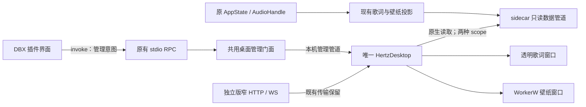

# DBX 接入桌面歌词与壁纸：后续设计

日期：2026-10-27。状态：**设计草案，待实施与验证**。核对基线为 `8e2a760` 与编写时工作树；本次仅补文档，不开放 DBX 桌面入口，不代表宿主兼容性、组件分发或原生验收已通过。

本文承接[共享宿主](./desktop-host.md)、[桌面歌词 L3](./desktop-lyrics.md)与[桌面壁纸的 DBX 扩展](./desktop-wallpaper.md)，只定义 DBX 形态新增的连接、身份、管理与分发契约。窗口、场景、桌面配置提交、预览租约和恢复策略继续以原设计为准；本文的协议与数值是拟议值，实现并验证后才能进入现行 ADR 和 API 清单。

## 1. 目标与范围

用户在 Windows 11 x64 的 Hertz DBX 插件中，能够打开现有「桌面歌词与壁纸」中心，把当前插件实例选作音乐来源，分别启用歌词、壁纸，并在插件重启后恢复同一来源的连接。独立版和 DBX 共用一个 HertzDesktop 进程、一套托盘及配置；不新增播放器或桌面渲染器。

| 范围 | 本期约定 |
| --- | --- |
| 支持形态 | Windows 11 x64 的 Standard / Full DBX 插件；两种发行版共用无账号能力的桌面组件 |
| 歌词 | 复用当前快照、已校准文档和时间插值；包括暂停、缓冲、无词、修订及断连 |
| 壁纸 | 复用宿主返回的合格场景、单目标显示器及真实 64 段频谱；固定 / 跟随选择沿用既有语义 |
| 设置 | 复用原生中心、草稿、revision 冲突、预览租约、定位、穿透与恢复 |
| 生命周期 | 插件停用、崩溃或 DBX 退出后清空歌词与音乐响应；壁纸可继续环境动画 |
| 不在本期 | macOS / Linux / ARM64、Windows 10、多屏同时运行、系统音频采集、外部 MCP、后台播放新策略、房间专用歌词或播放时钟 |

桌面连接不增加页面观众数，不替 DBX UI 维持事件订阅，也不产生播放 / 暂停命令。关闭插件工作台是否销毁 sidecar、是否触发离场调用，必须记录真实宿主行为；不能把独立版 `/ws` 的三秒离场暂停直接宣称为 DBX 已有保证。音频仍由原播放与房间 owner 决定，桌面只呈现得到的事实。

## 2. 当前缺口与方案选择

### 2.1 已核实的实现

| 事实 | 源码依据 | 需要补什么 |
| --- | --- | --- |
| sidecar 只启动 stdio RPC，启动时传入空的桌面窄凭据；没有本机 HTTP 服务 | `plugin/backend/src/main.rs::boot_plugin/main` | 给原生桌面组件提供独立于 DBX stdio 的只读数据入口 |
| 桌面两个 feed 依赖 `vmusicd.json`、窄凭据与回环 HTTP / WS | `crates/hertz-desktop/src/bridge.rs`、`feed.rs`、`wallpaper_feed.rs` | 在原生读取层识别来源传输，复用同一数据校验与呈现逻辑 |
| 桌面 launch / control 在 HTTP 路由中，RPC 路由未映射 | `crates/hertz-studio/src/routes.rs`、`src/rpc/mod.rs` | 提取共用桌面管理业务入口，并明确 DBX 启动组件的位置 |
| DBX 下主动隐藏桌面入口 | `plugin/ui/app.js` 的桌面设置初始化 | 改成能力判断与可操作的缺失 / 不兼容状态 |
| profile 目前只有 `dataDir`、`edition`，配置为 schema v2 | `crates/hertz-desktop/src/config.rs` | 显式区分独立版与 DBX，避免用目录或端口猜传输 |
| `.dbxp` 打包仅包含插件 sidecar、assets、ui | `plugin/dbx-plugin.toml`、`scripts/prepare-edition.js` | 定义配套桌面产物、安装位置、版本检查和升级路径 |

### 2.2 三条可选路径

| 路线 | 收益 | 代价与边界 | 结论 |
| --- | --- | --- | --- |
| A. sidecar 增加仅回环的窄 HTTP / WS 服务 | 桌面现有客户端改动较少 | 插件新增网络监听与端口、凭据和路由生命周期；需修改当前市场披露，不能挂出完整管理 router | 可行备选，本期不采用 |
| **B. sidecar 提供本机只读命名管道，原生 feed 适配** | 保持插件无网络监听；与 Windows 桌面支持范围一致；不依赖工作台常驻 | 需要实现并验证有界管道协议、身份检查与取消 | **推荐路径** |
| C. 插件网页经 `invoke/onEvent` 转发给桌面窗口 | 可使用现有 UI 事件 | 网页生命周期变成数据链必要条件；凭据和同步工作进入沙箱，易形成第二套缓存与重连 | 不采用 |

推荐 B 的依据是「桌面能读取当前插件的真实数据」只需要本机只读连接。DBX 浮动胶囊不具备现成的 WorkerW 挂载和透明穿透契约，也不能据其可拖动就替代 HertzDesktop。新适配只负责字节与连接；歌词解析、播放代际、频谱和配置均保留原 owner。

若真实 DBX 的进程隔离或发布规则禁止命名管道 / 启动外部配套组件，停止 B 的交付，携证据重审 A；不在运行期静默切换传输或自动启动独立播放器。

## 3. 所有权与数据流



| 层 | 唯一职责 | 禁止新增的归属 |
| --- | --- | --- |
| 原服务业务 | 构造歌词 snapshot / document、壁纸 snapshot，管理播放与缓存 | 桌面专用播放队列、第二个 FFT、从窗口反推播放状态 |
| sidecar 数据桥 | 管道、发现记录、scope 鉴权、连接额度和 shutdown | 复制歌词正文缓存、订阅完整业务事件再落第二份状态 |
| 共用管理门面 | capability、配套组件定位、launch、有限命令转发 | 写桌面配置、替用户切源、通用执行路径 |
| HertzDesktop 原生层 | 选择传输、认证来源、取消旧工作、向页面提供校验后的数据 | 向 WebView JS 提供钥匙、管道句柄或任意文件访问 |
| HertzDesktop `config.rs` | 两种来源的样式 / enabled / activeProfile、revision 和自启 | 插件另存一份桌面启用配置 |

实施时，建议在服务 crate 提取 `desktop` 管理模块和 Windows 专用 `desktop_bridge` 模块；`routes.rs`、`rpc`、`plugin/backend` 仅适配调用。桌面侧在 `bridge.rs` 下按 HTTP / pipe 分发，`feed.rs` 与 `wallpaper_feed.rs` 保留各自同步语义。模块名是落点建议，不要求预建通用插件传输框架。

## 4. 来源身份、发现与配置迁移

### 4.1 持久身份与运行身份分开

拟将配置升级为 **schema v3**，profile 使用明确的来源类型。DBX 示例：

```json
{
  "kind": "dbx",
  "edition": "standard",
  "dataDir": "C:\\profiles\\dbx-standard",
  "pluginId": "io.github.oncemisery.hertz-studio"
}
```

示例目录只表示 sidecar 实际解析后的目录；必须从 `resolve_data_dir()` 与 `absolute_data_dir()` 的结果生成，不拼接假定的 DBX 安装路径。Full 的 ID 为 `io.github.oncemisery.hertz-studio.full`，不得与 Standard 混用。

- 独立版 profile 为 `{kind:"standalone", edition, dataDir}`；DBX profile 额外要求合法 `pluginId` 与发行版匹配。
- profile 等价关系为来源类型、发行版、按既有 Windows 规则规范化的数据目录以及 DBX 插件 ID 均一致。session、端口、PID、管道名和版本均不属于持久身份。
- `custom` 等现有独立版发行版标记仍按原规则迁移，不变成绕过 DBX ID 校验的入口。
- 同一用户仍只允许一个桌面宿主与一个 activeProfile，歌词和壁纸同时跟随这个来源；第二个实例只能提供候选，不能抢绑。

迁移时把 schema v1 / v2 的所有旧 profile 显式标记为 `standalone`，完整保留域、revision 与偏好。不根据目录名含有 `dbx` 猜测其类型。成功原子保存后 revision 增加一次；失败保留原文件且不启用新功能。继续执行 64 KiB / 8 个 profile 上限。

旧宿主遇到 v3 应拒绝改写。升级前正常退出旧宿主并保留迁移前备份；若要降级，只能显式恢复备份，且会失去之后的配置修改。不要求旧宿主读懂新来源，也不为 DBX 写一份 v2 影子配置。

### 4.2 DBX 专用发现记录

DBX 在自己的实际 DataDir 发布 `desktop-source.json`；**不伪造带端口的 `vmusicd.json`**。独立版继续使用已有发现方式。拟议记录：

```json
{
  "discoveryProtocol": 1,
  "source": {
    "kind": "dbx",
    "edition": "standard",
    "dataDir": "C:\\profiles\\dbx-standard",
    "pluginId": "io.github.oncemisery.hertz-studio"
  },
  "serverInstanceId": "9a994748-b53b-4a2e-8347-4e1f754cb533",
  "pid": 1234,
  "windowsSessionId": 1,
  "buildId": "8e2a76026be2be696b4a8e994401dac32cf7687c",
  "bridgeProtocol": 1,
  "desktopLyricsProtocol": 1,
  "wallpaperProtocol": 1,
  "pipes": {
    "lyrics": "\\\\.\\pipe\\hertz-desktop-data-example-lyrics",
    "wallpaper": "\\\\.\\pipe\\hertz-desktop-data-example-wallpaper"
  }
}
```

真实记录的 `source` 必须与选中 profile 完全一致。示例用核对基线的完整提交标识演示 `buildId` 字段，不代表该提交已经具备桥能力；实际标识还须绑定构建资源输入，不能只靠 Git 版本判断兼容。

发布顺序为：拿到该 DataDir 的单实例所有权 → 准备有效窄凭据 → 成功建立 listener → 原子替换发现记录。一个 profile 同时只能有一个 sidecar 发布者；现有启动若没有这层保证，需要先补锁并测试。发生冲突明确失败，不能覆盖别的活实例的发现文件。

记录最多 64 KiB，读入、JSON 解析与路径校验前都要有界。管道名从当前用户、Windows 会话、profile 摘要、随机 server session 与 scope 生成，不把目录或凭据直接放进名字。数据 listener 显式限制为当前用户 SID，并拒绝远程客户端；服务端检查真实客户端的用户与交互会话。原生端校验本机管道命名空间、当前用户 / 会话，以及实际管道服务端 PID 与发现记录的对应关系；PID 只是运行期交叉检查，不代替 profile 或 session。不把现有管理管道的默认安全描述符当成新数据管道已验证的 ACL 证据。

配置不保存管道名、PID、session 或钥匙。断连后仅重读选中 profile 的记录，以新握手确认新 session；不扫描端口、插件目录或其他用户数据。退出时先停止接收、关闭现存连接，再仅清理仍属于自己的 session 的发现记录，避免旧进程误删新记录。崩溃遗留文件不视为在线证据。

## 5. 数据管道协议与资源边界

### 5.1 权限与启用

管理管道继续由 HertzDesktop 持有；新增数据管道由 sidecar 持有，二者不复用。歌词、壁纸各有一个 listener，只接受对应 scope 的只读请求。

首次用户执行「连接桌面组件」时，sidecar 在自身 DataDir 建立独立 `desktop-lyrics-key`、`wallpaper-key`。浏览 capability、进入普通播放器或仅探测组件不创建凭据、不启动桌面窗口。钥匙仅供原生层使用；不经 `invoke` 结果、页面消息、URL、进程参数或日志传出。

已存在的有效钥匙表示用户曾允许桌面读取该 scope；后续 sidecar 启动可恢复对应 listener 和发现记录，不必等待工作台再次打开。这个授权只决定数据可读性，不表示歌词 / 壁纸 enabled；后者仅存于 HertzDesktop 配置。一个 scope 的钥匙不允许读另一个 scope。

DBX 设置提供「撤销桌面连接」：删掉本插件的两把钥匙、停止 listener、关闭已建立连接并撤下本 session 的发现记录。再次连接必须是用户显式操作。不删除宿主样式，也不停止绑定其他来源的窗口。坏钥匙明确报错，不在后台自动重新授权。当前用户下仅有本地文件权限的恶意进程仍不在此隔离承诺内。

### 5.2 请求与应答

每个请求使用独立的短连接，采用 **4 字节无符号小端长度 + UTF-8 JSON**，不借用 DBX 的 stdin / stdout。拟议歌词快照请求：

```json
{
  "bridgeProtocol": 1,
  "requestId": "18",
  "serverInstanceId": "9a994748-b53b-4a2e-8347-4e1f754cb533",
  "scope": "lyrics",
  "key": "<仅原生层持有的窄凭据>",
  "op": "snapshot",
  "params": {}
}
```

应答固定为 `{bridgeProtocol, requestId, serverInstanceId, status, body}`；`status/body` 沿用现有 API 错误信封，正常 body 直接使用既有投影结果，不再 JSON 字符串化或复制正文。允许的方法只有：

| 管道 scope | op | 参数 | 业务 owner |
| --- | --- | --- | --- |
| lyrics | `snapshot` | 空对象 | `desktop_lyrics::snapshot` |
| lyrics | `document` | `{key: documentKey}` | `desktop_lyrics::document` |
| wallpaper | `snapshot` | 空对象 | `wallpaper::snapshot` |

每次请求必须先检查 envelope、session、scope 与钥匙，再进入业务投影；复核钥匙仍存在且与当前授权一致，删除或轮换后旧钥匙立即失效。歌词文档沿用过期 documentKey 返回 409、2 MiB 上限、取词不阻塞快照和偏移只应用一次的规则。快照仍包含数据协议版本与 `server.session`，必须与外层 session 一致；source 身份由已验证的发现记录与真实管道对端绑定，不能只看曲名判断来源。

桥协议、歌词协议、壁纸协议和桌面管理协议独立协商。未知 op / 字段 / 协议明确拒绝；不提供任意 HTTP path、RPC method、文件路径、播放或设置写接口。权限失败不返回歌词或当前曲目信息。

### 5.3 首版同步选择与数值

DBX 桥协议 v1 明确只提供请求 / 应答：歌词最多 2 Hz，壁纸最多 4 Hz，文档仅在 documentKey 变化时请求。壁纸仍使用原频谱新鲜度与衰减、原页面视觉时钟，不通过提高 IPC 频率代替插值。独立版继续使用现有 WS / HTTP；DBX 不先尝试 WS 再等失败，也不新增一条旁路事件总线。后续只有实测证明快照方式不足时才单独设计事件版本。

| 拟议边界 | 数值 | 行为 |
| --- | --- | --- |
| 请求帧最大 JSON 字节 | 8192 | 读长度后、分配正文前检查；不接受部分 JSON |
| 应答帧最大 JSON 字节 | 4194304 | 包含信封；超限用完整错误替换，不截断歌词 |
| 连接期限 | 1000 ms | 无 listener / pipe busy 时有界返回 |
| 建连成功后单请求总期限 | 2000 ms | 覆盖鉴权、业务等待、读写与 flush；不是每阶段各等两秒 |
| sidecar 同时处理的连接 | 每 scope 2 个，全局 4 个 | 不排等待队列；超额拒绝连接，不为每次过载另起任务 |
| 单个 feed 未完成请求 | 1 个 | 上一请求未完成不叠加下一拍 |
| 无成功快照时的来源失效阈值 | 3000 ms | 不再外推歌词位置，清空歌词与音乐响应；显示等待来源 |
| 失败重连间隔 | 1、2、4、8、16、30 s，之后 30 s | 可取消；成功后复位；用户重试可触发一次即时尝试 |

期限使用单调时钟。传输 deadline 到达时必须取消底层 I/O、关闭句柄；不能只让调用方超时、后台阻塞读写继续占槽。并发额度一直持有到工作和资源回收实际结束；数据桥退出不等待无期限的慢读客户端。输入长度、输出序列化和慢读测试必须在接入业务前完成。

三秒新鲜度检测由宿主定时器独立执行，不等待请求结束或下一轮重连。两个 scope 分别记录最后成功快照：歌词失效清空歌词，壁纸失效清零音乐响应；确认整个来源失效或 session 改变时两者一起作废。授权 / 身份失败立即清除对应数据，不继续显示到退避结束。配置中的 enabled 不因这些运行期故障而改变。

## 6. 管理入口与用户流程

### 6.1 能力查询与共用门面

新增逻辑 `GET /v1/desktop/capabilities`，由 HTTP 和 DBX RPC 映射到同一业务门面。拟议最小字段为：`supported`、`reason`、`source`、`transport`、`requiredBuildId`、`component`、`managementProtocol`、`bridgeProtocol`。`component` 区分 `missing / incompatible / ready`，可包含版本和构建标识；不返回钥匙或管道地址。

`supported` 表示该平台与运行形态实现了桌面适配；组件缺失仍可展示安装入口，不能因此隐藏整个功能。未实现的旧后端、非支持平台以及组件不兼容分别显示原因。读取失败显示「暂时无法确认」，不伪装成未安装。

新增逻辑 `POST /v1/desktop/connect` 和 `POST /v1/desktop/disconnect`：前者表示本插件允许桌面读取并请求打开原生中心，后者撤销本插件数据授权。本期仅通过 DBX RPC 暴露这两个动作，方法名去掉前导斜杠、信封携带 `op:POST`；不管理独立版的钥匙。路径是拟议合同，尚不加入生成的 REST 清单。已有 `desktop/lyrics/launch`、`desktop/wallpaper/launch`、`desktop/control` 的业务提取到共用门面；旧入口保留原用途，DBX 连接流程统一走 connect，不在前端拼两套启动逻辑。

connect 顺序：检查能力，优先验证已运行宿主，没有兼容宿主时再定位配套组件 → 创建 / 验证授权及 listener → 发布发现记录 → 打开现有宿主或启动已验证组件 → 传入本插件 profile 候选并展示设置。失败分阶段返回；若授权已建立但组件启动失败，要明确给出可重试状态与撤销入口，不宣称事务整体回滚。

管理转发继续用命令白名单；不增加 `exec`、任意可执行路径、通用读文件或强杀进程命令。`status` 增补管理协议能力与构建信息，支持 DBX profile 的拟议管理版本为 2。新客户端面对缺少能力字段的旧宿主不提交 DBX profile。旧客户端的无目标命令仅在 activeProfile 为独立版时维持兼容；宿主绑定 DBX 时拒绝旧式窗口 / 配置变更，只允许查询或打开中心，防止绕过目标校验。

### 6.2 用户可见流程

1. Windows DBX 插件设置中显示「桌面歌词与壁纸」。组件未装时解释其用途，提供配套发布页和「重新检测」；不自动下载或安装。
2. 点击「连接桌面组件」，明确授权本插件向原生组件提供歌词和音乐响应数据，随后打开现有中心。仅连接、打开设置不启用歌词或壁纸；首次进入的新 DBX profile 两项 enabled 均为 false，样式用宿主默认值，不改写旧 profile 的已保存偏好。
3. 中心显示「DBX · Standard / Full」及可区分实例的来源名称；详细目录仅放诊断。已有其他 activeProfile 时把当前插件加入候选，用户显式选择，按原草稿与 revision 规则提交；不因调用方变化自动切源。
4. 用户分别启用歌词或壁纸并应用。分别显示「设置已保存」「等待插件」「正在运行」等事实。另一项停用不影响当前项。
5. 点击解锁定位、显示或隐藏时，必须确认当前活动来源。插件 A 对绑定 B 的宿主，只能打开中心并提示选择 A；不能直接改动 B 的窗口。

配置变更继续使用 `expectedRevision`。拟议管理 v2 对作用于窗口 / 配置的命令增加目标 profile 校验，提供只读查询和打开中心不要求改绑；目标不匹配返回 `desktop_source_mismatch`。显示 / 隐藏采用明确目标命令；`wallpaper-toggle` 只保留旧调用兼容，新流程不自动重放 toggle。

v2 管理信封保留现有 `command/value`，增加 `managementProtocol:2`、`requestId` 与 `targetProfile`；涉及配置的 `value` 继续带 `expectedRevision`。共用门面从本服务真实身份构造 target，不接受网页冒充另一个 profile；原生中心自行切源仍经过唯一宿主的 revision 提交。管理管道保持原有 8 KiB 上限，不走上节数据帧协议，也不承载完整歌词。

launch 应答必须区分 `launchRequested`、`managementReady`、`sourceConnected`，打开窗口成功不等于数据已认证。同一 sidecar 合并并发 connect；已有启动进程存活但未 ready 时不再次 spawn。等待宿主 ready 采用最多五秒的有界查询，每次查询须服从剩余总期限；超时返回结果待确认，先查询状态再决定是否重试。沿用 requestId 关联，配置提交仍靠 revision 防止重复写入，不承诺通用跨进程 exactly-once。

### 6.3 拟议错误码

| 错误码 | 用户可采取的动作 |
| --- | --- |
| `desktop_platform_unsupported` | 使用受支持的 Windows 11 x64 环境 |
| `desktop_component_missing` | 安装对应构建的桌面组件，然后重新检测 |
| `desktop_component_incompatible` | 正常退出旧组件，换用匹配组件；不覆盖正在运行的进程 |
| `desktop_source_mismatch` | 在中心确认并切换音乐来源 |
| `desktop_source_conflict` | 关闭同 DataDir 的重复 sidecar，再连接 |
| `desktop_bridge_unauthorized` | 检查是否已撤销授权，显式重新连接 |
| `desktop_bridge_protocol_mismatch` | 更新匹配插件与组件，不切回其他来源 |
| `desktop_bridge_unavailable` | 启动 / 启用插件后重试；保留已保存配置 |
| `desktop_result_unknown` | 查询实际状态，确认后再操作 |

畸形帧、未知字段、过载及业务 documentKey 冲突分别按协议错误、忙、现有业务冲突处理，不全部翻译成「组件未安装」。

## 7. 退出、重启、切源与自启

| 事件 | 必须呈现的结果 | 所有权限制 |
| --- | --- | --- |
| 关闭 DBX 工作台，sidecar 仍在 | 桌面继续读原播放真值；若原播放 owner 暂停则歌词冻结 | 不虚构页面观众，不自行续播 |
| 插件停用、sidecar EOF / 崩溃、DBX 退出 | 确认断开或三秒无有效快照后清空歌词和音乐数据；壁纸进入环境动画 | 不清掉 enabled 偏好；不停止另一来源 |
| 同一插件重新启动 | 只读选中 DataDir 的新记录，认证新 session，拉完整快照及新 documentKey 后恢复 | 清旧 seq / generation / 文档锚；不接受旧在途结果 |
| Standard / Full 或独立版 / DBX 切换 | 原子提交 activeProfile 后递增绑定代际、取消旧请求、换上目标域 | 不复制另一来源的 enabled，不把端口重用当同源 |
| 用户退出桌面功能 | 按现有规则停对应窗口与 feed；两项及设置均关闭可退出宿主 | 不退出 DBX、不停播放器、不撤销插件数据授权 |
| 用户撤销 DBX 桌面连接 | 立即关闭该插件数据通道；宿主显示已断连 | 不自动重建钥匙，不删除宿主配置 |
| 用户登出 / 进入另一 Windows 会话 | 遵守现有会话与单实例限制 | 不跨会话重绑或操作窗口 |

HertzDesktop 的全局自启仍只有一个入口。活动来源是 DBX 而 DBX 未运行时，可恢复已启用的环境壁纸，歌词等待；不自动启动 DBX、插件或独立播放器。DBX 后来启动且仍有有效授权时，通过同一 profile 的发现记录恢复连接。恢复源连接不隐式恢复音乐播放。

房间模式只消费现有桌面投影。如果原投影没有某种房间歌词或时钟，显示真实空态，不能借 DBX 接入增加第二条房间数据 owner 或声学同步承诺。

## 8. 组件分发、版本与升级

首版采用**显式安装的配套 Windows 组件包**，不把第二个 exe 塞进所有平台 `.dbxp`。理由是桌面本来就是可选组件，且当前固定版 DBX 打包器与市场对辅助 exe 的布局 / 更新行为尚未验证。`.dbxp` 的跨平台矩阵继续保留。

- 产物拟为 `hertz-desktop-<version>-windows-x64.zip`，含 `hertz-desktop.exe`、`desktop-component.json`、许可证与安装说明；不含账号、插件数据或钥匙。JSON 记录目标平台、完整 buildId、文件 SHA-256、管理 / 数据协议版本。
- DBX 配套安装位置固定为 `%LOCALAPPDATA%/Hertz/Desktop/bin/`，配置仍在已有 `Desktop/config.json`。首次由用户按说明解压到该目录；sidecar 只查这个固定位置，不扫描 PATH、不从网页接收任意执行路径。独立版保留当前相邻组件定位规则。
- 构建时由同一来源提交与资源输入产生 buildId，供 sidecar、组件和其内嵌资源报告。Standard / Full 侧使用同一桌面资源构建；仅版本号相同不足以证明匹配。首版要求同 buildId、受支持协议及目标平台，不承诺跨提交兼容。
- 启动前检查清单与文件哈希；实际组件的 `--describe` / 管理 status 握手还须报告自身编译标识与协议。`--describe` 最多输出 64 KiB、两秒内退出，不创建窗口、不改配置；超限或超时均判为无法确认兼容。清单不能单独证明程序兼容；哈希用于完整性检查，不替代发布来源和市场签名。
- 已运行的全局宿主优先复用；不兼容时提示用户从托盘正常退出并升级，不启动第二套争抢配置，也不覆盖运行中的 exe。退出并备份配置后更新配套目录，验证成功再启动；失败保留旧包与备份，由用户显式恢复。
- 一个宿主无法同时为两个不兼容 build 提供服务。双发行版候选需来自同一兼容构建；版本不同可正常使用基础播放器，桌面中心明确说明需要升级哪一端。
- 自启记录始终指向经确认的组件路径；独立版相邻路径与 DBX 固定目录竞争时不悄悄改自启路径，由用户在中心确认修复。卸载插件不自动删除共用组件、另一来源的配置或自启项。

发布工作需同时覆盖 `release.yml`、`plugin-release.yml` 与现有打包脚本：生成配套 zip 和可验证清单，将准确的组件获取方式写进候选说明，按市场不可变版本规则发布。不得在已发布候选上原地补 exe。市场材料需披露「Windows 可选桌面组件 + 本机只读命名管道」，保留「没有网络监听口」的准确表述；目前文档仍只描述现行插件能力。

DBX 最低版本目前为 `>=0.6.35`。本设计不据此声称桌面适配已兼容该版本：必须实测最低声明版本与当前候选宿主；若需要更高版本，由能力与验证证据共同确定，再更新 manifest / 市场材料。

## 9. 实施阶段与退出条件

| 阶段 | 交付 | 退出条件 |
| --- | --- | --- |
| D0：宿主与传输验证 | 真实 DBX 下当前用户管道、辅助组件启动、停用 / EOF / 崩溃 / 重启报告；配套 zip 和构建身份试产物 | 最低宿主版本、发布规则、会话 ACL、I/O 可取消及发现所有权有证据；不通过则重审路线 |
| D1：数据接入 | sidecar 有界只读桥；schema v3 迁移；HTTP / pipe 分发；歌词和壁纸真实投影 | 身份、权限、时钟、旧结果失效与退出资源验收通过；仍可关闭 UI 入口联调 |
| D2：管理与产品闭环 | 共用管理门面、capability、组件检测、连接 / 撤销、目标 profile 校验、DBX UI 入口 | 缺组件、升级、来源冲突、待确认结果、自启等待与设置草稿均可走通 |
| D3：候选发布 | 同构建 Standard / Full 配套产物、签名候选说明、真实 DBX 和原生资源报告 | 下表必需项及桌面 L1-C / W1-C 对应项通过，才可声明 DBX 支持 |

D0 不依赖先完成所有桌面长稳；D3 必须继承现有原生验收要求。已有独立版 WorkerW / 透明窗口证据可复用其平台结论，不能替代 DBX 生命周期、来源隔离和实际安装升级的验证。实施顺序不等于发布日期承诺。

## 10. 验收矩阵

| 编号 | 场景 | 通过依据 |
| --- | --- | --- |
| D-A01 | Standard / Full DBX 各播本地曲；Full 再覆盖已有在线取词 | 歌词 snapshot / document 与原投影一致；偏移只应用一次，当前发行版能力不扩张 |
| D-A02 | 暂停、seek、快切歌、缓冲、同曲歌词修订与无词 | 真值一致；文档不串曲；旧 key 冲突后重新读快照 |
| D-A03 | 壁纸音乐响应、暂停和频谱过期 | 真 64 段输入；无新增 FFT；过期不重复播放旧峰值 |
| D-A04 | 同时运行独立 Standard、DBX Standard、DBX Full；另测自定义 DataDir | 明确切源；两 surface 同源；旧异步结果无法覆盖新绑定 |
| D-A05 | 新 DBX profile、v1 / v2 迁移、超限、坏文件、写盘失败、旧宿主降级 | 旧域完整保留；新 DBX 两项默认关闭；拒写未来 schema；不静默覆盖 |
| D-A06 | scope 互用、错误钥匙、撤销后旧连接、session 不符、远程 / 跨用户 / 跨会话访问 | 全部拒绝；零业务数据泄漏；撤销后不后台重新授权 |
| D-A07 | 超长前缀、半帧、非法 UTF-8 / JSON、慢读、慢写、超额并发 | 解码前限长；内存 / 任务有界；deadline 后句柄和额度实际回收 |
| D-A08 | sidecar kill、stdin EOF、DBX 退出、重启及旧实例迟到清理 | 三秒内不再显示过时音乐数据；新 session 恢复；旧实例不删新发现记录 |
| D-A09 | 工作台关闭 / 重开、主窗口最小化、浮动胶囊与插件停用 | 记录实际音频生命周期；桌面读取不改变观众数 / 播放意图；无网页转发依赖 |
| D-A10 | 未装组件、错误 build、运行中的旧宿主、连续点击连接、响应丢失 | 单宿主；不重复 spawn / 自动 toggle；结果可查询，错误可行动 |
| D-A11 | 自启早于 DBX、DBX 数据目录移动、插件升级 / 卸载、不同 build 并存 | 等待正确来源；不扫描或启动另一播放器；不误删共用配置 |
| D-A12 | 正式 zip 安装、升级失败恢复、Standard / Full 配套候选 | 校验真实下载产物的清单、hash、build / 协议握手和市场说明 |
| D-A13 | Windows 原生歌词穿透 / 找回、WorkerW 重建、显示器变化、锁屏与八小时运行 | 真实 DBX + 配套组件进程树报告；保持原桌面资源预算，退出无专属进程残留 |
| D-A14 | macOS / Linux / ARM64 以及无新 capability 的旧后端 | 基础插件正常；不提供不可用启用动作；给出准确平台 / 版本说明 |
| D-A15 | 独立版原 HTTP / WS、原桌面管理、原 DBX stdio 请求 / 事件与房间播放 | 原合同回归通过；新增数据不污染 stdout，不改变房间音频归属 |

验证分三层：Rust 协议与配置检查、真实 sidecar / DBX 沙箱界面流程、真实 Windows 原生与发布产物验收。浏览器 fixture 只能证明 UI；stdio 冒烟只能证明插件协议，均不能代替命名管道 ACL、辅助进程启动、声学听测与资源回收。

## 11. 决策审查与后续文档同步

| 审查项 | 结果 |
| --- | --- |
| First Principle | 桌面消费选中 DBX 实例的真实歌词、进度和频谱，保持用户可控制、可恢复 |
| Non-negotiables | 一套桌面配置与播放真值；来源 / scope / 会话隔离；无网络监听；基础插件不依赖组件 |
| Assumptions to Drop | 「去掉 isDbx 判断就能用」「必须把 exe 塞进插件」「关工作台必然等于独立版离页」均无依据 |
| Smallest Sufficient Path | Windows 原生窄管道 + 既有 DTO / feed / 中心；显式安装同构建组件 |
| Owner / retirement | 新增传输 owner 仅管理 I/O；复用原业务与配置 owner；入口发布后以 capability 替换静态 isDbx 隐藏；D0 探针并入生产测试或删除 |
| Dependency-removal test | 关闭插件网页后，只要原 sidecar 仍运行，数据桥可独立取数；移除组件后基础插件仍正常 |
| Counterexamples | 双发行版并存、同目录重复 sidecar、旧 session 迟到、撤销后重连、两个 build 竞争均必须可判定 |
| Must fail / degrade | 错身份与越权必须失败；断源保留环境壁纸并清空音乐数据；不静默改用其他播放器 |
| Verdict / blocking gaps | 推荐 B 进入 D0；辅助进程权限、实际 DBX 生命周期、I/O 取消、配套发布能力尚待证据，未形成已接受 ADR |

基线检查结论：已读的桌面所有权与当前源码一致；缺少 DBX 接入是明确范围缺口，不能通过文档宣称已补实现。与当前需求无关的工作树改动不纳入本设计。

| 工作草案 | 本次内容 |
| --- | --- |
| TaskIntentDraft | 补齐 DBX 桌面后续设计，使下一轮可据此分阶段实施；成功证据为来源、传输、管理、分发与验收可追溯；本次止于文档 |
| BaselineReadSetHint | `desktop-host.md`、`desktop-lyrics.md`、`desktop-wallpaper.md`、桌面原生验证计划、`dbx-store-submission.md`、ADR-0003 / 0006 / 0009；sidecar 启动、RPC、HTTP 桌面路由、原生 bridge / feed / config / pipe、manifest 与发布脚本 |
| ImpactStatementDraft | 未来影响 DBX sidecar、共用桌面门面、来源 schema、原生读取与组件分发；不改变原播放 / 账号 / 曲库、房间输出、桌面场景与配置唯一归属 |
| ADR signals | 持久来源类型、数据传输协议、scope 生命周期、并发 / 时限、组件产物与 build 兼容规则；验证后再将实际常量与禁止回退同步至现行 ADR |
| Decision Needed | 评审推荐 B 及独立配套组件分发后进入 D0；若证据否定路线，回到本页修改选择，不通过运行期 fallback 绕过 |

实施完成后同步本文状态、共享宿主的发现 / 权限 / 部署章节、歌词 L3 与壁纸 DBX 范围、README 能力表、生成的 API 清单、插件 manifest / 市场材料和现行 ADR。正式发布前不能把本文的拟议字段登记成当前能力，也不能把尚未通过的 D3 标为完成。
