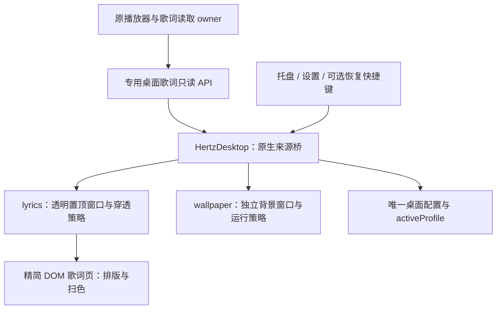

# Hertz 桌面歌词：产品与技术设计

2026-10-27 后续设计：L3 的 DBX 分支现见 [DBX 桌面接入方案](./desktop-dbx.md)，涵盖共用宿主、只读数据通道、来源身份和配套分发；尚未实施，不表示 DBX 已支持桌面歌词。其他平台与系统媒体来源仍属独立后续范围。

2026-10-27 UI 更新：播放器设置中的「歌词样式与布局」与托盘「桌面歌词与壁纸」进入同一原生中心。单行、双行、翻译预设包含实际字号、颜色、描边和不透明度；修改后识别为自定义。深浅预览仅使用样例，不提前改变桌面效果，点击「应用设置」才提交。

歌词窗口自身的工具条改为悬停显示、指针离开后收起；「样式」面板落在歌词下方，窗口按面板高度向下长高，歌词区域不缩放。面板内可改布局、次行、字号、已唱/未唱颜色、不透明度与窗口宽度，全部即时生效，再点「完成」收起。面板高度是会话内状态，不写入配置。

「调整桌面位置」进入临时编辑事务：真实窗口显示并解锁，支持工作区内 16 DIP 安全边界和边缘吸附。完成保存位置，取消或关闭中心恢复进入前的位置、启用、隐藏与锁定状态；位置编辑与样式草稿不能同时提交。锁定穿透后仍可从托盘进入中心找回。自动化原生验证已覆盖真实 Win32 移动与回滚，物理断屏等待验项目见[落地记录](plans/2026-10-27-ui-productization-delivery.md)。

日期：2026-10-22。状态：L1 首版已实现（服务端只读桥、Windows 宿主、播放器启动/解锁定位入口、本机管理通道与共享宿主的来源切换）；L1-C 发布验收未完成。本文的窗口与同步契约作为实现基线，未通过项不视为已验收。

核对基线：提交 `9e1bdb6` 与当日工作树。已有 `crates/hertz-studio/Cargo.toml`、`plugin/ui/app.js` 修改属于进行中的工作，本文只读核对，不修改其实现。正式正文随仓库存放于 `docs/desktop-lyrics.md`；本次交付为方案及文档导航。

2026-10-23 设计复核（`2f2765c`）：共享进程、托盘、来源切换、配置提交、自启与版本规则集中到[共享宿主设计](./desktop-host.md)；L0 的步骤与阶段退出见[原生验证计划](./plans/2026-10-23-desktop-native-validation.md)。本页只定义歌词特有行为，状态仍为设计草案。已修正“离页暂停设置”的描述：当前服务采用固定离场暂停策略，尚无对应产品开关。

## 1. 产品目标

**在其他应用上方显示清晰、同步、低干扰的 Hertz 当前歌词。用户可以拖动和调样式，锁定后鼠标完整穿透，并能随时通过托盘找回；关闭播放器网页后，桌面歌词窗口仍可保留。**

首版定位是日常听歌的桌面字幕。它消费 Hertz 的播放和歌词，不负责播放、搜词、识曲或编辑歌曲；歌词是否可用及时间精度仍取决于当前真实文档。

与相关能力的关系：

| 能力 | 窗口与用途 | 归属 |
| --- | --- | --- |
| 桌面歌词 | 普通桌面之上的透明置顶小窗口 | 本方案，独立开关与锁定状态 |
| [桌面壁纸](./desktop-wallpaper.md) | 图标后方的三维背景窗口 | 壁纸方案，独立开关与暂停策略 |
| [OBS 歌词浮层](../plugin/ui/overlay.html) | 供直播软件加载的浏览器源 | 保留现有 URL 与使用方式 |
| 播放器/舞台歌词 | 应用内阅读、歌词定位与视觉演出 | 保留原 Stage 时钟、歌词 owner 与交互 |
| DBX 浮动胶囊 | 宿主提供的小型播放控制窗口 | 保留现有能力，不把它视为已具备透明桌面歌词 |

桌面歌词可以先于桌面壁纸交付，不需要先完成三维背景、WorkerW 挂载或系统音频采集。

## 2. 现状与复用边界

| 源码/文档 | 已有事实 | 复用或补充 |
| --- | --- | --- |
| [歌词模型](../crates/vmusic-core/src/model.rs)、[解析库](../crates/vmusic-lyrics/src/lib.rs) | 行、词、结束时间、译文、罗马音与格式精度；播放快照已有 `generation` | 复用真实时间和播放代际，不按文字数量捏造词时间 |
| [歌词读取与修订](../crates/hertz-studio/src/lyrics.rs)、[导入说明](./lyric-import.md) | 本地 imported > embedded > sidecar；覆盖层持久修订；偏移和结构化导入 | 原服务继续唯一解析和校验，桌面不读音频文件或另建歌词数据库 |
| [浮层数据](../crates/hertz-studio/src/routes.rs) `overlay_lyric_data` | 当前歌曲、位置、整份歌词、词时间、译文/罗马音；呈现偏移已应用 | 可抽取共同的已校准文档构造；桌面增加身份、修订、新鲜度与异步结果校验 |
| [OBS 页面](../plugin/ui/overlay.html) | 500 ms 轮询、本地单调时钟插值、30 fps 染色 | 可复用轻量排版经验；不复制重叠请求、断连后无限外推及仅按曲目缓存 DOM 的行为 |
| [原 Stage](../plugin/ui/stage.js)、[ADR-0006](./adr/0006-frame-gates-and-visual-timing.md) | 播放位置插值、帧门与歌词呈现语义 | 共享纯时间/分频能力；桌面小窗口不加载整个播放器或 Three.js |
| [音频 actor](../crates/vmusic-audio/src/actor.rs) | load/play/pause/stop/seek 推进实际播放快照代际 | 以实际快照代际作失效边界，不新增并行播放 owner |
| [主 WS](../crates/hertz-studio/src/ws.rs) | 播放器订阅与页面观察者/离页策略有关 | 新桌面只读订阅不得冒充播放器页面，不能偷偷改变离页暂停行为 |
| [胶囊说明](./plans/2026-10-17-capsule-performance.md)、[app.js](../plugin/ui/app.js) | DBX 已有浮动 surface 的精简初始化；现有胶囊并不透明 | 不能从胶囊可拖动推断跨进程穿透或透明背景可用 |

尚缺原生透明置顶窗口、锁定/恢复、窗口定位与 DPI 管理、桌面专用只读同步契约，以及真实 Windows 验收。现有 OBS 数据没有完整的桌面来源/歌词修订/缓冲契约，不能原样包装后宣称已满足本方案。

## 3. 首版范围与默认值

本专项使用 **L0–L3** 阶段，独立于现有 R 系列和壁纸 W 系列。

| 项目 | L1 首版约定 |
| --- | --- |
| 平台与形态 | Windows 11 x64、独立播放器 Standard/Full；系统构建由 L0 实测确定 |
| 窗口 | 同一用户/交互会话最多一处歌词窗口；一个绑定来源；透明、无边框、置顶、非激活显示 |
| 布局 | 默认当前行＋下一行；可切单行。次行也可选择译文或罗马音，三者互斥，不堆成四行 |
| 时间精度 | 有真实词时间才逐词/逐字扫色；普通 LRC 整行高亮；混合文档逐行选择 |
| 外观 | 系统字体回退、字号、字重、已唱/未唱颜色、描边或阴影、整体透明度；不支持任意 CSS |
| 初始位置 | 当前播放器所在屏的工作区底部居中；无法确定时用主屏；避让任务栏 |
| 初始状态 | 未锁定，显示拖动柄和工具条；用户确认位置后锁定穿透 |
| 操作 | 拖动、调宽度、设置、锁定、显示/隐藏、解锁并定位、退出歌词 |
| 全屏 | 默认目标屏出现全屏应用时隐藏；首版不提供强制压在独占全屏之上的选项 |
| 安全桌面与会话 | 锁屏、息屏、休眠、会话断开均隐藏停绘，不试图覆盖 UAC 安全桌面 |
| 自启 | 默认关闭；显式开启后只恢复已启用桌面功能，不启动歌曲或完整音乐服务 |
| 暂不提供 | 点击歌词 seek、桌面播控、歌词偏移写入、搜词、封面、系统歌曲识别、第三方主题/脚本 |

样式候选默认值：字号 32 DIP，范围 18–72 DIP；宽度 900 DIP，受目标工作区约束；正文白色、已唱浅青、深色描边。透明度限制为 25%–100%，避免仅因样式参数而找不到窗口。具体视觉值在 L0 通过深浅背景和高 DPI 实测后冻结。

长歌词每个文本槽最多两行视觉折行，超出静态省略；完整内容仍在播放器中可读。首版不滚动跑马灯，不按字体宽度重新生成时间戳。窗口高度由所选模式和字号确定，切句不连续改变窗口位置。

译文、罗马音或下一行不存在时保留必要版面并留空；不把其他歌曲或上一行内容当作补位。合唱/重叠时间暂不做多声部排版，同时间起点按原文档稳定顺序选最后一条非空行，下一行取严格更晚的时间组，并在格式支持范围中说明限制。

## 4. 用户流程与状态

### 4.1 启用与锁定

1. 在“正在播放”更多操作或设置的“桌面歌词”中启用；先检查桌面组件、Runtime、版本和来源绑定。
2. 首次弹出未锁定窗口，工具条提供拖动柄、布局/外观设置、锁定和隐藏。未有歌曲也显示可定位的设置占位。
3. 拖动柄负责移动，边缘调整宽度；歌词文字单击、双击、滚轮均不发播放或 seek 请求。
4. 锁定前确认原生托盘已创建且恢复命令可用；锁定后收起工具条，整个窗口及所有 WebView 子窗口对鼠标穿透。
5. 托盘“解锁并定位歌词”撤销穿透，在当前可用屏安全区显示工具条。即使正文因无词或断连隐藏，也能找回这个设置窗口。

“设为桌面歌词”只启用已选来源的阅读视图，不自动播放、不导入歌词、不开启网络搜词，也不改变主播放器的偏移设置。

### 4.2 托盘与键盘恢复

桌面组件托盘保留“歌词：显示/隐藏”“解锁并定位歌词”“歌词设置”“退出歌词”，与壁纸的开关分别列出。托盘尚未就绪或失效时禁止进入锁定；Explorer 重启导致托盘消失时先隐藏歌词并撤销穿透，待托盘重建后才允许重新锁定。

提供可选的全局“解锁并定位”快捷键，默认不占用全局组合键。注册冲突显示失败并允许更改，不能静默抢占。托盘和播放器设置都是恢复入口，不能把一个可能冲突的快捷键作为唯一入口。

显示和刷新不激活前台窗口；用户主动打开设置或使用恢复命令时才允许进入可操作状态。未锁定窗口内 Esc 取消本次拖动/设置操作，不改变音乐；工具条支持键盘访问和可读控件名。逐字刷新不持续播报 live region。

### 4.3 内容状态

| 输入状态 | 正文与运行行为 |
| --- | --- |
| 有效播放且有歌词 | 按真实位置显示当前行与次行；需要扫色时限帧更新 |
| 暂停 | 冻结当前行和扫色进度，状态由工具条/托盘说明，不让字继续唱 |
| 缓冲/位置不推进 | 冻结位置；不能只看 `playing=true` 就继续预测 |
| 前奏或明确空白区间 | 可显示静态 ♪；不生成倒数或伪造歌词 |
| 无词/尚在加载 | 未锁定显示“暂无歌词/正在读取”；锁定状态隐藏正文，不留空白拦截窗口 |
| 无歌曲（trackId 为空） | 清除旧正文；未锁定显示设置占位，锁定不显示旧歌信息 |
| 换曲 | 接受新快照时立即清除旧词；新文档就绪后显示，不等待旧请求结束 |
| 同曲换词或改偏移 | 文档/呈现修订改变即刷新、重排和重锚，不能只按 trackId 复用旧 DOM |
| 源断连或快照过期 | 停止插值，隐藏正文；托盘显示等待来源，重连先取新快照 |

仅在文档有明确行结束或下一组开始边界时判断时间区间；没有结束边界不能用“已经显示很久”推断进入间奏。已知歌曲时长可作为最后边界，不凭空补出“3 秒唱完”。

现有 Stop 命令保留 trackId，仅将 playing 置 false、位置归零；与“在曲首暂停”无法由当前快照区分。L1 按现有快照显示为曲首冻结/前奏状态，不承诺单独的“停止后清空”。如果需要该产品行为，应由原播放 owner 增加明确传输状态后再接入，歌词桥不按 position=0 猜测。

### 4.4 可见性与生命周期

`enabled`、`userHidden`、`locked` 与运行策略分别建模：退出歌词关闭本功能；隐藏保留功能与来源；锁定只改变交互。用户隐藏是本次会话状态，自启后默认显示已启用歌词；退出歌词则不在下次登录恢复。

有效隐藏原因为集合：用户隐藏、目标屏全屏、锁屏/息屏、会话不可用、无可显示内容、快照无效。解除一个原因不能覆盖其他原因。恢复内容前先取新锚，恢复动画不追赶隐藏期间的时间。

绘制和来源观察分别计算。用户隐藏、全屏或会话不可用可停止轮询，由原生可见性事件恢复；仅因无歌曲、无词、读取中或快照失效而隐藏正文，仍保留有界快照读取/发现退避，才能自动发现下一首、新歌词或服务重连。“解锁并定位”清除 userHidden 并请求新快照，但不清除锁屏等系统原因。

关闭播放器网页不关闭桌面歌词。当前服务在最后页面离场的 3 秒宽限期后复核观众数，取消未完成播放意图并暂停已有播放；桌面订阅不计作播放器页面，因此歌词随后冻结到暂停位置。此处没有可切换的后台播放设置，桌面歌词不承诺关网页后继续听歌。退出歌词不停止音乐，也不退出仍启用的壁纸。关闭源服务后歌词清空并等待，不为恢复歌词而自动拉起服务。共同生命周期见[共享宿主 §2](./desktop-host.md#2-播放生命周期的当前事实)。

首版电池下仍可使用静态/低帧率歌词，电池状态不强制隐藏文字；扫色上限降为 15 fps，其他样式保留。壁纸默认电池暂停的规则不传染给歌词。

## 5. 原生组件与壁纸方案收敛

### 5.1 方案比较

| 方案 | 优点 | 代价与判断 |
| --- | --- | --- |
| **A：统一可选 `hertz-desktop.exe`，WebView2 轻量歌词 surface** | 复用 Web 文本能力；托盘、安装、配置与自启只有一个 owner；两项桌面能力可独立交付 | 推荐，需 L0 证明透明合成与输入穿透 |
| B：单独 `hertz-desktop-lyrics.exe` | 歌词组件完全隔离 | 与拟议壁纸组件重复托盘、来源和自启管理；当前两个功能尚未实现，无需先制造两个 owner |
| C：DirectWrite/Direct2D 原生文字 renderer | 可以减少浏览器运行时依赖 | 需另做文字塑形、排版、扫色与字体回退；仅当 L0 证明 WebView2 无法满足透明/功耗时重审 |

本方案将尚未实施的壁纸提案中的 `hertz-wallpaper.exe` 收敛为 **`hertz-desktop.exe`**，建议源码位于 `crates/hertz-desktop/`。壁纸文档同步记录该设计修订；当前不存在已发布旧组件需要迁移。

这是一个进程入口和桌面管理 owner，内部保留 `lyrics` 与 `wallpaper` 独立窗口/controller、启用状态、策略、预算和错误。歌词不挂 WorkerW；壁纸失败只停用壁纸 surface，不主动关闭歌词。宿主进程崩溃可能同时影响二者，是共享进程的已知限制。

单实例、跨会话冲突及 `activeProfile` 切换统一遵循[共享宿主](./desktop-host.md)。歌词在切换绑定时先清除旧词和时间锚；新来源未就绪时保持等待，不接受旧来源迟到文档。

### 5.2 架构与模块

建议落点如下，均为未来实现路径：

| 模块 | 路径建议 | 归属 |
| --- | --- | --- |
| 宿主公共管理 | `crates/hertz-desktop/src/main.rs`、`config.rs`、`ipc.rs`、`tray.rs` | 单实例、托盘、来源、配置 revision、自启、版本 |
| 原生歌词窗口 | `crates/hertz-desktop/src/lyrics/window.rs`、`policy.rs` | 透明、置顶、锁定/穿透、DPI、全屏、定位与隐藏 |
| 歌词读取桥 | `crates/hertz-desktop/src/lyrics/feed.rs` | 发现端点、窄凭据、非重叠请求、新鲜度与页面消息 |
| 服务呈现快照 | `crates/hertz-studio/src/desktop_lyrics.rs` | 从既有播放/歌词 owner 构建一致、只读的文档与游标 |
| 精简页面 | `plugin/ui/desktop-lyrics.html/.js/.css` | 当前/次行、真实词扫色、可访问工具条；不启动 app.js/Stage 全界面 |
| 共享纯工具 | 按实际复用从现有歌词/帧门提取 | 时间边界、格式校验与调度；不为了文档预建空基础框架 |

优先使用已安装 WebView2 Evergreen Runtime。组件内嵌同版本页面和资源，使用专属当前用户数据目录与受控本地 origin，不依赖 CDN、开发服务器或浏览器标签常驻。歌词页面不加载 Three.js、Pixi、全曲库、账号或推荐模块。

壁纸与歌词可共享受控 environment，但 controller 与窗口分别管理；停止某一功能不得误关另一功能。全部功能与设置关闭后正常释放 environment 并退出所属进程，不批量终止普通浏览器或 DBX 进程。

## 6. 窗口、输入与多屏

| 场景 | 首版规则 |
| --- | --- |
| 锁定 | 原生层整个 HWND/子窗口命中测试穿透；正文不能截获其他进程鼠标。CSS `pointer-events:none` 只解决页面内事件，不构成验收证据 |
| 未锁定 | 工具条、拖动柄、边缘尺寸操作可响应；正文区不发播放动作；透明空白区不应成为大块交互遮罩 |
| 置顶 | 普通窗口之上、非激活显示、不进 Alt+Tab；尊重安全桌面和系统限制，不声称覆盖所有应用 |
| 目标屏全屏 | 隐藏歌词并停止绘制；其他屏全屏不影响；恢复前复核前台窗口及当前歌词锚 |
| 工作区变化 | 使用稳定显示器身份＋DIP 位置/宽度，任务栏、分辨率、缩放变化时重新限位 |
| 跨屏拖动 | 在拖动提交时确定目标屏，按目标 DPI 重排文字；不把物理像素坐标当持久定位 |
| 指定屏断开 | 回收到主屏安全区并标记暂时定位；保留原显示器位置，重连后提示可恢复，不自动突然跳屏 |
| 解锁并定位 | 用户主动恢复到当前可用屏安全区；锁屏/全屏等强制隐藏原因仍存在时排队到可见状态，不强行覆盖 |
| Explorer 重启 | 重建托盘；恢复入口失效期间隐藏正文并退出锁定，避免留下找不回的穿透窗口 |
| WebView/context 故障 | 立即隐藏失效窗口；统一有界恢复，到限后托盘显示失败并允许重试，不留下黑底或透明拦截层 |

位置保存使用目标屏工作区内的归一化锚点与 DIP 尺寸，落地时钳制到可见区域；宽度不大于工作区的 90%，高度不大于 40%。小工作区允许低于常规最小宽度并收起次行，设置中明确当前有效布局。

宿主接收页面发来的窄意图，如开始拖动、锁定和打开设置，不提供任意窗口句柄、文件读取或命令执行接口。更改锁定状态以原生实际生效结果为准，JS 按钮状态不能代替原生穿透状态。

自动恢复沿共享宿主预算：同一 120 秒滚动窗最多 3 次自动尝试，第三次仍失败或下一次将超限即锁定失败；显式用户重试才解锁。各 surface 故障分别记状态，宿主级恢复统一计数，避免嵌套重试扩大额度。

## 7. 只读同步与呈现契约

### 7.1 复用原有时间与修订 owner

`PlayerSnapshot.generation` 是现有实际播放命令/转场的代际，用于识别 load、pause、resume、seek 等时钟不连续；作为不透明十进制字符串传给 JS。它不等于 trackId，也不能只将它解释成 seek 序号。服务层 `play_generation` 另有请求作废语义，不混作歌词时钟。

文档键由当前曲目、歌词内容修订/内容身份、每曲偏移、全局呈现偏移等共同决定。源文件/内嵌歌词变化和相同 trackId 的重新导入必须能使其变化；覆盖层 `lyricsRevision` 不能独自代表所有来源和全局设置。

文件与每曲偏移先合成应用，再应用全局偏移，复用 `apply_presentation_offset` 的饱和顺序。新桌面文档统一使用毫秒，明确 `timing: presentation_applied`；客户端不再对时间加 `offset`。保留修订和来源事实用于诊断，不生成第二套偏移配置。

服务取词可能包含异步 I/O。取词完成后须复核当前 trackId、播放 generation、歌词/呈现修订，再取最新位置快照；不把请求开始前抓到的旧位置绑定给数秒后取得的文档。不匹配则拒绝旧候选并返回当前“读取中/重取”状态，不循环等待所有切歌稳定。

### 7.2 API 草案与权限

以下均为新增提案，不是现有公开接口：

| 入口 | 用途 |
| --- | --- |
| `GET /v1/desktop-lyrics/snapshot` | 小快照：协议/来源/session、递增 seq、generation、曲目、位置/时长、playing/buffering、歌词状态与 documentKey；buffering 从原服务当前状态读取 |
| `GET /v1/desktop-lyrics/document?key=...` | 返回与当前身份匹配的完整已校准文档；过期 key 返回冲突，不返回另一首文档 |
| `/v1/desktop/control/*` | 原应用鉴权的管理门面，转发宿主 IPC；与只读歌词数据权限分开 |

文档 key 是不透明内容标识，不是凭据。认证使用服务数据目录下独立 `desktop-lyrics-key` 的请求头，只允许上述两个只读 GET，不允许主 `/ws`、曲库、设置、播放、模型、OBS 封面或壁纸频谱。原生读取钥匙，内嵌页面只收到无凭据数据。

OBS `overlay-key` 及原 URL 保持用途和兼容，不扩大授权；不让桌面歌词以全权 token 或带秘密的 URL 直接加载播放器网页。共享已校准文档构造可以渐进接入 OBS，但不借本专项改变其接口或风格。

端点仅从当前 `activeProfile` 的有界本机 discovery 读取，支持随机/自定义端口和源服务晚启动。只允许数值 loopback、不跟随重定向；认证快照再核对 edition/profile/session。旧记录、其他来源与旧会话不自动改绑定。原发现记录含全权凭据时只在原生层解析所需字段，不转给页面。

快照读取不增加播放器页面观察者计数，不触发 `depart_pause` 的“还有人在看”语义。不订阅频谱，不调用新的歌词搜索或完整音频读取；当前在线歌词只复用既有服务读取/缓存策略，失败有界，不因轮询重复访问上游。

### 7.3 拉取与文档更新

首版选择原生单飞轮询而非增加专用实时 WS：允许来源观察时，无论播放、暂停还是内容为空，每 500 ms 拉小快照；一次结束后才安排下一次，不使用会重叠的固定 `setInterval`。单个快照读取期限 2 秒，最多一个快照请求与一个按需文档请求并行。暂停时不连续绘制，但仍观察 seek、换曲与恢复播放。

快照为轻量状态，不每 500 ms 重传整首歌词。documentKey 改变时发起一次文档请求；同 key 请求合并。换曲、用户/全屏/会话策略隐藏或新文档作废未完成观察，迟到结果不得覆盖；服务真实工作未结束不提前归还并发许可。读取中造成的正文隐藏不取消所需文档请求。

完整文档最多 2 MiB，行/词/时间范围复用原解析校验上限，正文不包含 HTML 或任意资源 URL；当前页仅保留当前文档，不缓存整张收听历史。超限显示“桌面歌词暂不支持此文档”，不静默截掉时间轴后伪装完整。

服务已校准文档缓存只保留当前有效结果与一个在途候选，复用原解析/网络预算。歌词写入、每曲/全局偏移修改作废对应键；sidecar/内嵌文件变化复用已有曲库通知。缺少通知时在活动歌词期间至多每 2 秒做一次合并的元信息检查，不在音频回调或每帧重新读文件。小快照不等待文件/网络取词：文档未准备好时报告 loading，后台工作完成后发布新 documentKey，客户端仅对 ready 的 key 获取文档。

用户/全屏/会话策略隐藏时停止渲染和轮询，取消本客户端无用观察；原生事件允许观察后先读最新快照，再获取匹配文档。内容为空造成的正文隐藏继续小快照；源不可达时继续按 1/2/4/8/16/30 秒退避重新发现，成功后复位；不自动启动服务。

### 7.4 单调时钟与失效

每个歌词页面只有一个时间插值 owner，使用 `performance.now()`；歌曲位置来自服务，宿主和页面的单调时刻不直接相减。原生消息带“接收后经过的时长/RTT”等相对测量，页面收到后建立自身时间锚。

基本公式为 `position = anchorPosition + elapsed`，仅在有效、未缓冲且确认在推进时预测，并钳制到已知时长。RTT 较大的快照不用于平滑扫色；L1-A 以不超过 250 ms RTT 的本机样本验证接收锚，固定延迟补偿策略在证据明确后冻结，不把客户端 Date 时间当服务器单调时钟。L0 只用合成位置验证原生窗口，不以其结果替代真实服务同步。

预测最多 1 秒；超过停止推进，超过 2 秒没有有效快照则隐藏正文。明确断连/身份错误立即隐藏，不等过期。暂停或缓冲立即冻结；snapshot 直接投影原 `AppState.buffering` 当前真值，桌面无需连主 WS，也不从是否收到事件猜缓冲。

首次接收、generation 变化或缓冲结束后，先按快照位置补帧，再用连续两个同 session/曲目/generation 的快照确认位置正向推进，才启用两锚之间的外推。位置未增加则冻结；下一有效增量恢复。该确认以实际音频位置为准，不用“playing 已过了若干秒”证明声音仍推进。它只控制插值许可，不推迟新快照的选行和重锚。

generation、session、曲目或 documentKey 变化时直接重锚，不用缓动跨越 seek、倒退或歌词修订。相同身份内的小漂移可有限校正，但不跨行延迟显示新行；真实不连续优先于视觉平滑。

文档结果和快照必须属于同 session、曲目、documentKey；文档可跨同曲暂停/seek 复用，但开始显示前再取得最新 generation 锚。每会话 seq 拒绝倒序；重连先清空旧有效性。现有 OBS 的“轮询失败保持旧锚继续走”不进入桌面契约。

### 7.5 文本排版与扫色

按源文档的行/词边界计算进度；一个有效定时词也可扫色，不继承 OBS 少于两个词就退整行的限制。缺词尾时仅可使用下一词起点、明确行尾或已知时长；仍无可靠边界则该词保持整词高亮，不任意补三秒或按字数分摊。

空格、标点、组合字符、emoji 与 CJK 字体回退按原文保留。词与文字不一致或非法范围经服务校验后作逐行降级，不以桌面样式修补数据。页面以文本节点呈现，不执行歌词内容。

只挂载当前与次行的有界 DOM；字体、DPI、模式、文档或尺寸变化时测量，逐帧只改扫色属性，不反复读取布局或重建整首歌词。无词时间时按行边界定时补帧；暂停、纯静态和隐藏状态不运行连续 rAF。

## 8. 配置、生命周期与共存

配置文件、总容量、profile、revision、自启与提交/应用失败语义统一由[共享宿主 §4–7](./desktop-host.md#4-配置提交与实际运行分离)定义。歌词只在当前 profile 的 `lyrics` 域保存下列字段；不在浏览器或播放器数据库保存第二份偏好。

| lyrics 配置 | 约束 |
| --- | --- |
| enabled / locked | 持久功能与交互偏好；首次启用未锁定；恢复前仍验证托盘可用 |
| layout / secondary | 单/双行，次行 next/translation/romanization；值来自固定 schema |
| font / size / weight / colors / outline / opacity | 有界原始值，缺字体走系统回退；不保存 CSS 或脚本 |
| monitor / anchor / width | 稳定屏身份、工作区锚点、DIP 宽度；迁屏时钳制 |
| hideOnFullscreen | 首版默认并固定开启，留明确后续扩展点 |

用户隐藏只影响本次会话，不关闭 enabled 或更改全局自启。退出歌词停止本 surface 并保存 enabled=false；写入失败须显示偏好未保存，不能把临时停止报告成永久退出。退出歌词不关闭仍启用的壁纸。

歌词数据协议不兼容时清空来源内容并提示升级，不用旧歌词冒充同步。L1 不因壁纸尚未通过 W0 而被禁用；启动与恢复均先确认托盘可用，再恢复锁定偏好。

Standard/Full 共用桌面组件和歌词实现，服务仍按发行版裁剪来源；桌面组件不重新编译在线歌词协议。DBX 首版不提供启用入口，后续仅在宿主透明窗口、外部组件启动/分发与 sidecar 只读桥有证据时接入，不让普通 HTTP discovery 假装插件连接。

## 9. 性能与原生风险

默认扫色上限 30 fps，电池或减少动态效果时上限 15 fps；整数分频按实际刷新率求有效预算。整行歌词只在位置跨边界或状态变动时更新；减少动态效果取消滑入/缩放，保留必要读词进度。

同进程桌面预算分域统计：歌词最多一个活动窗口/controller，设置使用[共享宿主的唯一预览租约](./desktop-host.md#5-管理协议与恢复)，不能两个设置入口各建一份。歌词不创建 WebGL renderer。关闭窗口后释放文档、DOM、监听器、计时器、网络请求与 controller。

CPU、提交内存、GPU与电量影响统计宿主和专属 WebView 进程树；WebView 共享进程时同时给出整个组件及 surface 工作计数，不用单页 JS 时间冒充整机开销。只有全部 surface/controller 关闭后才验收整个 environment 退出。

关键风险依次为透明合成黑底、WebView 子窗口拦截鼠标、锁定后失去恢复入口、非激活显示失效、混合 DPI 漂移和后台节流。Win32 style、命中测试或透明 CSS 均只是实现手段，必须以点击真实其他应用和原生录制证明。

若 WebView2 不能在受支持系统上同时满足透明、穿透和可接受常驻开销，L0 停止，重审原生文字路线；不能通过放弃穿透、安装全局输入钩子或永久全屏透明窗口伪装完成。

## 10. 阶段与交付

| 阶段 | 交付 | 进入下一阶段的条件 |
| --- | --- | --- |
| **L0：原生验证** | 单窗口透明文本、非激活置顶、整窗穿透、托盘恢复、全屏/锁屏、DPI/断屏；WebView2 依赖与资源报告 | 普通应用之上透明正常；锁定不挡鼠标；恢复路径可靠；失败可彻底退出 |
| **L1-A：只读同步** | 同源已校准文档、版本/修订/generation、新快照和文档分离、无词/暂停/缓冲/换曲/断连 | 时钟及过期规则通过；不影响播放/离页策略；偏移只应用一次 |
| **L1-B：产品闭环** | 设置、拖动/锁定、托盘、来源绑定、全局自启、配置与定位 | 无服务也可打开设置和退出；用户能从锁定/隐藏/屏外找回；双发行版不串源 |
| **L1-C：发布候选** | Standard/Full 同源 Windows 组件、原生长稳、文档与发布矩阵 | 第 11 节必需验收通过，支持系统/依赖/限制绑定候选版本 |
| **L2：阅读增强** | 更细排版、受控主题、可选多人声/更多行、可选校准入口 | 有真实需求及格式/权限设计，不能默许歌词窗口开始写播放状态 |
| **L3：宿主与平台扩展** | [DBX 接入设计](./desktop-dbx.md)、其他 OS/ARM64、平台媒体会话来源 | DBX 按 D0–D3 取得传输、宿主和发布证据；其他平台单独验证；系统音频或媒体标题不等于取得完整歌词 |

L0 可与壁纸 W0 分别验证，共享单实例/托盘/配置的生产模块在任一功能率先实施时落地，另一功能随后接入。不要先创建两套入口，之后再以兼容层长期维持。

实验次序和未通过处理见[原生验证计划](./plans/2026-10-23-desktop-native-validation.md)。L0 后、L1-A 前冻结快照/文档字段、大小上限、错误码、凭据生命周期与身份规则；L1-B 前冻结共用 IPC；L1-C 前完成原生长稳及实际分发矩阵。未完成阶段的证据不能由前一阶段覆盖。

工期在 L0 定标后拆分，不以现有 OBS 页面可用推算桌面歌词已完成比例，不在设计阶段承诺发布日期。

## 11. 验收与证据

下表均为未来目标，当前没有实测结论。每份证据绑定提交、服务/组件/WebView2 版本、Windows 构建、GPU、DPI、刷新率和采样方法。

| 编号 | 必需结果 |
| --- | --- |
| U1 | 深色/浅色/动态背景上无黑底与残影；普通应用切换时不抢焦点，不进 Alt+Tab |
| U2 | 锁定后点击、双击、拖拽、滚轮实际到达其他应用和桌面；WebView 子窗口无拦截。歌词任何操作均无播放/seek 请求 |
| U3 | 托盘解锁/定位、快捷键冲突、窗口屏外、透明度最低值、Explorer 重启都能恢复；恢复入口不可用时不能遗留锁定窗口 |
| U4 | 当前/次行、译文、罗马音、单词行、普通 LRC、混合精度、空行、长句、CJK/emoji/组合字符及字体缺失按规则展示 |
| U5 | 换曲、同曲导入、清空歌词、每曲/全局偏移、seek、暂停与缓冲不残留旧词；叠加正负偏移包含零点饱和一致性 |
| U6 | 首次启用无音乐、无歌词、源服务未开、随机端口、服务晚启动/重启与旧 discovery 均有明确状态，绝不串源；正文因空内容/失效隐藏后可自动发现并显示新内容 |
| U7 | 全屏/用户隐藏/锁屏等叠加正确；其他屏全屏不误隐藏；断屏/混合 DPI/任务栏变化后窗口可见且不突然跳屏 |
| U8 | 关闭播放器页面遵循既有离页暂停；退出歌词不关音乐和壁纸；全局自启只恢复当前 profile 的 enabled 功能 |
| S1 | 快照和文档无重叠洪泛，迟到/过期/旧 session 不覆盖；500 ms 轮询不重传整份歌词；慢请求与无词网络失败有界；内容隐藏不会停止必要的来源探测 |
| S2 | dedicated key 仅能读桌面歌词；主 WS/播放/设置/曲库/AI/封面拒绝；页面、日志和启动 URL 不含秘密 |
| S3 | 正负 seek 与同曲 revision 改变直接重锚；播放代际使用原 actor，不能用额外墙钟或假 generation 掩盖失败 |
| P1 | 暂停/隐藏期间连续 10 秒采样没有连续歌词绘制或 rAF；静态行按边界更新；恢复先读新锚 |
| P2 | 50 次启停和切换锁定，窗口/controller/监听器回到基线；歌词与壁纸分别退出不误关对方，全部退出后无遗留专属进程 |
| P3 | 8 小时长稳，包含真实歌曲、断连、暂停恢复；不新增可复现的音频卡顿或持续内存增长 |

同步的受控测试把“数据延迟”与“排版误差”分别测量：在有效本机样本 RTT 不超过 50 ms、文档已 ready 且来源观察开启的条件下，稳态显示位置与同步采样播放位置的 p95 偏差目标不超过 100 ms；pause/seek/换曲接受后 750 ms 内反映到桌面，包括暂停中的 seek。首次取词、断连退避和策略隐藏分别按对应状态验收，不伪装成同步样本。失联预测不超过 1 秒、2 秒失效隐藏须单独断网验证。

以上指标针对软件时钟，不等同声卡实际出声时延。真实歌曲人工听测另测系统输出路径，不把模型生成时间、按字数推算或短截图当成精确歌词证据。

L0 在代表性集显和高 DPI 设备测量宿主/全部子进程开销，冻结 CPU、内存、GPU 的绝对发布阈值；未冻结不进入 L1-C。长稳内存以预热后第 30 分钟和末尾 30 分钟对照，增长不超过 `max(32 MiB, 基线的 10%)` 且无持续趋势，变化须能由有界缓存解释。

共享抽取涉及原 Stage/OBS/解析时，运行相关原有歌词校准、导入、浮层、帧门和双发行版回归；原生透明与穿透必须在真实其他应用中验证，浏览器 fixture 不能替代。发布证据落入[发布验收矩阵](./release-validation.md)。本次只有文档变更，不运行这些功能测试。

## 12. 第一性原理、架构决定与工作草案

必须守住：歌词展示不成为第二个播放器；当前歌曲/修订和时钟由原服务产生；每个页面只有一个插值/调度 owner；锁定不影响其他应用操作；断连后不继续显示未经确认的同步歌词；用户始终能找回或退出。

| 决策面 | 推荐结果与旧路径 |
| --- | --- |
| 新 owner | 一个 HertzDesktop 拥有桌面生命周期/配置；lyrics 与 wallpaper 分开 surface；原服务拥有数据 |
| 旧 owner | 原舞台、OBS、胶囊继续其原用途；未实现的 hertz-wallpaper 提案更名，不创建旧组件兼容壳 |
| 复用 | 播放 generation、歌词解析/修订/偏移、服务发现、纯调度；不复用整页播放器初始化 |
| 反证 | 移除壁纸仍可启用歌词；关闭服务立即失去歌词有效性；锁定后其他进程输入正常；更换同曲文档确实刷新 |
| 退役 | 实施时将真正重复的呈现构造/调度提取后删除内联重复；L0 原型入口不成为第二条发布路径 |

ADR 信号：需要在实际实施后同步 ADR-0006 的桌面歌词时钟/停绘，ADR-0009 的宿主与呈现归属，并记录只读接口、配置与恢复数值决定。本文不直接把提案写为现行架构事实。

| 工作草案 | 本次范围 |
| --- | --- |
| TaskIntentDraft | 形成可独立交付的桌面歌词产品技术文档；本次止于方案、导航和既有壁纸提案的必要归属修订 |
| BaselineReadSetHint | 歌词模型/解析/读取与修订、OBS 页面和接口、Stage、actor、主 WS、DBX 胶囊、双发行版、桌面壁纸、现行 ADR 和发布矩阵 |
| ImpactStatementDraft | 未来新增 Windows 桌面组件、精简歌词 surface、窄数据桥与统一设置；不改变音频/曲库/歌词原 owner、不扩大 OBS key 或 DBX 默认权限 |

实施规划前的评审重点是首版只读范围、统一桌面组件、穿透恢复闭环以及 L0 停止条件。准确依赖和最终协议字段在 L0 证据与方案评审后锁定。
