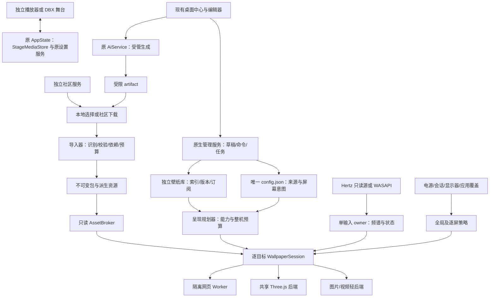
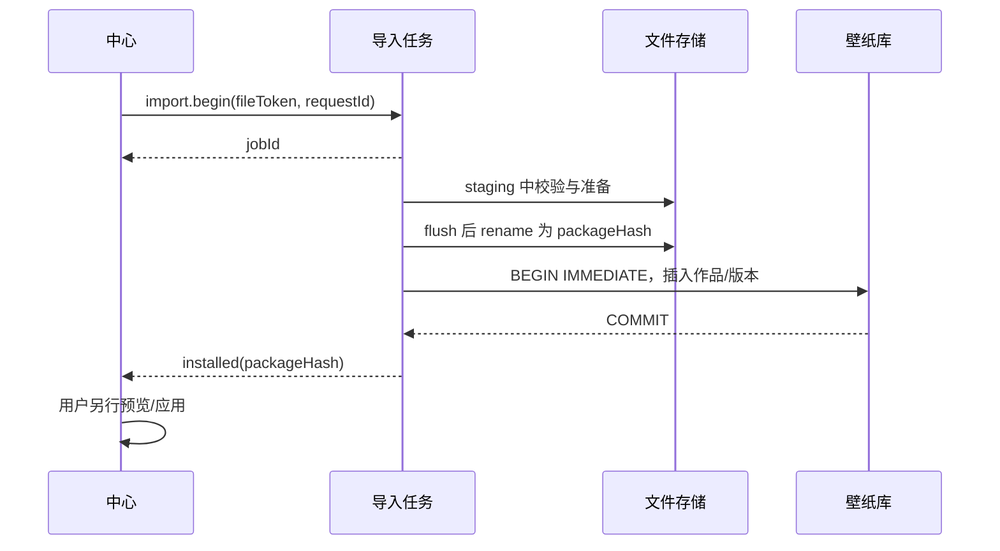
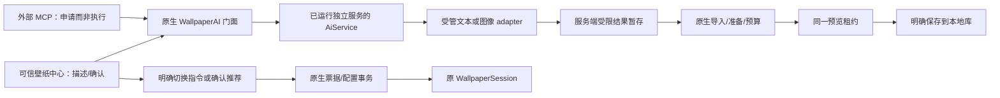

# Hertz 壁纸引擎 P0–P3 开发设计与实施计划

日期：2026-10-28；AI 增量更新：2026-10-29（并入 Muralume 运行期核对与本地媒体服务决定，见 §1.4、§8.1、§13.1–§13.3、§20.1、§21.2）。核对基线：`1d042b8` 与 2026-10-28 工作树；工作树另有 DBX 桌面接入的并行修改。状态：**开发设计，不代表新增能力已经实现或发布。**

本地媒体专项复核：2026-10-29，基于 `8eac246` 与当日工作树。按用户明确选择，**舞台与壁纸的图片/视频均采用持久化方案，导入并保存成功后重启可恢复**。补充舞台媒体存储 owner、稳定引用、导入快照与真实探测、媒体流合同、预览成本和暂停释放语义，见 §1.5、§7.1、§8.1–§8.5、§12–§13、§20–§21；本次只修订设计，未实现这些增量。

持久化再次复核：2026-10-30。明确 DBX 现有 mediaUrl 尚缺有界连续流合同，列为宿主升级与实际发行资格前置；补齐舞台预置的三个受管键、并发保存/迁移、删除后重导入的崩溃恢复，以及停服务的完整备份边界。新增能力仍是设计要求，不能按文档修订视作已经可用。

**目标：**在现有 Windows 桌面宿主上，建设可接入图片、视频、内置三维场景、图层工程、模型与受隔离网页作品的本地优先壁纸引擎，并演进到作品创作、AI 生成与受控切换、分享、订阅与安全更新。

**架构：**保留 `hertz-desktop` 为唯一桌面配置、显示器、策略和进程生命周期 owner；保留原场景与音频 owner。新增资源导入管线、不可变内容存储、资源适配器和受预算控制的呈现会话；编辑器、AI 与社区只消费同一作品协议，不另建渲染器、播放器或资源真值表。AI 复用原 `AiService` 的任务、凭据和账本，生成结果仍走原生导入与预览，切换只由原生提交。

**技术栈：**Rust、现有 Tao/Wry/WebView2、Three.js/WebGL2、原生 JavaScript、Tokio、SQLx/SQLite；系统音频使用 WASAPI loopback。社区服务采用独立 Axum/SQLite 服务，不运行在播放器服务里；AI 不进入渲染或音频热路径。

本文是壁纸 P0–P3 的唯一开发设计终稿，替代旧版 W2/W3 的后续范围与顺序；W0/W1 的有效原生证据在 §24 保留。共享宿主、歌词和 DBX 设计仍分别拥有其公共合同，本文明确列出的增量必须在对应实施任务中同步，不能靠本文修改就宣称 ADR 或现行接口已经改变。

## 1. 实施结论与产品边界

### 1.1 先把引擎做成资源管线，再做编辑器和社区

“支持更多资源”不是在设置页加几个文件扩展名，也不是把所有东西转成视频。必须使一种资源能够走完：

**用户选择 → 格式识别 → 有界校验 → 依赖解析 → 必要的离线准备 → 不可变安装 → 能力与预算准入 → 按需加载 → 呈现 → 暂停 → 释放 → 再次打开。**

扩展点放在资源导入、资源加载、场景节点和效果四个明确位置；调度、权限、预算、缓存、文件访问仍由宿主掌握。新增解码器不得自己联网、新建 renderer、建立永久定时器或获得完整播放器权限。

三条路线的决定：

| 路线 | 取舍 | 决定 |
| --- | --- | --- |
| 所有资源统一转视频 | 消费端简单，但丢失实时音频响应、交互和参数编辑，生成与磁盘成本高 | 不采用；视频只是一个原生内容类型 |
| 每种资源一套 WebView/播放器/引擎 | 接入初期容易，随后出现重复解码、上下文、缓存与暂停策略 | 不采用；WebView 按呈现目标或安全域划分，不按图层划分 |
| 资源适配器＋编译后的场景描述＋少量呈现后端 | 需要先定义合同，但能复用现有场景并控制资源总量 | **采用**；纯图片/视频走轻路径，组合内容才进入 WebGL |

### 1.2 P0–P3 的完成含义

| 阶段 | 用户得到什么 | 必须完成的引擎能力 |
| --- | --- | --- |
| P0：可靠运行底座 | 九场景可放心常驻，状态、暂停和设置保存可解释 | 时钟分离、按目标屏策略、亮度/运动、电池停绘、真实预算与故障恢复 |
| P1：通用本地壁纸 | 舞台与壁纸导入图片/视频并跨重启恢复、保存内置场景作品、作品库/轮播、系统音频和多屏；本地自然语言切换、AI 内置场景草稿 | 舞台持久媒体服务、包协议、资源目录、安装事务、轻后端、统一输入、逐屏预算与缓存；AI-01～03 |
| P2：可创作引擎 | 图片图层、遮罩、粒子/水波/风动、文本、受限三维模型、关键帧、公开参数；AI 文生图与组合草稿 | 场景文档、编译器、资源适配器、统一 Three.js 合成、编辑器复用同一运行时；AI-04/05 |
| P3：可分发内容平台 | 网页作品隔离运行、作者发布、审核、订阅更新、回滚和撤销；外部助手提出生成/切换申请 | 不可信内容执行边界、签名版本、下载与安装复用、独立社区服务；AI-06 |

AI 可在对应引擎闭环之后单独发布，但不能用“支持导入 AI 图片”冒充已实现受管生成；完整阶段出口包括其表列 AI 工作包。生成首发限 standalone，DBX 及视频模型生成的边界见 §19。

### 1.3 明确不做

- P0–P3 桌面运行平台固定为 Windows 11 x64；macOS、Linux、Windows ARM64、移动端和 HDR 色彩工作流不在本轮交付范围。社区服务可部署在 Linux x64。
- 不兼容 Wallpaper Engine 私有工程/原生作品格式，不接入 Steam Workshop，不把第三方作品重新打包后冒充自有版权。
- 不允许作品携带 exe、DLL、原生插件、浏览器扩展、任意依赖安装脚本或运行期模型生成代码。
- 不把任意 GLSL/JavaScript 注入现有可信场景注册表；P2 的效果实现随应用发布，P3 的用户脚本只在独立隔离网页里执行。
- 不采集麦克风、不保存系统原始录音；壁纸内的视频始终静音，本轮不新增环境音乐播放器。
- 不将 ObjectURL、用户原文件路径或浏览器临时缓存作为持久媒体身份。舞台素材由原播放器服务的 StageMediaStore 保存，壁纸由桌面 AssetStore 保存；renderer 只持稳定资源引用，不获得任意路径读取，也不要求独立舞台启动桌面组件。
- 不修改现有播放队列、账号、曲库、房间音频 owner 或原网页离场规则；壁纸存在不意味着音乐应继续播放。
- 不为了社区增加播放器登录前置；未配置社区、未登录、断网时，本地壁纸、编辑和导出继续可用。
- 不因 AI 授予任意代码执行、文件/网络访问、无人确认重复生成、收费或覆盖桌面权限；不自动上传桌面截图、歌曲或原始音频。
- 不预建 ECS、可热加载原生插件 ABI、通用节点脚本语言或跨进程共享 GPU 纹理框架。

### 1.4 本版收紧的五条决定

| 决定 | 理由 | 落地位置 |
| --- | --- | --- |
| 桌面壁纸视频字节只走 `WebResourceRequested` + 有界可 seek 的 COM IStream；不用 wry custom protocol 整段返回、不用 data/base64/NavigateToString、不把虚拟目录映射作默认或回退 | wry 0.57 在 Windows 把 custom protocol 响应体包进 `SHCreateMemStream`，当前同步 handler 跑 UI 线程；异步 responder 也不提供文件流 | §8.1、§21.2 C49；舞台传输另见 §8.5 |
| 壁纸媒体采用“复制进不可变包”模型，舞台复制进原服务内容库；P1 不支持只引用原路径 | 重启、轮播和导出必须使用稳定字节；原路径引用会引入移动/删除、授权与缺失恢复成本 | §7.1、§7.2、§8.5 |
| 视频能力只承诺 MP4/H.264 与 WebM/VP8/VP9；MOV/MKV/HEVC/AV1/HDR 不承诺，导入期实际探测 | WebView2 解码取决于 Edge 与系统编解码器，扩展名不是能力；Muralume 的 32 种扩展名来自 AVFoundation，不能平移 | §5.1、§7.1、§21.2 C48 |
| 多屏不按屏幕数默认开实例；span 只建一个呈现目标，single 多组必须显式选择并计入 decoder/GPU 预算 | 每屏一个 WebView2 = 多渲染进程 + 独立 GPU context + decoder；Muralume 的 per-display 没有额外进程，成本模型不适用 | §12.1、§13.1、§20.2 P1-07 |
| 舞台与壁纸素材均持久化；各自原生服务保存字节，运行时 URL 按需重建 | 重启恢复依赖文件副本和稳定 ID；DBX 的隔离页面不能靠设置存储或失效 blob URL 保存大媒体 | §1.5、§3.1、§8.5 |

### 1.5 本地图片/视频用于舞台与壁纸的评审结论

**结论：舞台和壁纸都默认持久化；导入及当前选择保存成功后，重开页面、重启应用/电脑均可恢复，无需重选原文件。** 用户删除或移动原文件不影响已导入副本。ObjectURL 和宿主媒体 URL 只是当前会话的播放租约，不进入设置，过期或重启后按稳定资源 ID 重新取得。

| 用途 | 资源入口与 owner | 恢复与分享 | 呈现方式 |
| --- | --- | --- | --- |
| 插件/播放器舞台 | 用户选择的 `File` → 原 AppState 的 StageMediaStore 复制/校验/持久化；CreativeStage 保存稳定 assetRef；Backgrounds 持有呈现租约 | 当前背景和本机预置跨重启恢复；独立版/DBX 使用各自 DataDir；文本分享不携带本机资源引用或媒体字节 | 平面用现有 img/video；独立版走原 HTTP 资源流，DBX 视频须先完成宿主受控 URL 的连续流升级/资格；组合借用同一媒体源 |
| 桌面壁纸 | 原生 fileToken → staging 快照 → 校验/准备 → 不可变包；AssetStore/Broker 持有 | 重启不依赖源路径；按固定版本导出/分享，源文件删除不影响已安装作品 | 图片/视频轻后端优先；只有组合效果进入同一 Three.js context |

三种路线的取舍：仅存 blob URL/浏览器缓存不能满足可靠恢复，DBX opaque-origin 页面也不能假定 IndexedDB/OPFS 可用；全部放进桌面库会使独立舞台依赖 `hertz-desktop`；**采用原播放器持久舞台库＋桌面持久壁纸库**，复用纯格式校验、适配计算和渲染实现。两者服务不同生命周期与进程，不同步同一条“当前选择”，也不跨目录直接读写。舞台转壁纸仍通过正式包导出/原生导入取得独立副本；P1 可在桌面中心重选原文件导入，不传 `blob:` URL，不要求为了壁纸继续运行音乐服务。

当前代码仍只有会话级媒体：`CreativeStage.saveLocal/flushLocalSave` 会序列化含 `blob:` URL 的 preset；`Backgrounds.setLocalFile` 没有持久文件库或完整准入；舞台视频的 `playbackRate=0.75` 与低分辨率画布不会保证源视频按更低分辨率解码。§8.5 和 P1-M0～M2 定义从现状到持久化的实施出口。导入字节保存与预置保存分别确认，任一步失败都不能显示“已保存”，也不自动退成临时素材。

本次审查的不变量是“已保存素材跨重启恢复，不依赖源路径；可呈现、可停止、可释放，失败可解释”。规范 owner 为播放器 StageMediaStore 与桌面 AssetStore；旧媒体 URL 只允许作为过渡预览租约，成功迁移后不再作为保存身份。用关闭桌面组件、删除原文件后重开舞台、DBX 重启、磁盘满、服务换 DataDir、宿主媒体 token 过期来证伪。原生视频后端、跨进程共享纹理和舞台跨机媒体工程包不在本次增量内。

## 2. 当前基线与必须先修的欠账

### 2.1 已有实现，不重新立项

| 事实 | 代码依据 | 复用方式 |
| --- | --- | --- |
| Windows WorkerW 桌面窗口、单目标屏、DPI 补偿、拓扑检查 | `crates/hertz-desktop/src/native.rs`、`app.rs::create_wallpaper` | 保留挂载算法，扩成目标描述与逐屏实例 |
| 九个内置壁纸场景、固定/跟随三维空间 | `config.rs::WALLPAPER_SCENES`、`assets/wallpaper-scene.js::ALLOWED` | 迁移到从场景定义生成的资格目录，删除重复白名单 |
| 统一设置中心、静态缩略图、实时预览、自启、托盘 | `assets/wallpaper-settings.html`、`wallpaper-settings.js`、`app.rs` | 扩展现有中心，不再建一个壁纸管理应用 |
| 配置 schema v2、最多 8 个 profile、全局 revision | `config.rs::StoredConfigV2` | 继续由原生宿主串行提交；库不复制活动配置 |
| 专用壁纸快照/事件、64 段频谱、过期衰减 | `crates/hertz-studio/src/wallpaper.rs`、`wallpaper_feed.rs` | 沿用投影与窄授权，P1 才升级高频数据协议 |
| 场景参数定义、迁移、scope、质量档、异步失效票据 | `tools/space-stage/src/{registry,main,scope,quality}.js` | 提取可复用的呈现与资源合同，不重写 Three.js 引擎 |
| 创意舞台工程与分享 | `plugin/ui/creative-project.js`、`creative-share-code.js` | 借鉴严格校验和编辑事务，不复用其文件格式 |
| 舞台本地图片/视频背景（当前仅会话级） | `plugin/ui/backgrounds.js::setLocalFile`、`space-layers.js`、`workshop.js` | 改为 §8.5 的原服务持久化＋稳定引用；保留现有媒体元素与借用关系，不并入桌面壁纸库 |

当前 `SpaceStagePure.catalog()` 包含的项目比桌面九个场景多，不能全部开放为壁纸。Creative 工程排除了自定义图片/视频，分享 CRC32 也不是内容签名；现有舞台构建 manifest 的截断哈希不能作为壁纸包的完整性校验。

### 2.2 P0 必修，而不是后期美化

1. `wallpaper-scene.js` 给空间场景强制传 `playing:true`，以播放状态维持环境运动；应改成真实音频状态与独立运动许可。
2. `app.rs` 的全屏判断使用歌词窗口所属屏，随后影响壁纸；歌词与壁纸位于不同屏时语义错误。
3. `apply_wallpaper_settings` 已保存新 revision 后，挂载失败又恢复旧配置并忽略再次保存错误；须区分保存失败与运行失败。
4. 去抖保存也需要“落盘成功后再提交 revision”的一致合同，不能提前清掉保存状态、只留日志。
5. 当前配置没有亮度和运动强度；电池策略作用于歌词的降帧不等于壁纸电池停绘。
6. 当前预览是设置页内 iframe，没有独立 owner token，且没有完整继承壁纸电源策略；它不能作为不可信网页容器。
7. `draws` 在调用 renderer 前递增，只能说明尝试调用，不能当作 GPU 完成次数；现有质量采样也会把主动低 FPS 误判为退化。
8. 旧管理管道、播放器代理、设置页消息分别有 8 KiB、2 KiB/8 KiB、8 KiB 边界；不能把大工程、素材或导入任务塞进同步命令。
9. 显示器身份仍按 GDI 名匹配：`native.rs` 取 `MONITORINFOEXW.szDevice`，`app.rs` 用 `monitor.name == surface.monitor.name`；换主屏、拔插或驱动重置后 `\\.\DISPLAY1` 可能指向另一块物理屏，壁纸会悄悄换屏。P0 改用 DisplayConfig `monitorDevicePath` + EDID，GDI 名只作当前枚举映射。
10. 目标屏消失立即 `surface.stop()`，没有空拓扑宽限；Windows 在模式切换、驱动重置、RDP 进出时可能短暂少报显示器。P0 加连续 3 次（约 750 ms）宽限，并把全屏/遮挡去抖做成非对称（进入慢、恢复快）。
11. 壁纸页把质量写死 `quality:'low'`/`deviceTier:1`，没有自适应档位；电池降帧只作用于歌词窗口。P0 的电池停绘与 P1 的降档阶梯要分开实现，不能把歌词的 `frameCap` 当作壁纸已降档。

### 2.3 与正在进行的 DBX 工作隔离

当前 DBX D0–D2 的共享 `Profile`、有界数据/管理管道、原生 feed 和设置流程已实现并通过独立审查，D3 配套候选与完整发布验收仍待完成。DBX 桌面来源由 [DBX 方案](./desktop-dbx.md) 负责，`manual` 启动、不增加插件网络 listener、不改变未连接时插件行为的约束继续有效。

本文不修改在途 DBX 代码。配置版本、共用 Profile 和 IPC 原语必须按 §4.3 的顺序整合，不能在两个分支上分别占用 schema v3，或复制第二套来源规范化代码。

## 3. 总体架构与模块归属



### 3.1 唯一 owner 表

| 对象 | owner | 不能出现的第二份 owner |
| --- | --- | --- |
| 用户启用意图、当前来源、屏幕布局、音频选择、全局自启 | `hertz-desktop` 配置管理 | 播放器 SQLite、DBX 授权记录、浏览器 localStorage |
| 已安装作品、版本、收藏、草稿、订阅 | 桌面壁纸库 | 社区响应缓存冒充本地安装状态 |
| 包文件与派生资源 | AssetStore，单写者 | 场景工厂直接往内容目录写文件 |
| 文件打开与网络访问 | 原生 AssetBroker / 社区客户端 | renderer 任意路径读取、作品自行下载依赖 |
| renderer、相机、render target 池 | 每个 RenderContext | 每个图层自己创建 WebGLRenderer |
| 图层实例的私有资源 | session scope | 全局变量残留、共享资源被任一图层 dispose |
| 共享纹理/几何 | RenderContext 的 ResourcePool | 把池对象直接交给旧 scope.trackTree 管理 |
| 调度和视觉时钟 | 每个呈现页一个 scheduler | adapter、效果、图层额外 rAF/ticker |
| 原 Hertz 播放与 FFT | 原音频服务 | 壁纸重新打开曲库音频进行分析 |
| 系统声音采集与 FFT | 桌面 AudioInput | 每块屏各开一个 loopback 或 FFT |
| 不可信内容生命周期 | 原生 worker manager | 网页自己宣称停止、自己恢复无限重试 |
| AI 派发、凭据与费用 | 已运行服务的 AiService | 桌面组件第二个 runner、renderer/MCP 持有模型密钥 |
| AI 候选到桌面的授权 | 原生 WallpaperAI 与原配置提交队列 | 模型自报“用户已确认”、生成服务直接修改桌面配置 |
| 舞台持久媒体文件、索引与导入任务 | 原 `hertz-studio` AppState 的 StageMediaStore；独立版/DBX 各自 DataDir | 桌面壁纸库、localStorage/DBX storage 中的媒体字节、renderer 自行写路径 |
| 舞台当前预置及本机预置库 | CreativeStage 定义/运行态＋原 settings 三个受管键（§8.5.3）；同 DataDir 共享最后保存状态，localStorage 仅缓存 | StageMediaStore 再存一份当前选择、桌面配置、分享 codec |
| 舞台媒体元素与呈现租约 | `Backgrounds`；Space3D/BgWall 只借用源与帧通知 | 每个舞台另建播放器、借用方撤销共享 URL |

### 3.2 文件级结构

现有文件采用小范围修改；新增文件在对应实施包开始时创建，不预先搭空壳。

| 路径 | 工作 |
| --- | --- |
| `crates/hertz-desktop/src/app.rs` | 保留 UI 事件协调，逐步委托 wallpaper 模块；不整份重写歌词逻辑 |
| `crates/hertz-desktop/src/config.rs` | 配置版本迁移、唯一提交、profile 与布局引用 |
| `crates/hertz-desktop/src/pipe.rs` | 接入共同身份校验和 management v2 信封 |
| `crates/hertz-desktop/src/native.rs` | 提取目标屏检查、稳定显示器身份、原生内容响应与进程 API |
| `crates/hertz-desktop/src/wallpaper/{mod,session,policy,budget,control,jobs}.rs` | 会话状态机、策略、准入、命令与异步任务 |
| `crates/hertz-desktop/src/wallpaper/{library,assets,media,display,audio,worker,community}.rs` | 本地库、资源 broker、原生媒体流、多屏、loopback、隔离与社区客户端 |
| `crates/hertz-desktop/migrations/wallpaper/` | 壁纸独立 SQLite 迁移；不进入根目录音乐库 migrations |
| `crates/hertz-wallpaper/src/{lib,manifest,archive,document,release}.rs` | 新增纯数据/校验共享 crate；供桌面与社区使用，无 Windows、音乐服务或联网副作用 |
| `crates/hertz-studio/src/stage_media/{mod,store,imports,leases}.rs` | 原 AppState 内的舞台持久文件、索引协调、分块导入及受控读取；不启动独立服务进程 |
| `crates/hertz-studio/src/rpc/stage_media.rs`、`routes.rs`、`plugin/backend/src/main.rs` | 同一舞台媒体/预置业务门面；独立版 HTTP、DBX 小块 RPC 与宿主媒体读取适配 |
| `crates/vmusic-store/src/{stage_media,settings,backup}.rs`、根 `migrations/` | 舞台媒体索引/导入收据、settings 受管键与原子版本提交、备份验证及删除恢复；使用下一个空闲迁移号 |
| `plugin/ui/stage-media.js`、`backgrounds.js`、`creative-stage.js`、`host.js`、`workshop.js`、`space-layers.js` | 资源引用/导入进度/恢复与 URL 租约；分离本机预置和分享投影；assets 宏清单沿现有入口登记 |
| `tools/space-stage/src/{main,registry,scope,quality}.js` | 现有工厂继续工作；加入明确帧合同与可复用 render context |
| `tools/space-stage/src/wallpaper/{context,assets,compiler,graph,timeline,bindings}.js` | 资源缓存、编译与组合场景运行时；随现有舞台构建产物发布 |
| `tools/space-stage/src/wallpaper/loaders/` | 图片、视频纹理、字体、GLB、KTX2 等内置 adapter |
| `tools/space-stage/src/wallpaper/nodes/`、`effects/` | 类型化图层与随包效果工厂，消费同一 context |
| `crates/hertz-desktop/assets/wallpaper-scene.js` | 从场景专用页收敛为内容会话适配器，不保存另一份资格表 |
| `crates/hertz-desktop/assets/wallpaper-{library,editor}.js` | 中心中的作品库与编辑器，不新引入 React/Vue |
| `scripts/export-wallpaper-contracts.mjs` | 从真实内置注册定义导出 schema/能力/默认值，Rust 消费生成物 |
| `crates/hertz-wallpaper/contracts/{catalog,document-schema}.json` | 生成的只读合同，含完整 SHA-256 的 registryHash；不手改 |
| `crates/hertz-wallpaper-hub/` | P3 新增独立社区服务、自己的迁移与管理页 |
| `crates/hertz-studio/src/ai/{jobs,usage,credential,capability}.rs` | 增量接入壁纸 capability、分型计价/结果和短会话，保留原任务 owner |
| `crates/hertz-studio/src/ai/{wallpaper,artifacts,image_provider}.rs` | 新增壁纸领域验证、artifact 安全暂存与图像 adapter，不复制 runner |
| `crates/vmusic-store/src/{ai,ai_jobs,ai_ledger}.rs`、根 `migrations/` | AI 服务任务/quote 版本/媒体用量/artifact 元数据迁移；不放桌面作品与配置 |
| `crates/hertz-wallpaper/src/ai.rs` | 纯生成合同、AI 组合子集与规范化校验，不含调用 provider 的能力 |
| `crates/hertz-desktop/src/wallpaper/ai.rs`、`assets/wallpaper-ai.js` | 原生配对/候选/确认/接收/切换票据与现有中心 AI 面板 |

AI 服务迁移在实施时使用根 migrations 的下一个空闲编号，已应用迁移不改号；桌面 ai_receipts/ai_origins/ai_requests 走独立 wallpaper migrations。两边不用同名任务表假装跨库原子提交。

壁纸渲染模块放进现有 `tools/space-stage` 构建图，继续只打包一份 Three.js。GLTFLoader/KTX2Loader 等采用同版本 Three.js 的模块导入；第三方解码器按需打包，禁止从 CDN 动态下载。

合同导出只遍历纯定义 metadata，不创建 canvas/renderer、执行资源加载或运行第三方代码；registryHash 对不含 hash 字段自身的规范化定义载荷计算，避免自引用。Rust 以 include_bytes 消费生成物并验证 catalog/schema 的版本与完整 hash。导出器必须提供 `--check`，CI 比较当前定义生成结果与已提交产物；参数、默认值、能力或成本规则变化后不得继续发布旧合同。

新增依赖按需要引入：ZIP 读取器仅启用 Store/Deflate，图片缩略图使用有界 Rust 图像库，SVG 准备采用 resvg 系解析/栅格化，签名采用 Ed25519 库与 RFC 8785 编码器；GLB/KTX2 加载器来自已锁定同版 Three.js。各实施包锁定实际版本到 Cargo.lock/对应 npm lock，先通过 Rust 1.88/MSRV、许可证、漏洞与二进制体积检查；不为本方案提前升级整个 workspace 或添加在线依赖下载入口。

## 4. 身份、存储与迁移

### 4.1 五类身份不可混用

- `profile`：音乐来源，复用共用 Profile；包含 standalone/dbx、edition、规范化 DataDir，DBX 另含 pluginId。
- `workId`：作者写入包的逻辑 UUID，不单独证明作者或覆盖权限；本地索引另有随机 `workKey`，来源作品按 `(sourceId,remoteWorkId)` 映射。
- `packageHash`：完整安装包 SHA-256，64 个小写十六进制字符；精确标识不可变字节。
- `displayId`：显示器 device path 与 EDID 身份组成的持久键，不采用显示器枚举下标。
- `sessionId/generation`：运行态会话与作废代际；不写进作品包，不代替 profile 或包版本。

`source=follow/fixed` 是旧场景选择模式，不是音频来源，也不是 standalone/dbx。新模型拆成 `selection` 与 `audioInput`，迁移后删除旧模式字段，不能长期维护两个名字。

### 4.2 目录与数据库

根目录沿用 `%LOCALAPPDATA%/Hertz/Desktop/`，测试用 `HERTZ_DESKTOP_CONFIG_DIR` 将全部桌面状态重定向到隔离根，而不是只重定向 config。

```text
Desktop/
  config.json
  wallpaper.db
  trust.db
  packages/<packageHash>/original.hwpkg
  packages/<packageHash>/files/
  packages/<packageHash>/receipt.json
  derived/<inputHash>/<pipelineVersion>/<variantKey>/
  staging/<jobId>/
  drafts/<draftId>/
  operations/<requestId>/
  worker-data/<sessionId>/
  diagnostics/
```

- `packages` 保留收到的原始包字节、只读解包投影和本机验证收据；broker 只服务 files 中已索引资源，original.hwpkg 与 receipt.json 不暴露给作品。P1 不做跨包文件硬链接；减少引用计数、更新与安全边界复杂度。相同 packageHash 的物理内容直接复用，但其来源记录不会因此合并。原包、投影与派生缓存均计入磁盘预算。
- `derived` 是可重建缓存，键包含输入完整哈希、转换器版本、输出参数与色彩空间；损坏删除后可重建，不反向修改原包。
- `wallpaper.db` 仅由宿主写，WAL、外键开启、写事务短小；文件 I/O、解码和下载不在事务或 UI 线程内。
- 库按 Windows 用户共享；屏幕布局与音频偏好仍随 profile 保存，延续现有显式切源语义。无音乐来源也允许 `activeProfile=null` 使用设备默认壁纸域；该域只有一份，绑定新来源时不静默复制或启用。
- 不将歌曲、原始 PCM、凭据、系统路径或显示器身份导出到作品包。

表结构合同如下；除 trust_state/release_watermarks 位于独立 trust.db 外，其余位于 wallpaper.db。同库引用启用外键，跨库来源/版本一致性由原生提交校验。trust.db 只持有安全信任与防回放水位，不参与程序/作品库的版本回滚；其 schema 使用独立版本，旧组件无法理解时停止社区操作，不降级信任。两个库仍只有桌面宿主一个写者，不把活动配置存入其中。

| 表 | 主键与核心字段 | 约束 |
| --- | --- | --- |
| `sources` | source_id；kind、canonical_origin、root_fingerprint | local、unsigned-import、hub；来源身份不能从包声明取得 |
| `works` | work_key；source_id、remote_work_id、title、kind、favorite、archived | `(source_id,remote_work_id)` 唯一；名称 1–120 字符；描述最多 4000 字符；最多 10000 项 |
| `packages` | package_hash；manifest_json、installed_at、bytes、state | 状态 installed/quarantined/unavailable；原包和解包投影均不可变 |
| `versions` | version_key；work_key、version、package_hash、release_id | `(work_key,version)` 唯一；同来源同版本不同 hash 拒绝；关联 packages |
| `tags` / `work_tags` | tag_id；work_key+tag_id | 单作品最多 20 标签，标签最多 32 字符 |
| `playlists` / `playlist_items` | playlist_id；playlist_id+position | 最多 100 列表、每列表 1000 项；项目固定 workKey 与 packageHash |
| `drafts` | draft_id、work_key、revision、document_path、updated_at | 最多 50 草稿；保存用独立 draft revision |
| `subscriptions` | source_id+remote_work_id | channel、installed_hash、available_hash、update_mode、last_error |
| `grants` | work_key+package_hash+permission_digest+input_scope | 已确认权限、确认时间、撤回时间；本机 owner，不导出 |
| `trust_state` | source_id | 根指纹、已验证密钥链、最高密钥代际、撤销序号/摘要/有效期 |
| `release_watermarks` | source_id+remote_work_id+channel | 最高已接受版本及 hash；回滚不降低水位 |
| `install_jobs` | job_id | request_id、payload_digest、state、input_identity、progress、error、updated_at |
| `derived_entries` | cache_key | path、bytes、last_used、pipeline_version |
| `ai_receipts` | service_owner+job_id+artifact_id | hash、会话关联、素材别名映射、draft_id/import_job_id、状态/过期时间；最多 8 个活动候选 |
| `ai_origins` | work_key+package_hash | provider/model、生成时间、输出 hash 与来源标记；跟随版本，不含 prompt 或凭据 |
| `ai_requests` | service_owner+grant_id+request_id | payload_digest、状态、确认/操作关联、过期时间；不保存 bearer 或原始自然语言 |

ai_receipts/ai_requests 的终态收据合计最多 256 条/4 MiB，至少保留 10 分钟；活动候选按 §19 的 24 小时窗口保护，容量不足拒绝新申请。待确认 brief 只在内存、2 分钟到期，重启作废，不能由持久申请恢复执行；已确认操作通过原 operations/install_jobs 协调，不复制配置事务日志。

本机新作品属于固定 local 来源；无签名文件首次导入建立独立 unsigned-import 收据来源，不能用其自称 UUID 覆盖本机作者或社区作品。相同 hash 再导入可返回已有导入收据；用户明确“作为新来源保存”才新建映射。社区来源绑定规范化 HTTPS origin 与首次确认的根身份，合法密钥轮换保留 sourceId。布局的 package 选择同时保存 workKey 和 packageHash，以便正确查授权与版本；渲染字节仍按 hash 去重。

运行中的引用租约放内存，不把 `refcount` 永久存入数据库。启动时从已保存布局、播放列表、草稿引用和订阅安装版本重建 GC 根；不依赖上次正常退出才能避免删掉活动文件。

本节目录、wallpaper.db 与 GC 仅属于桌面壁纸。舞台素材另由原播放器的 `<DataDir>/stage-media/` 和原 SQLite 管理（§8.5），独立版与 DBX 的 DataDir 不互相回退，桌面卸载/壁纸 GC 不清舞台素材。两库出现相同字节也不跨进程做硬链接；各自副本和导入峰值分别计入容量。

### 4.3 配置版本与提交

版本分配固定为：DBX 来源身份迁移使用共享方案保留的 **v3**；P0 的新增运行字段使用 **v4**；P1 的布局/作品引用模型使用 **v5**。P2/P3 不再改变布局结构，工程与订阅分别在独立文档/数据库中版本化。

- P0 配置任务在共用 v3 Profile 迁移落地后合入；时钟、策略和测试工作不必等待 DBX 发布完成。不得抢占 v3，也不得把 DBX 尚未通过的数据桥标为可用。
- v1/v2 输入先沿已有迁移恢复 profile，再显式标为 standalone；v3 保留真实 kind/pluginId；随后顺序迁到 v4/v5。
- v4 给旧配置补 brightness=1、motion=1、batteryPolicy=pause、quality=low；只在版本迁移中补一次，不在每次启动覆盖用户保存值。
- v5 把旧单屏、fixed/follow 转成一个布局组；`monitor=null` 转为显式 primary 选择策略，旧 GDI 名必须在当前枚举中匹配后建立稳定身份，无法确认则等待用户认领，不猜另一块屏。
- 未来版本与未知字段拒绝写回；迁移先完整验证并备份原文件，原子替换成功后才提交内存版本。安装回滚需要恢复对应配置备份，不能让旧组件尝试保存新格式。

根对象在 v4/v5 的字段固定为 schemaVersion、revision、launchAtLogin、activeProfile、profiles、unboundDomain、lastCommit；前五项保留共享配置含义，lastCommit 为 null 或 `{requestId,payloadDigest}`，用于崩溃后核对最后提交，不能传入作品。unboundDomain 新增于 v4，结构为 `{lyrics,wallpaper}`，保存未绑定来源时唯一的桌面意图。`profiles[*]` 仍只含 profile、lyrics、wallpaper，lyrics 按原 LyricsConfig 校验，不复制歌词默认值。activeProfile 非空时只使用对应 profile 域，否则只使用 unboundDomain；两者互斥生效，不双写。无来源时歌词只保留样式与启用意图，不显示伪造正文。

v1 无绑定但有已保存歌词/壁纸的输入完整迁入 unboundDomain，不能因 profiles 为空丢掉。普通新绑定仍先使用目标 profile 自己的配置，不自动复制未绑定域；用户可显式复制其样式。新增安装的 unboundDomain 两功能 enabled=false。旧文件中的非标准整数 FPS 在迁移时取不大于原值的 15/30/60 档，并显示一次迁移说明；正常 v4/v5 写入只接受这三档，不再 sanitize 任意整数。

v5 壁纸域的提交草稿示例，内置选择不需要安装包；空 params 在提交阶段由原 registry 补全，实际落盘写完整规范化参数：

```json
{
  "enabled": true,
  "audioInput": {"kind": "hertz", "gain": 1, "attackMs": 40, "releaseMs": 250},
  "batteryPolicy": "pause",
  "pauseOnFullscreen": true,
  "pauseOnMaximized": false,
  "applicationRules": [],
  "groups": [
    {
      "id": "main",
      "mode": "single",
      "displays": [{"kind": "primary"}],
      "selection": {"kind": "builtin", "sceneId": "zodiac", "stateVersion": 1, "params": {}},
      "presentation": {"fps": 30, "quality": "low", "brightness": 1, "motion": 1, "fit": "cover", "pointer": false},
      "properties": {}
    }
  ]
}
```

`selection` 是判别联合：`builtin`、`followHertz`、`package`、`playlist`。package 必带 workKey 与 packageHash，且版本映射必须吻合；playlist 必带 playlistId；followHertz 必带用户选定的 `idleBuiltin`，来源无合格场景时显示“等待来源”并运行该显式环境场景，不偷偷选择第一项。作品公开参数覆盖保存在组的 properties，包原文保持不变。

brightness 范围 0.25–1；motion 范围 0–1；FPS 只接受 15/30/60，0 不作为持久偏好。运行期 effectiveFps=0 表示停绘。全部配置最多 64 KiB，组数最多 4，应用规则最多 32；超过拒绝，不截断。

提交顺序：校验 expectedRevision 和全部值 → 检查引用已安装且可用 → 原子落盘新配置 → 内存 revision 生效 → 异步应用目标。保存失败保持旧配置；运行失败保留新配置和 `applyError`。手动选择旧版本属于新提交，revision 只能递增。

## 5. 资源支持矩阵与扩展等级

### 5.1 必须区分资源、内容类型和实现代码

资源是图片、字体或网格等可复用输入；内容类型描述如何呈现一个作品；adapter 是随应用构建的受信实现。**第三方可以提交数据和作品，但不能通过 manifest 注册一个新的原生 adapter。**

| 资源/内容 | P1 | P2 | P3 与边界 |
| --- | --- | --- | --- |
| JPEG/PNG/WebP 静态图片 | 直接导入、静态轻后端、裁切/适配 | 图层、纹理、遮罩、派生尺寸 | 相同管线 |
| MP4/H.264，WebM/VP8/VP9 | 静音循环，导入期实际解码探测 | 视频纹理及图层；仍受解码槽限制 | 相同管线；不承诺所有 profile/level；MOV/MKV/HEVC/AV1/HDR 不承诺 |
| 内置三维场景 | 版本化参数快照，复用真实 registry | 可作为组合工程的唯一三维背景 | 不开放内容包替换内置脚本 |
| SVG | 拒绝直接执行或静默取第一帧 | 受限静态 SVG 导入后栅格化；保留原稿 | 不把 SVG 当网页导航 |
| TTF/OTF/WOFF2 | 不作为独立壁纸 | 包内字体与文本层，不安装系统字体 | 字体授权随包声明 |
| GLB/glTF 2.0 | 明确未支持 | GLB 优先；glTF 的全部依赖必须封装进包；受限 PBR、骨骼与动画 | 不接远程 URI、FBX/OBJ/Blender 工程或任意扩展插件 |
| KTX2/Basis 纹理 | 不要求用户准备 | 按需可信转码器与 GPU 压缩格式选择 | 不下载作品指定的 WASM 解码器 |
| 粒子/材质/关键帧/绑定 | 内置场景参数 | 声明式文档，内置工厂执行 | 无自由求值脚本 |
| HTML/CSS/JavaScript 网页 | 不支持 | 不支持 | 本地完整依赖、独立隔离 worker；网络与原生权限默认不授予 |
| 系统音频/播放器频谱 | 输入信号，不是资源文件 | 同一输入总线 | 网页需显式申请只读频谱授权 |
| GIF/APNG、HEVC、AV1、HDR、任意音频文件 | 不承诺；不得以扩展名冒充可播 | 在能力目录明确 unsupported | 后续通过独立 adapter/转换器增量加入，不绕过预算 |

视频能力以容器解析、`canPlayType` 初筛和实际首帧/seek/错误探测为准（§7.1），能力目录记录本机结果；扩展名只用于选择候选 adapter，不能作为“可播”的声明。Muralume 的 32 种视频扩展名来自 AVFoundation，WebView2 不能平移这套覆盖；HEVC 取决于系统扩展，AV1 取决于 Edge 版本，HDR 不在本轮范围。

P1 的图片必须确认为静态：PNG 的 APNG 标记、WebP 的动画标记与 GIF 都不能因 `image/*` 或首帧解码成功而混入静态轻后端。视频首发限经过验证的 SDR、8-bit 变体；容器、codec/profile、旋转、像素宽高比和时间信息按 §7.1 提取。P1 不内置通用视频转码器，能力拒绝或超预算时提示用户另选受支持文件/更低分辨率或帧率版本，不自动下载 FFmpeg 或静默改变素材。图片派生与视频封面生成属于 P1；降分辨率/降帧率视频转码是后续独立 adapter 工作。

模型支持范围先冻结为 glTF 2.0 核心 metallic-roughness、unlit、纹理变换、基础 morph/skinning 和动画；`extensionsRequired` 中存在未注册扩展即拒绝。Draco/Meshopt 压缩扩展不是“GLB 能导入就自动支持”，其解码器只能在单独能力与性能验收后随应用加入。

### 5.2 能力目录

原生组件提供 `wallpaper.capabilities`，包含 packageFormat、documentVersion、contentKinds、assetAdapters、modelExtensions、gpuCompressedFormats、maxTextureSize、videoCodecProbe、limits 和 isolationLevel。目录来自当前构建及当前设备，不从 README、文件扩展名或组件版本号猜测。

每个导入 adapter 声明唯一 `id`、`version`、MIME/魔数、输出资源 kind、是否需要派生、静态成本提取器和验证器。每个运行时 loader 声明输入 kind/variant、解码能力和释放方法。新增一种图片容器只改导入/加载 adapter 与测试，不改设置页、库表、调度器、音频总线或社区上传协议。

### 5.3 扩展分级与改动面

| 扩展 | 必须改什么 | 不应改什么 |
| --- | --- | --- |
| 新素材/新作品 | manifest 与资源文件；同一验证/安装流程 | 引擎代码、数据库 schema、权限实现 |
| 同类新格式，如另一图片容器 | importer/loader、魔数与能力、格式反例 | 帧循环、作品库 UI、源身份、多屏管理 |
| 新节点/内置效果 | factory、专用 schema、成本公式、资格与渲染测试 | 通用调度、文件访问、音频采集、全局缓存实现 |
| 新能力域，如原生视频后端或联网内容 | 版本化 backend/权限合同、原生实现与平台验收 | 不能伪装成一个 manifest 字段或给脚本更多权限 |

注册目录由构建期显式聚合各定义并导出合同；文中的 NodeKind/AssetKind 联合类型描述本版集合，实际生成物由目录推导，不在中心页面和 Rust 中各手写一个 switch。核心只在稳定生命周期方法上派发。新增语义确实需要新的资源成本或权限时升级合同，不能为了“零修改扩展”把未识别字段透传给任意代码。

## 6. 作品包与资源描述

### 6.1 包格式 HWPK v1

扩展名 `.hwpkg`，容器采用 ZIP 的 Store/Deflate 两种方法，禁止加密、分卷和额外压缩方法。ZIP 只是运输容器，不是信任边界。

```text
manifest.json
content/scene.json
assets/background.webp
assets/model.glb
assets/title.woff2
previews/poster.webp
licenses/assets.txt
```

manifest 必须为 UTF-8、无重复键、深度不超过 16、最多 256 KiB；拒绝未知字段。version 为 1–4294967295 整数，workId 为标准 UUID 字符串；资源/节点 id 为 `[a-z][a-z0-9-]{0,63}`，在人类可见名称之外使用。`files` 列举 manifest 自身以外的每个文件，所有依赖必须在其中，不能出现未声明文件。

以下是可生成有效安装 fixture 的完整 manifest，素材是一张 1×1 不透明黑色 PNG；文件名、长度和完整哈希相互匹配。

```json
{
  "formatVersion": 1,
  "workId": "c17ed10a-5c55-4a52-85dc-7509f9e88aae",
  "version": 1,
  "title": "静夜",
  "description": "静态图片壁纸",
  "content": {"kind": "image", "asset": "background"},
  "assets": [
    {
      "id": "background",
      "kind": "image",
      "source": "assets/background.png",
      "variants": []
    }
  ],
  "files": [
    {
      "path": "assets/background.png",
      "bytes": 70,
      "sha256": "abc58d5127d7cdf313beb9ec8ee839860a9c6bfbc48c8b8eb6a3f7d8bb63de6f",
      "mime": "image/png"
    }
  ],
  "properties": [],
  "permissions": {"audioSpectrum": false, "pointer": false},
  "license": {"code": "none", "assets": "CC0-1.0", "attribution": ""}
}
```

图片原始字节的 base64 为 `iVBORw0KGgoAAAANSUhEUgAAAAEAAAABCAYAAAAfFcSJAAAADUlEQVR4nGNgYGD4DwABBAEAX+XDSwAAAABJRU5ErkJggg==`；测试解码为文件后再计算 SHA-256，不把 base64 放进安装 manifest。`scripts/check-wallpaper-package.js` 使用该 fixture 做真实包往返，再分别变异哈希、长度和 MIME，三种变异均应失败。

content 的各分支固定为：

| kind | 必需字段 |
| --- | --- |
| `image` / `video` | asset |
| `builtin` | sceneId、stateVersion、完整规范化 params |
| `composition` | document，指向包内 scene.json |
| `web` | entry、apiVersion=1，指向包内 HTML |

### 6.2 AssetDescriptor

每个 asset 有局部 id、kind、source 和 variants；id 仅在该包内唯一。source/variant 引用 files.path，不接系统路径或 URL。派生元数据由导入器测得，不把作者填写的宽高、三角形数、时长作为准入真值。

variant 包含 `id/file/purpose` 以及类型对应的 width/height、codec、colorSpace、alphaMode、mipLevels。purpose 只接受 preview/low/medium/high；选择顺序为满足用途的最小分辨率、当前设备能解码的 codec、然后比较字节数。没有满足预算的变体时，仅已实现的转换 adapter 可在导入期生成；P1 不承诺视频转码。禁止在每次切壁纸时重新缩图或压纹理。

原始资源与派生资源分别校验哈希。派生缓存不必加入导出包；导出时只有作者选择“包含优化资源”才固化为新的包版本。资源转换失败保留原稿、说明不可应用，不静默替换为别的资源。

### 6.3 上限

以下是设计准入上限，不是已测吞吐承诺；实现后调整必须改同一 limits 定义和边界测试。

| 项目 | 上限 |
| --- | --- |
| 压缩包 / 解压总量 | 512 MiB / 1 GiB |
| 文件数 / 相对路径 | 2048 / 180 个 ASCII 字符 |
| 单资源压缩输入 | 图片 32 MiB；视频 512 MiB；模型 256 MiB；字体 16 MiB；文本文件 4 MiB |
| 图片原始像素 | 64 MP、单边 16384；超过 GPU 上限必须先派生 |
| 导入期同时解码的原始图片 | 1 张，独立 320 MiB CPU 内存预算；原图不进入常驻缓存 |
| 视频元数据探测 | 输入仍受 512 MiB 限制；累计检查最多 32 MiB 元数据、100 万采样/时间条目；超限或无法得出可靠帧率上界则不准入 |
| SVG | 1024 元素、100000 路径段；禁脚本、foreignObject、外部引用、动画与滤镜图 |
| 工程 | 1 MiB、128 个编辑节点、层级深度 8、64 条绑定、256 条轨道、4096 个关键帧 |
| 模型 | 5000 节点、100 万三角形文件准入；运行时仍受所选质量档更低预算 |
| 本地内容库 / 派生缓存 | 默认 20 GiB / 2 GiB；安装前检查剩余空间，不自动删除用户原稿 |

相对路径只允许小写 ASCII 字母、数字、`-_. /` 中的合法路径字符，实际不允许空格；每段非空，拒绝 `.`/`..`、反斜杠、冒号、百分号、控制字符、尾点、Windows 保留设备名、绝对路径和大小写折叠冲突。禁止符号链接、硬链接和 reparse point；解包逐文件使用新建语义，不跟随已有路径。压缩比超过 100:1 的大条目拒绝，解压流仍逐块累计实际字节，不能只信 ZIP 目录声明。

文件像素上限不代表解码一定能放进工作区：64 MP 的单张 RGBA 已接近 256 MiB，解码器内部、方向变换和缩放输出必须一起预留；可用缩放解码时优先使用，否则提前拒绝，不能分配后才检查。图片准备统一应用 EXIF 方向并输出 SDR sRGB；剥离运行时不需要的 EXIF/GPS，保留的原稿不被改写，分享 UI 说明原稿可能含元数据。所有单文件上限还受整个包上限约束，512 MiB 视频加 manifest/封面不能绕过 512 MiB 包上限。

## 7. 导入、编译与安装管线

### 7.1 三个阶段，不能把重活放进播放路径

1. **Probe**：先消费 fileToken，以只读句柄把输入有界复制到私有 staging 并计算 hash，后续所有检查、封面与安装均读取这份固定快照。句柄打开时拒绝并发写入；源不可读、复制中断或输入身份变化则失败，不使用“先探测原路径、再复制另一份字节”的结果。读魔数及有界容器结构，未知格式返回 format_unsupported，不靠文件名选择 decoder。MP4/WebM 的可信解析器提取 codec/profile、编码/显示尺寸、旋转、像素宽高比、色彩、时长和帧时间；MP4 尾部 moov 允许定位读取，WebM 缺少可靠时间信息时允许在 §6.3 限额内扫描，不只读固定前缀。CFR 记录 sourceFps；VFR 根据时间戳记录 fpsUpperBound，不能把 duration 的平均帧率当上界。结构未知、病态时间戳或超出探测限额则明确不支持。
2. **Prepare**：在后台导入槽中校验所有文件、计算 SHA-256、解析依赖 DAG、生成必要缩略图/低分辨率变体、编译工程计划；不创建桌面窗口。
3. **Install**：校验结果和可用磁盘空间后，把包含 original.hwpkg、files 投影与 receipt 的完整 staging 原子改名为 packageHash 目录，再用短事务发布包/来源/版本索引。只有此时作品才在可用库中出现。

裸图片、视频和已保存草稿先在 Prepare 末尾生成一次最终 `.hwpkg`，冻结文件顺序、时间戳和编码参数后计算完整包 hash；之后按同一安装器处理。导入已有包必须保留原字节，不能解包再重压后沿用原 hash。普通导出逐字节复制 original.hwpkg；修改内容、嵌入新优化资源或改许可均生成新版本和新 hash。

原生管理请求只启动 job 并立即返回 jobId。总并发：一个准备/解码任务，两个下载任务；交互修改与停止永远不等待这些任务。取消后先作废 job generation，待真实 I/O/解码退出才归还槽，不能提前接受第二个大任务。

页面不提交系统路径：`wallpaper.file.pick` 由原生对话框产生一次性 fileToken，绑定真实路径或文件句柄；`import.begin` 只接受 token，不接受绝对路径、相对路径或 URL。token 单次、短期、绑定 settingsSession，过期/取消后不可重放。

**真实解码是 Probe 的第二道检查。** `loadedmetadata` 只证明部分元数据可读，不提供可靠 codec/源帧率，也不证明首帧可播。使用当前 WebView2 的受信探测容器和仅该 job 可访问的 staging URL，完成 metadata → `play()` 成功 → 首个 `requestVideoFrameCallback` → 中段/近尾 seek 与帧到达 → error 观察；全部请求受同一取消代际约束，单次探测最长 15 秒。探测宿主必须经实测能解码，不能依赖 `display:none`、隐藏 controller 或桌面 WorkerW 窗口；后台节流导致无帧应报告 probe_inconclusive，不能误记 codec unsupported。结果是有限抽样，运行中仍处理坏帧和断流。

上述顺序针对裸媒体；已有 `.hwpkg` 先完成包结构、路径、长度/hash 校验与有界安全解包，再对 staging 中已验证的媒体执行同样探测，不能为了取首帧跳过包校验或直接开放压缩包任意路径。

探测沿用全局 decoder 上限 2，另受一个准备任务槽限制；已占满时返回 budget_busy/有界等待，用户可显式释放预览或暂停并卸载指定桌面会话，不额外开第三个隐藏 decoder。取消、失败或完成都执行 pause、清 src、load、移除监听与原生流租约回收；实际退出后才还槽。能力结果按内容 hash、adapter 版本、WebView2/OS 与图形驱动环境版本缓存，环境变化后复核，不能将一次成功永久当作跨机器承诺。

打包已压缩图片/视频默认 ZIP Store，避免对视频做无收益的 Deflate。安装空间预检同时计算 staging、原包、解包投影、封面/派生与旧版本暂存的峰值；容量不足在发布前拒绝。复制快照完成后原文件移动/删除不影响本次任务，已安装作品永不重新打开用户源路径。

### 7.2 原子性与崩溃恢复



文件发布后、数据库提交前崩溃：启动扫描发现未索引目录，核验 original.hwpkg 的 hash、投影各文件与 manifest 后，允许恢复入库或作为孤立包清理，不自动启用。数据库记录存在但目录缺失：标记 unavailable，布局保留引用并报告，不改成默认作品。所有写入路径都不能覆盖另一个 hash 目录。

已完成安装的包以验证收据、只读目录和文件身份/大小/修改时间快速检查；安装时做过完整哈希，不在每帧或每次 Range 读取时重哈希整个视频。元数据变化或读取损坏会隔离包，完整复核通过后才能再次启用；互相恶意的同用户本地进程不在文件完整性实时防御承诺内。网页 worker 只有只读权限，不能修改原包或收据。

导入外部目录时先复制到 staging，后续不依赖原路径；不要持续监听用户下载目录并热换运行脚本。导出读取指定不可变版本，写临时文件、flush、原子改名；不导出未确认草稿或活动配置。

### 7.3 派生与缓存键

`derivedKey = SHA256(inputHash || importerId || importerVersion || canonicalOptions)`。canonicalOptions 包含目标像素、色彩空间、alpha、mipmap 和 codec。GPU 纹理缓存再增加 rendererContextId 与 sampler/format；不能因为两个纹理来源字节相同，就混用不同 sRGB/linear 或 repeat/clamp 语义。

转换器升级不覆盖旧派生目录，旧会话继续持有旧租约。重新生成成功后新会话才选择新版本；旧缓存无引用后按 LRU 回收。

## 8. 引擎资源接入合同

### 8.1 原生 AssetBroker：只负责受控字节

renderer 只持有 `(packageHash, assetId, variantId)`，不知道真实磁盘路径。Broker 先解析已验证索引，再打开文件；查询字符串、页面输入和任意相对 URL 不能拼接成系统路径。

逻辑接口：

```typescript
type AssetKind = 'image' | 'video' | 'font' | 'model' | 'vector' | 'texture';
type AssetRef = { packageHash: string; assetId: string; variantId: string | null };
type ByteRange = { start: number; endExclusive: number };
type AssetMetadata = {
  width?: number; height?: number; durationMs?: number; sourceFps?: number; fpsUpperBound?: number;
  encodedWidth?: number; encodedHeight?: number; rotationDegrees?: number; pixelAspectRatio?: number;
  triangles?: number; vertexBytes?: number; mipBytes?: readonly number[];
  codec?: string; profile?: string; bitDepth?: number; colorSpace?: 'srgb' | 'linear';
};
type AssetInfo = {
  bytes: number; mime: string; sha256: string; kind: AssetKind;
  metadata: Readonly<AssetMetadata>;
};
type VariantRequest = {
  purpose: 'preview' | 'low' | 'medium' | 'high';
  width: number; height: number; supportedFormats: readonly string[];
};
type ResolvedAsset = {
  packageHash: string; assetId: string; variantId: string;
  contentKey: string; info: Readonly<AssetInfo>; url: string;
};
interface AssetProvider {
  resolve(ref: AssetRef, target: VariantRequest, signal: AbortSignal): Promise<ResolvedAsset>;
  read(asset: ResolvedAsset, range: ByteRange, signal: AbortSignal): Promise<ArrayBuffer>;
}
```

这是新增合同的类型说明，不要求前端改用 TypeScript。类型专用 schema 规定 metadata 的必需字段：图片必有规范化宽高；视频必有编码/显示尺寸、方向、像素宽高比、codec/profile、时长、CFR 的 sourceFps 或 VFR 的 fpsUpperBound。显示尺寸用于适配，编码尺寸与帧率上界用于解码预算，不能把可选字段当作允许漏掉成本真值。`read` 单次最多 1 MiB；大视频不经过 read/JSON/base64，而由原生文件流供 WebView 解码。控制消息不传媒体 Blob。

AssetRef 是文档逻辑引用，ResolvedAsset 是一次规划选择的不可变实体：原包 variant 的 contentKey 为文件完整 hash，派生资源为 derivedKey＋输出文件 hash；url 和租约必须固定到该实体。转换器升级生成新 contentKey，旧 session 继续引用旧实体，不能让同一个 variantId 悄悄换字节。缺少所需派生时返回 prepare_required 并启动已有准备任务，不在 loader 内隐式转码。

资源地址使用每包隔离的保留域 `https://<hash前32位>.<hash后32位>.wallpaper.invalid/`，由 WebView2 `WebResourceRequested` 在本机拦截，不做 DNS 请求；拆分标签避免超过单个 DNS 标签 63 字符限制。只允许已索引路径的 GET/HEAD；可信引擎资源和作品资源使用不同 origin。hash URL 不是授权：原生按发起请求的 controller/session/generation 检查当前准入包及派生资源集合；未知域/路径或已撤销租约在本机失败，不漏到网络。导入探测只得到该 job 的临时集合，不开放 staging 目录。

响应设置正确 MIME、`nosniff`、准确 Content-Length 与严格 CORS；媒体响应不做内容压缩，使用 `Cache-Control: no-store`，避免 WebView HTTP 磁盘缓存再存一份大视频或绕过会话资源撤回；包/派生与系统文件缓存承担复用。可信 img/video 加载跨 origin 资源时设置 `crossOrigin='anonymous'` 并匹配 CSP 白名单，使组合纹理可用且不污染 canvas；CORS 只允许当前可信呈现 origin，网页作品对同包为同源，不使用 `*`。确有预检时仅对已授权 origin/资源响应 OPTIONS，限定 GET/HEAD 与 Range；不把 OPTIONS 变成额外文件读取入口。

视频 Range 按 HTTP byte-range 定义实现，并用固定长度 N 的 fixture 验证：

| 请求 | 响应 |
| --- | --- |
| GET 无 Range / HEAD | 200；完整 Content-Length=N；HEAD 无响应体、不占流槽 |
| `bytes=a-b`、`bytes=a-`、`bytes=-k` 的可满足单范围 | 206；末端裁至 N−1；Content-Length 为实际片段长度，Content-Range 为 `bytes a-b/N`，Accept-Ranges=bytes |
| 有效但不可满足的范围 | 416；Content-Range=`bytes */N`，不创建文件流 |
| 语法错误、整数溢出或多范围 | 有界解析后返回 400；不拼 multipart、不退回整文件响应 |

用有界、可 seek 的原生 COM IStream 持有已打开文件句柄，响应创建不读取整文件。206 的流视图只暴露所选片段，逻辑 Seek/Stat/EOF 以片段为界；Clone 如需支持必须使用独立游标，不能让并发请求改写共享文件位置。流必须 agile 或在后台线程创建并正确 marshal；文件打开/校验经 `GetDeferral` 在后台完成，响应回到 WebView2 所属线程设置并 Complete，所有失败/取消分支也要完成 deferral。不可用 UI apartment 上同步执行的大文件 Read 冒充非阻塞流，也不能返回暂时没数据的“未来流”：Complete 时全部文件字节必须已可读取，未到 EOF 不返回伪 EOF。

流总并发 8、单流缓冲最多 1 MiB；达到上限返回可解释的资源忙错误，不在 UI 线程等待信号量或无限排队。EOF 不等于对象寿命结束，不能在首次读到尾部就关闭仍可 seek 的句柄；按最终 COM 引用及 session 取消租约回收。页面关闭/换代先取消新读，待在途读取退出再关闭句柄并归还槽；需以 50 次 seek/切换证明不会遗留流。WebView2 自身缓冲仍计入实际进程内存，1 MiB 只约束本应用的单流缓冲。

实现约束：不要用 wry `with_custom_protocol` 返回视频整段字节。wry 0.57 在 Windows 把 custom protocol 的响应体包进 `SHCreateMemStream`，当前同步 handler 跑在 UI 线程；改成异步 responder 仍需提供内存响应体，不能自动成为文件流。即使状态码和响应头能表达 206，整段读入也会阻塞 UI、放大内存峰值。视频只走本节的 `WebResourceRequested` + 有界 IStream；图片同样走该流，但不要求实现 206/416，仍受 §6.3 上限约束。原生集成使用 wry `WebViewExtWindows` 暴露的 controller/environment/webview，直接依赖与锁定 wry 匹配的 COM/windows crate 版本，不为媒体另建 HTTP listener 或第二套 WebView 运行时。

不以 `NavigateToString` 内联大包，也不改用任意 `file://`。不把虚拟目录映射当作默认视频路径：微软文档明确指出其媒体加载可能很慢；资源流方案须在 P1 媒体门槛中测首帧、seek、句柄与 UI 响应。

### 8.2 运行时 AssetAdapter：只负责解码与表示

```typescript
type Cost = {
  cpuBytes: number; gpuBytes: number; decoderSlots: number; transcodeSlots: number;
  uploadBytes: number; streamUploadBytesPerSecond: number; pixelWorkPerSecond: number;
  decodePixelsPerSecond: number;
};
type AssetLease<T> = { value: T; release(): void };
type DecodeOptions = {
  usage: 'color' | 'mask' | 'normal' | 'data' | 'media' | 'font' | 'model';
  colorSpace: 'srgb' | 'linear'; alphaMode: 'opaque' | 'straight' | 'premultiplied';
  mipmaps: boolean; wrap: 'clamp' | 'repeat'; targetFormat: string | null;
};
type EngineCapabilities = {
  loaderIds: readonly string[]; imageMimes: readonly string[];
  videoCodecs: readonly string[]; textureFormats: readonly string[];
  modelExtensions: readonly string[]; maxTextureSize: number;
};
type Reservation = { token: string; release(): void };
type DecodeContext = {
  provider: AssetProvider;
  signal: AbortSignal;
  reserve(cost: Cost): Promise<Reservation>;
  invalidate(reason: string): void;
};
interface AssetAdapter<T> {
  id: string;
  version: number;
  kind: AssetKind;
  supports(info: AssetInfo, capabilities: Readonly<EngineCapabilities>): boolean;
  estimate(asset: ResolvedAsset, options: Readonly<DecodeOptions>): Cost;
  load(asset: ResolvedAsset, options: Readonly<DecodeOptions>, context: DecodeContext): Promise<AssetLease<T>>;
}
```

每个 load 必须先取得预算再分配/解码；成功返回租约，失败或取消释放已取得的部分资源。适配器不得回调配置保存、启动全局循环或绕过 provider 发 fetch。作用域对象不是权限沙箱，只对受信 adapter 的合作式清理负责。

具体实现：

- 图片：优先有界下载后的 `createImageBitmap`，导入期生成合适尺寸；WebGL 上传后在不需要 CPU 恢复副本时 `ImageBitmap.close()`。静态轻后端不为了复用接口额外建立 WebGLTexture。
- 视频：一个解码槽对应一个 HTMLVideoElement；设置 muted/defaultMuted/loop/playsInline，原生 controller 同时静音，P1 playbackRate=1。纯视频直接交给 WebView 合成器；组合工程才创建 VideoTexture，不把每帧读成 ImageData 或经 Rust 复制。`play()` 拒绝、首帧超时、运行时 error/断流都进入当前 generation 的结构化失败态并显示已准备封面；不空吞错误或无限重试。释放取消帧回调与监听，pause → 清 src/srcObject → load → 移除元素 → 释放 VideoTexture/流租约，最后确认预算释放。
- 字体：FontFace 从包 URL 加载，只加入当前 document.fonts；卸载删 FontFace，文本纹理按文本/字体/字号/颜色/比例缓存，不每帧重排字形。
- GLB：GLTFLoader 使用受控 LoadingManager，所有 URI 改写为同包 asset 引用；拒绝未声明外链和 data URI 超限。实例克隆保留骨骼/动画私有状态，几何和只读纹理可以由池共享。
- SVG：在导入期使用受限解析与栅格化 adapter，运行时消费普通图片；不把不可信 SVG DOM 注入设置页。
- KTX2：随应用发布的 Basis 转码 worker，按 GPU 能力选择 ASTC/BC/ETC 或受预算允许的 RGBA；选择结果写入运行诊断，不假称所有设备都获得压缩收益。

### 8.3 ResourcePool 与 Scope 不得互相销毁

池键为 `ResolvedAsset.contentKey + canonicalDecodeOptions + adapterId/version + contextId`；别名引用可以共享同一表示，sRGB/linear、alpha、mipmap、wrap 或压缩目标不同则不共享。acquire 必须把 DecodeOptions 原样传入 estimate/load，不能只有缓存字符串而加载器没有对应输入。同一键的并发 load 合并为一个 Promise；多个消费者各持一份租约。单个调用方取消只减少自己的等待者，最后一个等待者离开才中止底层加载。

媒体元素具有可变播放位置，不能仅按 contentKey 合并：video 的共享键还包含 session、播放时钟域、循环区间与 seek 策略；不同区间/独立时间线占独立 decoder，同一播放域的多个图层才可借用一个元素。跨 WebView 不共享元素或解码槽；释放某个图层不得暂停其它仍持租约的消费者。

状态机：`absent → loading → ready(refs>0) → idle(refs=0) → evicted`；失败不保留永久 rejected Promise，记录有界错误并允许显式重试。异步完成时必须再核对 session generation，过期结果立即 release，不能重新挂入新场景。

旧 `scope.trackTree()` 会 dispose 扫到的几何/材质/纹理，因此不能直接把池对象混进去。实施时增加显式 `scope.lease(lease)` 和 pool-owned 判别：私有对象继续 track，池资源只释放租约；替换掉对共享纹理的临时标记约定，不以某个图层先退出导致其它图层黑屏为可接受代价。

常驻缓存分层：

| 层 | 共享范围 | 缓存策略 |
| --- | --- | --- |
| 不可变磁盘包 | 全桌面用户 | 用户内容不自动 LRU 删除 |
| 派生磁盘缓存 | 全桌面用户 | 2 GiB 有界 LRU，活动引用不可淘汰 |
| CPU 解码结果 | 同一 JS realm | 默认闲置缓存 32 MiB；大原图不常驻 |
| GPU 纹理/几何 | 同一 WebGL context | 默认闲置纹理缓存 16 MiB；预算压力优先清闲置 |
| 字形图集 | 同一 RenderContext | 最多 2 张 2048² RGBA 图集；字体卸载使相关键失效 |

跨 WebView/跨 GPU context **不承诺共享 GPU 纹理或零复制**。首版通过共享磁盘、系统文件缓存和单实例内复用避免重复工作；多屏复制模式仍按每个 context 计显存。只有实测证明它成为瓶颈后才另立共享纹理传输工程。

### 8.4 新增资源类型的固定接入步骤

以新增 KTX2 为例，不改业务页面的判断分支：

1. 在原生 adapter 目录加入魔数、头部尺寸、层数、mip 和转码成本检查，声明 adapterId/version。
2. 在能力导出器登记 `texture.ktx2`，生成 JSON 合同；不手写 Rust 和 JS 两份默认值。
3. 增加 runtime loader，消费已有 provider/reserve/scope，返回纹理租约。
4. 在导入器生成或选择 variant，manifest 仍只增加普通 asset，不新增数据库表。
5. 参数控件从资源 kind 自动筛选可选项；错误和不支持状态使用共用格式。
6. 增加有效文件、坏头、超限、取消、并发去重、切换迟到、context loss、释放和真实 GPU 对照测试。
7. 通过构建、包往返与性能门槛后随应用发布；作者不能靠在包中写一个同名 adapter 文件覆盖它。

### 8.5 舞台持久媒体：原服务保存文件，设置保存稳定引用

**默认行为：选择图片/视频 → 导入到当前播放器资料目录 → 保存背景选择 → 呈现；完成后重启仍恢复。** 不要求安装或启动 `hertz-desktop`，不增加 DBX 网络 listener，不把大文件写入 localStorage、DBX storage、普通 settings JSON 或分享码。以下是新增设计；当前 `setLocalFile` 仍为会话实现，不能因修改本文就宣称已交付。

#### 8.5.1 owner、稳定引用与存储

StageMediaStore 作为原 AppState 的领域服务，同时服务独立版 HTTP 和 DBX stdio RPC；不另开服务进程。字节存在 `<DataDir>/stage-media/objects/<sha256>/source`，派生图在 `derived/`，未提交导入在 `staging/<importId>/`；元数据位于原播放器 SQLite 的 `stage_media_assets`、`stage_media_imports` 表。前者记录 assetId、hash、bytes、MIME、显示名、验证结果及 ready/missing/quarantined/deleting 状态，删除中另记 deleteId；后者记录 requestId、输入摘要、进度及提交事实。ready 只代表原生字节/结构验证与安装完成，不代表每个浏览器都能播放。媒体域按 DataDir 持有进程级独占锁，防止两个 AppState 同写文件；拿不到锁只报告媒体库被占用，不阻断原音乐播放。启动先协调未完成的发布/删除记录，再开放相应媒体操作，不全库解码或等待浏览器。

首次初始化在原 settings 的受管 `creative_stage_state` 中持久生成 storeId，标识这套数据库与媒体目录，不能从 UI 自报或读取失败时重新生成。assetId 使用完整内容 SHA-256；同一 store 中重复字节复用已核验的 ready 文件，不能仅凭索引存在就跳过缺失/损坏检查。完整搬迁 DataDir 保留 storeId；独立创建的独立版、DBX Standard/Full 或其它 DataDir 不自动合并/回退。storeId 不匹配时报告资源来自另一资料库，不按文件名猜测；相同 hash 不是跨库授权，也不赋予任意路径访问。

CreativeStage 的本机持久背景形状为 `bg={type:'media',media:'image'|'video',assetRef:{storeId,assetId},...融合参数}`；标题/文件名仅在媒体索引中作为有界展示元数据。实际 url、File/Blob、句柄、导入 token 和解码状态只在运行态。Backgrounds 持有唯一媒体元素及资源租约，Space3D/工坊/BgWall 借源，不各自恢复一个视频。文件是否已保存由 StageMediaStore 裁决，当前选哪个背景仍由 CreativeStage/原设置服务裁决。

舞台媒体库首发默认 10 GiB、最多 2000 个素材，派生缓存另限 256 MiB；与桌面 20 GiB 库分开计量。一个活动导入、单媒体大小及呈现限制见下文；写入前检查副本、staging 和派生峰值。用户导入的 source 不是可自动淘汰缓存，清理浏览器缓存、关闭页面、预览回滚或壁纸 GC 都不得删除它。本节数值是初始设计阈值，实施时与性能基线一同冻结。

#### 8.5.2 导入与保存确认

工坊和 Space3D 统一走 stage-media 客户端，再调用 Backgrounds 呈现。`setLocalFile` 的调用者必须等待异步导入/保存结果，不能继续按同步返回 spec 就提示成功。候选过程带 UI generation 与 requestId，取消文件对话框保持现状。

1. File 的 `accept`/MIME 仅作提示，原生复核字节、容器、长度/hash、静态/动画和成本；格式范围沿用 §5.1，原生图片准备沿用 §6.3 的尺寸、方向/色彩与工作区预算。舞台只加载适配目标且最多 16 MP、单边 8192、压缩字节≤32 MiB 的准备后图片；16 MP 是上限，不是所有屏幕都生成的默认尺寸。视频输入最多 512 MiB，首发编码像素总数≤1920×1088、编码单边≤1920（为常见 1080p 保留 codec 对齐填充），显示尺寸另按裁切/旋转/像素宽高比计算；codec/帧率按 §7.1 解析，并按编码像素×帧率上界准入，不能只限制裁切后的显示区域。P1 无视频转码，过重素材明确拒绝或选择已有合格变体，不能用 CSS 缩小冒充降解码尺寸。
2. `stage.media.import.begin` 返回 importId 与绑定本 UI 会话的短期上传 token；`chunk` 只接受顺序 offset、块摘要及最多 256 KiB 原始字节，一个在途块。独立版使用原 HTTP 二进制 body，DBX 使用已有 RPC 的 `raw_base64` 承载**单个小块**（编码后约 342 KiB），两端均在解码/写入前验长度；禁止 `file.arrayBuffer()`/base64 整段视频或扩大桌面管理 IPC。UI 使用 `File.slice()`，超时按相同 importId/offset/hash 查询或幂等重试，不重复追加；错序/异载荷拒绝。
3. `finish` 冻结已收字节、持久记录任务受理后返回 jobId；同 importId 重复 finish 返回同一任务，之后不再收 chunk。后台验证完整 hash/格式结构，安全解码/准备图片变体，flush 后在同一文件系统原子发布对象，再以短事务同时提交素材索引和导入终态；只有查询到该提交才返回稳定 assetRef。原文件之后移动/删除不影响此副本。文件发布后数据库失败的孤立对象可核验恢复，不自动启用；未完成导入不能作为可用素材返回。查询已受理任务使用当前管理会话和 requestId/importId，不依赖已过期的上传 token。
4. 当前受信舞台页面取得该 assetRef 的租约后，做实际图片 decode 或视频 metadata/play/首帧与 seek 探测（沿 §7.1 的超时/错误原则，最多 15 秒），再写入当前预置，等待 §8.5.3 的持久回执后才提示“已保存”。AppState 不引入 WebView/第二个视频解码器；容器结构有效、文件已保存与当前浏览器能播放是三个事实，探测结果按客户端浏览器/设备缓存，不能跨远程浏览器复用。旧背景/静态帧保留到新媒体首帧；视频换视频先卸载旧 decoder，再探测/加载新候选，旧 assetRef 保留以供显式恢复，不为切换双开。首帧失败展示素材已保存但不可呈现的事实和重试入口，不删除已经完成的素材；可用视频帧生成的封面只以有界图片回传校验，失败使用内置静态占位，不增加通用视频转换器。

一个导入槽覆盖上传到准备结束；上传 token 空闲 60 秒过期，单次任务总期限 15 分钟，finish 受理后以 job 期限管理，不再因没有 chunk 误判上传空闲。UI 取消先作废 generation，再显式发送取消请求；AbortSignal/停止等待不等于原生已停。待在途写入退出后才释放槽与临时文件；取消不撤销已完成的文件安装。已保存但未应用的素材留在库中供用户查找/删除；旧结果可记导入终态，只有仍匹配当前意图与预置版本的结果才可请求应用。服务重启先查提交事实，已提交任务仍返回原 assetRef；其它任务标为 interrupted，重选 File 才重传，不伪造浏览器仍能重开原路径。

独立版素材保存在**当前连接服务所在设备**的 DataDir；远程部署时界面明确保存设备。导入行为不自动同步到社区、AI provider 或其它客户端资料库。

#### 8.5.3 预置提交、启动恢复与旧数据迁移

持久化只收口原有舞台预置，不搬迁播放器全部 UI 状态。CreativeStage 继续拥有字段规则与运行态；原 SQLite settings 中明确管理以下三个键，不新增 current-background 真值表：

| 键 | 内容与规则 |
| --- | --- |
| `creative_current_preset`（新增） | 一份完整的本机当前预置，含稳定 assetRef；不存预览草稿、播放位置、元素或 URL |
| `creative_presets`（沿用） | 原本机预置库，保留既有最多 40 份的产品边界；不是分享投影 |
| `creative_stage_state`（新增、内部写入） | schemaVersion、storeId，以及 current/library 各自的 revision、lastCommit 和迁移完成标志；载荷不在此再复制 |

同一 DataDir 的客户端共享最后成功保存的当前预置，不再声称每个浏览器有独立的持久当前选择；打开页面或显式刷新时载入，不新增实时跨端控制。`saveLocal/flushLocalSave/persistLibrary/loadLocal` 收口到可等待回执的舞台持久化适配器；localStorage/DBX storage 仅缓存与 storeId/revision 对应的规范化预置，缓存写失败不撤销服务端已保存结果。启动 hydrate 完成前不自动保存默认值；服务未连接时不把缓存当作已提交真值。

新增 `stage.preset.load/save` 的窄 HTTP/RPC 门面，save 明确 target=current 或 library、requestId、expectedPresetRevision；载荷摘要由服务端对校验后的规范形计算。原生在同一短事务检查 revision、新增/替换的媒体引用属于当前 store 且 ready，再更新对应载荷键与 `creative_stage_state`；不借用桌面 configRevision。保留原持久项中未改变的缺失/跨库引用允许编辑其它字段或移除它，但不能把它当成新选中的可播素材。JS 与原生使用同一字段合同及往返 fixture，原生验证版本、结构和媒体身份，不复制造景/渲染逻辑，也不复用会把媒体变成 theme 的分享校验器。

每个客户端每个 target 最多一个保存请求在途，后续编辑只合并最新待存状态；前次终态明确后才携带新 revision 发出下一次。迟到回执只能更新对应提交状态，不能把旧画面/载荷重新 apply；跨客户端冲突返回 conflict，保留本地未保存编辑，用户重新载入或明确重提后才可覆盖，不能自动取新 revision 重放旧载荷。同 requestId/摘要的最后一次提交返回原回执，异载荷拒绝；回执丢失先 load 核对 lastCommit/revision。若已被另一提交取代，只能报告无法确认旧结果并展示当前值，不能凭 lastCommit 缺失认定旧请求从未执行。自动去抖写入必须在页面存活期间完成；pagehide/unload 只尽力刷新，不作为跨重启保证。媒体应用和显式保存必须等待成功回执才显示“已保存”。

域写入与删除协调，但不持 SQLite 事务跨越上传/解码/文件清理。通用 settings 写入若包含上述受管键，应在任何写入前拒绝并指向舞台门面；备份恢复按 §8.5.5 走同一验证/事务入口。现有 `settings::set_all` 的逐键 execute 不能冒充这项原子提交。其它 settings 键沿用原自由 JSON 与总量边界，不增加全局单值上限；舞台预置沿用原字段/数量约束。媒体/预置写入口只面向原可信 UI 的完整管理认证或当前 DBX 插件会话，不映射到 overlay、MCP、AI 申请或壁纸只读凭据。

导入成功、预置落盘失败时明确显示“素材已保存，背景选择未保存”，保留旧持久选择并允许对同一 assetRef 重试；不重新上传或静默退为临时模式。页面可继续显示当前临时预览，但必须显示未保存状态。启动先载入持久预置与 store 身份，再解析 assetRef、重新取得资源 URL、按现有可见性/播放策略呈现；服务暂不可用时显示连接/等待，不能把默认 theme 回写覆盖原选择，也不自动播放音乐。

首次迁移分别处理 current/library：先接纳已有服务端 `creative_presets`，只有对应项尚未初始化时才允许旧本机/DBX 缓存作一次 CAS 迁移；已保存空库/默认背景也算初始化，不能下次又被旧缓存填回。旧 `blob:` 字符串无法恢复文件字节，清理失效地址并提示该项需重新导入一次；若当前页面仍持有真实 File/Blob，须走完整导入后才生成 assetRef。正常持久化成功后不再要求每次启动重选。store/素材缺失保留原引用及错误，不悄悄将持久预置改为 theme；同字节重导入修复原 assetId，换成不同字节则是用户明确选择的新引用。

#### 8.5.4 运行时资源交付与 DBX 资格门

独立版沿用现有 HTTP listener，以窄只读资源租约提供 GET/HEAD、正确 MIME、无压缩与单 Range；按 §8.1 的范围/取消原则流式读文件，不经过 JSON 整文件响应。媒体标签不能携带管理 bearer：URL 只含随机短期只读 lease，限制当前 assetRef、用途和会话，可续租，关闭时撤销，不写日志或设置。完整管理 token、系统路径、目录枚举均不暴露。

资源租约固定到规划器选择的变体及完整 contentKey；图片读取不能借原 assetId 绕过尺寸限制加载大 source。派生缓存缺失时由原后台准备槽从持久原稿重建，期间保留引用并显示加载/静态占位，不在帧循环缩图，也不要求重选素材。不同流水线版本的变体不在活动 URL 下换字节，活动读租约固定旧版本直到释放。

DBX 页面不访问 loopback listener，不以 IndexedDB/OPFS 或 host.storage 存视频。图片通过有界 `stage.media.read(offset,length)` 小块 RPC 恢复已准备变体，单块≤256 KiB、顺序读取，累计不超过其验证长度和 32 MiB，组装 Blob 后由 Backgrounds 持当前 ObjectURL 租约；完成即释放块数组，中途失败立即释放片段，不建立整库内存副本。该图片路径不依赖视频流升级。

**DBX 视频的宿主字节流能力是外部前置，现有 mediaUrl 布尔值不够。** 参考 DBX 工作树 `41698ac70` 的 `pluginHostBridge.ts`、`commands/plugin_media.rs`、`plugin_ui_protocol.rs`：`dbxPlugin.media.open/close` 已存在且只允许 `filesystem/media/read`；但一次浏览器请求只 invoke 一次后端，并把整个 `dataBase64` 解码成 `Vec<u8>` 回包，没有后续块的拼接流或背压。直接把响应截为 256 KiB 会缩短浏览器请求的范围，甚至对无 Range 请求返回 206；不能假定所有 WebView2 都会自动补读直到 EOF。反过来满足 `bytes=0-` 而整段回包，又会突破 RPC/内存边界。

采用宿主受控媒体 URL 路线，但 **P1-M1 先完成宿主流合同及发布资格，再开放 DBX 视频应用**：

- 插件的 `filesystem/media/read` 精确适配器只接受当前 StageMediaStore 的 lease 及 `hertz-stage:<assetId>`，由升级后的宿主按确定的 offset/length 拉取片段；单次原始字节≤256 KiB，元数据/HEAD 不读 body，返回宿主正式合同要求的顶层 `dataBase64/size/offset/length/partial/rangeNotSatisfiable/contentType/etag`，不套普通 `{status,body}`。只开放已准入的变体，不接任意路径/URL/目录枚举。
- 宿主负责将片段接入有界、可取消的原生媒体流；面对浏览器按 §8.1 的 GET/HEAD/单 Range 表返回完整语义。无 Range 返回完整长度的 200 流，`bytes=0-`/大范围按其实际范围持续供给；Content-Length/Content-Range 描述 HTTP 响应，不能直接拿一次 RPC 块长度代替。不得在宿主先拼完整 `Vec`、在 renderer 拼整视频 Blob，或以过早 EOF 诱导播放器重试。
- 插件每会话最多两个媒体读请求在途、单块≤256 KiB；宿主只按消费进度拉取，并界定总缓冲/流并发及关闭传播。解码器/宿主的实际内存仍须测量，RPC 块上限不等于全链路内存上限。seek/关闭撤销旧读代际，不允许读任务占住控制队列形成无限等待；原播控 P95 和请求取消必须实测。
- HTTPS/资源 origin 的 CSP 与 CORS 由各宿主合同配置。独立版与 DBX 都在设置 src 前设 `crossOrigin='anonymous'`；DBX opaque-origin 所需的宿主 CORS 策略不能照搬桌面包 origin。图片/视频用作 canvas/WebGL 纹理须通过真实不污染画布的检查。

宿主流支持须有可识别的协议版本/已验收发行版本，不能从源码或 `mediaUrl=true` 推算最低 0.6.35 可用。P1-M1 的宿主升级属于 DBX 仓库外部依赖，本文不表示已获实现或发布；未满足时，Hertz 单独改适配器不足以交付 DBX 大视频。保留已安装媒体/引用，选择前明确当前宿主不能应用视频；不得显示已可播、回落为临时素材、开放 loopback 或新增 MSE/视频转码旁路。原小块 JSON 传输可复用，不为规避缺失流能力临时放宽 host.binary 权限。独立版与 DBX 图片可独立验证，但不能据此勾掉 DBX 视频出口。

播放 URL/token 都是会话租约，重新启动、过期、插件重载后按 assetRef 重建；原生读取租约绑定当前会话、assetRef/变体、用途及期限，仅在活动呈现时续租，页面退出或连接失效后有界回收。宿主当前媒体 token 有 6 小时有效期且最多 32 个，适配器须按已验收宿主合同在到期前换取租约，通过同一停止/恢复流程保留媒体位置，关闭旧 token，不让 token 随切换累计；续租时钟也归呈现租约管理，停止后不留永久定时器。8 小时用例必须跨过这一边界。服务重启或租约失效只重取资源，不再要求用户选原文件；恢复仍受 generation 和可见性策略控制。

#### 8.5.5 呈现、删除与分享边界

同一媒体元素随唯一背景层在主页/舞台间移动；重复 apply 同 assetRef 幂等，改透明度/适配参数不重建元素。临时 ObjectURL/宿主媒体 URL 由创建者在最后借用/预览回滚引用释放时撤销；撤销 URL **不删除 source**。正常替换、失败、取消预览、页面关闭统一取消监听/帧回调、清 src/load、释放纹理与读取租约；页面异常消失的原生租约有期限，未确认 I/O 退出前不归还资源额度。

隐藏、离开活动舞台或减少动态时停止视频播放/上传；恢复核对 host/generation 后再取租约/play，拒绝须可见。舞台同时最多一个活动视频 decoder，与独立桌面进程的上限 2 分开计量；整机验收仍包含两者。已有 0.75 倍速只是艺术参数，不能降低解码分辨率估计。沿用 Stage 性能采样，连续 3 个 2 秒窗口超预算或掉帧比例超过 10% 时停视频并显示封面/原因，保留已保存 assetRef，不另开帧循环或永久轮询。

持久库必须有最小可找回入口：在现有背景选择器提供“已导入素材”，分页最多 50 项，展示封面/名称/类型/大小、是否被预置引用及错误状态，支持重新应用、重试和显式删除。列表不自动播放视频；未应用或保存选择失败的素材也可找到，不要求再次选原文件，不另建完整媒体管理应用。

容量不足、只读目录、损坏或数据库失败均显式报错，不自动删除用户导入文件。永久删除按以下顺序执行，不能只写“串行”而省略崩溃后的事实：

1. 在媒体域协调锁下，短事务检查当前预置/预置库引用及运行态读取、探测、预览回滚 pin；在用返回 asset_in_use。无引用则持久标记 deleting 与唯一 deleteId，拒绝新的读取/保存引用和同 hash 导入提交。
2. 释放数据库事务后，把对象目录原子移到同卷 `trash/<deleteId>/<assetId>/`；后台只清除此 deleteId 对应的目录，最后核对 deleteId 完成索引删除。标记、改名或清理任一步崩溃，重启按记录与两处路径协调并继续；未完成前不释放磁盘额度，也不开放该 hash 的重新安装。
3. 新导入只有在旧删除终结后才可发布相同 hash；迟到清理任务只能操作原 trash 路径，不能重新按 `objects/<hash>` 删除。缺失/隔离素材的修复同样在域内协调，排空旧租约后以新校验副本替换，保留原 assetId/预置引用，不把坏文件当去重命中。

关闭预览、换背景、清缓存不等于永久删除；运行态 pin 不作为持久 refcount。应用更新/普通卸载默认保留 DataDir，用户显式删除应用数据才删除素材。

**P1 的舞台完整备份/恢复采用停服务后的完整 DataDir 快照**：数据库完成关闭/检查点，连同 stage-media 原稿及必要元数据一起复制，恢复时核验 schema、storeId 和文件 hash；派生缓存可重建。SQLite backup API 只保证数据库快照，不能单独保证同时变化的媒体目录一致，舞台在线跨文件备份不列为本轮能力。JSON 设置备份明确不含媒体，导出排除内部 `creative_stage_state`，恢复也不能接受它来覆盖 storeId/revision；恢复其中的当前预置/预置库时，由舞台域校验并在原备份事务内作为新的版本提交，缺失/跨库引用保留为不可用并报告。受管键验证失败须在整个备份写入前拒绝，不能先恢复其它设置再半途失败；需要调整原 HTTP/RPC 与 `vmusic-store::backup::restore` 的入口，不能绕过域规则直写 settings。

本机保存的当前预置/预置库保留稳定 assetRef；**跨机工程 JSON 和 HSCP1 分享码继续使用原分享投影，排除媒体字节、URL 与本机 storeId/assetId**，并在导出前说明不包含本地素材。不得为持久化放宽旧分享格式/大小或把本机资源 ID 当跨机可用；含媒体的舞台工程分发包以后单独设计，壁纸 `.hwpkg` 仍走既有完整包管线。

## 9. 场景文档、编译器与可扩展节点

### 9.1 作品文档不是每帧解释的任意 JSON

P2 使用 `documentVersion:1`。文档含 canvas、nodes、timeline、bindings；节点 id 在文档内唯一，引用只能指向同文档或同包 asset。图层顺序为 painter order；三维节点内部采用 Three.js 深度规则。

节点集合：image、video、text、group、particles、model、builtinScene。一个 composition 最多一个 builtinScene 或一个三维场景根；二维图层在同一 context 中叠加。不是把每个内置场景各创建一个 renderer 再合成。

编译阶段执行：

1. schema、字段范围、引用完整性、循环引用及节点数检查。
2. 解析本地依赖 DAG，列出首次可见所需资源与可延迟资源。
3. 使用节点/效果注册定义补全默认值；导出/保存写完整规范化状态。
4. 计算设备无关的静态成本表达式和资源需求，尚不选择具体质量、variant 或 render target 尺寸。
5. 展平变换层级、轨道和绑定到语义 IR；属性路径解析成槽位，不在热循环拆字符串。
6. 为当前目标执行 TargetPlanner，选择 ResolvedAsset、质量档和 render targets，生成 DrawPlan、UpdatePlan 与待取得租约清单；保留节点 id 便于定位失败。

两级缓存严格分开：语义 IR 的键为 documentHash＋compilerVersion＋registryHash；目标计划的键还包含所有 resolved contentKey、decodeOptions、adapterVersion、设备能力摘要、实际输出像素、effectiveBudgetFps 和 budgetAllocationRevision。预览转桌面、换屏、能力或质量变化会使目标计划失效并重新准入，语义 IR 可复用。缓存不持有活动 GPU 句柄或资源租约；每个 session 必须重新取得自己的租约。

IR 只驻内存或作为可丢弃派生缓存。持久作品仍保存可编辑文档；不能导出指针、GPU 句柄或依赖当前数组布局的私有 IR。

### 9.2 NodeFactory 合同

```typescript
type FrameInput = {
  nowMs: number;
  dtSeconds: number;
  sceneTimeSeconds: number;
  motionActive: boolean;
  audioPlaying: boolean;
  mediaPositionMs: number | null;
  spectrum: Float32Array;
  pointerX: number;
  pointerY: number;
  pointerActive: boolean;
};
type NodeKind = 'image' | 'video' | 'text' | 'group' | 'particles' | 'model' | 'builtinScene';
type PropertyValue = number | boolean | string | readonly number[];
type NodeDefinition = {
  id: string;
  type: NodeKind;
  stateVersion: number;
  children: readonly string[];
  assets: Readonly<Record<string, string>>;
  properties: Readonly<Record<string, PropertyValue>>;
};
type NodeIR = {
  id: string;
  type: NodeKind;
  parentIndex: number;
  matrixOffset: number;
  propertyOffset: number;
  dirtyMaskOffset: number;
  propertySlots: Readonly<Record<string, number>>;
  constants: Readonly<Record<string, PropertyValue>>;
  assetIds: readonly string[];
  staticCost: Cost;
};
type RuntimeAsset = ImageBitmap | HTMLVideoElement | FontFace |
  import('three').Texture | import('three').Object3D | import('three').BufferGeometry;
interface ResourcePool {
  acquire(asset: ResolvedAsset, options: Readonly<DecodeOptions>, signal: AbortSignal): Promise<AssetLease<RuntimeAsset>>;
}
interface ResourceScope {
  readonly signal: AbortSignal;
  lease<T>(value: AssetLease<T>): T;
  track<T extends { dispose(): void }>(value: T): T;
  defer(cleanup: () => void): void;
  dispose(): void;
}
type NodeContext = {
  renderer: import('three').WebGLRenderer;
  scene: import('three').Scene;
  camera: import('three').Camera;
  propertyValues: Float64Array;
  transformMatrices: Float32Array;
  scope: ResourceScope;
  assetPool: ResourcePool;
  resolveAsset(localId: string): ResolvedAsset;
  reserve(cost: Cost): Promise<Reservation>;
  invalidate(reason: string): void;
};
type NodeInstance = {
  object: import('three').Object3D;
  update(frame: FrameInput, dirtySlots: Uint32Array): boolean;
  resize(width: number, height: number): void;
  setQuality(level: 'low' | 'medium' | 'high'): void;
  dispose(): void;
};
type NodeAllocation = Pick<NodeIR, 'parentIndex' | 'matrixOffset' | 'propertyOffset' | 'dirtyMaskOffset'>;
interface NodeFactory {
  id: NodeKind;
  stateVersion: number;
  timeModel: 'absolute' | 'integrated';
  compile(node: Readonly<NodeDefinition>, allocation: Readonly<NodeAllocation>): Readonly<NodeIR>;
  create(context: NodeContext, compiled: Readonly<NodeIR>): Promise<NodeInstance>;
}
```

NodeDefinition 是规范化后的共同形状；各 type 的专用 schema 决定 properties/assets 可用键，不能借 Record 接受任意字段。编译器分配表内 offset，factory 只编译自己的节点数据；父节点、矩阵和属性表归全局 compiler。持久文档只写局部 assetId，安装后的 resolveAsset 才补 packageHash，避免包自包含自身哈希。

context 不提供 config、shell、音乐控制或任意 fetch；factory 不持有 rAF，update 返回是否产生视觉变化，scheduler 决定是否提交。object 在 session 初始化时挂入 scene，dispose 只释放该节点的私有状态与租约，不清空整个共享 scene。

现有 SpaceStage 的 scene 参数与 camera 默认值继续由原 registry 管；新资源字段不硬塞进原来 number/boolean/select/color/string 参数表。组合节点拥有自己的文档 schema，内置场景节点引用 sceneId/stateVersion/params 并调用原 normalizeState。

### 9.3 时间线和信号绑定

时间线是循环环境时间，不复用 Creative 工程中绑定歌曲的绝对 cue。每条轨道指定节点属性、0–3600 秒时间点和 linear/easeInOut/step 插值；每帧按当前 sceneTime 求值，编辑器 seek 可逆，退出后不追赶隐藏时间。

绑定仅允许白名单输入：energy、bass/mid/high、64 段频谱、pointer x/y、sceneTime 和公开参数；运算为 add/mul/clamp/map/smoothstep/sin/cos。最多 64 条绑定，每条最多 32 个操作；编译成固定操作数组，不使用 eval、Function、表达式字符串或用户 JS。

合成顺序固定为：**包基础值 → 时间线绝对值 → 声明式输入调制 → 用户公开参数覆盖所指定的槽位 → 类型/范围钳位**。公开参数若绑定某条轨道的 amplitude，则覆盖 amplitude，不无条件抹掉轨道输出；schema 明确 target，禁止含糊的同名广播。

音频平滑按 dt 计算 attack/release，不按帧数计算；30/60 fps 下时间常数一致。motion=0 或系统减少动态时冻结视觉时间、相机、粒子与绑定驱动，只合并配置/尺寸补帧；真实歌曲时间不因此停止。

轨道的确定结构为 id、target、keys；target 固定 nodeId/property/component，component 为 null 或向量分量下标。只允许 schema 声明 animatable 的数值槽；文本、资源引用和文件路径不能放入逐帧轨道。同一目标最多一条轨道，时间严格递增，相同时间重复关键帧拒绝；easing 属于到当前键的区间。例：

```json
{
  "id": "fade",
  "target": {"nodeId": "background-layer", "property": "opacity", "component": null},
  "keys": [
    {"timeSeconds": 0, "value": 0.4, "easing": "step"},
    {"timeSeconds": 2, "value": 1, "easing": "easeInOut"}
  ]
}
```

绑定采用无跳转的栈式操作数组，静态验证每步栈深最多 8、结束时恰好一个值、操作最多 32；没有变量赋值、函数调用或循环。input 读取白名单信号，parameter 读取本绑定的有界数值参数，const 入栈，add/mul 出栈两个值，sin/cos/abs 出栈一个值。clamp 使用 min/max；map 使用 inputMin/inputMax/outputMin/outputMax，且输入区间非零；smoothstep 使用 edge0/edge1，要求 edge0<edge1，三者均出栈一个值。任何非有限中间结果使该绑定本帧无效，保留进入绑定前的轨道/基础值，只记录有界错误，不把 NaN 上传 GPU。例：

```json
{
  "id": "pulse",
  "target": {"nodeId": "background-layer", "property": "opacity", "component": null},
  "mode": "multiply",
  "parameters": {"gain": 1},
  "program": [
    {"op": "input", "name": "energy"},
    {"op": "parameter", "name": "gain"},
    {"op": "mul"},
    {"op": "const", "value": 0.5},
    {"op": "add"},
    {"op": "clamp", "min": 0, "max": 1}
  ]
}
```

mode 只接受 add/multiply/replace；同一目标最多一条绑定，轨道与绑定按前述顺序组合。公开参数 target 只能是 `{kind:node,nodeId,property,component}` 或 `{kind:binding,bindingId,parameter}`；调制强度应绑定 parameters.gain，而不是覆盖最终 opacity。所有路径在编译时转为槽，运行时不执行 JSONPath 或字符串表达式。

### 9.4 效果与渲染图

P2 内置效果先交付色彩调整、局部波动、风动、遮罩、粒子和轻量辉光；每个效果声明输入纹理数、输出格式、采样倍率、是否需要历史帧、质量档和成本。任意循环 render graph、逐帧分配 render target 和作品自带 GLSL 不允许进入可信后端。

简单变换、透明度、调色尽量合入同一材质；普通图层不自动分配离屏缓冲。只有确实需要中间结果的效果才取得池内 render target；按相同尺寸/格式和不重叠生命周期复用。全屏后处理链每个 context 只有一份。

批处理仅合并**相邻且材质、纹理、blend、裁剪和深度规则兼容**的节点，不能为了减少 draw call 改变透明图层顺序。粒子采用 InstancedBufferGeometry/Points 和预分配属性；不能每粒子创建对象、材质或 DOM 节点。

### 9.5 坐标、材质和节点字段

文档基准画布采用逻辑像素，canvas.width/height 为 1–16384 整数，左上角为原点，x 向右、y 向下。二维节点公共属性为 x/y、width/height、anchorX/anchorY（0–1）、rotation（角度）、scaleX/scaleY、opacity（0–1）、visible、blend；group 变换按父到子矩阵相乘，节点最多一个父节点，资源可以共享但场景节点不可挂在两个父节点下。

目标适配只计算一次全局矩阵：contain 的缩放为 min(targetW/canvasW,targetH/canvasH)，cover 为 max，stretch 为两个独立比例；anchor 决定剩余空间偏移。转换到正交场景使用 `worldX=x-canvasW/2`、`worldY=canvasH/2-y`，避免不同 loader 各自翻转坐标。resize 使布局/RT 计划失效，不改作者文档或重解码不需要变化的纹理。

| 节点 | 专用字段与资源 | 实现约束 |
| --- | --- | --- |
| image | asset、fit、可选 maskAsset | 一个平面；遮罩作为同材质采样，不默认多一个 pass |
| video | asset、loopStartMs、loopEndMs | 区间必须落在实测时长；始终静音；一个已预留 decoder |
| text | text、fontAsset、fontSize、color、align、lineHeight | text 最多 4096 字符；排版只在内容/样式/DPI 变化时重做 |
| particles | spriteAsset、count、seed、lifetimeSeconds、speed、spread | count 受质量预算；默认绝对相位实现，不为每粒子创建 JS 对象 |
| model | asset、position[3]、rotation[3]、scale[3]、animationClip、animationSpeed | glTF 米制空间；动画以 setTime 采样；材质扩展必须在能力表内 |
| builtinScene | sceneId、stateVersion、params | 复用原 registry；不加载包提供的同名 factory |
| group | space=2d/3d、children | 同组子节点空间一致；不创建 renderer 或独立计时器 |

builtinScene 与 model 节点互斥作为三维背景来源；多个 model 共享一个三维场景与相机。三维先绘制、二维正交层随后绘制并按需要清深度，仍用同一 renderer/输出链。模型相机记录在 canvas.scene3d，字段为 position[3]、target[3]、fovDegrees（1–120）、near>0、far>near；不凭模型包自带任意相机自动改变桌面构图。

纹理声明用途与色彩空间：照片/视频/文本颜色为 sRGB，法线/遮罩/数值纹理为 linear；采样后在线性空间混合，最后一次转换到 sRGB 输出。二维图层纹理统一 straight alpha 输入，shader 在线性采样后 premultiply，再使用相应混合因子；不把已经 premultiplied 的数据重复乘 alpha。内置 Three.js 材质继续按其颜色管理合同运行，不全局修改旧场景的混合规则。

静态色彩 pass 默认 RGBA8、不开多重采样和实时阴影；需要更高精度的效果必须声明 RT 格式和额外预算。解码选项、颜色空间与材质变体均进入缓存键，以透明边缘、半透明文字和遮罩组合的像素测试防止黑边与色偏。

### 9.6 最小组合工程的确定形状

下面的文档引用同包 background 资源，展示“资源不嵌入 JSON、图层不拥有独立 renderer”的最小形状；公共字段的缺省值由节点 schema 补全，保存与导出写回完整规范化结果。

```json
{
  "documentVersion": 1,
  "canvas": {"width": 1920, "height": 1080, "colorSpace": "srgb", "background": "#000000"},
  "nodes": [
    {
      "id": "background-layer",
      "type": "image",
      "stateVersion": 1,
      "children": [],
      "assets": {"asset": "background"},
      "properties": {"x": 960, "y": 540, "width": 1920, "height": 1080, "anchorX": 0.5, "anchorY": 0.5, "opacity": 1, "fit": "cover"}
    }
  ],
  "timeline": {"durationSeconds": 30, "loop": true, "tracks": []},
  "bindings": []
}
```

节点专用 asset 字段在序列化时统一放 assets，数值/颜色/文本放 properties，不能再接受第二种扁平混合形式。根节点为未被任何 children 引用的节点，沿 nodes 中的顺序绘制；有环、多个父节点、缺失资源或不存在的 target 属性在编译前拒绝。

## 10. 呈现后端与低损耗路径

### 10.1 三条路径，不强迫所有作品经过 WebGL

| 作品 | 后端 | 调度与成本 |
| --- | --- | --- |
| 单静态图片，无组合效果 | 一个 img/CSS 适配层 | 无连续 rAF，无持续音频上传，无 WebGL context |
| 单静音视频，无 WebGL 效果 | 一个 video 元素 | 浏览器解码与合成；不做逐帧 CPU 回读 |
| 内置三维/组合/模型/视频纹理 | 一个 Three.js RenderContext | 一个 rAF、一个 renderer、一个资源池和后处理链 |
| 网页作品 | 隔离 worker 的独立 WebView | 不与可信设置或场景共享 origin、environment 或原生能力 |

CSS 亮度不保证一定被平台零成本合成，必须测量；组合场景则在已有最终输出 pass 中调亮度，避免单独增加全屏 pass。视频硬解是否实际启用由原生/GPU 诊断确认，`canPlayType` 只能用于初筛。

图片/视频轻后端消费同一 `presentation.fit=cover|contain|stretch`：默认 cover，居中裁切；contain 留边填充固定底色，stretch 明确允许比例变化。先按图片方向规范化结果或视频显示尺寸适配，预览与 WorkerW 使用相同计算；不默认增加模糊铺底、第二个 video、canvas 拷贝或 rAF。`motion=0`/减少动态对视频表示冻结到当前帧或已准备封面，不用降低 playbackRate 伪装静态；单纯亮度与布局更新只触发一次必要补画。

纯视频轻路径必须在真实 WorkerW 窗口里验遮挡与自动播放：Chromium 可能把被桌面图标或其它窗口覆盖的 WebView 判为 occluded，暂停或降频媒体；`muted`/`playsinline`/`autoplay` 是允许自动播放的前提，但仍不能假设隐藏窗口会持续解码。验收使用 `requestVideoFrameCallback` 计数、10 分钟位置推进和原生 GPU/解码计数，不用“画面看起来在动”代替。

### 10.2 一份 RenderContext

从现有 main.js 提取 context 创建、质量对象、scope 和共享资源服务，原 SpaceStagePure 继续调用这一实现；新增 composition 后端也调用它。一个 WallpaperSession 同时只选一个后端，后端切换先释放旧的 renderer 再创建新的，不保留两个大场景做默认淡入淡出。

不要为了壁纸修改原播放器的高性能 GPU 偏好。壁纸新增明确的 powerPreference 入口，默认 default；是否允许 high-performance 由用户质量选择与实际设备测试决定，不能用“低画质”名义每次把独显唤醒。

### 10.3 热路径规则

- 不在 frame 中解析 JSON、遍历整份工程、哈希文件、读数据库、创建 Promise 或测量 DOM 布局。
- 频谱使用固定 Float32Array；接收消息时原位更新，帧内不复制 64 个对象。
- 静态节点只有资源、属性、尺寸或依赖变化时更新；变换 dirty 向下传播，输出 dirty 向渲染图消费者传播。
- 静态资源上传分帧限额默认 4 MiB/帧、主线程提交预算 2 ms；不可分割的大纹理上传只允许在 loading 阶段一次执行，记录长任务，不在稳定播放中隐藏卡顿。
- 持续 VideoTexture 上传单独准入，默认全局估算上限 256 MiB/s，不套用静态资源 4 MiB/帧。1080p RGBA 一帧约 7.9 MiB、30 fps 约 237 MiB/s；这不是零复制承诺，即使平台有更快 GPU 路径仍先保守计算，实测后才能调低估计。超过选择已准备变体或拒绝，不能每帧排积压上传任务。
- 图像由原生文件流/浏览器解码交给 GPU；不经过 HTTP JSON base64，不绕回 Rust，再发回 JS。
- 不承诺浏览器视频纹理、ImageBitmap 上传或跨屏渲染是真正零复制；诊断报告实际内存、上传和帧耗时。

## 11. 帧时钟、音频与输入

### 11.1 时钟分离与调度

`nowMs` 用于截止时间与采样；`sceneTime` 只在允许运动时累加；`mediaPositionMs` 只来自经过验证的音乐来源。真实音频 playing 与 motionActive 分开，场景不能再用强置 playing 维持环境运动。

现有场景工厂逐项迁移环境运动分支。旧播放器的 frame 适配明确计算 motionActive，保持播放暂停及减少动态的原行为；壁纸的 frame 适配按策略计算 motionActive。不得全局删除 document.hidden 保护。

沿用 [ADR-0006](./adr/0006-frame-gates-and-visual-timing.md) 的整数分频：`N=max(1,ceil(refreshHz/targetFps))`，effectiveBudget=refreshHz/N；configured/effectiveBudget/measured 分开显示。停绘结束先重置基准和平滑，再继续有限 dt，不累积休眠的大间隔。

纯图片不创建循环。组合视频的原生解码时钟不是第二个场景调度器；requestVideoFrameCallback 只通知新帧并触发已有合成器失效，不再套一个独立 rAF。实际视频解码帧率可能高于场景提交 FPS，必须显示并计入解码预算。

纯 video 轻路径由浏览器直接呈现，场景 FPS 设置不能强行把 60 fps 源限制到 15 fps；界面对此类型将帧率控件设为说明态，显示源/解码/呈现速率。准入按真实源帧率上界计算像素工作量和解码成本，可变帧率取已验证上界，无法得出上界则该变体不具备资格；不以 configuredFps 少记。用户要求低帧率时必须选择实际低帧率的已准备视频变体，P1 不通过降低 playbackRate 改变作品速度。组合后端可降低提交频率，但解码仍按源速率单独计量，且只上传最新帧。

### 11.2 Hertz 数据桥

当前 v1 事件流最多每 250 ms 合并快照，约 4 Hz；不能仅在页面插值就宣称获得 30 Hz 的真实音频响应。P0 保留原协议，P1 将同源配套服务/组件升级为 v2：状态最多 1 Hz，最新频谱最多 30 Hz，每客户端只保留一份待发送数据，慢消费者不排历史帧。

v2 保留 profile/session/seq/generation、64 段有限数值和音频新鲜度；状态和频谱序号分别递增，包长最多 8 KiB。500 ms 开始衰减，1 秒归零；断连立即作废歌曲位置，不伪造 onset。源数据仍来自已有 FFT，不新开一次分析。

数据协议不兼容则停止该音乐响应并保留环境动画，提示升级配套组件；不改走主 `/ws`、完整 token 或另一个端口。独立版使用发现记录和专用钥匙；DBX 只在其已验收桥协议支持相同投影后接入，不因本文写了 v2 就扩大 DBX scope。

### 11.3 系统音频

AudioInput 是互斥联合：none、hertz、system。system 固定选择一个 WASAPI render endpoint，使用 shared/event loopback 和 IAudioCaptureClient；不是麦克风，也不是已有 IAudioRenderClient 输出路径。

原生采集线程只做有限格式转换和有界环形缓冲写入，不分配、不写日志、不调用 JS。分析线程复用 2048 点 Hann FFT 的算法，按实际采样率映射 64 个频带、最多 30 Hz 输出；复用算法代码而不是依赖播放器启动或读取其 PCM tap。

环形缓冲最多 250 ms；过载丢最旧样本并记录计数，不扩大队列。多声道合成单声道后分析；设备格式改变重建分析器。默认设备选择和固定设备选择分别编码，默认设备变化只有前者重新绑定。

切换来源顺序：取消旧输入 → generation 递增 → 清空频谱和滤波 → 旧线程真实退出 → 打开新输入 → 首个合法样本生效。采集失败不得偷换到麦克风、Hertz 或另一块设备。

当所有消费者均暂停/静态或未授权时关闭采集；恢复重开但不追赶旧样本。video 壁纸默认静音，不建立壁纸声音自激反馈。

### 11.4 鼠标输入

默认关闭；原生定时采样 GetCursorPos，最多 30 Hz，转换为目标内容的归一化坐标。仅在会话可见、pointer 被作品声明且用户允许时采样；不安装全局输入钩子、不转发桌面点击、不抢焦点。P3 网页只收到归一化位置，不得到真实屏幕坐标或按键流。

## 12. 性能预算、准入与降档

### 12.1 预算分三层

1. **文件安全上限**：阻止压缩炸弹、超大文档和病态资源，见 §6；不等于资源可在任意质量档运行。
2. **静态准入与运行预算**：按设备、全部会话和预览计算，未取得预算不得分配。
3. **实际性能验收**：测整棵进程树、GPU 引擎和呈现，不用声明估计替代结果。

单 context 的低/中/高几何与纹理默认值继续来自现有 quality.js；新增以下全局预算由 `wallpaper/budget.rs` 唯一持有，JS 接收分配结果，不复制第二份自适应算法。

| 额度 | 默认值与规则 |
| --- | --- |
| 桌面呈现目标 | 最多 4；同时组合/三维 context 最多 4 |
| 实时预览 | 全局最多 1，960×540 上限；GL 提交上限 15 fps；纯视频按源速率计量，与编辑器预览共用 |
| 视频解码 | 桌面、预览及导入探测合计最多 2；第三个不启动，返回 budget_busy 或进入有界等待 |
| 视频解码像素率 | 默认合计 125 MP/s，按编码宽×高×已验证帧率上界计算；独立于输出像素预算 |
| CPU 常驻解码资产 | 全局 128 MiB；导入工作区另计且不与播放同时抢满 |
| GPU 跟踪资源估计 | 默认总 384 MiB，含纹理、几何、RT、骨骼、字形与闲置池 |
| 输出像素工作量 | 默认 120 MP/s，按每目标实际呈现像素×有效 FPS 相加，纯视频按源帧率上界；GL 预览先保留最多 8 MP/s |
| 资源准备任务 | 一个；图片/字体解析工作进程和 Basis 转码各最多一个活动任务，不按屏扩容 |
| 待应用场景 | 每个目标最多一个，新的意图取代未提交的旧意图 |

此表的 context/decoder/资源预留硬合同适用于经可信 adapter 创建的内容；P3 任意网页不能依靠这些 API 自觉遵守，使用 §16.5 的独立原生配额和准入规则。不得把网页自报统计并入后就宣称它也只创建了一个 context。

纯视频轻路径不创建 WebGL context，仍占 decoder、解码/输出像素率及媒体缓冲预算。暂停先停止播放、帧回调与纹理上传，允许最多 2 秒排空已提交解码；仍持续推进就强制卸载并报告。`pause()` 不证明 decoder/缓冲已经释放，短暂停时继续记账。真正卸载按 §8.2 清 src/load 并确认资源退出后才还槽；强制原因立即卸载，软暂停可按 §13.3 保留有限资源。纯视频与组合视频共用同一全局上限，不能以 muted、DOM 隐藏或停止 JS 帧循环替代停解码。

decoderSlots 约束本应用持有的媒体管线，不是驱动内部对象数量。卸载至少需要当前代际的媒体重置/纹理释放回执、流租约退出与解码停止证据；`paused`/`emptied` 单一事件不能证明原生缓冲全部销毁。实现若无法可靠确认退出，就关闭该媒体呈现/探测 controller 后再还槽；媒体故障不允许通过关闭整个设置中心来清理。P1-03 须先证明可独立关闭的媒体容器与回收边界，平台内部缓存仍另计实测内存，不能宣称全部受 JS 硬配额控制。

视频预览不能把 60 fps 源按 15 fps 少记：输出为预览尺寸×源帧率上界，解码仍为编码尺寸×帧率上界；没有可用额度时只显示已准备封面并说明原因，用户显式播放才申请剩余全局预算。一个 GL 预览的 8 MP/s 预留不是视频额外硬额度。预览转应用先释放其媒体租约，再为桌面申请；不因是同一文件就假定跨 WebView 复用 decoder。

上述 GPU 数字是 tracked estimate，不是实测显存。驱动、WebView、交换链和视频解码器还有额外开销，必须另测，不能通过少记一类资源“达标”。

### 12.2 成本计算

- RGBA8 纹理：width×height×4；完整 mip 链近似乘 4/3；数组纹理再乘层数。
- 压缩纹理按块大小和 mip 实际字节求和，不按图片文件大小估显存。
- render target 按全部颜色附件、深度/模板、采样数和 ping-pong 数量相加。
- 几何按去重后的 attribute/index typed array 字节；实例矩阵、骨骼纹理、morph 目标单独计入。
- 视频至少保守计入三帧解码缓冲和输出纹理；NV12 与 RGBA 表示分别计算，不把压缩码率当显存。
- 视频解码像素率按编码尺寸计算并独立累计；旋转、CSS cover/缩小与较低合成 FPS 不降低该值。125 MP/s 是 P1 初始准入上限，仍须通过设备性能门；它不代表 H.264、VP9 或软件解码具有相同成本。

例如一张 3840×2160 RGBA 纹理约 31.6 MiB，含 mip 约 42.2 MiB；若每个图层都额外建两张全尺寸 RGBA 离屏缓冲，十层仅这些缓冲就约 633 MiB。因此默认禁止“一层一套全屏 RT”，必须根据真实依赖分配并复用。

### 12.3 准入算法

全局额度只能由原生 BudgetCoordinator 原子授予。reservation token 绑定 ownerSession、sessionGeneration、taskId、CPU/GPU 字节、decoder/转码槽、解码/输出像素率和 allocationRevision；同一 token 的释放幂等，错误 owner 或旧代际不得改写新账本。两个 WebView 竞争最后一个解码槽时，只有一个收到 granted，另一个得到 budget_busy，不允许先各自解码再上报。

TargetPlanner 取得整个 session 的保留额度，内部资源 acquire 从该额度分配子 token，不重复扣一次全局账；准备阶段临时峰值单独保留。原生拒绝超过计划或账面保留量的新增申请。请求取消先标记 cancelling，实际解码/上传任务退出且部分资源释放后才归还；池的底层任务拥有 token，单个等待者不拥有它。超时只使调用方停止等待，不视作资源已经退出。

可信页面销毁后，宿主在 controller/context 清理完成时释放其 token；不可信 worker 只在受控进程树确实退出后归还。某个释放没有确认时保留占用并报告，而不是为下一实例无条件腾账。所有额度消息都带原生绑定的 session/generation，不接收网页自称的 usage 作为授权依据。

读取候选所有资源的**派生元数据**，先计算新旧资源交接峰值，再尝试分配：

1. 给预览保留小额度，但未打开时不创建资源。
2. 按每目标用户质量上限和显示像素选择最小足够 variant。
3. 同时计算 live、preview、闲置缓存、加载中的解码和上传峰值。
4. 超额先清 idle cache，再降低预览像素/停止预览，随后降低允许自动降档目标的像素和可选后处理。
5. 不减少文本可读性所需的最小字号，不静默删除模型/图层/资源；仍超额则返回 budget_exceeded，给出最大贡献项与可操作选项。

默认切换不双持完整场景：保留上一帧静态图 → 释放旧场景租约 → 加载新场景 → 首帧提交 → 收起静态图。用户配置已保存但新场景失败时保留错误，可显式重试或选择旧版本；不得静默改写配置。

### 12.4 运行期降档与观测

质量采样使用 actual effectiveBudget，不再固定以 30/60 fps 比较。预热 10 秒后每 2 秒采样，连续 3 个窗口超过预算才降一级；恢复后重新预热，不把暂停期、资源首次编译或主动限帧算成持续退化。

请求质量与有效质量分别保存/展示，运行降档不覆盖持久偏好。低档仍持续超限 10 秒时停止该会话并报告，不无限降低到不可读画面。多个会话先限制可选效果与最昂贵会话，不能把某个后台 worker 的压力算成每块屏都需要重启。

最低诊断：configuredFps、effectiveBudgetFps、measuredRenderFps、videoDecodedFps、frameP50/P95、cpuUpdateMs、uploadBytes、drawCalls、triangles、trackedGpuBytes、processPrivateBytes、cacheHits、decoderSlots、decodePixelsPerSecond、pauseReasons、recoveryAttempts。GPU 时间不可得时为 null；不得把 JS 时间标成 GPU 时间。

## 13. 多屏、策略和生命周期

### 13.1 多屏模型

布局组 mode 为 single、mirror、span；多个 single 组实现各屏独立。一个 displayId 不能属于两个组。mirror 共享作品与逻辑时钟，但每屏拥有独立呈现与资源预算；span 只有一个覆盖虚拟边界的呈现目标。

稳定屏幕键使用 DisplayConfig 的 monitorDevicePath，辅以 EDID 厂商/产品/序列和已知连接路径；GDI 名仅用于当前枚举映射。相同无序列显示器发生歧义时等待用户识别，不自动交换壁纸。显示器拓扑 generation 使旧 resize/挂载回调失效。

空拓扑宽限：系统枚举在模式切换、驱动重置、RDP 进出时可能短暂返回 0 块屏；不要立即销毁 session，先等 500 ms 并连续复核。目标屏从非空拓扑中消失时，要求连续 3 次（约 750 ms）未命中才判定 missing；确认后进入 `waitingDisplay`，避免一次误判重建 WebView2。

single/mirror 沿用目标 DPI / 窗口 DPI 补偿。span 以物理虚拟屏坐标为画布，按 96 DPI 逻辑基准建立明确映射，所有渲染像素再由质量比例缩放；不能把某一屏的 CSS DPR 当作整个跨屏 DPR。负坐标、旋转、不同缩放率必须原生验证。

mirror 的时间线来自组时钟，不发送逐帧变换：任一成员可运行时组时钟推进，全部暂停时冻结。局部屏幕暂停只停止该屏呈现；恢复时以 dt=0 直接采样当前组时间，不补算隐藏帧，这与单屏自身冻结后继续是两种明确语义。组所有成员恢复则从冻结组时间继续。

节点定义必须声明 timeModel=absolute 或 integrated。image、video、绝对关键帧、GLB 动画采样和基于 seed/绝对相位的粒子可进入 mirror；依赖不可重建历史积分的节点在未提供绝对采样实现前只允许 single/span，不能声称重置粒子就与另一屏一致。context 释放后也按同一资格重建，不回放隐藏期间的积分步骤。

视频镜像用相同目标时间，2 秒检查一次，偏差超过 100 ms 才校正；不承诺跨显示器逐帧锁相。span 的视频只使用一个 decoder。

### 13.2 暂停原因集合

<a id="101-一份策略计算有效预算"></a>

强制原因：sessionUnavailable、displayOff、displayMissing、battery、shutdown、contentRevoked。软原因：manualPause、fullscreen、maximized、applicationRule、reducedMotion、aiGeneration。hidden 独立控制可见性，不等同保留静帧的暂停；aiGeneration 仅由用户选中的本地推理暂停租约产生，见 §19.9，不改变持久 enabled 意图。

每个原因独立增删，并带 scope：`allPresentations`、`desktopOnly`、`previewOnly`，以及可选的 target/group 句柄；解除时只移除对应范围的原因，不能清空整个集合。这样用户手动暂停后不会因解锁/唤醒被自动恢复，预览暂停也不会误停 live。全局会话/电源信号可共享，目标覆盖只按对应 display/group 计算，不能再使用歌词 HWND。single/mirror 的其它屏全屏不暂停本屏；span 任一成员屏被全屏覆盖即暂停整个组，避免半张跨屏画面继续消耗。

电池策略默认 pause。启动状态未知先停绘，后续未知沿最近一次已知电源状态并标注；接拔电源、解锁、唤醒重新采样。P1 才允许用户明确选择 batteryPolicy=runLow；锁屏、息屏和会话不可用没有继续绘制选项。

全屏判断排除桌面壳和本组件窗口，对目标完整矩形比较并去抖 300 ms；普通最大化使用单独开关。应用规则按规范化可执行文件路径匹配，不能靠可变窗口标题；规则不得覆盖强制原因。

displayMissing 先走 §13.1 的空拓扑/目标缺失宽限。遮挡/最大化去抖采用非对称：进入暂停慢（约 750 ms；若实测改用 400 ms 必须写进同一常量），恢复快（约 150 ms；预览可用 100 ms）。全屏保留 300 ms 进入去抖，恢复可更快。恢复快是为了退出全屏立刻看到画面，暂停慢是为了容忍短暂抖动。

### 13.3 Session 状态机

`disabled → resolving → preparing → attaching → ready → running/paused`；失败进入 `failed`，显示器缺席进入 `waitingDisplay`。状态同时携带 desiredRevision、appliedRevision、generation、pauseReasons 和结构化 error。

ready 要求资源准入成功、原生窗口挂载/可见确认、当前 generation 页面握手与后端 firstFrameReady；“DOM ready”“已保存”或调用前计数均不等价。图片使用实际 decode 完成，视频使用首个帧回调，WebGL 使用当前会话真实提交后的确认；状态同时保留 frameSubmitted 与 nativeAttached 两个事实，不把它们称作 GPU 完成或逐帧物理显示证明。发布验收再用原生截图与进程/GPU采样证明用户实际可见，不能仅靠页面自报。

首帧揭幕：窗口先以透明/极低 alpha 存在，`firstFrameReady` 后再渐显，避免用户瞥见未上色的黑矩形；就绪轮询从 16 ms 起步，1.5 s 后转 250 ms，再指数退避到 4 s 上限。轮询必须受 generation 约束，旧代际的迟到 ready 不能揭幕新窗口。此项为 P2 收尾，不阻塞 P1 的 ready 判定。

恢复预算沿用 120 秒最多 3 次，但按故障域记账：单会话故障计会话预算；Explorer 全局重挂计一次全局预算，不按屏幕数消耗四次。全局恢复串行建窗，不并行产生 GPU 峰值。超额进入终止态，只接受用户明确重试；时间经过不会自动解锁。

强制暂停原因生效时立即卸载视频和需回收的动态资源，不等待 5 分钟；软暂停停止运动与解码后可短暂保留已记账的资源，持续 5 分钟必须释放 decoder/GPU scope 和非必要 feed，仅保留作品引用、媒体位置与静态图。预算紧张时允许提前释放。暂停保留的租约未释放就不能授予其它会话；卸载后恢复先重新准入，单屏继续原位置，mirror 采样当前组时间，不能假设旧预算仍可用。退出按订阅、scheduler、视频、scope、controller、worker 的顺序回收；只处理明确归属本组件的进程。

### 13.4 预览租约

预览仍全局一个，涵盖中心和编辑器。租约为 native 生成的随机 leaseId，绑定 settingsSession、generation 和 15 秒过期时间，每 5 秒续租；非 owner 不能续租/关闭。切页、关闭、断线、换 profile、应用或过期先释放旧实例再交接。

草稿更新只作用预览，不改 live；预览必须继承电池、会话、息屏策略，并计入全局预算。静态卡片不建实时实例。禁止为作品库每张卡片创建一个 video 或 WebGL context。

## 14. 管理协议与异步操作

### 14.1 Management v2

使用现有管理入口升级同一条原生命名管道；身份与 framing 复用 `hertz-desktop-ipc` 的原语，但不复用 DBX 数据面 scope/凭据。管理请求最多 16 KiB、响应最多 64 KiB；同时未完成调用最多 4，UI 线程一次只提交一个配置事务。当前 2/8 KiB 链路必须同步升级，不能只改服务端常量。

信封：

```json
{
  "protocol": 2,
  "requestId": "eb6d56a1-6316-4a75-92a5-2fb6a0dc1da8",
  "command": "wallpaper.apply",
  "expectedRevision": 31,
  "payload": {"draftId": "4f41a856-eb64-45c9-b573-d4f1465dff27", "draftRevision": 7}
}
```

回应固定含 requestId、ok、configRevision、jobId、result、error；不适用字段为 null。error 包含 code、message、retryable、field、details，details 总量最多 4 KiB。超时只表示结果未知，客户端必须按 requestId/jobId 查询，不盲目重复安装或覆盖配置。

小查询总期限 2 秒；导入、保存大草稿、发布、下载和模型准备返回 job。内存请求去重表最多 256 项、保留 10 分钟；安装变更的 requestId/payloadDigest 记在 install_jobs 的同一事务中。相同主体和 requestId 重试返回原结果，相同 ID 不同 payloadDigest 返回 request_id_conflict。

配置写入不能靠“JSON 与 SQLite 各自原子”宣称跨文件原子。P0 起使用单活动提交日志：先在 operations/requestId 写入并 flush 意图和候选配置，记录调用 SID、payloadDigest、baseRevision/baseDigest、targetRevision/targetConfigDigest；候选根对象写 lastCommit；再原子替换 config；最后把日志标记 committed。完成最后一步前不接受下一次配置提交，运行应用状态另行更新。

启动先协调日志再接受命令：config 的 lastCommit/摘要吻合则补写 committed；config 仍吻合 base 则记录 not_committed、不自动补提交；两者都不吻合则进入 config_conflict，保留文件并拒绝写入。日志总量最多 16 MiB、终态记录最多 256，至少保留 10 分钟；容量不足拒绝新持久命令，不提前淘汰保护期记录。过期查询返回 operation_unknown，不假称从未提交，客户端仍须重读 revision。安装记录独立保留到任务/版本清理，查询入口按 command 类别查询，不混为同一事务。

### 14.2 命令目录

| 命令 | 语义与输入 |
| --- | --- |
| `wallpaper.capabilities/status` | 能力与分页运行诊断；不返回秘密 |
| `wallpaper.library.list/get` | cursor 分页，单页最多 50 项；详情最多 64 KiB |
| `wallpaper.file.pick` | 原生文件选择，返回一次性 fileToken，不让页面提交任意路径 |
| `wallpaper.import.begin` | fileToken、requestId；返回 jobId，不自动启用 |
| `wallpaper.export.begin` | packageHash、原生输出 token |
| `wallpaper.draft.create/update/save/discard` | 草稿单独 revision；update 一次最多 32 个类型化操作 |
| `wallpaper.preview.acquire/update/renew/release` | owner 租约与草稿引用 |
| `wallpaper.apply` | expectedRevision、草稿引用；保存与应用结果分开 |
| `wallpaper.pause/show/stop/retry` | 明确目标与 desired 状态，不用不确定 toggle 重试 |
| `wallpaper.playlist.save/next` | 固定版本列表、顺序/随机、intervalSeconds |
| `wallpaper.audio.devices/select` | 原生设备枚举、显式输入切换 |
| `wallpaper.jobs.get/cancel` | 进度、失败和取消；不承诺取消已提交事务 |
| `wallpaper.operations.get` | 以 requestId 查询已受理操作、jobId、是否保存及 revision；回执丢失后使用 |
| `wallpaper.permissions.get/grant/revoke` | 原生确认敏感输入与网页执行；撤回立即作废输入代际 |
| `wallpaper.community.*` | 原生登录、查询、下载、订阅、发布；P3 才出现能力 |
| `wallpaper.ai.*` | §19 的候选、quote、接收和切换申请；confirm 只接受绑定当前 settingsSession/generation 的可信中心，未登记为可转发命令，MCP/网页无映射 |
| `wallpaper.ai.pair.verify` / `wallpaper.ai.request.forward` | 前者只接受持有当前 challenge 且实例身份匹配的服务，后者只接受已配对会话；负责配对回验与窄申请，不向设置页、网页或 MCP 转发，不能用通配命令 |

fileToken 为随机单次能力，60 秒过期，绑定当前设置会话、只读文件句柄与文件身份；关闭对话框不产生授权。大工程由宿主读取 token 或分块更新，不能通过扩大 IPC 到数十 MiB 解决。

草稿明确分型：`draft.create` 必带 kind=settings 或 work。settings 草稿最多 64 KiB，仅存在内存并绑定 settingsSession，包含当前 profile 的壁纸域以及中心原有可共同提交的歌词修改；`wallpaper.apply` 只接受该类型并检查基线 configRevision。work 草稿最多 1 MiB，落在 drafts 表并拥有自己的 draftRevision；save 只保存工程，不能改 config。工作草稿先导出/安装为 packageHash，再由 settings 草稿选择该版本；两条 revision 不互相冒充。`preview.update` 可引用任一类型，但必须具备本次 owner 租约。

文件/库引用提交与 GC 由同一个原生串行队列协调：提交配置前对新引用取得临时 pin，落盘成功后把 pin 转成活动配置引用，再释放旧引用；失败释放临时 pin。重启时先解析所有 profile、unboundDomain、列表和草稿，再允许 GC。用户请求永久移除仍被引用的版本时返回 content_in_use 及有界引用列表；“归档”只隐藏作品，不删除其数据。

轮播间隔 10–86400 秒，以可绘制时间计时；暂停冻结，恢复不补播。每组最多一个待切换，失败停止本轮并展示重试，不无限跳过错误项。随机种子按运行实例保存，不修改用户列表顺序。

## 15. 编辑器作为引擎客户端

编辑器放在现有中心“作品 / 编辑 / 显示器 / 运行 / 社区”信息架构中；歌词入口保持独立页签，不把作品编辑状态写入歌词配置。AI 面板从“作品”的描述/推荐入口和“编辑”的生成入口展开，复用当前选定目标与唯一预览；始终分开显示生成、保存、应用状态，不能只放一个含义不清的“完成”按钮。

界面结构：左侧资产与图层树，中间同一运行时预览，右侧类型化属性，底部关键帧轨道；没有打开时间线时不初始化它的高频视图。拖动只更新临时草稿，pointer move 合并到帧；pointer up 形成一条 undo 操作。

- 撤销最多 200 条且总量 16 MiB，保存差量操作而不是每次深拷贝整个含素材文档。
- 草稿自动保存 1 秒去抖，保存时校验 draftRevision；失败显示“尚未保存”，不弹“已完成”。草稿最多 1 MiB，不含二进制。
- 参数控件从节点/效果/场景真实 schema 生成；资源控件按 kind 和可用预算筛选，不写场景 id 专用分支。
- 公开参数支持 number、boolean、select、color、text、asset；每项包含 id、label、default、约束、target，最多 64 项。asset 只能选择该作品包中已声明且类型兼容的资源。
- 发布/导出从已提交草稿生成新不可变版本；保存作品不自动替换桌面，应用必须另行确认。
- 第三方作品只有许可证允许改编才开放“另存为我的作品”；fork 生成新 workId 并保留来源与 attribution，不能覆盖原作者作品。

P2 的三维编辑只提供模型导入、变换、相机、灯光、材质受支持参数与动画片段选择，不建设 Blender 级网格建模、骨骼编辑或任意材质代码编辑器。

## 16. P3 网页内容隔离与权限

### 16.1 信任分层

| 层 | 内容 | 能力 |
| --- | --- | --- |
| 可信组件 UI | 随组件发布的设置/编辑器 | 窄管理协议；原生文件选择与用户确认 |
| 声明式作品 | 图片、视频、模型、composition 数据 | 有界资源 broker，由可信 adapter 解释，无任意原生命令 |
| 不可信网页 | 作者 HTML/CSS/JS | 独立 worker；仅该包只读资源与明确授予的数值输入 |

签名证明某个发布者交付了这些字节，不证明代码安全。不能因通过审核或签名就将网页提升为可信 UI。

manifest.permissions 只是申请，不是授权。原生 grants 表绑定 workKey、packageHash、权限摘要及 inputScope；频谱的 inputScope 区分具体 Hertz profile 与用户选定的系统 endpoint 策略，切换到另一类音源不能继承旧同意。有效权限为“作品申请∩用户已同意∩当前运行策略”；可信内置作品也不能在用户尚未选择系统声音时自行开启采集。

首次预览与首次应用走同一授权检查：网页执行需要原生确认，频谱/pointer 分项默认关闭；拒绝敏感输入仍可运行不依赖该输入的内容。相同可信来源的新版本在权限摘要与 inputScope 均未扩大时可按已选更新策略继承，并生成新版本 grant；无签名新来源不能借 UUID 继承。授权不进入包或分享文件，也不扩大 DBX 数据 scope。

撤回先递增 inputGeneration、停止推送并清零客户端输入，再落盘 revoked；落盘失败仍停止本次输入并提示偏好未保存。无其它合法消费者时关闭系统采集。重启只恢复仍有效的已保存 grant，不凭页面发送的权限字段重新授予。

### 16.2 执行边界与原生资格门 G3-S

新增 `hertz-desktop --wallpaper-worker` 内部入口，在单实例管理初始化之前分流；它不加载用户 config、音乐发现记录、钥匙、壁纸库或托盘。父进程通过继承的私有管道交付包引用与预算，命令行不带长期凭据。

worker 使用独立 WebView2 environment 和临时 user data，配套 Job 对象跟踪并回收受控进程树；可信 UI 不与其共享浏览器进程。网络拒绝与文件权限必须在原生/操作系统边界执行，不能靠替换 JavaScript 的 fetch、删 window.ipc 或 CSP 一项宣称沙箱成立。

选定的资格验证路线为：无网络 capability 的 AppContainer/受限 worker，加 WebView2 默认 renderer 沙箱；只授予运行时必需文件、该作品只读目录和私有临时目录。用原生 `CreateAppContainerProfile`、进程 `SECURITY_CAPABILITIES` 与父子进程/句柄控制建立边界，WorkerW 挂载仍由可信父进程协调。

**此组合在本项目尚未验证，不把它写成现成能力。** G3-S 必须先证明窗口挂载、WebView2 初始化、文件/网络拒绝、进程归属和退出成立；包含 WebRTC/STUN、DNS 预取、WebSocket、WebTransport、worker/service worker 等非普通 fetch 路径。如果 WebView2/桌面组合无法在该边界可靠工作，P3 网页类型不准发布，保留 P2 声明式内容；不得自动降级为普通同用户进程并仍标“安全隔离”。这是停止门，不是把普通进程隔离冒充权限隔离。

### 16.3 原生内容与页面策略

worker 只允许包内入口导航；新窗口、外部导航、下载、剪贴板、文件选择、摄像头、麦克风、通知、地理位置和权限请求一律拒绝。CSP 基线：default-src none，script-src self，style-src self 与必要 inline style，img/media/font-src self，connect-src none，object-src none，frame-src none，worker-src none，base-uri none，form-action none；不允许 unsafe-eval、blob 脚本或用户 WASM。

资源响应由原生 broker 设置 CSP 与 nosniff，不接受包通过 meta 放宽。作品名、描述、日志使用 textContent，不能把作者 HTML 放进可信管理页。禁止在生产 worker 开远程调试口。

只读网页 API `wallpaperApiVersion=1` 提供 properties、viewport、policy、time、可选 spectrum/pointer；不提供 DataDir、歌名、歌词、媒体路径、token、控制管道或任意 URL。消息最多 8 KiB；输入最新值合并，spectrum 最多 30 Hz，日志最多 10 条/秒、每条 512 字符。

### 16.4 暂停不能信任网页自觉

收到暂停：停止输入推送 → 获取最近可用静态预览 → 隐藏 controller → 请求 TrySuspend。TrySuspend 是 best-effort，成功回调不证明正在死循环的脚本已停；2 秒内不能确认停机就关闭该 worker 的受控进程树，父进程显示静态图或系统壁纸。

锁屏/息屏/退出不为截图等待；立即停止呈现并关闭需要关闭的 worker。恢复重新准入、重新建 worker，不承诺任意 JS 的内存状态跨强制暂停保留；作者应从公开参数和 sceneTime 重建。

### 16.5 网页独立配额，不伪装成可信资源账本

- P3 首版同时最多一个网页 worker，只支持 single/span；启动网页前暂停其它桌面动态 GL/视频会话，静态图片仍可显示，界面在应用前说明这一互斥限制。不能静默占用“剩余一个 decoder 槽”后允许网页随意创建媒体对象。
- 受控 Job 整树私有提交硬上限 512 MiB、活动进程最多 32；CPU 硬上限按一个逻辑核等效总 CPU 分配配置。达到原生限制或子进程超出已证明归属范围就终止 worker，错误单独展示，不重启循环。
- 网页 P3 不提供音视频播放资源，CSP 的 web 专属 media-src 为 none；WebView 原生 IsMuted=true 防止脚本绕过 HTML muted 或通过 WebAudio 出声。网页图形可以使用 Canvas/WebGL，但其内部 context、WebCodecs 或 GPU 分配不声称受可信 adapter 的硬槽位限制。
- GPU 使用属于独立的**观测停止阈值**而非分配前硬限制：按已归属 GPU 子进程每秒采样，GPU 内存目标 256 MiB、3D 引擎占用目标 30%；连续两次超额停止 worker。无法取得可信归属或有效采样的环境不获得 web 运行资格。浏览器/驱动仍可能短时越界，不能宣称 AppContainer 限制了显存或消除了 GPU 驱动故障。
- 原生管道在分配前检查 8 KiB 帧长；整树入站最多 60 消息/秒、burst 120，父进程队列最多 32 帧/256 KiB。心跳/数值只保留最新；控制帧不能进入有损合并。持续洪泛、无效帧或超长帧关闭连接并终止 worker，不为每条垃圾消息分配错误回复。
- 网页性能准入增加真实死循环、内存增长、反复建 canvas/decoder、GPU 压力与消息洪泛用例。普通示例网页通过不等于任意第三方网页成本有保证；超限按明确失败处理，不能拖慢音乐与管理 UI 后才让用户手动退出。

这些限制是 P3 首版安全与资源边界，不是隐藏的通用网页播放器。以后若开放网页视频、多 worker 共存或更高 GPU 档，须重新测量并修改能力协议与相关准入测试。

## 17. P3 社区、签名与订阅更新

### 17.1 服务边界

新增 `hertz-wallpaper-hub`，Axum/Tokio/SQLx SQLite、单实例写者和本地内容目录；部署于 TLS 反向代理之后。先支持单节点，不预建微服务、搜索集群或多活数据库。社区地址由用户/发行配置显式提供 HTTPS origin，本文不设虚构线上地址。

社区负责作者身份、作品元数据、版本审核、签名发布、下载和撤销；不读取播放器数据库、不代理音乐账号、不远程控制桌面。桌面本地库、安装器和引擎不依赖社区在线。

认证固定为外部 OIDC Authorization Code + PKCE S256，系统浏览器登录；不自建密码库。部署必须注册桌面 public clientId，允许原生应用的 `http://127.0.0.1:<临时端口>/oauth/callback` 回调；原生监听仅绑定回环地址，随机 state、单次 code、精确路径与 5 分钟期限。只支持能给 Hub 签发 JWT access token 的提供商，本版不实现 opaque token introspection。

认证配置字段为 issuer、desktopClientId、apiAudience、scopes、allowedSigningAlgorithms，scopes 固定包含 openid/profile 与该部署注册的 wallpaper.read/write；若需要后台续期，再由用户同意 offline_access。public client 不使用 client secret，apiAudience 与 desktopClientId 必须不同。Hub 只接受面向自身 apiAudience 且含相应 scope 的 access token，禁止 ID token 充当 API 凭据；允许算法固定 RS256/ES256，严格校验 issuer、aud、exp/nbf、签名与 kid，时钟容忍最多 60 秒。

JWKS 来自受信 issuer 元数据，缓存最多 1 小时；未知 kid 受刷新频率限制，不按每个恶意 token 发网络请求。发现/JWKS 响应有 64 KiB 上限、不跟随重定向，实际连接经过公网地址验证；私有部署须由管理员显式配置固定受信地址，不能让登录请求提供新 issuer 或 JWKS URL。

账号主键为 `(issuer,sub)`，author/moderator/admin 由 Hub 库授予，不按 email 或客户端 role 声明授权。token 只存 Windows 凭据存储，键绑定 Hub 来源、issuer、clientId 和 sub；刷新在原生单槽执行，失败转需重新登录，不影响本地作品。退出登录清除访问/刷新 token，停止作者操作，不删除本地作品或其独立输入授权。

### 17.2 最小服务 API

路径为新社区服务的相对路径，不加入现有播放器 `/v1` 路由。

| 方法与路径 | 行为 |
| --- | --- |
| `GET /api/v1/auth/config` | 该部署的 issuer、public clientId、API audience 和 scope；不返回秘密 |
| `GET /api/v1/works` | 已发布作品分页/标签/关键词；每页最多 50 |
| `GET /api/v1/works/{id}` | 元数据和已发布版本，不返回审核私有材料 |
| `POST /api/v1/works` | 作者创建作品身份，校验标题/许可 |
| `POST /api/v1/works/{id}/uploads` | 申请单次上传槽，声明包长和 SHA-256 |
| `PUT /api/v1/uploads/{id}/content` | 有界流式上传，只接受所有者及约定字节 |
| `POST /api/v1/uploads/{id}/submit` | 完整校验后进入审核，不直接发布 |
| `POST /api/v1/releases/{id}/review` | 审核通过/拒绝，管理员权限，记录理由 |
| `GET /api/v1/works/{id}/release` | 已签名不可变发布清单，支持 ETag |
| `GET /api/v1/packages/{hash}` | 已发布包，Range/ETag，限流 |
| `GET /api/v1/revocations` | 已签名撤销清单与递增序号 |
| `POST /api/v1/reports` | 有界举报，关联作品/版本/原因 |
| `POST /api/v1/releases/{id}/revoke` | 管理员撤销、签名与审计 |

服务表为 users、works、releases、uploads、reviews、reports、revocations、audit_events；release 固定 packageHash、权限集合、作者、许可、单调版本和状态。上传单作者并发 1、全服务 4、30 分钟期限、512 MiB 上限；配额默认每作者 5 GiB，未提交对象 24 小时回收。公开浏览每 IP 120 次/分钟，上传申请 10 次/小时；下载并发每 IP 4，响应流背压有界。

审核顺序：同一包验证器 → 依赖与能力检查 → 许可证/来源声明 → 静态违规扫描 → 隔离客户端人工预览 → 审核结论 → 签名发布。社区服务本身不执行上传的 JS、模型脚本或安装命令。

### 17.3 完整性、签名与撤销

包用完整 SHA-256。发布清单以 Ed25519 签名，签名字节严格为 ASCII `HERTZ-WALLPAPER-RELEASE-V1`＋一个 LF 字节＋RFC 8785 规范化 JSON 的 UTF-8；签名为无 padding 的 base64url。字段包括 hubId、workId、releaseId、version、packageHash、bytes、permissions、minEngineProtocol、publishedAt、keyId，版本与字节数必须是安全整数；拒绝重复键、未知字段与非有限数值。Rust/JS 共用固定有效和被变异向量验证编码一致。

签名私钥不在上传/API 进程中加载。独立 signer 只接受两个类型化操作：签已审核 release、签已批准 revocation snapshot；根密钥离线，只负责授予有明确 purpose 与代际的发布/撤销公钥。桌面首次添加社区时显示并确认根公钥指纹；后续密钥轮换必须由已信任根链验证，不能从同一个被替换的下载响应重新信任新根。

trust.db 持久保存每来源根身份、已验证密钥链与最高代际；release_watermarks 按 sourceId/remoteWorkId/channel 保存最高已接受版本及 hash。P3 只开放 stable 频道。同版本不同 hash 拒绝；低于水位的网络响应不能成为自动更新候选。用户显式选择已安装旧版本只改配置选择，不降低水位，不解除撤销；普通程序/库备份恢复也不回滚 trust.db。用户若主动清空全部本机信任数据，属于重新建信任，不能承诺记住清空前的历史。

撤销签名字节使用独立域 `HERTZ-WALLPAPER-REVOCATIONS-V1`＋LF＋同一规范化编码；正文固定 hubId、sequence、issuedAt、expiresAt、entries、keyId。sequence 单调递增，同序号不同摘要拒绝，过期清单不算最新；有效期最多 24 小时。entries 为 packageHash/reason/effectiveAt，不接受任意执行动作。完整清单上限 1 MiB，达到上限停止新增发布并要求协议升级，不截断漏项。

撤销分为 security 与 copyright：security 命中已知恶意 hash 时阻止应用、预览、重新导入后启动、旧版本回滚，并停止其运行；copyright 隐藏列表与新下载，保留用户已安装内容及说明，不偷偷删除本地文件。离线无法获知新撤销，界面显示最后同步时间，不承诺离线实时撤销；已知 security 撤销离线仍有效。没有有效新鲜撤销状态时不自动应用网页更新，用户本地声明式内容不因此依赖联网。

### 17.4 更新与回滚

订阅记录绑定 hub origin＋remote workId，不能只按包内 workId 合并作者身份。默认“下载后提示应用”，不在用户编辑或正在展示时静默替换。

更新顺序：校验发布清单签名/版本 → 下载到 staging → 校验包与权限 → 安装新不可变版本 → 提示差异 → 用户确认或既定自动策略 → 新配置 revision 切换。权限增加、资源 kind 变成 web、最低协议变化均必须重新确认；自动策略不能替代授权。

自动应用只在组轮播切点或下次启动执行，保留一个上一有效版本。失败保持新配置的失败事实，提供显式“回到上一版本”操作；回滚产生新的配置 revision，不偷偷倒退。旧版本有 active/draft/playlist 引用时不得清理。

## 18. 安装、升级与运维

继续发布匹配的可选桌面组件，不强制安装完整 `hertz-app`。组件包包含 executable、配套 build identity、受信场景/adapter/codec 资源与许可清单；Standard/Full 共用相同壁纸实现。社区服务单独打包，不随用户播放器自动运行。

升级必须正常关闭原宿主与 worker，建立同一恢复点：旧组件完整包、config 原字节、wallpaper.db 的完整 SQLite 一致性快照，而不是只备份 DDL/schema 号。使用 SQLite 一致性备份或关闭全部写者并完成 WAL checkpoint 后的文件快照，不能只复制尚有未合并 WAL 的主文件。升级标记记录 sourceBuild/targetBuild、配置摘要、库 schema/快照摘要及 prepared/replaced/migrated/verified 阶段。

失败先停止新宿主，再恢复同一恢复点的程序、config 和完整 wallpaper.db；旧组件不得直接打开已迁移新库。trust.db 的已验证安全水位不回滚；恢复后的敏感 grant 全部转为需重新确认，避免恢复已经撤回的授权。升级后新增作品仍保留物理文件但可能不在旧索引中，界面明确说明恢复点之后的索引/编辑改动需要重新导入，不自动删除它们。验收同时覆盖迁移中断和迁移成功但首次启动失败。

用户作品目录与派生缓存不随程序卸载自动删除，卸载界面分开选择配置、作品、信任数据与缓存，自启项只清本组件所属项。

社区部署必填：HTTPS 公共 origin、OIDC issuer、desktopClientId、apiAudience、已注册 scope、数据库路径、内容目录、受信反向代理列表、签名器入口和以 issuer/sub 指定的管理员主体。缺失时服务拒绝对外监听，不用开发密钥或默认管理员。每日 SQLite 一致性备份和不可变内容增量备份，恢复演练必须验证发布清单与包仍匹配；恢复目标为 RPO 24 小时、RTO 4 小时。

默认遥测不上传歌曲、屏幕截图、原始音频、文件路径或作品内容；用户可导出诊断，包含构建、系统/GPU/WebView2、匿名化设备拓扑、资源计数和错误。日志轮转总量最多 20 MiB，不记每帧频谱。

## 19. AI 生成、推荐与切换

### 19.1 产品边界与真实基线

AI 是作品生产和操作入口，不是第二套壁纸引擎。采用三条明确链路：

- **生成：**用户描述 → 一次受管生成 → 数据/素材校验 → 同一导入准备与预算准入 → 预览 → 用户确认保存入库。完成不自动应用、不自动发布。
- **推荐：**描述 → 本地已安装目录筛选 → 有界候选。模糊要求只返回推荐，选择作品后才形成操作。
- **切换：**可信入口中的明确指令 → 唯一已安装版本与明确目标 → 原生授权票据 → 原配置事务与运行回执。不让模型直接写 config、调用 shell 或持有完整管理能力。

| 能力 | 当前事实 | 本设计增量与交付阶段 |
| --- | --- | --- |
| 文本生成内置场景 | 现有 StageIntent 只属于创意舞台，不是壁纸工程 | AI-02：生成壁纸专用 builtin 草稿，使用桌面资格目录，依赖 P1 |
| 文本生成组合场景 | 现有生成合同不含壁纸图层、素材或时间线 | AI-05：生成受限 composition 数据，依赖 P2；没有自由代码节点 |
| 文生图 | fake/Ollama/OpenAI/StepFun 当前都是文本路径，没有图像生成 adapter | AI-04：新增有真实计费与文件输出合同的 ImageProvider；不能因为文本 provider 同名就标记可用 |
| 已安装作品推荐/切换 | 当前没有壁纸 AI 工具 | AI-01：先做本地确定性解析和候选，明确指令可直接切换；不依赖云模型 |
| 外部助手接入 | 现有 MCP 十工具均为 NoProviderCall，无壁纸生成/应用工具 | AI-06：新增窄目录与申请工具，实际生成或切换须本机确认 |

P0–P3 的 AI 交付覆盖上述五项，按依赖分批开放；P0 不等待 AI。首版生成输入固定为文字，不上传参考图、桌面截图、整库封面或音频；用户选定的本地素材只作为组合中的资源引用，不把原始字节发给模型。视频仍可按 P1/P2 导入和使用，**模型视频生成不属于本轮交付**；不能将现有文本接口包装成视频能力，也不提前展示不可用的入口。

明确禁止：AI 生成任意 HTML/JS/GLSL 后当可信作品运行、自动下载模型建议的任意 URL、把作品描述当执行指令、按歌曲/时间/轮播 tick 连续调用模型、自动修复重试、自动覆盖当前桌面。P3 接受用户自行导入的网页作品仍走独立安全域，不能借“AI 生成”绕过 §16。

### 19.2 唯一 owner 与接入形态



图中的 MCP→Native 由原独立服务转发窄申请，不是让 MCP 子进程获得通用管理管道。

- `AiService` 持有生成任务、provider 调用、凭据代际与费用账本；继续由原 bootstrap 装配、同 DataDir runner 锁保护。官方应用内调用直接进入原服务，不形成“应用内 AI → MCP → HTTP → 原服务”的回环。
- 原生 `wallpaper/ai.rs` 只持有本次连接身份、候选上下文、原生确认、artifact 接收和切换票据；不保存 provider key、不启动第二个模型队列或音乐服务、不复制服务端 usage 账本。
- 桌面库持有作品、草稿及导入结果；生成服务只能返回候选，不知道最终哪些显示器已呈现。服务端 `succeeded` 绝不映射成桌面“已应用”。
- 图像文件暂存属于服务端 AI artifact store；安装后属于桌面 AssetStore，两者通过字节哈希交接而不是共享可写目录。服务不能直接修改 `wallpaper.db`，原生也不直接读取音乐数据库。
- 同一 Windows 用户可以不连接 AI 服务而继续导入、编辑、播放本地作品；本地明确切换与确定性推荐也不依赖服务。

**形态决定：**首版完整生成链路只连接用户显式选择、已经运行的 standalone Standard/Full 服务；没有服务时提示启动/连接，不自动拉起播放器。DBX 形态先保留原生本地推荐/切换和人工导入，不能扩大既有 DBX 只读 feed 或增加插件网络 listener。DBX 生成桥须在后续独立同步 DBX 合同并验收后开放，本轮不把 standalone 成功写成 DBX 成功。

原生与服务配对使用现有 grant 存储/撤销机制的**新增短会话交付模式**，不是读取或复用 `wallpaper-key`、overlay key、MCP key 或全权 discovery token：

1. 原生发起一次 60 秒有效的随机配对 challenge，绑定当前登录 SID、原生 PID/启动代际、选定 standalone Profile 和服务发现中的实例身份。challenge 不是凭据，可在官方已认证服务 UI 中选择对应待配对实例。
2. 用户在该服务的官方 UI 确认“允许此桌面组件使用壁纸生成”；全权 HTTP 处理器通过固定原生命名管道完成 challenge 回验。两端检查当前登录 SID、实际管道对端 PID、构建/协议与选定服务身份；管道名不得来自模型或任意网页。应用级信任不宣称能防御已控制同一用户所有进程的攻击者。
3. 服务建立 256 位随机短会话 bearer，数据库只存摘要；经验证后的原生通道交付，HTTP UI 只获得非秘密状态。该模式不写现有 `grants/<id>.key` 文件，bearer 只在两端原生内存中存活。增加交付模式时复用原 grant owner/撤销校验，不建第二张授权真值表。
4. 会话最长 30 分钟、不静默续期；绑定 owner、edition、Profile、服务实例和原生启动代际，只含壁纸 quote/submit/own-job/read-artifact/cancel scope，不含凭据管理、通用模型 completion、播放或桌面配置权限。余下有效期小于本次任务最长期限时不受理，要求重新连接。
5. 用户断开、撤权、换 Profile、任一进程重启或身份不匹配即作废；撤权取消该会话未终结任务。仅关闭面板不等于撤权：已确认任务可以在期限内完成，但停止面板轮询，不产生新任务。旧 artifact 再访问须在官方 UI 显式认领到同 owner 的新会话，不能仅凭 jobId 恢复读取权限。

配对控制信封沿 §14 的 16 KiB/64 KiB 边界；服务到原生的入口与可信 UI 共用 framing，但单独注册 `wallpaper.ai.pair.verify`/`wallpaper.ai.request.forward`：前者以 challenge 和实例身份为门槛，后者只接受已配对会话，均不混入普通命令的可调用集合。后台查询最多每 2 秒一次、仅在可见面板或原生接收任务存活时进行。服务地址只取所选 Profile 的已验证本机发现记录，并固定回环 origin/实例，不接受模型指定地址、重定向或远程服务地址。桌面设置页面只收到安全摘要，不接触 bearer。

### 19.3 类型化生成合同与能力目录

新增 `wallpaper.generate` 领域任务，禁止把内容塞进 `stage.intent.generate` 的 brief 后绕过其输出验证；原 StageIntent 的 create-only、提案保留期与不能远程 apply 的合同保持不变。复用 jobs 的 admission、幂等、runner、派发标记、CAS、取消与结算，按 capability 选择输入验证器、执行 adapter 和结果验证器，不复制第二个 runner。队列/执行期限、单槽容量和计费上界改为 capability 注册项；舞台继续使用 60/30 秒与原上界，不能为图像把全局舞台期限或预算一起改长。

服务和原生使用 `hertz-wallpaper` 中的纯数据类型及生成合同。其依赖只能是 schema/哈希/有界验证；不得为共享类型拉入 Windows API、播放器状态、HTTP client 或密钥。

```typescript
type WallpaperGeneration =
  | { kind: 'builtin'; sceneId: string }
  | { kind: 'composition'; assetSetId: string }
  | { kind: 'image'; width: number; height: number; qualityId: string };
type WallpaperGenerateRequest = {
  version: 1;
  requestId: string;
  brief: string;
  output: WallpaperGeneration;
  registryHash: string;
  generationSchemaHash: string;
  capabilitySnapshotId: string;
};
type WallpaperArtifact = {
  artifactId: string;
  jobId: string;
  kind: 'builtin' | 'composition' | 'image';
  sha256: string;
  bytes: number;
  mime: 'application/json' | 'image/png' | 'image/jpeg' | 'image/webp';
  registryHash: string;
  generationSchemaHash: string;
  expiresAt: string;
};
```

`capabilitySnapshotId` 由服务对“本版本能力∩已连接桌面能力∩已就绪 adapter”产生，不是调用方自报能力。目录声明可用 output kind、具体 provider/model、输入/输出上限、支持尺寸/质量、价格模式和失效原因；只读取本地配置与受控 metadata，不为查询目录调用模型。不同版本仅在 hash 完全一致的生成子集上工作，首版不做静默字段降级。

组合生成前，原生将选定素材的有界 metadata 发到 `POST /v1/ai/wallpaper/asset-sets`，服务生成绑定当前会话的 assetSetId/digest；最多 8 组、每组 8 KiB，未被 quote 使用的快照 5 分钟到期，受理后仅保留到任务终态。quote 绑定该 digest，不能在确认后换素材。只允许用户导入且有使用权、或许可证允许改编的资源；保存组合时将选定字节复制进新包并保留 attribution，不让新作品运行时依赖原作品的可变安装目录。

- 请求含 brief 最多 4 KiB，完整控制 JSON 最多 12 KiB，确保连同 §14 信封不超过 16 KiB；只接收合法 UTF-8、拒绝重复/未知字段。brief 是用户数据，不是工具调用指令，模型不获得执行工具列表。
- `builtin` 必须先从有桌面资格的目录选定一个 sceneId；不明确则让用户选择候选。模型只返回 `{kind,sceneId,stateVersion,params}`，params 严格按该 scene 的 schema 验证，未知参数、越界和不匹配版本拒绝，不自动 clamp 后声称原结果有效。
- `composition` 的 `assetSetId` 来自用户选中的本地素材快照，最多 32 项。服务只得到临时资源别名、kind、尺寸/时长等必要数值，总计最多 8 KiB；原始文件名、目录、描述和字节不上传。别名映射留在原生，绑定选定版本和 digest，模型只能引用这些别名；不允许返回新路径、URL 或未选素材。
- AI 组合输出固定为 `{kind:"composition",document}`，document 采用 §9 的 documentVersion/canvas/nodes/timeline/bindings，资源字段只能使用本次合法别名；原生按 schema 的资源字段位置映射为新包 assetId，不对 JSON 做文本替换。AI 子集最多 32 节点、8 效果、16 轨道、16 绑定；结构化输出最多 64 KiB、深度最多 16，仍须满足 §9 更严格的具体节点限制。只允许已发布节点与效果，无 web、脚本、任意表达式或自带 shader。数值合法不代表性能合格，仍须编译与逐目标预算准入。
- 素材集内的资源在原生任务期间取得只读 pin，最多存活到任务终态后 24 小时；取消、到期或用户丢弃释放。进入 work 草稿后转为草稿引用；AI 原始响应过期不影响已保存草稿。临时别名映射及已选资源只存本机有界任务记录，重启可恢复映射但不重发模型。
- `image` 的尺寸/质量来自就绪 adapter 的有限枚举；首版每任务只产出一张，最长边 4096、像素总数不超过 8 Mi，输出文件不超过 32 MiB。选择宽高比与实际尺寸在确认前可见，不用模型自由文字隐式选择收费规格。

生成结果 JSON 中不接收 workKey、packageHash、displayId、configRevision、权限授权或 `applied`。这些字段只能由本机相应 owner 产生。Artifact 信封也由服务根据接收字节构造，不能相信模型自报的哈希、大小或费用。

### 19.4 一次确认、计费与凭据

四种同意互不替代：**允许使用生成能力、允许本次数据发送及费用、允许作品运行权限、允许改变桌面。**原 `ai_generation_consent` 仍是服务端总开关；它不是每笔收费授权，更不是切换桌面许可。

原生先取得 quote，再展示模型/地址标签、发送数据范围、生成规格、最长等待、价格模式和最大费用。用户点击本次“生成”才 submit；本地免费任务的该按钮同时完成本次数据范围确认。付费、token-only 或信息变化时必须重新展示，不能记住一次同意后替用户自动循环。

quote 只做本地编码/计价，不发 provider 网络请求。quoteId 绑定 owner/会话、requestDigest、模型与 endpoint identity、凭据代际、能力/schema hash、价格版本和输出规格，5 分钟到期；最多 8 个、含待提交请求合计最多 128 KiB，只存内存。submit 只引用 quoteId 与 requestId，不能在确认后改 brief/尺寸/模型。服务在同一 admission 事务中消费 quote、创建幂等记录和费用预留；同键同载荷重试查原 job，同键异载荷拒绝。关闭服务不恢复 quote 或内存 brief。

现有 `PriceQuote/TrustedUsage` 只有输入和输出 token，**不得把图像任务的费用填成 0 token**。计费增量如下：

| 模式 | 受理与记账合同 |
| --- | --- |
| 明确免费本地/fixture | 固定 free 标记，不伪造云账单；外部 Ollama 的硬件、电费不被称作零成本 |
| 文本 metered | 保留每任务 50,000 micro-USD 上界及现有计价语义，按冻结 token 上限预留 |
| 文本 token-only | 保留现有可派发能力；界面明确“费用未知”，冻结 token 上限并取得本次确认，金额为 null 而不是 0，不声称有硬美元封顶 |
| 图像 metered-v2 | 必须有 adapter 可验证的单张规格计价与所有附加 token 维度；每任务最高 500,000 micro-USD，未知计价的图像 adapter 不受理 |

新增版本化 quote/usage 向量：维度为 inputTokens、outputTokens、imageOutput；imageOutput 的 SKU 固定实际宽高/质量，按该 SKU 的完整单张价格报价，不能漏掉高分辨率或额外 token 费用。每个维度有 quantityLimit、unitPriceMicroUsd、unitScale；金额以 u128 做乘法并逐项向上取整后求和，检查溢出。量与单价都来自受管 adapter，模型输出不参与账单。只支持 token 的旧记录继续按其原版本读取，不能无损转换的记录不得套用新零值。

Stage/歌词任务/壁纸的已知费用与未结算预留仍共用同 DataDir 的月预算事务，默认 5,000,000 micro-USD；图像的单次上界提升只针对新 capability，不抬高舞台旧上界、不建立第二个 5 USD 额度。token-only 的未知金额单独标注，不能从已知金额小计推出全账户月账单未超限。当前常量校验与数据库需要一起迁移到按 capability 的上界，不能只在 UI 放宽数字。

费用结算独立于候选是否可用：派发前失败释放预留；可能已发送但用量未知，按冻结预留保守占用并标记 unknown；之后仅凭可信 provider 收据幂等校正。取消、下载失败、非法输出和预览不通过不等于免费。API 单价只是本地预算依据，不替代 provider 账户账单；计费模型无法完整表达时停止该 adapter 受理，不静默省略维度。

凭据继续由原 `SecretBackend` 和生命周期锁持有。quote 冻结非秘密身份与代际，admission/派发前再次核对；保存同值、删除、换地址也使旧任务失效，按现有取消/未知费用合同处理。桌面、MCP、artifact、包、日志和诊断都拿不到 API key。图像模型地址与密钥管理在官方服务 UI 中配置，不能由生成请求覆盖。

### 19.5 Provider 执行与素材安全交付

文本生成使用已选 provider 的受管 transport/credential/cancellation，但必须新增结构化壁纸输出模式及对应请求/响应上限；不能调用返回 StageIntent 的 `generate()` 再假装它返回 WallpaperArtifact，也不能绕过 jobs 直接调用 generic completion。每任务最多一次生成请求，不串联“规划模型→绘图模型→修复模型”。

图像 adapter 使用独立 `ImageProvider` 输入/结果类型，复用现有 AI 执行 owner 与 HTTP 安全构造器，不把图片塞入文本 completion 字段。AI-04 首个生产 adapter 固定为 OpenAI Images 文生图接口，模型 ID 由官方配置显式指定；只有完成对应模型/规格/计价/返回字段资格测试后才进入可用目录，不因为已存 OpenAI 文本 key 就自动启用。fake 图像 adapter 仅作无费用 fixture。StepFun/Ollama 图像能力本轮不猜测支持，日后按同一资格合同加入。

首版图像请求采用单次同步生成响应；不接后台远端 job 的自动轮询/恢复模式。文本队列/执行期限分别沿用 60/30 秒，图像队列 60 秒、整个本地执行 180 秒（含接收与校验），超时后不重发。同 DataDir 的一个执行槽及最多八个等待任务跨舞台/歌词/壁纸共用，取消后的槽直到本地执行实际退出才归还。

- adapter 只接受其正式响应字段中的二进制、base64 图像或结果 URL；URL 不能来自模型正文。base64 的 wire body 最多 48 MiB，流式解码到受限暂存文件，解码后仍限 32 MiB；禁止将完整大 JSON、base64、解码数组同时驻留。文本结构化响应沿 64 KiB 领域上限，不能为图像放宽全部 AI 接口。
- 下载只允许 adapter 随发布固定的 HTTPS 结果主机与 443 端口，无 userinfo，不跟随重定向；解析后拒绝 loopback、私网、链路本地及其它非公网目标，并将连接钉到已验证地址，同时保持 TLS 主机验证。每次独立下载重新校验，禁止 DNS 重绑定和从网页配置 CDN 白名单。生成请求的认证头不转发给下载主机；签名 URL 不写日志、不交给页面。测试只在显式 fixture 模式使用回环服务器。
- 文件嗅探优先于 Content-Type/扩展名，拒绝 HTML/SVG/压缩包伪装；检查长度、像素、帧数与有界解码。首版只接单帧 PNG/JPEG/WebP；通过图像准备器生成去非必要元数据的标准文件，结果 hash 对这个实际交付文件计算。失败保留计费事实但不产生可导入 artifact。
- 网络接收和准备使用受限流缓冲/阻塞任务；不能在 Tokio 执行线程或音频线程同步解码整图。服务端同时只有一个 AI 图像准备任务、解码工作集上限 128 MiB；不能声称桌面进程的预算自动覆盖服务进程。

服务在 `DataDir/ai/wallpaper-artifacts/<artifactId>/` 保存不可变结果与收据，控制消息只传上述 WallpaperArtifact。metadata 先以临时状态建立，文件 flush/rename 完成后在 AI 数据库事务中将 artifact 置 available 并将 job 置 succeeded；崩溃遗留临时/孤立文件按记录回收，不把缺文件的 job 展示为可下载。

原生通过选定服务的专用二进制 artifact 端点拉取到自己的 `staging/<jobId>/`，只带当前短会话 bearer，不接任意 URL/路径；固定 origin，无重定向，按 metadata 长度/hash 双重校验，接收上限 32 MiB。此端点不走普通 JSON/MCP 响应封装，不复制媒体进 16 KiB 管理信封。断流显式报错，用户重试只重新取同一 artifact，不重新生成；服务原始收据中的下载 URL 和内部路径从不外发。

### 19.6 状态、导入、预览与保留

生成和本地呈现分开记录：

| owner | 状态与回执 | 不代表什么 |
| --- | --- | --- |
| AiService job | queued → running → succeeded/failed/cancelled/interrupted；另列 settlementState | succeeded 只代表有通过领域验证的 artifact，不代表预算准入、入库或显示 |
| 服务 artifact | writing → available → expired/deleted；校验失败为 rejected | artifactId 不是作品身份或访问授权 |
| 原生接收任务 | receiving → validating → preparing → previewReady/failed/cancelled | previewReady 不是 config 已提交 |
| 原生 work 草稿/库 | draftRevision；用户保存后返回 workKey/packageHash | 保存作品不等于启用桌面 |
| 原生应用操作 | requestId、savedRevision、desiredRevision、appliedRevision、运行状态 | savedRevision 不冒充显示成功，沿 §13/14 回执 |

具体流程固定为：

1. 原生核对 artifact owner、job、hash/schema，并对当前任务 generation 取接收资格；迟到/取消结果只做资源清理，不切换。
2. builtin 数据走既有内置作品准备器；image 走 P1 图片 Probe/Prepare；composition 按原生素材别名映射导入 work 草稿，再走 P2 compiler/TargetPlan。没有“AI 专用低校验安装器”。
3. 参数/引用/依赖/权限/性能不通过，显示有界 diagnostics；用户可进入编辑器修改或重新明确发起一次生成，系统不自动向模型修复。输出申请音频/指针等权限时按 §16 另行确认，生成同意不能代替权限。
4. 复用唯一预览租约，在同一分辨率/预算/策略下显示结果。候选图片卡片为静态缩略图，不为每个生成结果创建 renderer；面板关闭释放预览，不丢已确认任务回执。
5. 用户“保存作品”后才由原安装事务写入本地 local 来源和新 workKey/packageHash；相同 job/artifact 的保存以幂等导入记录回读，不能重复建立新作品。builtin/composition 也必须封成真实不可变包，不能只写一个服务端 artifactId 到 config。
6. “应用到此屏”是独立明确操作，经 settings 草稿与原生事务执行；若从生成开始到应用前用户改了布局/壁纸，重新读取并让用户确认当前目标，不用旧生成任务覆盖后来选择。

服务端结果保留 24 小时；每 owner 最多 8 份 artifact、文件合计最多 256 MiB，接收前按该任务上界预留磁盘容量。空间不足拒绝新任务，不偷偷删除仍在期限内的未导入结果。artifact metadata 纳入现有任务历史 500 条/20 MiB 元数据边界，二进制另计；正在读取的流持有有界租约，最长 180 秒，到期停止读、真实句柄退出后才删除，不因过期提前释放容量。

原生未保存的 AI 暂存同样最多 8 份/256 MiB/24 小时；接收/准备共用 §7 的下载/准备槽，暂存字节与 §6 的本地内容磁盘预算合并计数，不凭 AI 身份另开额度。保存成功转交包/草稿引用后释放临时 pin。仅删除暂存不删除已安装作品或已保存草稿。原生用 `ai_receipts` 记录 `(serviceOwner,jobId,artifactId,sha256)`、草稿/导入关联、状态和过期时间；`ai_origins` 记录已安装版本的 provider/model、生成时间、输出 hash 与 AI 来源标记，不存 prompt/费用/密钥。两者均不成为第二份活动配置。

brief、模型原始响应、凭据和签名下载 URL 不进入普通日志、作品包、通用备份或社区发布；服务重启清掉内存输入，未终结任务沿原机制转 interrupted，不能恢复后自动再次收费。持久 artifact 是用户生成的内容，界面说明本地 24 小时保留，可手动删除；只有用户明确保存的作品才进入普通作品备份。服务 artifact 不属于桌面备份：恢复桌面后 ai_receipts 中未保存候选直接标 expired，不阻塞启动；已保存作品/草稿随桌面库恢复，ai_origins 随版本保留，旧服务 artifact 仍需新会话显式认领。发布时单独确认 AI 来源与授权声明；“AI 生成”不等于拥有第三方素材再分发权。

### 19.7 推荐、明确切换与一次执行票据

第一条可交付链路不调用模型。用户在可信壁纸中心输入“把副屏换成《雨夜》”，原生先做确定性解析：动作必须为切换、作品必须在本地唯一匹配、目标必须已选且唯一，所选版本已安装/未撤销/权限齐全/预算允许。满足时直接执行并显示结果，不再弹一个重复确认框；“换个安静的”“更像雨天”或重名/版本/目标歧义只列候选。没有本地候选时提示导入/明确生成，不自动转云调用或下载。

推荐先按已安装状态、kind、标签、许可与目标预算过滤，以当前壁纸中心选择的目标为默认上下文，不默认修改全部屏幕。一次最多 32 个候选；本地先按名称/用户标签/主题词与低运动标签确定性排序，展示依据，不新增常驻 embedding/RAG 服务。标签只是内容数据，不能解释成工具指令。外部助手可以在用户授权的目录投影上自行理解自然语言，其返回值仍只是申请，不继承本地明确指令资格。

执行票据使用原生随机 256 位不透明句柄，仅在原生内存中保存以下绑定；它与 §19.8 中只用于选择屏幕/组的“目标句柄”不是同一对象，不能互换：

```typescript
type SwitchAuthorization = {
  requestId: string;
  principalId: string;
  settingsSession: string;
  hostGeneration: string;
  profileDigest: string;
  targetGroupId: string;
  selectionGeneration: number;
  topologyRevision: number;
  expectedConfigRevision: number;
  workKey: string;
  packageHash: string;
  permissionDigest: string;
  actionDigest: string;
  expiresAtMonotonicMs: number;
};
```

执行票据不进入模型输入/输出、MCP、日志、持久工程或网页作品；目标句柄可以给当前授权的 MCP 会话，但不含作品或授权。selectionGeneration、topologyRevision、hostGeneration 是原生运行态计数，不写进 config；expectedConfigRevision 才是持久配置 revision。actionDigest 对由原生重建的规范化动作计算，固定只改变该目标组的 selection；不含亮度、音源、歌词、自启、其它屏幕、订阅或权限。没有显式启用意图时，不因“切换”顺带开启已停用的壁纸；目标停用时先提示用户确认启用，确认后的独立动作再走原管理合同。

- **签发来源仅两种：**可信设置页中原生确定性解析出的完整明确指令；或原生确认 UI 对已经展示的规范化动作的点击。除绑定当前 settingsSession 的专用 `wallpaper.ai.switch.request` 外，管理管道的通用转发与 MCP 的自然语言申请一律进入待确认，不允许带 `explicit=true`、`confidence=1`、`approved=true` 自证。`isTrusted` DOM 标志也不能单独成为授权依据。
- 票据 30 秒有效、单次使用、每设置会话最多 4 份；关闭会话、切 Profile、拓扑变化、手工切换或轮播更新选择时作废相应 generation。内容库、权限与预算变化在执行前重新读取，不使用推荐阶段的缓存授权。
- 原生在同一串行控制队列中校验票据、锁定当前 target/引用、构造 settings 候选并进入 §14 提交日志；队列内不得让手工提交插入“检查通过”和“写新配置”之间。票据消费与 requestId 关联，首次受理之后只查询操作结果，不重放动作。宿主崩溃使所有内存票据失效，已持久操作按 journal 恢复。
- settings 候选从当前配置复制，仅替换被授权的 selection，不能沿用一个含未确认歌词/音源改动的通用 UI 草稿。版本不存在、撤销、权限不足、目标不在或 revision/generation 变化均拒绝；不能自动换成另一作品、主屏或最新版本。
- 多屏 mirror/span 以已存在目标组为单位，确认文案列出会受影响的成员；不能将单屏指令解释成新建/拆分组。只改布局归属的问题由用户先在显示器页完成。
- 回执至少区分 accepted、saved、running/paused、failed，并说明策略暂停原因。响应丢失先按 requestId 查询 `wallpaper.operations.get`；日志过期返回 unknown 后重新读配置，不再次默认执行。取消等待不回滚已经保存的选择，撤销必须是新的明确操作和新 revision。

### 19.8 接口、MCP 与权限投影

以下均为**待新增**接口，不是当前已实现路由；正式实现同步原 API 合同/生成清单。原生管理命令沿 §14 的信封，只有小对象/引用，不增加任意执行入口。

| 原生能力 | 输入与权限 |
| --- | --- |
| `wallpaper.ai.status/connect/disconnect` | 已选择 standalone Profile 与本机配对状态；connect 只建立 challenge，不能自发授予服务权限 |
| `wallpaper.ai.recommend` | brief、当前目标句柄；本地筛选，不调用 provider，不发出执行票据 |
| `wallpaper.ai.generate.prepare` | 类型化请求，取得受管 quote，展示费用/数据范围 |
| `wallpaper.ai.generate.confirm` | 只接受当前 settingsSession/generation 及原生在确认卡签发的一次性 confirmToken，消费 quote；未登记为可转发 submit，MCP/网页无映射 |
| `wallpaper.ai.receive` | 本会话 jobId/artifactId，返回本地接收 job；不接受 URL/路径 |
| `wallpaper.ai.switch.request` | 精确版本与目标句柄，或有界自然语言；仅绑定 settingsSession 的调用可按确定性解析直接执行，通用转发/外部调用只创建待确认申请 |
| `wallpaper.ai.switch.confirm` | 与 generate.confirm 相同的会话/generation/一次性 token 绑定，消费已展示动作并签发票据；不存在通用 `execute(modelJson)` |

服务增量使用 `/v1/ai/wallpaper/` 命名空间：`GET capabilities`、`POST asset-sets`、`POST quotes`、`POST jobs`、`GET jobs/{id}`、`POST jobs/{id}/cancel`、`GET artifacts/{id}`。最后一个为二进制流，其余请求 16 KiB/响应 64 KiB；取消和读取必须校验 job 所属会话或显式重新认领关系。full 官方入口与短会话入口共用同一业务方法，但受限入口永远不能管理 credentials/grants 或直达桌面 apply。artifact 流每 owner 最多 2 条，每条 64 KiB 读缓冲、总期限 180 秒；既有 MCP 1 MiB HTTP 上限不因此放宽。

外部 MCP 在现有 `Capability` 注册表新增下列四项；`effect` 按真实是否创建申请登记，`budget_class` 均为 NoProviderCall，因为创建申请本身不调用模型、不切换。目录按连接时 scope 固定，每次调用仍复核，撤权后也不能读幂等缓存。

| MCP 工具 | scope | 返回与边界 |
| --- | --- | --- |
| `wallpaper_catalog_get` | `wallpaper:catalog_read` | 已安装且可用候选及当前可用的不透明目标句柄，单页最多 32；title/tags 属于用户明确同意共享的元数据，不含本地路径/完整屏幕身份/秘密 |
| `wallpaper_switch_request` | `wallpaper:request` | 客户端 operationId、workKey/packageHash、catalog 返回且仍有效的目标句柄；无 catalog 授权不能构造目标，返回 pending_confirmation，不直接执行 |
| `wallpaper_generate_request` | `wallpaper:request` | 客户端 operationId、brief 与输出 kind；仅在当前可信 UI 创建生成申请，用户重新查看数据/报价并确认后才受理任务 |
| `wallpaper_request_get` | `wallpaper:request` | 本 grant 创建的申请及脱敏操作回执；不读取 artifact 字节、其它申请或凭据 |

目录中的目标句柄由原生生成，绑定 profile、拓扑、grant 与 60 秒期限；不存在可用目标或 UI 会话时返回 desktop_unavailable，不把原始 displayId/设备路径给助手。没有配对 AI 会话时，生成申请只显示连接入口，不能自动建立配对、报价或任务；切换申请仍可在本地确认后执行。申请最多 4 个、每 grant 每分钟 4 次，2 分钟过期；只在已打开的可信面板显示，不弹窗抢焦点，不后台自动启动桌面。取消/拒绝/到期不生成费用；已经确认派发后按真实 job 取消/费用合同处理。

服务将申请通过固定、对端验证的管理管道转给原生，原生只接受这几个窄命令；用于 AI 的入口不得转发任意 `wallpaper.*`，更不得转发 `/v1/desktop/control` 的全权命令。申请 requestId、grant subject 与幂等 digest 一起持久在原生有界申请收据中；服务每次转发前重新验权。确认前再回服务核实申请 grant 仍有效，连接失效时拒绝，不信任调用方自报 grantId。授权检查与确认取得的受理回执定义动作先后：撤权先完成则不受理；已受理后撤权阻止新动作，但不回滚已提交配置或已发生费用。

### 19.9 性能、失败与可观察性

AI 不接入 FrameInput、render/update、FFT 回调或轮播时钟；生成关闭且面板未打开时，不创建模型调用、AI 目录轮询、embedding、额外 rAF 或素材解码。资源校验和编译只在显式任务中执行，缓存/预算继续由原 owner 管理。

本地模型可能与壁纸争抢 GPU；外部 Ollama 不是宿主 Job 的子进程，不能宣称受壁纸 GPU/进程额度硬约束，也不能替用户杀它。发起本地推理前提供明确选项“生成期间暂停动态壁纸与预览”，默认选中；按独立 `aiGeneration` 暂停原因租约作用于动态目标，任务结束/取消/期限终止只移除此原因，不解除电池、锁屏或用户暂停。服务失联时租约最晚在该任务原截止时间释放，不无限等待；用户可选择保持运行，但界面说明可能影响流畅度。生成不暂停音乐、不新增音频 owner。

诊断分别记录 service jobId、原生接收 jobId、draftId、application requestId 的非秘密关联；包含 provider/model 标签、排队/执行/下载/准备/首帧耗时、费用已知/未知、失败阶段与稳定错误码。错误采用 ai_not_connected、ai_contract_mismatch、ai_quote_expired、ai_budget_exceeded、ai_artifact_expired、ai_output_rejected、ai_target_changed 等有界码，不回显 prompt、响应正文、key 或 URL。

测试必须分开证明“请求未派发”“派发但取消”“生成有效”“可导入”“可预览”“已保存”“原生可见”。fake/回环 fixture 只证明合同与交错，不代表真实模型质量、实际计费、生成时长或最终画面；真实 provider 验收必须用户单独批准费用与数据外发，并记录确切模型/规格/构建，不能把本设计任务当作该批准。

## 20. 分阶段实施包与依赖

以下是同一设计中的可独立验收工作包，不另产出互相冲突的子方案。每包遵循：先写失败用例 → 确认测试能失败 → 最小实现 → 反例/真实运行验证 → 更新证据；只在用户授权时创建提交。

### 20.1 P0：先修真实运行合同

| 任务 | 文件与具体变更 | 交付证据 |
| --- | --- | --- |
| P0-01 保存语义 | `app.rs::apply_wallpaper_settings/flush_save`、`config.rs`；抽出候选落盘后提交，运行失败不回滚 | 注入保存失败/挂载失败/迟到完成，检查磁盘 revision 与 UI 分别报告 |
| P0-02 时钟 | `wallpaper-scene.js`、`tools/space-stage/src/main.js` 和九场景工厂；引入 motionActive、真实 playing、冻结补帧 | 音乐暂停仍环境运动；策略暂停无连续 render；旧播放器暂停不回归 |
| P0-03 策略 | 新增 `wallpaper/policy.rs`，修改 native/app 目标屏传递；电池与逐屏原因集合 | 歌词 A 屏/壁纸 B 屏，全屏 A 不误停 B；电池/锁屏叠加不提前恢复 |
| P0-04 参数与迁移 | `config.rs`、settings HTML/JS、场景页；v3→v4、亮度/运动/质量 | 迁移只补一次；草稿/预览/应用一致；motion=0 静态且真实媒体时钟不变 |
| P0-05 帧率与诊断 | `quality.js`、场景实际提交计数与原生状态 | 15/30/60 FPS 和 60/75/120/144 Hz，不误降档，不冒充 GPU 完成 |
| P0-06 预览与候选 | app/settings、原生脚本；owner 租约、电池共停、退出回收 | 发布候选长稳、50 次启停、安装升级和进程归属报告 |
| P0-07 显示器身份与拓扑宽限 | `native.rs` 增加 DisplayConfig `monitorDevicePath` 与 EDID 读取，`app.rs` 改匹配顺序；`wallpaper/policy` 加空拓扑/目标缺失宽限与非对称去抖 | 换主屏/拔插/驱动重置后壁纸回到原屏；模式切换、RDP 进出不销毁 WebView2；歧义显示器等待用户识别 |

P0-02/P0-03/P0-07 可并行；P0-04 的配置合入依赖共享 v3 身份迁移，不能擅改 DBX 分支。P0-06 必须使用实际候选产物，不只运行 debug 探针。P0-07 的宽限依赖 P0-03 的原因集合，先建 Gate 再加去抖。

### 20.2 P1：本地资源闭环

| 任务 | 文件与具体变更 | 交付证据 |
| --- | --- | --- |
| P1-01 合同和包校验 | 新增 `hertz-wallpaper` crate、manifest/archive、合同导出器 | 包 schema、完整哈希、路径/压缩/重复键反例、有效图片/视频往返 |
| P1-M0 舞台持久文件库 | 原 AppState 的 stage_media 服务、vmusic-store 索引/收据迁移、分块导入；单写锁、原子发布、去重修复、deleting/trash 恢复、配额/取消 | 只启动原播放器服务也可保存素材；删除源文件不影响副本；断流/磁盘满/崩溃不发布半成品；删除后重导入同 hash 不被旧任务误删 |
| P1-M1 舞台资源交付 | 独立版 HTTP 流、DBX 图片小块恢复；DBX 视频须先落实宿主有界流协议/发行版本的外部依赖，再接精确媒体方法与 URL 租约 | 实际宿主无 Range/大 Range 完整响应、首帧/seek/循环/纹理、原播控与 8 小时换租约；只具 mediaUrl 的旧宿主不能当作通过，不改桌面管道或开 DBX listener |
| P1-M2 舞台保存与恢复 | CreativeStage/Backgrounds/工坊/SpaceLayers；settings 三个受管键的原子 revision、备份入口校验、hydrate/迁移、已导入素材入口、本机/分享投影分离 | 独立版与合格 DBX 重启恢复；双客户端/回执丢失不覆盖新选择；空库迁移不反复填回；未应用素材可找回；停服务快照及 JSON 备份边界明确 |
| P1-02 本地库与任务 | 新增 wallpaper/library/assets/jobs 和独立 migrations | 固定输入快照、staging→安装事务、空间峰值/崩溃恢复/取消/句柄/重复导入 |
| P1-03 媒体路径 | 新增 wallpaper/media，容器解析/真实解码探测、原生流响应、image/video 轻后端 | 尾部 moov/VFR/动画图拒绝、Range/seek/首帧、静音、硬解事实、暂停与释放分开计账、WorkerW 遮挡/自动播、预览竞争、源缺失/包损坏回退 |
| P1-04 资源会话 | session/budget、JS context/assets、scope 租约；内置资格从 registry 派生 | 合并加载、取消最后等待者、共享资源不被误 dispose、预算峰值 |
| P1-05 库 UI 与配置 | 现有中心＋wallpaper-library.js、v4→v5、management v2 | 导入→预览→应用→重启；无来源本地可用；大载荷不进入小 IPC |
| P1-06 输入 | wallpaper/audio、原音频 FFT 算法复用、只读 feed v2 | 真设备切换/失联/静音/休眠；同机多屏只有一个采集和分析 owner |
| P1-07 多屏 | wallpaper/display/policy/budget，single/mirror/span | 双屏混合 DPI、负坐标、拔插、视频槽、整机预算、局部全屏 |
| P1-08 收藏与轮播 | library/playlist 状态与中心控件 | 暂停冻结、失败停止、不预建一排实例、引用版本不可被 GC |

依赖：01→02→03/04→05；06 可在 P0 输入合同上并行；07 依赖 04/05/06；08 依赖 05。舞台 M0→M1/M2 使用原播放器后端，可独立于桌面库推进；M2 的提交/迁移可先验证，端到端恢复须接通 M1。DBX 宿主流升级与 M0 可并行准备，须在 M1 的视频集成前冻结合同并取得实际发行证据；未完成只阻断 DBX 视频，不能把图片/独立版的通过替作全部出口。纯格式校验可共享，不依赖桌面组件安装/授权；M0～M2 全部完成才满足舞台持久化出口，不能只存文件却重启丢选择。P1-03 先做最小真实 WebView2 文件流/首帧/seek 验证，再扩展库界面；流线程或 WorkerW 解码门不通过时停止对应视频交付。纯图片路径先交付，不能让三维模型或社区阻塞 P1。

### 20.3 P2：可扩展组合引擎与创作

| 任务 | 文件与具体变更 | 交付证据 |
| --- | --- | --- |
| P2-01 文档编译器 | `document.rs`、JS compiler/graph、节点目录 | DAG/引用/版本拒绝、静态成本、dirty 传播、IR 缓存失效 |
| P2-02 核心节点 | image/video/text/group/particles/builtinScene，RenderContext 抽取 | 一个 renderer，多图层不增上下文；透明顺序、私有/共享释放 |
| P2-03 资源扩展 | font/SVG/GLB/KTX2 adapter，依赖与能力目录 | 各格式坏输入、依赖拒绝、真实 GPU/codec、不同纹理空间缓存键 |
| P2-04 效果与预算 | 效果目录、render target 池、质量降档 | 无逐层全屏 RT、无每帧材质编译、低档保留内容语义 |
| P2-05 时间线/绑定 | timeline/bindings 和统一 FrameInput | 正反 seek、循环边界、帧率不改时间常数、无 eval/第二循环 |
| P2-06 编辑器 | wallpaper-editor.js、草稿任务、公开参数控件 | 拖动/撤销/保存/重开/导出/再导入一致，live 不受未应用草稿影响 |
| P2-07 性能资格 | 新增引擎浏览器与原生场景矩阵 | 同素材纯视频/纹理视频、1/32/128 节点、缓存命中/冷启动对照 |

02 和 03 在 01/资源合同稳定后可并行；04/05 依赖 02；06 消费已验证的同一引擎，不先做假预览；07 是 P2 出口。

### 20.4 P3：安全扩展与分发

| 任务 | 文件与具体变更 | 交付证据 |
| --- | --- | --- |
| P3-01 G3-S 原生资格 | wallpaper/worker、main 内部入口、独立环境/Job/AppContainer | 网络/文件拒绝、同源隔离、WorkerW、死循环停机和进程退出；失败停止网页开放 |
| P3-02 网页协议 | worker resource broker、CSP、只读输入 API | 仅包资源、权限关闭、没有管理 bridge，超频/超长消息有界 |
| P3-03 社区基础 | 新增 hub crate、独立 schema、OIDC、上传/作品/版本 API | 所有权、配额、上传期限、未审不得下载、请求重放与数据库恢复 |
| P3-04 审核与签名 | hub review/signer/revocation、shared release 校验 | 审核权限、密钥隔离、签名向量、轮换、版本回放和撤销 |
| P3-05 订阅与更新 | wallpaper/community、library subscriptions、中心页面 | 下载→验签→安装→授权→应用→回滚，共用 P1 安装器 |
| P3-06 运营与发布 | 配套打包、许可清单、备份恢复、隔离安全测试 | 服务真实部署、作者发布到另一台客户端使用的闭环 |

P3-03 可与 G3-S 并行，社区先分发声明式包；但**完整 P3** 必须同时通过网页隔离与社区出口，不能只把页面入口隐藏后宣称全部完成。

### 20.5 AI：复用底座，逐层增加能力

| 任务/归属阶段 | 文件与具体变更 | 交付证据 |
| --- | --- | --- |
| AI-01 / P1 本地推荐与切换 | wallpaper/ai、library、control、中心入口；确定性解析、候选、目标句柄、一次票据 | 无服务/无网络能完成明确切换；歧义只推荐；手动切换、轮播、撤权、重启交错不被迟到请求覆盖 |
| AI-02 / P1 文本壁纸任务 | ai/jobs、wallpaper、credential/grant、routes、store/migrations；短会话配对、领域 DTO、quote、builtin 输出 | 两进程 owner、全权/窄权隔离、同键幂等、期限/取消/凭据轮换；真实文本 provider 单次输出通过壁纸 schema |
| AI-03 / P1 结果交付与入库 | ai/artifacts、原生 ai_receipts、importer、唯一预览、AI 面板 | 断流只重取不重生成，服务重启不重发；生成→预览→保存→重开；应用独立确认、权限/预算不绕行 |
| AI-04 / P2 图像 adapter 与计费 | ai/image_provider、usage/ledger、版本迁移与官方配置 UI；首个 OpenAI Images adapter | 单张规格报价及所有计费维度；真实费用/响应资格；base64/URL/图片炸弹/配额/取消后费用反例；无明文 key |
| AI-05 / P2 声明式组合 | hertz-wallpaper/ai、asset-sets、原生别名/pin、compiler、editor | 32 资源/节点边界，许可与 attribution；已选素材→生成组合→编辑/导出→另一台导入，重启/到期不丢已存作品 |
| AI-06 / P3 外部助手申请 | ai/capability、mcp/adapter、窄转发/ai_requests、确认 UI | 正式 MCP 客户端目录/授权/幂等；生成/切换均等待本机确认，旧 grant/目标句柄/高频申请被拒绝，无任意管理代理 |

依赖：AI-01 在 P1-02/05/07 后；AI-02 在 P1-01 的资格合同冻结后可并行；AI-03 依赖 AI-02 和 P1-02～05。AI-04 依赖 AI-02/03；AI-05 依赖 AI-03 与 P2-01～06；AI-06 依赖 AI-01～05 和已验收的独立版 MCP，不以 DBX 只读桥代替。真实付费调用单独征得用户同意，fixture 不能抵该资格；没有模型配置时本地引擎仍必须通过全部离线验收。

## 21. 可执行测试清单与性能判据

### 21.1 自动化测试文件

新增测试随对应工作包创建，不能把下面列出的未来命令冒充当前可执行结果。

| 测试文件 | 覆盖 |
| --- | --- |
| `crates/hertz-wallpaper/tests/package.rs` | 所有包与文件边界、依赖/哈希、重复字段、未知版本 |
| `crates/hertz-wallpaper/tests/document.rs` | 节点/轨道/绑定/能力/成本及规范化往返 |
| `crates/hertz-desktop/src/wallpaper/` 内模块测试 | 策略、状态、预算、引用、取消、恢复与迁移 |
| `scripts/check-wallpaper-package.js` | 生成真实资源 fixture、导入导出往返、失败无副作用 |
| `scripts/check-wallpaper-runtime.js` | 资源池并发、生命周期、时钟、dirty、适配器合同 |
| `crates/hertz-studio/src/stage_media/`、`crates/vmusic-store/src/{stage_media,settings,backup}.rs` 模块测试与真实服务集成用例 | 分块/去重修复/发布事务/配额、删除各阶段崩溃及同 hash 重导入、双进程锁、原子预置 revision、备份/通用 settings 不旁路、DataDir/租约隔离 |
| `scripts/check-stage-media-browser.js` 与现有舞台/SpaceLayers 检查增量 | File→持久导入→保存→关闭→重启恢复、删除原文件、已导入素材找回、快速替换/双客户端/空库迁移、回滚不删副本、本机/分享投影分离 |
| `scripts/check-stage-media-dbx.js` | 实际发行宿主的流协议版本、顶层片段合同、无 Range/大 Range/seek/循环/取消、CSP/纹理、6 小时到期与 8 小时恢复；旧 mediaUrl 布尔能力不冒充流资格 |
| `scripts/check-wallpaper-editor-browser.js` | 编辑器真实交互、文件导入、撤销与版本 |
| `scripts/check-wallpaper-native.js` | 实机窗口、流媒体（Range/seek/遮挡/自动播/编解码拒绝）、策略、多屏、worker 和进程树 |
| `scripts/check-wallpaper-performance.js` | 固定素材和采样窗的冷/热、CPU/GPU/内存对照 |
| `crates/hertz-wallpaper-hub/tests/releases.rs` | 上传/审核/权限/签名/撤销/订阅端到端 |
| `crates/hertz-studio/src/ai/{wallpaper,artifacts,image_provider,usage}.rs` 模块测试 | 分型请求、原 owner/单槽、计价迁移、artifact 边界、迟到费用 |
| `crates/hertz-studio/tests/ai_wallpaper.rs` | 隔离真实服务进程、短会话配对/撤权、provider fixture、二进制交付与重启 |
| `crates/hertz-wallpaper/tests/ai.rs` | 模型输出子集、资源别名/hash、无执行字段、双端验证一致 |
| `scripts/check-wallpaper-ai-browser.js` | 可信 UI 的报价/确认/取消/预览/保存/应用，密钥与原始输入不残留 |
| `scripts/check-wallpaper-ai-native.js` | 明确指令、多屏票据、手工操作抢先、重启 journal、受限 MCP 申请与真实呈现 |

### 21.2 必须出现的反例

| 编号 | 输入或交错 | 必须观察到的结果 |
| --- | --- | --- |
| C01 | 新配置已保存，原生挂载失败 | revision 与新意图保留，运行错误独立；不回写旧文件 |
| C02 | 保存失败后重启 | 仍读到旧配置，不展示新 revision 已提交 |
| C03 | 音乐暂停/断连，策略允许运动 | 环境继续，音频 1 秒内归零，mediaPosition 无伪推进 |
| C04 | 电池＋锁屏，随后接电 | 仅清电池原因，仍不绘制 |
| C05 | 两个节点请求同纹理，其中一个取消 | 只解码一次，另一节点正常，最后 release 才可回收 |
| C06 | A 包慢解码，用户已切 B | A 迟到结果释放，不能覆盖 B 或重新占预算 |
| C07 | 相同字节分别用作 sRGB 颜色与 linear 遮罩 | 缓存键不同，颜色正确，引用各自释放 |
| C08 | 共享模型/纹理的一个图层卸载 | 其它图层不黑屏，池资源不被 scope 误销毁 |
| C09 | ZIP 路径穿越、ADS、链接、大小写冲突、虚报大小 | 安装前拒绝，目标目录与配置不变 |
| C10 | 安装 rename 后、DB commit 前中断 | 可识别孤立包，不自动启用，无半版本 |
| C11 | 第三个视频或超预算跨屏 | 明确 decoder/budget 错误，不无限重试、不突破额度 |
| C12 | 每层 blur 使 RT 峰值超限 | 准入拒绝或按既定档位降低效果；不先分配再测 |
| C13 | 预览退出而桌面仍引用同包 | 只释放预览资源，不 GC 活动包 |
| C14 | 不可信脚本死循环并收到暂停 | 2 秒内原生终止受控 worker；不依赖脚本 ACK |
| C15 | 更新增加频谱权限或由图片变网页 | 等待用户确认，不自动运行 |
| C16 | 签名有效但包哈希错误/版本回放 | 拒绝安装/更新，旧版本保持可查询 |
| C17 | 旧控制请求超时后查询 | 可确认已提交 job/revision，不重复导入或保存 |
| C18 | 用户修改系统壁纸后停用 Hertz | 显示系统当前壁纸，不恢复历史截图 |
| C19 | 安装包→普通导出→再导入 | 原包字节与 packageHash 完全不变，无重复物理包 |
| C20 | 两个社区与本地包使用相同 workId/version | workKey/来源隔离，无覆盖；同来源同版本不同 hash 明确拒绝 |
| C21 | 转换器升级时旧 session 尚持有派生纹理 | 新旧 contentKey 并存，旧 URL 不换字节，最后租约释放才回收 |
| C22 | 预览转桌面、换 DPI 或降低质量 | 语义 IR 可复用，TargetPlan 重建，不能复用旧 RT/预算租约 |
| C23 | 两 WebView 抢最后 decoder 槽 | 仅一个获准；另一个未开始解码，也未分配大缓冲 |
| C24 | load 被取消但 decoder 尚未退出 | 原生 token 仍占用，不提前给下一任务 |
| C25 | 60 fps 视频配 15 fps 设置；1080p VideoTexture | 纯视频按源速率核算；组合解码/上传分开计，超额有确定结果 |
| C26 | mirror A 暂停、B 运行，A 释放后恢复 | A 采样当前组时钟、不补隐藏帧；integrated 节点资格被拒绝 |
| C27 | config 替换成功但操作日志未落 committed 即崩溃 | 重启据 lastCommit/摘要补终态，按 requestId 查询到原 revision |
| C28 | 第一次网页预览未授权系统频谱，或运行时撤回 | 没有敏感数据；撤回清零、作废代际并按消费者数停采集 |
| C29 | 网页创建大量资源或洪泛消息 | 原生 Job/父队列边界生效，停止后额度按真实退出回收 |
| C30 | 显式回滚/恢复旧库后收到旧签名版本或旧撤销清单 | trust.db 水位不下降，同序号异摘要拒绝，已知恶意 hash 不可启动 |
| C31 | 用 ID token、错误 audience/issuer 或未注册 scope 访问 Hub | 认证/授权失败，不触发作者操作 |
| C32 | 库迁移中断或迁移成功后首次启动失败 | 程序/config/完整库同恢复点还原，WAL 不漏数据，敏感 grant 需再确认 |
| C33 | 模型返回 approved=true、脚本、URL、未选资源或无资格场景 | 领域验证拒绝，无执行/下载/配置副作用；派发后的计费事实仍记账 |
| C34 | quote 确认后更改 brief、尺寸、模型、素材集或凭据代际 | 原 quote 不可消费，无新派发；同 requestId 不同载荷冲突 |
| C35 | 两类任务争抢最后月预算/执行槽，或图像取消但本地接收未退出 | 共用事务只受理一个，原槽真实退出才归还；旧 Stage 上界不被图像上界放宽 |
| C36 | 图像响应零 token 但包含图片计费，或所有 usage 缺失 | 不记为免费；按冻结多维报价/保守预留记已知与未知，晚到收据只结算一次 |
| C37 | 正式响应 URL 重定向到私网、DNS 换绑、base64 超限或图片像素炸弹 | 下载/解码前或有界接收中拒绝；秘密不转发，工作集和磁盘额度不突破 |
| C38 | 生成完成，原生接收断流/磁盘满/准备失败 | 不生成可用作品，不自动应用；重试只取原 artifact，不重新调用模型 |
| C39 | artifact/素材映射到期，另一任务仍读流或已有草稿/作品引用 | 读租约到期实际退出后回收；已保存草稿/包完整，旧 artifactId 无权读取 |
| C40 | 配对 Profile/edition/PID 不符，短会话到期，或 wallpaper-key 访问生成入口 | 认证失败；不读 full token、不落短会话明文文件，撤权后缓存结果也不可读 |
| C41 | 票据签发后手工换壁纸、轮播、拔屏、换 profile 或撤销权限 | 对应 revision/generation/权限检查失败，不覆盖新选择、不回落到主屏 |
| C42 | MCP/普通管道自报明确指令或 approved，确认前 grant 被撤销 | 只能待确认或被拒绝；不能取得原生执行票据，也不能花费生成费用 |
| C43 | 原生保存成功回执丢失，再次提交同 requestId，或宿主此时崩溃 | 查询/协调返回原保存事实，不重复切换，不把保存当作原生已经可见 |
| C44 | “安静一点”、重名作品或停用目标，未连接 AI 服务 | 本地候选/明确提示，不调用模型、不下载、不自动启用或修改其它屏 |
| C45 | 本地模型任务期间锁屏，随后任务取消/服务断开 | 只释放 aiGeneration 暂停原因，锁屏仍停绘；不停止音乐或杀外部 Ollama |
| C46 | 服务重启或用户关闭面板后重新进入 | 输入不重发、未终结生成 interrupted；已确认完成结果可显式认领，未确认申请不可恢复执行 |
| C47 | 壁纸窗口挂到 WorkerW 后被全屏应用覆盖、锁屏或息屏 | 视频解码计数停止；恢复后不补隐藏帧；不能只靠画面截图判断 |
| C48 | 视频文件为 MOV/MKV/HEVC/AV1/HDR，或扩展名与容器不符 | 导入期明确 unsupported 或转码提示；不黑屏、不静默播放失败 |
| C49 | 视频 seek/循环到未缓冲区间，闭区间/开放末端/后缀 Range，或多范围/溢出输入 | 206/416/400、片段长度与 Seek/Stat 正确；HEAD 无体；首帧与 seek 后位置正确；整文件不被读入内存 |
| C50 | 源在快照前不可读/复制失败，快照后源被移动/删除，或已安装包损坏/磁盘满 | 快照失败明确终止；快照成功后不再依赖源；包缺失/损坏标记 unavailable/quarantined，仅临时显示封面/系统壁纸并保留原选择与错误，不隐式改配置 |
| C51 | 设置页提交绝对路径、相对路径或 URL，或重放过期 fileToken | 拒绝；只接受一次性 token；不读取任意路径 |
| C52 | MP4 的 moov 在尾部，WebM 无可靠帧率，VFR 尖峰或元数据超限 | 有界解析后取可靠帧率上界或明确拒绝；不从 loadedmetadata/平均 FPS 伪造准入数据 |
| C53 | 隐藏探测页无首帧，play 被拒绝，探测中取消或旧帧迟到 | 报告可区分的失败/不确定状态；15 秒内终结等待；旧代际不成功入库，实际清理后归还槽 |
| C54 | APNG/动画 WebP 伪装静态图，带 EXIF 旋转的照片、非方形像素/旋转视频 | 动画拒绝；方向/宽高/适配在预览与桌面一致；contain/cover/stretch 无额外 decoder |
| C55 | 两个桌面视频占满，再导入/播放预览；或 60 fps 源用于 15 fps 预览 | 不启动第三个 decoder；封面可显示；源解码成本真实计量，释放预览后应用不重复占槽 |
| C56 | 软暂停后请求新视频，随后锁屏/恢复；pause 后 decoder 仍持缓冲 | 保留资源仍记账；不提前还槽；强制卸载后释放，恢复重新准入，2 秒排空后无持续解码 |
| C57 | 舞台本地文件 A 慢加载，立刻选择 B/取消预览/关闭；同 URL 重复 apply | A 不覆盖 B；活动素材不被撤销；最后借用释放才 revoke，视频元素/回调/纹理回到基线 |
| C58 | 舞台导入图片/视频并保存，删除/移动原文件，随后关闭页面、重启服务/DBX/电脑 | 已保存字节和 assetRef 恢复，重新取得 URL；同一素材可呈现，无需重选；旧 blob 数据只在迁移时提示重新导入一次 |
| C59 | 流读到 EOF 后 seek 回前部，后台读尚未结束时关闭页面/耗尽 8 个流槽 | 有效租约内仍可 seek；取消不关闭在用句柄；流槽有界且 UI 不阻塞，无遗留 deferral/句柄 |
| C60 | 未准入 controller 猜中另一个包 hash URL，或撤回后重放旧 URL | 原生按 session 拒绝，不靠 CORS 授权；无跨包读取或意外 DNS/网络请求 |
| C61 | 两图层用同视频不同循环区间，或两个高解码像素率视频仍未超过 2 个槽 | 独立播放域分配独立元素；超解码像素率预算仍拒绝，不以共享 hash 或剩余槽绕过 |
| C62 | 舞台媒体复制/准备时磁盘满、只读，发布文件后数据库提交失败 | 不报已保存；旧选择不变；可识别孤立对象，未完成素材不可供呈现；不自动降为临时素材 |
| C63 | 同 importId/offset/hash 块重试、同 offset 不同字节、乱序/越界、重复 finish | 同载荷幂等，异载荷/越界拒绝；只发布一份内容，实际字节和索引长度/hash 一致 |
| C64 | DBX token 到期/插件重载/服务重启，或连续视频运行超过 6 小时 | 按已保存 assetRef 重取租约并恢复；不要求原 File，不累计 token，不依赖未过期旧 URL；8 小时用例通过 |
| C65 | 真实宿主只有 mediaUrl=true、缺少有界流合同，或最低版本未获资格 | 视频应用明确 unsupported/需升级；已有素材保留；无 loopback/权限放宽/整视频 base64 或临时模式回退 |
| C66 | 换 DataDir/另一库 assetRef/过期 lease，或两个 AppState 打开同一 DataDir | 跨库/过期读取拒绝；第二个媒体写者锁失败且不影响音乐；完整 DataDir 搬迁保留 storeId，不按名字跨目录找文件 |
| C67 | 媒体已存但预置提交失败/回执丢失；旧保存迟到、双客户端冲突、保存前关闭页面 | 字节与选择分别显示；最多一个同目标保存在途，旧回执不 apply；冲突不盲重试，未知结果不谎称未执行；只保证已确认提交跨重启恢复，重试不重传素材 |
| C68 | 删除正在读/被已存预置引用的素材，同时另一请求保存该 assetRef | asset_in_use 或串行确定结果；不删在用文件，不产生指向刚删除素材的新成功提交；关预览不删持久文件 |
| C69 | 清浏览器缓存/更新应用、停服务完整 DataDir 恢复、仅 JSON 恢复或通用 settings 写受管键 | 文件不受缓存/更新影响；完整快照校验后恢复；JSON 不重置 storeId/revision，缺媒体明确标记；受管键不被直写旁路，非法备份整体不写入 |
| C70 | 同一本机媒体预置保存/重开，再导出工程 JSON 或 HSCP1 分享码 | 本机保持 assetRef；跨机文本导出按原投影排除资源身份/字节并提示；不能复用分享校验器把本机媒体保存成 theme |
| C71 | 512 MiB 舞台视频导入/恢复、暂停读流、快速取消或 stdio 原播控并发 | 单块≤256 KiB、一个上传在途块；不把整个视频读入 JS/JSON，不无限排队；取消后实际 I/O 回收，原播放控制保持可用 |
| C72 | DBX 对大视频发无 Range、bytes=0-、跨多个块的有限范围、后缀范围、HEAD，再 seek/取消 | 按 §8.1 返回准确状态/长度/范围及全部应有字节；无截短 206/伪 EOF，不拼整文件；含尾部 moov 的视频可播，宿主内存不随文件大小线性增长 |
| C73 | 删除标记、移入 trash、删文件、删索引任一步崩溃，再导入同 hash；或索引 ready 但文件损坏 | 删除未终结前不发布同 hash；重启可协调，迟到任务只删旧 deleteId 目录；坏文件不能命中去重，修复后原引用仍有效 |
| C74 | 已保存空库/默认背景，旧客户端带缓存启动；缺失素材时改其它舞台字段；素材安装成功但选择保存失败 | 初始化标志阻止旧缓存重新填回；未改变的不可用引用可保留，不误清成 theme；素材可从“已导入素材”找到并重试应用，无需原文件 |

每个新增断言至少做一次针对性变异：例如去掉 generation 检查、改成提前 release 或用歌词 HWND，测试必须失败；“代码里搜到某个字符串”不能代替交错与资源归属验证。

### 21.3 性能验收

固定两类设备：一台代表性集显、一台高 DPI/独显；记录 OS build、驱动、WebView2、分辨率/刷新率、供电模式、所有相关进程。每组有无壁纸基线和相同音乐播放条件。

- 纯静态图稳定后无连续引擎 frame/render，无系统音频采集；进程树 CPU 应接近停用基线，增量目标不超过 0.5 个单核百分点。
- 1080p/低档/30 fps 动态默认作品：有效帧率达到调度预算的 90%，帧间隔 P95 不超过预算间隔 1.5 倍；引擎 update+提交 P95≤4 ms。
- 扩展基础设施开销用相同场景 A/B 测：新增资源池/IR/调度层的 JS P95 增量≤0.3 ms，CPU 稳态增量≤10%；不通过则先定位，不能以场景更简单换取通过。
- 本地 SSD 上已安装作品冷打开到首帧 P95：静态图≤1 秒、1080p H.264≤2 秒、内置/标准组合≤3 秒；导入准备时间单独计，不混成加载成绩。
- 纯视频壁纸：1080p H.264 静音循环 10 分钟，视频解码帧率/呈现帧率/GPU 视频解码计数稳定；策略触发暂停后最多 2 秒排空，随后连续 10 秒解码计数不增长；保留资源的短暂停恢复首帧 P95≤500 ms，已卸载恢复按冷打开门槛计，不混为同一成绩。
- 文件流：大视频冷打开、前/中/近尾 seek 和连续循环时，UI 命令 P95≤100 ms，取消不被文件 I/O 阻塞；分别记录应用流缓冲与 WebView2 进程内存，证明内存峰值不随视频总文件长度线性增长。覆盖软件解码回退与非 fast-start MP4，不能只测小型缓存命中样片。
- 组合视频纹理：1080p30 上传按 §10.3 的 256 MiB/s 估算准入；实测 GPU 上传与帧 P95，不能把解码帧率当成提交帧率。
- 50 次切换/预览关闭后，活动 renderer、decoder、文件句柄和 scope 回到相应基线；缓存只允许停在声明的上限以内。
- 舞台分别在独立版与实际 DBX 宿主执行“导入→保存→退出→删除原文件→重启→恢复”，图片/视频各覆盖；检查持久文件、当前预置和首次可见帧，不能只验证数据库存在一行。DBX 记录实际流协议/发行版本，用短片与 512 MiB 同规格视频对照，并覆盖无 Range/大范围/尾部 moov；分别记录插件、宿主及 WebView2 进程内存和原播控 P95（目标≤100 ms），证明各层不拼整视频、峰值不随文件大小线性增长。8 小时循环跨过宿主 token 的 6 小时有效期，换租约后位置正确、旧 token 和读租约数量回到基线。
- 连续 8 小时：第 30 分钟与末 30 分钟的私有提交内存增长不超过 `max(32 MiB,10%)`，无持续单调增长；覆盖真实音乐、暂停、恢复和轮播。
- 暂停采样 10 秒无连续 render/解码；native worker 另验证停止后的 CPU/网络/进程事实，不用心跳停止冒充停机。
- 多屏按全局像素/资源预算做对照，不把单屏的通过数字乘四作为证据；视频硬解、GPU 引擎和驱动额外内存分别记录。
- AI 无活动任务且面板关闭时，与同构建禁用 AI 入口基线相比无新增常驻轮询/解码/网络请求；相同壁纸的帧路径 P95 增量不得超过上述 0.3 ms 基础设施总预算，不能再叠加一个 AI 额度。
- 10000 项本地库下候选查询 P95≤150 ms，单页最多 32，不创建实时预览；生成与安装分别计时。云端生成、本地图像准备、外部 Ollama 三组分别采样服务/桌面/外部进程，不把模型资源计到桌面之外后宣称整机无损耗。
- 同一 AI 候选连续 50 次接收/取消/预览/保存交错后，原生/服务句柄、任务槽、预留及暂存均回到对应基线；已保存作品不受暂存回收影响。真实 provider 的排队/生成时长与费用另列，不用 fixture 毫秒成绩替代。

绝对整机 CPU/GPU/内存阈值须在 P0-06 用代表设备预先冻结并写进候选证据；这些平台相关数字不能从 JS 估算或历史探针直接推导。上面的时延/开销是目标门槛，不是本次文档任务的测量结果。

### 21.4 命令与运行前提

当前已有的定向检查：

```bash
cargo test -p hertz-desktop
cargo test -p hertz-desktop-ipc --test primitives
node scripts/check-space-stage.js
node scripts/check-frame-gates.js
node scripts/check-stage-project.js
node scripts/check-creative-share-code.js
```

新模块落地后的检查：

```bash
cargo test -p hertz-wallpaper
cargo test -p hertz-wallpaper-hub
node scripts/check-wallpaper-package.js
node scripts/check-wallpaper-runtime.js
node scripts/check-wallpaper-editor-browser.js
node scripts/check-wallpaper-performance.js
cargo test -p hertz-studio --test ai_wallpaper
node scripts/check-wallpaper-ai-browser.js
cargo clippy --workspace --all-targets -- -D warnings
```

Windows 原生测试前先正常退出用户正在运行的桌面组件，取得用户同意后使用隔离配置目录和测试专属 CDP；不能按进程名批量杀掉现有实例。当前 `scripts/check-desktop-settings-native.js` 固定使用 target/debug 组件且拒绝已有实例，后续将路径参数化后再用于候选验收。Playwright 模块由环境明确提供。

原生构建与执行：

```bash
cargo build -p hertz-desktop
node scripts/check-desktop-settings-native.js
node scripts/check-wallpaper-native.js
node scripts/check-wallpaper-ai-native.js
```

AI 自动化命令默认只连接隔离 fixture、关闭真实云请求与真实钥匙串；Standard/Full 分别运行服务集成测试。真实 provider 验收使用独立显式开关和单次人工费用确认，不纳入默认 CI；命令成功不自动证明该资格。

新增模型/纹理/效果后沿 `tools/build-stages.mjs` 的现有构建链更新共享产物与预览，运行真实浏览器/WebView，而非只验证文件包含符号。不要运行 `cargo fmt --all` 触碰 vendored SDK；格式化限定实际修改的 workspace 包。CI/发布配置变更在相应实现阶段单独审阅，本次不修改。

## 22. 发布退出条件与停止条件

| 出口 | 不可替代的完成证据 |
| --- | --- |
| P0 | 原生保存/策略/时钟与预览闭环，候选安装升级、资源释放和长稳；九场景逐项资格 |
| P1 | 新用户无音乐服务导入壁纸图片/视频并跨重启使用；P1-M0～M2 的舞台文件/选择/重启闭环，独立版和完成流升级及发行资格的 DBX 均不依赖原文件；保存并发/删除崩溃/备份反例通过，不能只凭 mediaUrl 宣告 DBX 视频完成；视频在 WorkerW 遮挡/息屏下真正停解码，MOV/MKV/HEVC 明确拒绝；系统音频与完整多屏实测；安装事务与预算反例；AI-01～03 本地切换与 standalone 内置草稿生成→预览→保存闭环 |
| P2 | 从素材新建组合→编辑→保存→导出→另一台机器导入→相同语义呈现；节点/adapter 扩展不修改管理业务；性能对照通过；AI-04/05 的真实文生图计费/文件资格与受限组合生成 |
| P3 | 作者上传→审核→签名→另一账号下载/订阅→权限变更→更新/回滚/撤销；G3-S 安全隔离、真实部署及备份恢复；AI-06 的正式外部客户端申请→本机确认→原生回执 |

停止条件：资源访问越出包根、秘密进入页面、不可信 worker 无法停机、默认壁纸新增可复现播放中断、内存/解码实例持续增长、发布候选与证据不匹配、社区签名根无法验证、AI 未确认派发/收费、模型输出取得执行权限、手工新选择被迟到 AI 覆盖。遇到这些情况停止对应类型或阶段发布，不降低安全边界或悄悄改验收阈值。

不按场景数量估算完成百分比，不给未经工作包实测的总工期。每包完成后用实际投入与剩余同类任务重新估算；编辑器、原生隔离和运营服务是不同能力，不以其中一个页面完成替代全部完成。

## 23. 架构决定与同步事项

| 决定 | 为什么 | 实施时必须同步 |
| --- | --- | --- |
| 一份桌面 owner，不重写渲染器 | 现有原生与场景已可复用，风险在合同与资源流 | desktop-host、ADR-0006/0009 |
| 原生包存储＋不可变版本，配置只引用 | 避免大载荷、共享目录热改与双写 | ADR-0002/0004、配置迁移、卸载策略 |
| import/probe/prepare 与 frame 分离 | 把可缓存重活移出稳定播放路径 | ADR-0003、任务取消与预算 |
| renderer 按目标，不按图层 | 控制 GPU context、重复上传和后处理成本 | scope/resource pool、质量与多屏测试 |
| adapter 只负责资源，注册代码随组件发布 | 可扩展但不把内容变成原生插件 | ADR-0009 的桌面专属扩展边界 |
| P3 不可信网页独立隔离 | 当前同源 iframe 没有该安全能力 | G3-S、worker 进程与网络/文件权限 |
| 社区独立服务，本地能力无账号前置 | 不把上传/审核/下载压力带进音乐进程 | hub 部署、签名器、隐私与许可证 |
| AI 复用 AiService，但新增壁纸领域合同 | StageIntent 不是壁纸文档，文本 adapter 不是图像接口 | ADR-0010、ai-stage-drafts、任务/历史/计费迁移及技术路线 |
| 一次数据/费用确认，短会话不持完整管理权 | 总开关、provider key 和桌面许可不能互相冒充 | ai-provider-credential、grant 交付/撤销、API 路由清单与边界测试 |
| 推荐与切换分开，原生签发并消费票据 | 模型的置信度/approved 字段不是用户授权 | desktop-host、management v2、revision/代际/操作日志 |
| MCP 只查询或创建申请 | 不让外部工具绕过本机收费/动作确认，不给任意管理代理 | mcp-interoperability、同一 Capability 注册表、正式客户端验收 |
| 不兼容 Steam/Wallpaper Engine 私有格式 | 这是另一条格式与生态工程，不是本轮资源 adapter | 对外能力说明和错误提示 |
| 舞台和壁纸均持久化，分别由原播放器 StageMediaStore 和桌面 AssetStore 保存 | 重启恢复需要独立于源文件的副本；舞台不以桌面组件安装/授权为前提 | P1-M0～M2、desktop-host、播放器 DataDir/迁移/卸载/容量与资源边界 |
| 舞台本机预置保存 assetRef，原 settings 三个受管键为准，分享使用独立投影 | 文件保存与预置提交分别确认；同 DataDir 共享持久选择，缓存/旧页面/普通备份不能覆盖新版本 | CreativeStage/host hydrate、原子 revision、settings/backup 入口、ADR-0004/0008/0009 作用域；旧分享格式不放宽 |
| DBX 舞台用小块 RPC 和宿主受控媒体流，不开 listener；当前宿主需升级 | 现有 mediaUrl 一次返回内存 Vec，不能把 RPC 小块当成完整 HTTP 范围；opaque-origin 也不能靠浏览器缓存保存视频 | DBX 仓库流协议/发行资格的外部依赖、plugin/backend 适配、背压/内存/到期测试；不改变桌面只读管道和 ADR-0012 |
| 舞台删除先持久标记再移入独立 trash；完整备份首版停服务 | 单队列不能替代崩溃记录，旧清理不能误删重新导入；SQLite 快照不等于媒体目录快照 | StageMediaStore 单写锁/deleteId/恢复、设置与备份入口、C68/69/73 |
| 壁纸媒体复制进不可变包，舞台复制进内容库，P1 不引用原路径 | 重启/轮播/导出需要稳定字节；固定快照同时消除探测与实际安装字节不一致 | P1-01/02/03、P1-M0～M2、导入 UI 与错误提示 |
| 桌面壁纸视频字节只走 WebResourceRequested + 有界 IStream | wry custom protocol 的响应体在 Windows 走内存流且 handler 同步，整段视频会阻塞 UI | P1-03、§8.1、C49；舞台宿主另按 §8.5 验收 |
| 视频能力以实际解码探测为准 | WebView2 解码取决于 Edge/OS；扩展名不是能力 | P1-03、能力目录、C48 |
| 容器真值与解码抽样分开，P1 无通用视频转码 | HTMLVideoElement 不提供可靠 codec/源帧率；首帧可播不保证全片无损坏 | P1-03、有界解析/探测与环境版本缓存、失败提示 |
| 暂停、卸载、还槽是三个事实；视频预览按真实源速率计账 | pause 不释放所有缓冲，场景 FPS 不限制浏览器解码，不能产生虚假空余预算 | session/budget、C55/56/61、真实解码停止与资源退出证据 |
| 多屏不按屏幕数默认开实例；single 组需显式选择 | 每屏 WebView2 多渲染进程/GPU context/decoder；Muralume 的 per-display 无额外进程 | P1-07、预算与解码槽 |

旧 ADR-0009 的“只允许内置扩展”仍约束播放器及可信代码；P1/P2 新增的是桌面声明式内容数据，P3 在独立安全域开放网页。对应 ADR 更新必须写清作用域，不把整仓的动态代码执行权限一并放开。

ADR-0010 的现有 Stage create-only 和不远程 apply 仍有效；壁纸新增 capability 单独说明输入/结果、图像计费、原生授权和保留边界，不能把新许可泛化为原舞台远程应用。短会话、二进制 artifact 与图像 adapter 都是未来实现项，本次只更新设计，不宣称现有 grant/HTTP/DBX 已支持它们。

## 24. 保留的原生证据与历史协议

### 24.1 W0/W1 证据的有效范围

- W0 的 8 小时探针已于 2026-10-24 按用户判断稳定通过；恢复附近的一帧补绘已作为边界记录，不因本方案重新推翻或要求重复同一实验。
- 已有 WorkerW 挂载、图标输入、50 次启停/surface churn、Explorer 重启恢复、暂停信号与专属进程回收的分项记录，见[原生验证计划](./plans/2026-10-23-desktop-native-validation.md)和[W0 报告](./plans/2026-10-23-desk-w0-report.md)。
- 2026-10-25 双屏记录包含主屏 2560×1600@144、第二屏 1920×1080@96、zoom=0.667、负虚拟原点与分辨率重排；这证明所测单目标屏补偿，不证明多屏同时运行、横竖屏与全部 DPI 拓扑。
- Explorer/页面失联重建、Standard/Full 只读 feed、live/preview 共存有 debug 分项证据；不等于完整发布候选、安装升级和所有 GPU/系统构建均已验收。
- 统一中心的草稿、静态缩略图、内嵌预览与运行状态证据见[UI 落地记录](./plans/2026-10-27-ui-productization-delivery.md)。

P0/P1 改变调度、策略、资源与发布产物后，必须对新候选做对应回归；这是验证新的系统，不是把旧 W0 已通过结论改成未完成。

### 24.2 原生实现中不得重踩的边界

- WorkerW 可能是 Progman 子窗，坐标必须相对真实父窗换算；目标区域是完整显示器矩形，不是工作区。
- WebView set_visible(false) 不能替代可信页面 stopMotion；不可信页面更不能只靠该操作宣称暂停。
- 页面初始 ready 之前提前隐藏可能阻止加载；构造期与稳定运行期的策略应用必须分开。
- 内联大运行时可能越过 NavigateToString 约 2 MB 限制；`file://` 的页面 IPC 在本项目历史路径中失效，继续使用受控本地 origin。
- 不要用 wry 的同步 custom protocol 返回视频整段字节；Windows 侧响应体会进 `SHCreateMemStream`，UI 线程会被大文件读盘阻塞。视频走受控 `WebResourceRequested` + 可 seek IStream。
- 真实 S3 的消息送达、QUNS 与唤醒抖动必须按独立原因集合处理，不能收到一个恢复事件就清掉全部停绘原因。

<a id="w1-a-冻结首版只做快照轮询2026-10-24"></a>

### 24.3 既有只读桥 v1

服务发现记录声明壁纸协议，原生读取 `wallpaper-key`，只访问 `GET /v1/wallpaper/snapshot` 和 `GET /v1/wallpaper/events`；JS 不持有钥匙。快照包含来源会话、seq、valid、playing、positionMs/durationMs、generation 和 64 段有限频谱。

v1 事件流首发快照，最多每 250 ms 合并状态，1 秒心跳；旧服务无事件入口时已有轮询回退。原生对会话、代际、序号、新鲜度校验，500 ms 后衰减、1 秒归零。壁纸不连接主播放 WebSocket 冒充网页观众；服务停止后保留环境动画。

P1 的 v2 是配套升级任务，不用当前 v1 历史证据冒充高频输入已经完成。

## 25. 参考与证据入口

项目内：

- [共享桌面宿主](./desktop-host.md)、[桌面歌词](./desktop-lyrics.md)、[DBX 接入](./desktop-dbx.md)、[独立桌面客户端](./desktop-client.md)
- [可编辑舞台工程](./stage-projects.md)、[舞台引擎评估](./stage-engine-feasibility.md)
- [现有 AI 舞台草稿](./ai-stage-drafts.md)、[模型密钥与任务代际](./ai-provider-credential.md)、[MCP 互操作](./mcp-interoperability.md)、[ADR-0010 AI 草稿与保留](./adr/0010-ai-drafts-and-retention.md)
- [ADR-0002 缓存](./adr/0002-bounded-in-memory-caches.md)、[ADR-0003 后台预算](./adr/0003-background-work-budget.md)、[ADR-0004 持久载荷](./adr/0004-persisted-payload-bounds.md)、[ADR-0006 帧门](./adr/0006-frame-gates-and-visual-timing.md)、[ADR-0009 注册与资源](./adr/0009-extension-registries.md)
- [Muralume 桌面壁纸实现分析](./reference-muralume-wallpaper-comparison.md)：MIT 参考实现；只采用其运行期证据（稳定屏身份、暂停原因集合、空拓扑宽限、非对称去抖、首帧揭幕），不移植 macOS 窗口层级、AVFoundation 与探针窗；原文 §5.4 热/负载、§7.5 电池降帧、§7.1 DeviceID、§7.3 250 ms 四处以本文为准。

外部事实仅用于说明能力与 API 边界，不替代本项目实测：

- [Wallpaper Engine 官方功能](https://www.wallpaperengine.io/en)
- [Wallpaper Engine 用户参数](https://docs.wallpaperengine.io/en/web/customization/properties.html)
- [WebView2 本地内容与媒体限制](https://learn.microsoft.com/en-us/microsoft-edge/webview2/concepts/working-with-local-content)
- [WebView2 TrySuspend 与虚拟主机映射](https://learn.microsoft.com/en-us/microsoft-edge/webview2/reference/win32/icorewebview2_3?view=webview2-1.0.4191.47)
- [WebView2 响应流的可读性、线程与 Range 要求](https://learn.microsoft.com/en-us/microsoft-edge/webview2/reference/win32/icorewebview2webresourceresponse)：2026-10-29 核对 Content 合同；deferral 完成时数据须可读，流须 agile 或在后台创建，Range 响应只暴露所选片段。
- [HTTP byte ranges（RFC 9110 §14）](https://www.rfc-editor.org/rfc/rfc9110.html#section-14)：闭区间、开放末端、后缀范围及 206/416 语义；本方案对语法错误/多范围采用明确拒绝策略。
