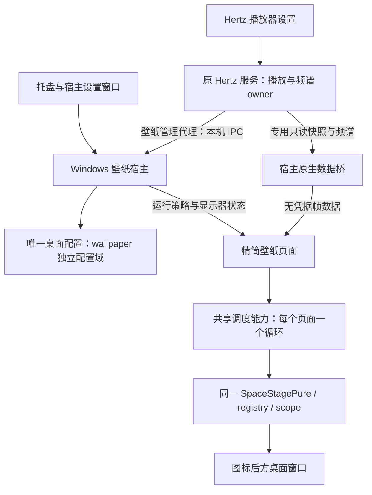

# Hertz 自带桌面壁纸模式：产品与技术方案

日期：2026-10-21。状态：产品目标已由用户选定；本文为待评审的设计方案，功能尚未实施，不代表架构已生效、原生兼容性已验证或发布日期已承诺。

核对基线：提交 `acd87e9` 与当日工作树。工作树包含正在进行的空间场景、星座和歌词相关修改，本文按实际源码描述现状，不把这些修改视为已经发布。本文交付范围为方案与文档导航；实现、依赖引入、安装和发布另行执行。

2026-10-22 设计修订：结合[桌面歌词方案](./desktop-lyrics.md)，将尚未实施的 `hertz-wallpaper.exe` 提案收敛为统一可选组件 `hertz-desktop.exe`。托盘、来源绑定、配置和全局自启只有一个 owner；壁纸与歌词保持独立窗口、启用状态和运行策略。歌词不依赖壁纸 W0，壁纸也不要求启用歌词；下文已同步相关归属。这是设计修订，不表示已存在需要兼容的旧壁纸组件。

2026-10-23 设计复核（`2f2765c`）：共同管理规则收敛到[共享宿主设计](./desktop-host.md)，W0 的步骤和阶段退出见[原生验证计划](./plans/2026-10-23-desktop-native-validation.md)。本页保留壁纸特有的场景、时钟、频谱和挂载契约；两份设计均尚未实施。

## 1. 产品目标与定位

**让 Hertz 的三维场景成为可以长期运行的 Windows 桌面壁纸：不播放音乐时保留安静的环境动画，播放 Hertz 音乐时响应真实频谱；关闭播放器网页后仍能使用，并主动为前台工作、游戏和电池续航让出资源。**

面向喜欢音乐视觉、希望桌面有适度动态效果的 Hertz 用户。第一阶段的价值是“已有场景的一键桌面化与可靠常驻”；长期价值是音乐、封面、歌词与桌面场景的组合。

用户对“像 Wallpaper Engine”的期待拆成三个层级：

| 层级 | 本方案定位 |
| --- | --- |
| 桌面动态壁纸体验 | 首版必须打通：桌面挂载、持续动画、音频响应、资源策略、托盘与退出 |
| 音乐场景创作能力 | 后续复用 Hertz 的参数、镜头和作品机制，逐项接入并验证 |
| 通用壁纸生态 | 暂不建设第三方代码加载、内容商店、订阅分发或 Steam 创意工坊 |

本专项使用 **W0–W3** 编号，与现有产品路线图 R0–R6 分开描述依赖和验收。不得把壁纸视为 AI 接入的前置条件，也不因本方案重排已在推进的播放可靠性工作。

## 2. 现状、可复用资产与缺口

| 现状证据 | 已有能力 | 对本方案的结论 |
| --- | --- | --- |
| [SpaceStagePure](../tools/space-stage/src/main.js) | 外部驱动的 `create/select/frame/resize/setParams/dispose`、共享 Three.js renderer、后处理与资源 scope | 作为共享场景内核，继续复用同一源码与构建产物 |
| [场景注册表](../tools/space-stage/src/registry.js)、[场景定义](../tools/space-stage/src/scenes/index.js) | API/state 版本、参数范围、默认值、机位、能力与预览 | 壁纸资格与构图元数据继续归场景定义，不复制另一套参数表 |
| [Space3D](../plugin/ui/space3d.js) | 播放器导航、面板、队列、歌词、镜头与场景挂载 | 是应用界面宿主，不宜直接把整个播放器页面挂在桌面后方 |
| [Stage](../plugin/ui/stage.js)、[ADR-0006](./adr/0006-frame-gates-and-visual-timing.md) | 帧门、播放位置插值、可见性与设备分级 | 复用调度原则，抽取必要公共能力；保留原播放器的时序语义 |
| [质量策略](../tools/space-stage/src/quality.js) | 几何、像素、DPR、资源统计与压力降档 | 保留现有预算来源；增加实际调度帧率输入，避免低帧率被误判为性能不足 |
| [服务入口](../crates/hertz-studio/src/main.rs)、[WebSocket](../crates/hertz-studio/src/ws.rs) | 独立形态为本地 HTTP/WS 服务，提供播放与频谱事件 | 尚无 Windows 桌面窗口宿主，也没有可直接用于壁纸的窄权限频谱桥 |
| [工程文件](./stage-projects.md)、[模板](./stage-templates.md) | 创意舞台已有参数、cue、工程和分享机制 | 当前主要归 CreativeStage，不能宣称所有 SpaceStagePure 场景已能导出成壁纸作品 |
| [双发行版](./editions.md)、[插件入口](../plugin/backend/src/main.rs) | Standard/Full 同源；DBX 通过 stdio RPC 使用服务逻辑 | 独立程序先交付；不能假定插件运行时存在相同本地 HTTP 入口 |

当前缺口包括 Windows 桌面挂载、原生托盘与生命周期、脱离播放的视觉时钟、后台功耗策略、独立壁纸入口、只读数据桥，以及真实 Windows/GPU 长时间验收。

2026-10-17 的[舞台引擎评估](./stage-engine-feasibility.md)保留为历史分析，其中部分注册表和生命周期缺口已经在当前源码中改善。本方案以上表及现行 ADR 为依据，不照搬旧文的完成比例或工期估计。未发现 `docs/aegis/baseline/` 快照；本次为有界源码核对，不是全仓架构审计。

## 3. 范围与默认行为

### 3.1 W1：首个可发布版本

| 项目 | 首版约定 |
| --- | --- |
| 平台 | Windows 11 x64，本机交互桌面；受支持的具体系统构建由 W0 实测矩阵确定 |
| 分发形态 | Hertz 独立程序的可选 Windows 桌面组件中的壁纸功能，Standard/Full 同源同版本 |
| 显示器 | 同时只在一个用户指定的显示器运行；默认选主显示器，允许手动改选 |
| 场景 | 优先交付一个通过原生验收的星座场景；海岸及其他场景在 W2 逐项开放 |
| 静音状态 | 保留低干扰环境动画，不生成伪造的音频节拍，不主动播放声音 |
| 音乐响应 | 仅响应绑定的 Hertz 服务真实输出的频谱；可关闭；不采集系统声音或麦克风 |
| 画面 | 无播放器导航、播放条、队列、歌词与封面叠层；提供亮度、运动强度、星座原有可用参数 |
| 输入 | 不抢焦点；桌面图标点击、拖拽、框选、右键和滚轮保持原有行为；不启用场景点击交互 |
| 性能 | 默认节能画质、30 fps 上限；可选 15/30/60 fps，60 fps 须由设备预算允许 |
| 暂停 | 手动、目标屏全屏覆盖、锁屏、息屏、休眠、会话断开、目标屏移除时停绘；默认使用电池时停绘 |
| 管理 | 设置入口、托盘菜单、运行状态、暂停原因、修改和停止 |
| 自启 | 默认关闭；用户开启后只启动桌面组件并恢复当前 profile 中 enabled 的功能，不启动音乐播放或完整曲库服务 |
| 无运行时 | 缺少 WebView2 Runtime 时显示明确状态与用户可触发的安装指引，检测不自动下载安装 |

“不播放音乐”与“壁纸已暂停”不同：前者继续环境动画，后者不推进场景。减少动态效果时保留静帧，配置或尺寸变化才合并补帧。

首版指定场景必须能独立运行，不依赖曲库、封面、在线账号或歌词。场景资格按注册表能力派生；开发版本中存在的其他场景不自动进入发布列表。

### 3.2 后续范围

| 阶段 | 能力 | 开放条件 |
| --- | --- | --- |
| W2：音乐桌面表现 | 海岸及更多内置场景、桌面构图参数、可选当前歌曲/封面/简洁歌词 | 每项完成构图、音频脱离、资源与隐私验收 |
| W2：作品化 | 版本化的壁纸配置导入导出、参数预置；按需接入已支持的编排能力 | 壁纸作品格式明确，场景归属与现有工程格式兼容规则稳定 |
| W3：系统音频 | 用户显式启用的 WASAPI loopback、设备切换与可选设备选择 | 独立验证采集、静音、设备热插拔、资源和权限体验 |
| W3：多屏与交互 | 多屏独立配置、整机总预算；可选不拦截图标的鼠标视差 | 首版单屏资源稳定，新的实例和输入契约完成评审 |
| 另行评估 | DBX 联动、Windows 10/ARM64、macOS/Linux、通用编辑器和内容分发 | 宿主权限、平台适配及维护成本有明确依据 |

暂不支持 Wallpaper Engine 原生作品格式、任意网页壁纸、用户提供的 JS/GLSL、视频壁纸播放器或 Steam Workshop。现有播放器、创意工坊和视频导出继续按原契约工作。

## 4. 使用流程与可见状态

### 4.1 首次启用

1. 用户在设置中进入“桌面壁纸”，或从具备壁纸资格的空间场景选择“设为桌面壁纸”。
2. 检查 Windows 形态、组件版本、WebView2 Runtime 和目标显示器；失败显示具体原因，不创建占住桌面的空窗口。
3. 展示同一场景的受控预览，选择显示器、亮度、运动强度、帧率和 Hertz 音乐响应。预览为单个活动实例，关闭页面即释放。
4. 点击“应用到桌面”后，启动或连接已有壁纸宿主，验证实际桌面挂载成功，再显示“壁纸运行中”。设置保存成功与挂载成功分开报告。
5. 桌面画面位于图标之后，应用出现托盘入口。关闭播放器网页不影响壁纸运行。

预览在播放器内显示不等于桌面挂载已经通过。只有原生宿主确认目标显示器、窗口归属和首帧就绪后，才报告应用成功。

### 4.2 日常管理

托盘提供“打开壁纸设置”“暂停/继续”“退出壁纸”。“打开壁纸设置”使用宿主自己的原生设置窗口加内嵌设置页，可在音乐服务未启动时使用；不靠自动启动整个服务才能修改壁纸。播放器的壁纸设置使用同一管理协议，不保存另一份配置。

所有设置入口共享[宿主唯一预览租约](./desktop-host.md#5-管理协议与恢复)，关闭、断连或超时回收，旧实例释放后才可交接。壁纸预览的像素、几何和后处理上限从现有低档 profile 派生，叠加预览视口上限；不因同时打开两套设置而各建一份 renderer。

| 用户动作或环境变化 | 明确行为 |
| --- | --- |
| 关闭播放器网页 | 壁纸继续；当前服务在最后页面离场宽限期后暂停音乐，壁纸转环境动画，不计作播放器页面观察者 |
| 停止 Hertz 服务 | 壁纸保留环境动画，频谱在 1 秒内衰减至零，显示音乐源未连接 |
| 暂停 Hertz 音乐 | 仅音频响应消退；环境动画继续 |
| 手动暂停壁纸 | 停止连续绘制并冻结视觉时间；不会暂停歌曲 |
| 退出壁纸 | 关闭持久壁纸 enabled 并销毁其窗口/controller；若歌词仍启用则桌面组件继续，Hertz 播放不受影响 |
| 再次启用另一发行版或数据目录 | 明确展示当前绑定，用户选择“切换来源”后替换；不同时启动两套桌面宿主 |
| 登录自启 | 全局开关开启时恢复当前 profile 中 enabled 的桌面功能；源服务未运行时壁纸保持环境动画 |
| 用户在 Windows 中修改原壁纸 | 保留系统的新配置；退出 Hertz 壁纸时显示当下系统壁纸 |

宿主设置页默认开关包括音乐响应、电池暂停、全屏暂停和登录自启。登录自启为整个桌面组件的全局偏好，恢复唯一当前 profile 中 enabled 的功能，不在各 profile 中分别保存。退出壁纸关闭其 enabled，下次登录不恢复壁纸；手动暂停仅为本次运行状态，不关闭 enabled 或覆盖画质。锁屏、休眠和会话不可用属于强制停绘条件，不提供持续绘制选项。

运行状态展示为“运行中”“已暂停：原因”“等待显示器”“音乐源未连接”“桌面连接失败”“需要运行时/版本升级”。原生实现细节保留在诊断面板，不放进主要启用流程。

## 5. 技术路线与选型

| 路线 | 特点 | 取舍 |
| --- | --- | --- |
| **A：独立 Rust 壁纸宿主 + WebView2 + 共享场景内核** | Windows 窗口、托盘、策略和 WebView 生命周期独立；场景继续使用现有 JS | 推荐；需要验证原生挂载和 Runtime 部署，但故障及平台依赖可隔离 |
| B：在现有服务进程加入桌面窗口 | 二进制数量较少 | 网络服务与 Windows UI 消息循环耦合，GPU/UI 故障影响播放器；不作为首版方向 |
| C：完整 Tauri/Electron 应用壳 | 窗口与打包框架现成 | 新增应用框架和部署体系；当前只需要单个 Windows 原生宿主，收益不足 |

推荐新增可选组件 `hertz-desktop.exe`，源码建议位于 `crates/hertz-desktop/`；其 `wallpaper` surface 独占壁纸窗口和桌面挂载，`lyrics` surface 见桌面歌词方案。原生依赖优先评估 `windows` 与 WebView2 Rust 绑定；准确版本、Rust 1.88 兼容性和许可证由率先实施的 L0/W0 锁定后才进入生产依赖。若该组合无法可靠工作，应重审选型，不临时叠加多套原生宿主。

原 `hertz-studio` CLI、HTTP/WS 服务和 DBX 包保持原分发与启动方式。壁纸组件作为额外 Windows 产物，基础 CLI 的单 exe 使用不依赖该组件；也不把 Node.js、Python 或浏览器调试工具加入用户运行时。

WebView2 优先使用已安装的 Evergreen Runtime，组件自身内嵌壁纸页、设置页和同版本场景资源，不依赖运行期开发服务器或 CDN。首次启用由播放器调用组件内嵌的原生设置页完成资格检查和预览；已有网页入口只发管理意图并展示状态。未安装组件时说明获取匹配版本的方法，不把下载解包藏在“应用”操作中。

壁纸、歌词与宿主设置页由同一组件管理专属 WebView2 environment，数据目录与普通浏览器、DBX 和播放器网页隔离；不借用它们的 profile。内嵌页面使用受控本地 origin，拒绝外部页面导航和任意本地文件读取，不向 JS 暴露通用原生命令执行接口。environment 的创建、关闭、进程归属与缓存边界由共用原生实验验证；关闭壁纸不关闭仍启用的歌词。

两个发行版使用同一共享构建流程和 UI 资源注册来源，不能手工维护第二份 Three.js bundle 或资产清单。生产构建需检验组件、服务与共享场景资源的版本/hash；新增 Windows 依赖不能使 Linux/macOS 的原工作区检查被迫编译原生宿主。

### 5.1 运行架构

宿主不启动第二个音频引擎、不打开播放器 SQLite、不扫描曲库、不调用模型。服务断开影响音乐响应，不影响壁纸的基本渲染。

### 5.2 模块归属

以下路径为建议落点，不代表文件已创建：

| 模块 | 建议落点 | 唯一职责 |
| --- | --- | --- |
| 桌面窗口与恢复 | `crates/hertz-desktop/src/wallpaper/desktop.rs` | 识别桌面层、定位窗口、显示器/DPI 变更、Explorer 重挂 |
| 壁纸运行策略 | `crates/hertz-desktop/src/wallpaper/policy.rs` | 汇总本 surface 暂停原因，输出有效运行策略 |
| 设置与进程入口 | `crates/hertz-desktop/src/main.rs`、`config.rs`、`ipc.rs` | 全桌面组件单实例、配置提交、托盘、设置窗口与管理协议 |
| 壁纸数据桥 | `crates/hertz-studio/src/wallpaper.rs` 与宿主 `feed.rs` | 服务导出窄只读数据；宿主验证来源、合并与转交 |
| 壁纸呈现 | `plugin/ui/wallpaper.html`、`wallpaper.js`、`wallpaper.css` | 精简页面、场景挂载、无音乐动画与配置补帧 |
| 通用调度 | 从 `plugin/ui/stage.js` 抽取的纯调度模块 | 保持帧门分频和真实 dt 语义；Stage 与壁纸分别消费 |
| 场景和预算 | 原 `tools/space-stage/src/` 与相关场景源码 | 参数、机位、运动逻辑、质量与资源释放 |

场景是否适合壁纸由原 registry 中的可扩展能力描述，例如版本化 `capabilities.wallpaper`，默认未开放。相关参数与构图默认值仍在原场景定义中。菜单从 registry 派生，不维护另一份硬编码可用场景清单。

## 6. 时钟、可见性与帧契约

### 6.1 区分三类时间

| 时间 | 来源与用途 | 暂停/断连语义 |
| --- | --- | --- |
| 单调时刻 `now` | 宿主页面单调时钟，用于采样和调度 | 不作为歌曲位置，不累加恢复期间的大 dt |
| 视觉时间 `sceneTime` | 唯一视觉调度 owner 在允许运动时累加 | 音乐暂停不断；壁纸暂停、隐藏或减少动态效果时冻结 |
| 歌曲位置 `position/time` | 服务播放快照及有界插值，保留现有 Stage 语义 | 歌曲暂停冻结；换曲/seek 重锚；断连后无效 |

每个渲染页面至多一个调度循环。播放器和独立壁纸是不同页面，可以各有一个实例；不得在同一个页面让 Stage、场景和壁纸控制器同时创建循环。壁纸背景与宿主设置页预览同时存在时，预览占用单独、可观测的临时预算，关闭即释放。

需要给共享帧输入补充“视觉是否运动”的明确信号，如 `motionActive`。旧播放器默认由 `playing && !reduced` 得出；壁纸由运行策略得出。`playing` 继续只表达实际音乐状态，不能为让场景转动而永久伪造为 `true`。

除了改动 `space3d.js` 的推进条件，还须检查场景内部：当前星座和海岸的 `createScene().update()` 也读取 `frame.playing` 决定冻结。首版场景必须迁移这一分支并验证旧入口行为，不能仅补一个新的外部时钟。

恢复绘制时重置帧基准、频谱平滑和性能采样窗口，以有限 dt 继续；不追赶休眠期间的时间，不一帧跨过大量动画。

### 6.2 后台可见性是 W0 的关键验证

现有 `Stage.frame()` 与 `SpaceStagePure.frame()` 都有页面隐藏即停的保护。WorkerW 层的 WebView 可能被判为遮挡或后台，不能假定切成桌面窗口后 rAF 仍正常。

W0 必须同时验证原生窗口状态、`document.hidden`、实际帧回调与 GPU 绘制；普通浏览器标签的测试不足以证明桌面宿主可用。若需将共享内核的可见性判断改为宿主输入，默认仍保持现有网页行为，壁纸仅接受本机可信宿主的有效策略。

不得全局移除隐藏保护、通过模拟音乐播放维持动画，或依赖关闭浏览器所有节流的全局启动参数作为发布方案。无法在限定宿主内可靠控制绘制与停绘时，W0 不通过。

## 7. Windows 桌面生命周期

采用位于图标层后方的独立窗口。WorkerW/Progman 相关桌面挂载为待验证的 Windows 实现手段，并非稳定公开产品契约；封装在 `desktop` 模块，不泄漏到场景代码。

| 场景 | 宿主行为 |
| --- | --- |
| 首次挂载 | 创建不激活、不进入 Alt+Tab 的桌面窗口；确认层级、目标屏和首帧后报告成功 |
| 桌面输入 | 壁纸不获取键盘焦点；验证 WebView 子窗口也不拦截桌面命中测试；不装全局输入钩子 |
| Explorer 重启 | 清除旧窗口归属，重新探测；同一 120 秒滚动窗最多 3 次自动恢复尝试，超限或连续失败进入明确错误态等待用户重试 |
| 场景加载或挂载失败 | 销毁候选及其资源，保留系统桌面；不退成普通前台全屏窗口 |
| 目标屏拔出 | 停绘并释放失效呈现目标，进入等待显示器；不自动占用另一块屏 |
| 目标屏重新连接 | 按稳定显示器身份匹配，重算 DPI 和尺寸后恢复；不能只依赖显示器枚举序号 |
| 分辨率/DPI/横竖屏变化 | 合并 resize、重新构图；不重置用户参数或覆盖保存的质量偏好 |
| 锁屏/休眠/会话断开 | 停绘并停用不需要的数据订阅；恢复后重新确认桌面和最新音频状态 |
| WebGL context loss/WebView 崩溃 | 释放失效实例，受统一恢复预算约束；恢复失败露出系统壁纸并保留诊断入口 |
| 手动退出/升级/卸载 | 停止订阅、销毁窗口和资源，移除需要移除的自启项；不终止无关 WebView2 进程 |

Explorer、GPU 与 WebView 恢复由宿主统一计数和协调，不让每个子模块各用 3 次额度叠加重试。初次用户应用不计作恢复；每次自动重建呈现/context 计一次，按单调时间记录尝试，未进入终止错误态时移除超过 120 秒的旧记录。成功恢复不立即清空记录；第三次尝试仍失败，或下一次尝试将超过窗口限额时，锁定为终止错误态。

进入终止错误态后，时间自然过去、窗口事件或设备事件都不解锁；仅显式用户“重试/重新应用”清空记录并开始新轮。显示器缺席是等待状态，不计入渲染故障重试，不持续轮询重建。

覆盖窗口方案不修改 Windows 的系统壁纸配置，因此不需要用旧截图或旧路径“恢复原壁纸”。停止或崩溃后应露出系统当前壁纸，包括用户在 Hertz 运行期间刚改过的壁纸。

全屏检测限定在目标屏：非本进程、非桌面壳的可见前台窗口覆盖目标屏主要区域时触发；兼顾独占与无边框全屏，不把其他屏上的全屏误判到目标屏。事件合并及短防抖避免切换闪烁，具体窗口边界算法在 W0 用实际游戏/视频/任务切换验证。

W1 不承诺普通窗口部分遮挡的逐像素裁剪，也不承诺远程桌面持续动画。普通窗口覆盖仍受 30 fps/质量预算约束；本机会话断开必须停绘。

## 8. 音频与服务只读桥

### 8.1 首版数据边界

新增专用只读能力，从既有播放状态和频谱广播派生数据，不创建第二份 FFT 或第二个播放状态 owner。现有 OBS `overlay-key` 只允许歌词与封面；主 `/ws` 使用原鉴权，均不能直接宣称为已具备的壁纸频谱通道。

建议的 HTTP/WS 形状如下，均为新增草案，不是当前公开 API：

| 入口 | 权限与行为 |
| --- | --- |
| `GET /v1/wallpaper/snapshot` | 专用只读凭据；获取发行版、来源身份、服务会话、播放状态与最新频谱快照 |
| `GET /v1/wallpaper/events` | 原生客户端使用凭据请求头升级 WS；首发完整快照，再推送允许的播放/频谱事件 |
| `/v1/desktop/control/*` | 原应用鉴权；统一管理门面转发宿主 IPC，命令明确指定 surface，不改变音乐播放 |

只读凭据建议为服务数据目录下独立的 `wallpaper-key`，复用既有本地秘密文件创建/权限机制，但不复用 `token` 或 `overlay-key`。它只允许专用快照与事件入口，不能访问主 `/ws`、播放控制、曲库列表、账号、设置或 AI。

本地 native feed 读取该钥匙，JS 页面不读取文件、不拿播放器完整令牌，也不持有只读钥匙。原生桥将数据转为无凭据消息交给内嵌页面；来源不在受信内嵌 origin 的页面不得接收桥或命令。

#### W1-A 冻结：首版只做快照轮询（2026-10-24）

W1-A 先实现 `GET /v1/wallpaper/snapshot`，不实现 `/v1/wallpaper/events` WS；事件推送留到 W1-B。原生 feed 500 ms 轮询，不新建第二份播放/频谱 owner。W1-A 只交付契约与宿主 feed，探针场景仍只做环境动画；把 feed 接入场景在 W1-B 完成。

| 项 | 冻结值 |
| --- | --- |
| 凭据 | 数据目录 `wallpaper-key`（64 hex，删文件重启轮换）；请求头 `Authorization: Wallpaper <key>`；只放行该 GET |
| discovery | `vmusicd.json` 增加 `wallpaper_protocol: 1`；缺失/不匹配时停止音乐桥，不扫描端口 |
| 快照 | `protocol:1`、`timing:"presentation_applied"`、`server{session,edition,version}`、`seq`、`valid`、`playing`、`positionMs`、`durationMs`、`generation`、`spectrum{bands[64],energy,ageMs}` |
| 频谱 | 64 个有限值，范围 0..1；`energy` 为均值；服务端最后一帧超过 1 s 归零 |
| 新鲜度 | 客户端 500 ms 内原样、500–1000 ms 线性衰减、之后归零；没有频谱帧也归零 |
| 暂停/无曲 | `playing:false` 时不插值位置，频谱按 `ageMs` 衰减；环境动画继续 |
| 断连 | HTTP 失败、发现失效或会话变化时丢弃快照，不保留旧位置插值；按有界退避重读发现 |
| 迟到/重复 | 同一 session 内 `seq` 必须严格递增，否则 `wallpaper_stale_snapshot` |
| 隐私 | 不含曲名、路径、账号、封面；W2 再单独评审 |

客户端错误码冻结为：`discovery_missing`、`discovery_invalid`、`edition_mismatch`、`wallpaper_protocol_missing`、`wallpaper_protocol_mismatch`、`wallpaper_key_missing`、`wallpaper_key_invalid`、`wallpaper_http_error`、`wallpaper_session_changed`、`wallpaper_stale_snapshot`、`wallpaper_invalid_snapshot`。服务端对越权一律 401，不回显钥匙。

#### W1-B 首片进度（2026-10-24）

已实现：`hertz-desktop` 的壁纸场景页（registry 相机 + `applyFeed`）、WorkerW 目标屏 surface（完整显示器矩形）、混合 DPI WebView 缩放补偿、目标屏选择（设置页）、500 ms feed 线程、全屏/会话/息屏停绘、托盘“显示壁纸”开关（用户隐藏时隐藏 WebView，露出系统壁纸）、壁纸设置页（启用/目标屏/帧率/跟随音乐）、15 s 预览租约与预览窗口、应用 revision 与运行时启停、Explorer 重启自动恢复（存活检测 + 3 次/120 s 预算 + 托盘重新挂载），以及 `wallpaper.enabled`（默认关闭）与 `--wallpaper` 运行开关。隔离 mock 快照端到端已记录 page ready / mounted / feed ok；设置页经 WebView2 CDP 验证预览、应用、live surface 与 feed；真实 Explorer 重启验证 page/scene 重新挂载。

未实现，当前不能标记 W1-B 完成：主应用侧的宿主管理 IPC、自启、多 profile/发行版切换、事件 WS；同时挂多块屏、分辨率/DPI 拓扑变化后的自动重排仍属 W3。当前环境只枚举到主屏，混合 DPI 的实机复测（96/144 → 0.667）仍需外接屏；运行中的旧服务也需重建/重启后才提供 `wallpaper-key` 与快照端点。

#### W1-B 设置与预览首片（2026-10-24）

- 托盘“壁纸设置”打开 520×520 设置页；可改启用、15/30/60 fps、跟随音乐，点“预览”打开 960×540 场景预览窗口。
- 预览租约 15 s，设置窗口打开期间自动续租；同一时间只有一个预览；关闭设置、应用或超时都会关闭预览。
- “应用”校验当前配置 revision 后保存，运行时创建/销毁 WorkerW surface、重建托盘并更新 feed 响应；目标屏变化会重建 surface；失败显示错误，不静默改配置。
- 设置页可选目标显示器；列表来自宿主的完整显示器矩形（设备名、物理尺寸、DPI、主屏标记），选择结果保存到 `wallpaper.monitor`。
- 当前页面 IPC 只属于宿主设置页；主应用通过服务端转发命令的宿主管理 IPC 与自启/事件 WS 仍未完成。

#### W1-B 多屏与混合 DPI 首片（2026-10-24）

- 宿主枚举每块显示器的完整矩形、设备名、有效 DPI 与主屏标记；默认主屏，用户可在设置页选择单块目标屏。
- 壁纸窗口作为 WorkerW 子窗放在目标屏完整矩形（不受任务栏工作区裁剪）；WebView 缩放因子为目标 DPI / 窗口 DPI，页面按目标屏 CSS 尺寸首次布局。
- 目标屏消失时停绘并保留窗口；重新出现后恢复绘制。分辨率/DPI 拓扑变化后的自动重排、同时挂多块屏仍未实现（W3）。
- 当前机器只枚举到 `DISPLAY1 2560×1600@144`，已验证目标屏选择、完整矩形、`zoom=1.000`、page/scene/feed；W0 探针曾在 96/144 混合 DPI 上验证 `0.667` 补偿，但生产宿主路径需接第二块屏后复测。

#### W1-B Explorer 重启恢复（2026-10-24）

- 每秒核对壁纸子窗口仍挂在 WorkerW 下；Explorer 重启销毁 WorkerW 后自动丢弃旧窗口，重新找 Progman/WorkerW（各最多等 3 s）、建窗、挂载并加载场景页。
- 页面事件带 generation；旧页面的迟到 IPC 被丢弃。新页面就绪后重新应用最新 feed，并以当前 policy/用户隐藏状态起停。
- 自动恢复预算为 120 s 内最多 3 次；到顶进入终止态并提示，托盘“重新挂载壁纸”显式清零预算后重试。设置页“应用”也会清零预算。
- 真实 Explorer 重启验收：初始 page ready/mounted 各 1 次，重启后各增至 2 次，`wallpaper recovery success attempt=1`，宿主继续运行；仍未覆盖其它 OS、弱机和 GPU 恢复。

### 8.2 数据与流量约定

W1 帧数据包括协议版本、发行版、绑定 profile 身份、当前服务 session、递增序号、有效性、播放标志、歌曲位置、64 个有限频谱数值和能量。频谱归一化到约定范围，非法值拒绝，不传 PCM、文件路径、账号或整张曲库。

播放状态与频谱的新鲜度分别跟踪。没有频谱更新不等于曲目变化，也不能因为服务仍连接就永久保持上一帧能量。超过 500 ms 未收到有效频谱，开始衰减；包括衰减在内，最后有效帧后 1 秒内归零。断连立即使歌曲位置插值失效，转环境动画。

原生接收层按类型只保留最新待处理快照和频谱，不为每帧追加任务。向页面推送上限为 `min(30, 当前有效绘制 fps)`；暂停时停止频谱订阅或转为只接收低频状态，恢复先拉最新快照再订阅。不重放暂停期间的频谱。

壁纸只读连接不增加播放器页面观察者计数，不改变当前固定离场暂停策略；关闭最后网页后音乐暂停，环境动画继续，详见[共享宿主 §2](./desktop-host.md#2-播放生命周期的当前事实)。桌面歌词使用独立窄凭据和数据面；共享宿主不代表歌词页面能读取壁纸频谱或任何完整播放控制权限。

WS 重连采用 1/2/4/8/16/30 秒有界退避，恢复收到有效快照后重置；断连期间不触发用户提示连发，不尝试启动服务。服务会话变化时清空旧序号和时间锚，旧连接迟到事件不能覆盖新快照。

来源身份、切换和 discovery 统一遵循[共享宿主 §3/6](./desktop-host.md#3-来源身份与切换)，不依赖 AI/MCP 开启。壁纸 feed 仅采纳绑定 profile 的数值 loopback 端点，不跟随重定向、不扫描默认端口；随机/自定义端口从版本化发现记录取得，再核对认证快照身份。当前 `vmusicd.json` 尚缺该身份契约，必须补齐后接入。

发现记录缺失、过期、端点未就绪或来源不匹配时保留环境动画，并按有界退避重新读取。服务晚启动或换端口重启后可重新发现；旧记录和旧连接不能修改当前绑定。发现记录中现有全权 token 不传入壁纸页面，专用 feed 仅使用 `wallpaper-key`。

### 8.3 后续系统音频与歌词

W3 的 WASAPI loopback 是独立输入源，必须由用户显式选择。首个版本只选 Hertz 或系统混合声音中的一个，不自动混合、不静默改源。无麦克风采集，也不落盘原始音频。

系统声音只提供混合音频与分析结果，不能据此识别当前歌曲、封面或歌词。W2 歌曲信息只能来自显式绑定的 Hertz 播放状态；与系统音频同时使用时必须标明两者来源，不能显示为同一首歌的可靠同步。

W2 封面只允许服务确认的当前曲目封面入口，由原生桥有界读取；不得让壁纸根据收到的任意 URL 下载资源。歌词为默认关闭的可选叠层，复用原歌词时钟与渲染能力，并提供隐藏歌曲信息的开关。

## 9. 管理协议、配置与发行版隔离

### 9.1 单一桌面 owner

单实例、交互会话、托盘、activeProfile 和管理 IPC 的唯一规范为[共享宿主设计](./desktop-host.md)。壁纸只拥有自己的 controller、挂载与运行策略；管理命令显式指定 surface。第二份 exe 不会静默替换已有宿主，配置提交与运行就绪分别报告。

### 9.2 配置唯一归属

共享配置路径、总容量、revision、profile 切换和失败处理由[共享宿主 §4](./desktop-host.md#4-配置提交与实际运行分离)定义；本页只定义各 profile 的 wallpaper 域，不在 `settings.space3d` 或 localStorage 保存副本。字段如下：

| 字段组 | 内容与约束 |
| --- | --- |
| 场景快照 | `sceneId`、原 `stateVersion`、原 registry 校验后的 `params`；不复制默认值生成规则 |
| 桌面设置 | 目标显示器稳定标识、亮度、运动强度、质量与 FPS 偏好 |
| profile 壁纸运行偏好 | enabled、音乐响应、全屏暂停、电池暂停；不复制宿主全局自启开关 |

配置提交前使用原 registry 校验场景参数。挂载失败仍如实保留“配置已保存、运行失败”，不会自动改回另一 profile；选择上次有效配置须由用户明确提交。配置不可读时不擅自用默认场景占据桌面。

“将当前舞台设为壁纸”是一次性复制已校验的场景状态。之后舞台和壁纸各自修改，不双向实时同步。未具备壁纸资格的场景明确不可用，不能静默换成另一场景。

新场景候选在同一个呈现目标内切换，最多一个待应用请求；过期的异步结果必须失效并释放 scope。若切换失败，露出系统桌面并报告失败，用户可以选择上一个有效配置重新应用；不保证同时保留两套 GPU 场景做无缝回退。

### 9.3 登录自启与更新

自启、便携目录迁移、安装升级和协议兼容遵循[共享宿主 §6–7](./desktop-host.md#6-数据权限和版本边界)。退出壁纸不禁用歌词；数据协议不兼容时停止音乐桥，已有环境动画可继续。壁纸内嵌场景资源必须与宿主配套，不现场替换运行中的脚本包。

## 10. 性能、功耗与可观测性

### 10.1 一份策略计算有效预算

有效运行策略由原生 host 汇总：会话/显示器可用性、锁屏和电源、用户暂停、全屏、减少动态效果、FPS 偏好及设备上限。所有暂停原因构成集合，界面显示最高优先级原因；解除其中一个原因不能误恢复仍被其他原因暂停的画面。

有效 FPS 为用户 FPS、设备/场景 FPS 上限与运行策略上限的最小值，再由现有整数分频逻辑求可执行预算。显示器刷新率无法整除目标时，允许更低的实际预算，例如 75 Hz 下目标 30 fps 可能得到 25 fps；显示真实有效预算，不伪称固定 30 fps。

几何、像素、纹理和后处理预算仍由现有 `quality.js` 及场景定义持有。壁纸默认低档，首版关闭高成本后处理；画质和帧率是两个独立偏好，改变 FPS 不隐式覆盖用户选择的画质。

### 10.2 修正低帧率误判

目前 `quality.js` 按质量档固定 30/60 fps 评估帧间隔；Stage 另有连续播放低于 40 fps 的探针。中档壁纸主动限到 30 fps，或低档限到 15 fps，都可能被误判。

共享质量采样须接收当前有效调度预算，所有依赖帧预算的判断一起调整，包括 p95 帧间隔与 `cpuMs` 阈值；资源超限仍独立判断。故意限帧、暂停补帧、启动预热与休眠恢复不计作性能退化。未传新预算的旧入口保留原默认行为。壁纸不运行播放器那套固定 40 fps 的分级探针，也不另建第三份几何/DPR预算表。

### 10.3 资源与诊断边界

- W1 桌面呈现最多一个活动场景 renderer；所有设置入口经宿主预览租约合计最多一个临时 renderer，总计最多两个。预览关闭立即释放，换租约须确认旧实例释放后再创建。原播放器本身的场景开销另计并纳入同机共存测试。
- 渲染暂停后不运行连续帧循环，不持续上传频谱纹理；保留静帧不等于销毁所有 WebView 内存。息屏等长期暂停超过 5 分钟可释放场景 GPU scope，恢复后重建，不丢失用户配置。
- 退出壁纸释放其 controller、频谱连接和 scope，不关闭仍启用的歌词；仅全部 surface 与设置关闭时退出宿主，届时窗口、IPC、WS、定时器及专属 environment 的 WebView 进程全部退出。先正常关闭全部 controller/environment，8 秒内核验退出；若需终止遗留进程，只能操作 W0 已证明归属于专属 environment 的受控进程/Job，不能误杀歌词或无关浏览器。无法界定归属时保留诊断并判退出验收失败。
- 诊断展示期望/有效/实测 FPS、帧间隔、绘制调用、跟踪资源估计、暂停原因、桥状态、恢复次数和错误。跟踪资源估计不能标为实测显存；无法测得 GPU 时间时明确不可用。
- CPU、内存和 GPU 统计包含 host 及其所有 WebView 子进程。日志不记录凭据；默认不记录逐帧频谱、歌曲位置或歌曲正文。

## 11. 阶段交付、依赖与退出条件

| 阶段 | 工作与产物 | 进入下一阶段的条件 |
| --- | --- | --- |
| **W0：原生可行性验证** | 最小桌面宿主、星座一场景、WebView2/GPU/可见性验证、输入穿透、锁屏/全屏/Explorer/显示器恢复；依赖与支持矩阵报告 | 实机可可靠绘制及停绘；失败可退出并露出系统桌面；性能预算与组件部署路线确定 |
| **W1-A：共享运行契约** | 调度抽取、视觉/歌曲时钟分离、星座运动解耦、质量采样修订、只读 feed 与协议身份 | 原舞台回归通过，壁纸无音乐/暂停/断连语义确定；低 FPS 无误降档 |
| **W1-B：产品闭环** | 管理 IPC、配置与 revision、设置预览、一键应用、托盘、自启、单屏与发行版切换、有限恢复 | 首次启用、修改、退出、重启与安装升级流程可完整走通 |
| **W1-C：发布候选验收** | Standard/Full Windows 组件、实机长稳、共存播放、恢复矩阵、资源报告与用户说明 | 第 12 节全部必需项通过；支持范围与已知限制绑定候选版本 |
| **W2：音乐桌面与作品** | 更多场景、构图、封面/歌词、版本化壁纸预置；按需复用编排 | 每项独立验收，不以场景数量替代完成度 |
| **W3：系统音频与多屏** | WASAPI 输入、整机多屏预算、可选交互 | 另行设计输入、采集、资源与兼容契约，完成真实设备验证 |

W0 先验证最不确定的 Windows 边界，W1-A/B 可在接口明确后分工；集成前均依赖 W0 结论。W2/W3 不阻塞首版，不要求模型、商店或通用编辑器先完成。

W0 输出必须包含具体 Windows 构建、GPU/驱动、显示器/DPI/刷新率、WebView2 版本、Rust 依赖、帧率和资源数据。若可靠运行依赖不受控的系统改动、关闭所有后台保护或无法恢复桌面输入，停止进入 W1，重审技术路线。

本方案不锁发布日期。W0 实测后才能按已验证的部署与恢复成本拆工期，不能用现有 Web 场景数量推算原生开发完成比例。

具体实验见[原生验证计划](./plans/2026-10-23-desktop-native-validation.md)。W0 只证明原生挂载/绘制及所测恢复条件；进入 W1-A 前冻结共享帧信号、频谱 schema、身份和窄凭据契约，进入 W1-B 前冻结管理 IPC，W1-C 再完成八小时长稳与完整发布矩阵。

## 12. 验收标准与证据

以下为未来实现的验收目标，当前没有运行结果。测试须绑定提交、组件版本、系统和硬件；纯浏览器、软件 WebGL 或构建成功均不能代替原生桌面证据。

### 12.1 功能与生命周期

| 编号 | 必须证明的结果 |
| --- | --- |
| A1 | 初次应用在指定屏图标后方可见；Alt+Tab、图标双击、拖拽、框选、桌面右键和任务切换正常 |
| A2 | 无曲库、无网络、无源服务时可独立运行星座环境动画；没有伪造节拍或自行发声 |
| A3 | 播放 Hertz 实际音乐时有对应频谱响应；暂停音乐后动画继续，最后有效频谱后 1 秒内能量归零 |
| A4 | 关闭播放器网页不停止壁纸；退出壁纸不停止播放；服务停止后转无音乐状态且不自动重启服务 |
| A5 | 手动暂停、全屏、锁屏、息屏、电池、显示器移除和会话断开均停绘；多个暂停原因叠加时无提前恢复 |
| A6 | Explorer 重启、显示器断开重连、锁屏解锁各重复 10 次；目标身份正确，无累积窗口、无限恢复或前台全屏兜底 |
| A7 | 50 次应用/停止和连续切换设置，无遗留壁纸 controller/scope；未启用歌词时无遗留宿主或子进程；旧异步场景结果不会覆盖最新配置 |
| A8 | 系统壁纸在运行期间改动后，停止、崩溃和卸载壁纸组件均显示当前系统配置，不覆盖为旧值 |
| A9 | 全局自启默认关闭；切换来源后登录只恢复当前 profile 中 enabled 的桌面功能，关闭后任意 profile 都不自启；禁用/卸载无残留有效启动项；Runtime 缺失与版本不兼容可理解地失败 |
| A10 | Standard/Full 及不同数据目录的配置与音频来源不串用；第二个实例必须显式切换；DBX 不暴露不可用的启用操作 |
| A11 | 宿主设置窗口在服务停止后仍可修改、应用和退出；并发修改旧 revision 被拒绝，没有双份偏好 |
| A12 | 自定义端口、随机端口、服务晚启动和换端口重启均按绑定 profile 的 discovery 恢复；旧记录、错误来源及重定向不会导致串源 |
| A13 | 播放器与托盘同时请求设置预览时只有一个有效租约；关闭、失联和过期均回收，FPS/像素遵守预览预算 |

### 12.2 时钟、预算和故障

| 编号 | 必须证明的结果 |
| --- | --- |
| T1 | 每个渲染页只有一个连续调度 owner；暂停 10 秒采样中无连续 `frame/render` 调用，允许合并的配置补帧 |
| T2 | 音乐 pause/seek/换曲不倒退视觉时间；壁纸暂停恢复不追赶大 dt；原播放器暂停和歌词时钟保持原行为 |
| T3 | 15/30/60 fps 与 60/75/120/144 Hz 组合按实际有效预算采样；主动限帧不触发错误降档，真实资源超限仍降档 |
| T4 | WS 断连、旧会话迟到、非法频谱、事件突发和慢页面消费者均有界；暂停频谱不积压，恢复从最新快照开始 |
| T5 | 只读钥匙可读专用 feed，但对主 `/ws`、播放、曲库、设置和 AI 均被拒绝；页面和 URL 无任何钥匙或全权 token |
| T6 | GPU/context/WebView 失败受统一重试预算约束；到顶后留可操作错误，无持续黑窗口和无限进程拉起 |
| T7 | 坏配置、未来版本、旧 revision 和不合格场景不会被静默改写；原文件保留，失败状态明确 |

### 12.3 原生长稳与性能门槛

W0 选定一台代表性集显设备和一台高 DPI/独显设备，记录完整配置；这是测试基准，不能直接宣称为最低硬件要求。

首版默认场景在代表设备上按低档、1080p 输出、30 fps 上限跑以下检查：

- 预热 10 分钟后连续运行 8 小时，覆盖无音乐、真实 Hertz 播放和周期性暂停恢复；与无壁纸的同一播放条件对照，不得新增可复现的播放中断。
- 排除明确的启动/恢复窗口后，实际帧率至少达到有效调度预算的 90%，帧间隔 p95 不高于有效预算间隔的 1.5 倍。
- 50 次启停及预览关闭后，窗口、活动 renderer、纹理与 scope 数量回到对应基线；进程树不得随次数增长。
- 以预热后第 30 分钟和最后 30 分钟为比较窗，观察进程树私有提交内存；增长不超过 `max(32 MiB, 基线的 10%)`，并检查无持续增长趋势。资源缓存变化须能由有界缓存解释。
- CPU/GPU/总内存的绝对上限由 W0 对照实测后作为发布阈值冻结，并在报告中给出机器与采样方法；未冻结或超标时不进入 W1 发布验收。不得用仅 JS 主线程或几何统计代替整机功耗与进程树开销。

Windows 支持矩阵至少覆盖实际准备支持的两个系统构建、混合 DPI/横竖屏、目标屏更换、常见全屏视频及一个真实游戏场景。未测系统和 GPU 标明未验收，不从同厂商另一设备推断通过。

未来实施按改动范围运行已有 `check-space-stage.js`、`check-space-scenes.js`、星座检查、帧门/前端/资源/双发行版检查及相关 Rust 测试；新增原生验收记录补入[发布矩阵](./release-validation.md)。具体命令以实施时现存脚本为准，不为本次文档交付运行重型功能测试。

## 13. 主要风险与处理决策

| 风险 | 应对与决定点 |
| --- | --- |
| Windows 桌面层级变化 | 限定实测支持矩阵，原生挂载集中封装，W0 失败不扩大范围；失败露出系统桌面 |
| WebView 后台节流或暂停失效 | 原生状态与实际绘制联合测量；采用限定宿主适配，保留普通网页保护 |
| 隐性资源开销 | 默认低档/30 fps，进程树计量，预览预算独立、长时间暂停释放场景 |
| 场景仍把播放状态当动画开关 | 增加明确运动信号，逐项迁移首版工厂，回归旧舞台与暂停语义 |
| 组件与服务升级不一致 | 同源构建、版本握手、协议主版本拒绝；不运行混合版本脚本 |
| 多实例争抢桌面/串音源 | 单一宿主、显式 profile 绑定、来源会话校验、用户确认切换 |
| 跨平台和 DBX 范围膨胀 | 原服务不引入桌面依赖；W1 仅 Windows 独立组件，其他形态另行验证 |
| 内容格式变成另一套引擎 | 场景/参数/机位继续归原 registry；W2 才定义壁纸作品格式和兼容边界 |

## 14. 架构决定信号与第一性原理复核

### 14.1 不变条件

1. 原服务唯一负责播放、音频分析、曲库与凭据；壁纸不成为第二个播放器。
2. 原场景定义唯一负责场景 ID、参数、默认值和资源创建；壁纸不复制引擎或默认值表。
3. 每个呈现页面只有一个调度 owner；播放位置与视觉时间语义分开。
4. 桌面输入、当前系统壁纸和现有播放可靠性不能因壁纸启用而受损。
5. 服务停止、网络断开和没有歌曲都能保留基本环境动画；锁屏、休眠和用户暂停时能真正停绘。

### 14.2 Owner 与退役矩阵

| 项目 | 新增/保留的 owner | 旧路径与退役条件 |
| --- | --- | --- |
| 桌面生命周期 | 新原生 HertzDesktop 统一管理，wallpaper surface 负责自身生命周期 | 现无旧桌面宿主，无兼容包装需要保留；不另建第二套歌词托盘/自启 |
| 场景渲染与参数 | 保留 SpaceStagePure 与 registry | 不新建复制版引擎；旧播放器入口保留原归属 |
| 调度算法 | 提取共享纯调度能力，Stage/壁纸各自持有实例 | 两方接入并验证后删除原内联算法重复实现，不长期双份维护 |
| 壁纸配置 | 原生宿主唯一文件与 revision | 不新增服务端/浏览器镜像；空间设置保持独立用途 |
| 只读音频数据 | 原服务从现有状态导出、原生 feed 消费 | 主 WS/OBS key 原用途保留，不扩大原 key 权限 |
| W0 试验代码 | 只为证明原生可行性 | W1 合入正式模块时删除重复入口与临时调度，不形成第二条发布路径 |

### 14.3 反证检查与结论

| 检查 | 方案必须给出的结果 |
| --- | --- |
| 移除播放器网页 | 壁纸仍运行，证明未依赖整页空间 UI |
| 移除服务与网络 | 无音频环境动画仍可运行，证明来源是可选输入 |
| 同时暂停音乐、恢复壁纸 | 画面恢复环境运动，证明视觉时钟没有偷用 `playing` |
| 同时锁屏、解除手动暂停 | 仍停绘，证明策略不是单个易覆盖布尔值 |
| 运行 Full 后启用 Standard | 显式切换身份、配置和 feed，证明未按端口猜源 |
| Windows 原壁纸被用户改动 | 退出后显示新系统壁纸，证明未依赖过时恢复快照 |

结论：推荐采用独立 Windows 宿主、共享场景内核、窄只读输入的路线；进入生产实现前必须取得 W0 原生证据。当前最大未知是桌面层级与 WebView2 后台行为，不能以现有浏览器场景可运行替代验证。

后续实现需要同步 ADR-0006 的每宿主调度、时钟与质量预算，ADR-0009 的壁纸资格及场景归属，并按实际落地补充桌面生命周期和只读桥的契约/数值决定。配置边界遵循 ADR-0002/0004，恢复预算遵循 ADR-0003。本文不提前修改现行 ADR 形成“已实施”事实。

## 15. 本次工作草案与评审重点

| 工作草案 | 本次落点 |
| --- | --- |
| TaskIntentDraft | 将 Hertz 自带桌面壁纸确立为产品目标，产出可评审的范围、架构、阶段与验收；本次止于文档，不实现组件 |
| BaselineReadSetHint | README、双发行版、产品/技术路线、现行 ADR-0002/0003/0004/0006/0009、Stage/Space3D/SpaceStagePure、场景和质量源码、服务与 WS、工程/模板、发布验收矩阵 |
| ImpactStatementDraft | 未来影响 Windows 组件、场景帧契约、共享调度、只读服务桥、设置入口和发布矩阵；原播放/账号/曲库归属、现有工程与分享格式、DBX 默认能力不变 |

进入实施规划前评审四项：W1 单屏/星座/独立组件的产品范围；WebView2 与独立进程的技术方向；宿主配置与服务只读桥的归属；W0 技术停止条件及 W1 原生发布证据。

产品方向已由用户选择。依赖锁定、公开接口最终字段和具体实施任务在本方案评审与 W0 证据明确后细化，不以本文草案替代生效契约。
