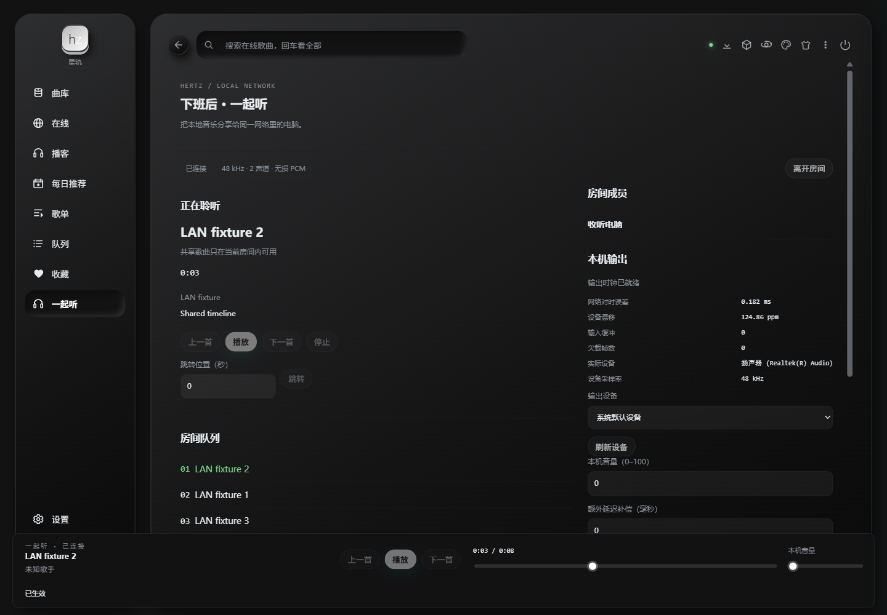

# 局域网一起听：使用与维护

每台电脑运行一份 Hertz 服务，浏览器访问本机界面。房主统一解码、混音和处理本地歌曲，所有收听端通过独立 TLS 音频通道接收同一份浮点 PCM；浏览器关闭后服务继续收听。

## 启动

```powershell
cargo build -p hertz-studio --bin hertz-studio
.\target\debug\hertz-studio.exe --open
```

若这台电脑已经运行另一份 Hertz，使用独立数据目录和空闲端口试用本交付，避免占用原实例：

```powershell
.\target\debug\hertz-studio.exe --data-dir .\output\lan-preview --port 0 --open
```

macOS / Linux 使用 `./target/debug/hertz-studio`，在浏览器打开终端打印的 `ui` 地址；当前 `--open` 自动打开仅支持 Windows。Linux 构建需安装 ALSA、D-Bus 开发库与 pkg-config（Debian/Ubuntu：`sudo apt-get install libasound2-dev libdbus-1-dev pkg-config`）。Standard / Full 使用同一房间实现；加入端不需要复制房主的音乐文件。

Full 版的构建命令为 `cargo build -p hertz-studio --bin hertz-studio --features full`，输出路径与 Standard 相同。

在导航栏选择“一起听”。房主先导入本地曲库，再创建房间，选择实际局域网网卡。端口 `0` 由系统分配；需要固定防火墙规则时指定固定端口。只把这个房间 TCP 端口放行给可信局域网，本机管理 API 仍绑定回环地址。主机可以关闭“本机同时收听”，由其它电脑输出音频。

## 分享与加入

1. 房主在“分享本地歌曲”中选择歌曲，应用分享范围，再从“共享曲库”加入房间队列。未分享的曲目和本地文件路径不会发送给成员。
2. 在“邀请与成员”勾选权限并生成邀请。邀请五分钟内有效且仅能使用一次。
3. 接收电脑打开本机“一起听”，粘贴邀请，核对主机地址与完整指纹后加入。选中“在本机播放音频”才会打开声卡。
4. 等待“输出时钟已就绪”，再由房主或获准播控的成员播放。页面不会把浏览器在线状态当作音频同步成功。

附近房间发现使用 mDNS，只负责查找；手工粘贴邀请也能加入。首次信任与授权仍由邀请和证书指纹决定。保存的成员凭据由原生服务存入系统凭据服务；“重新加入上次房间”会重新校验身份并获取当前权限。主动离开或被移除后需要重新授权。

Linux 接收端需要可用的 Secret Service，例如已解锁的 GNOME Keyring 或兼容服务。凭据服务不可用时会返回错误，不会改存明文；无声卡房主可以关闭本机收听。

## 播放、音效与设备

房间播放栏提供播放/暂停、上一首/下一首、进度拖动和本机音量。房间页提供停止、精确跳转、队列重排/移除、循环/随机。并发修改发生冲突时刷新状态后再操作；结果未确认的操作可查询原操作，页面不会自动重放写请求。

同一歌曲重复加入时，每次出现都有独立身份；移除或上移某次出现会保留其它条目的身份与当前播放。网络重连后，同一成员仍能使用“查询操作结果”确认先前的下一首等操作，页面不会重新发送它；换房或换成员后不沿用旧操作。

房间音量和房主的 EQ、响度归一化、交叉淡化作用于广播 PCM。本机音量仅作用于该电脑的输出。房主睡眠定时由服务计时，最长八小时，到期安排全房间暂停，不依赖页面定时器。

“本机输出”可以刷新和切换声卡、开关音频、设置音量，以及输入额外延迟补偿。切换设备会清除旧校准绑定；补偿绑定具体设备、后端、采样率和配置。暂停播放并等待时钟就绪后，可播放当前设备的 250 毫秒、440 Hz 测试音。它用于确认输出设备，不是跨机声学延迟测量。

当前实现使用**创建时固定的房间采样率**（44.1 / 48 / 96 / 192 kHz，双声道 f32）。不同源采样率由房主转换到房间格式；接收端将设备格式转换与时钟漂移补偿合并为一次转换。界面显示实际设备采样率。传输不增加有损编码，但经过混音、DSP、重采样或系统混音后不能称为 bit-perfect。设计文档中的“源采样率优先、逐曲切换房间格式”尚未开放，不能把固定格式模式描述为已经支持该能力。

设备时钟缺失、对时过期、PCM 断档或连接失效时先静音，恢复后加入新的未来播放点，避免追播积压。关闭全部音频端后，房间经过宽限暂停；仅关闭浏览器不会触发暂停。离开房间恢复本机队列与位置，并保持暂停。

主动退出房主服务会明确结束房间，接收端收到结束通知后恢复暂停的本地模式，不会继续重连已经结束的房间。仅退出接收端服务会保留最近房间凭据，重启后可手动重新加入。房间线协议现为 v2，所有参与电脑需使用兼容版本；邀请链接中的 v1 标记属于邀请封装版本。

## 实际界面

现有皮肤下的真实浏览器截图：[创建与加入](images/lan-room/entry.png)、[房主分享与权限](images/lan-room/host.png)、[390px 窄屏](images/lan-room/narrow.png)。房主页集中显示队列、共享曲库、设备和聊天；底部播放栏在其它页面也能控制房间。受限成员的播控和队列按钮按服务器授权禁用。

下图为暂停中的原生接收端：本机音量为零，显示实际 WASAPI 设备与 48kHz 输出。网络对时读数不能作为两台扬声器的声学同步误差。



## 聊天

聊天仅接受纯文本，最多 200 字、800 字节。读取和发言是独立权限。房主可禁言、删除消息、预览并修改保留策略、清理历史房间。历史默认最多一万条、七天、64 MiB，存储和发送队列独立于音频。空间不足或存储故障会显示错误，不把未保存的消息伪装为已保存。

## 自动验收与故障定位

先构建，再运行两个独立 profile 的控制通道验收：

```powershell
python scripts/check-lan-room.py --binary target/debug/hertz-studio.exe --report output/lan-control.json
```

插件侧车另有真实 EOF 生命周期回归：创建插件 Host、加入独立 HTTP Guest，用第二次发现返回“忙”确认首个请求仍在途，然后关闭 stdin，检查服务退出前发出 End，Guest 恢复静音本地模式并清除失效房间凭据。它使用 null 后端和进程内凭据，不需要声卡或外网：

```powershell
cargo build -p dbx-plugin-hertz
python scripts/check-plugin-room-shutdown.py --plugin target/debug/dbx-plugin-hertz.exe --service target/debug/hertz-studio.exe --report output/lan-e2e/plugin-eof-acceptance-standard.json
cargo build -p dbx-plugin-hertz --features full
python scripts/check-plugin-room-shutdown.py --plugin target/debug/dbx-plugin-hertz.exe --service target/debug/hertz-studio.exe --report output/lan-e2e/plugin-eof-acceptance-full.json
```

CI smoke 在 Standard / Full 侧车构建后各运行一次并保存对应报告。macOS / Linux 命令去掉二进制文件的 `.exe` 后缀。

Windows 原生设备验收会打开默认声卡，并将接收端本机音量设置为零：

```powershell
python scripts/check-lan-room.py --binary target/debug/hertz-studio.exe --native-output --duration 120 --report output/lan-native.json
```

脚本记录二进制 SHA-256、平台、设备绑定、时钟/缓冲和失败时最后状态，不记录邀请与凭据；观测记录有界。可设置 `--duration 28800` 进行八小时运行。两进程同机通过只说明对应软件和设备路径通过，不能外推为两台电脑或其它操作系统的声学精度结果。

验收状态以实际报告为准：三平台构建矩阵与跨机声学、多通道同钟采集、八端压力、八小时真机长稳是不同项目。虚拟设备长时回归不替代真实设备记录。实际设备排队延迟过大或时间戳无效时，应修正设备配置或换设备，不能通过扩大缓冲、关闭门禁来伪造同步成功。

维护与扩展时先查 [ADR-0011](adr/0011-lan-rendering-and-output-ownership.md)：业务队列、共同渲染、原生设备网格与凭据各有唯一归属。新增传输能力需要升级握手契约，新增设备后端需要提供同样的呈现时钟和取消语义；前端入口不能另建播放器绕过房间裁决。最终构建身份、验收命令与硬件待测项见[交付记录](../evals/lan-sync/delivery-2026-10-25/README.md)。
