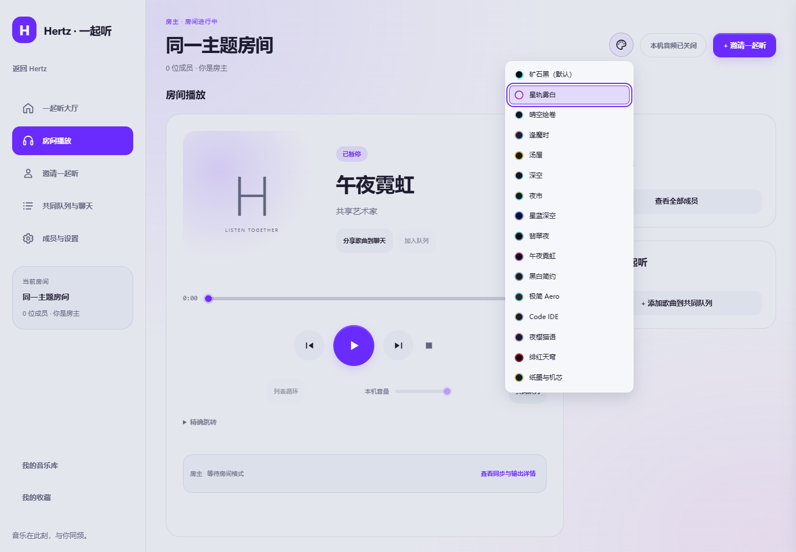
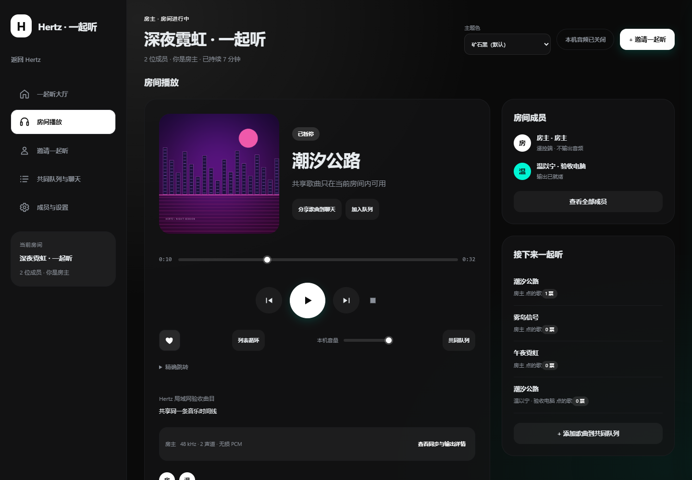
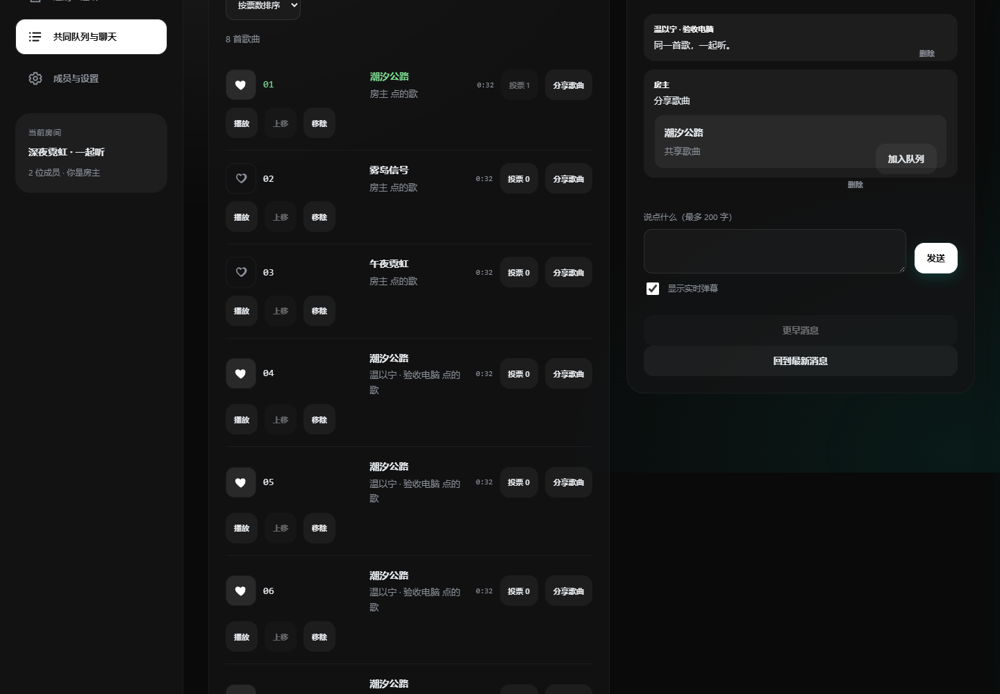
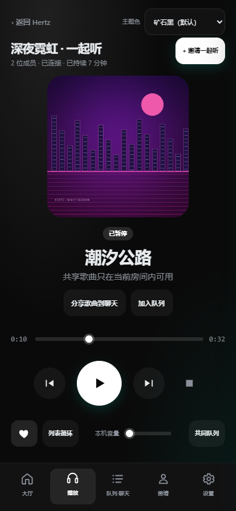
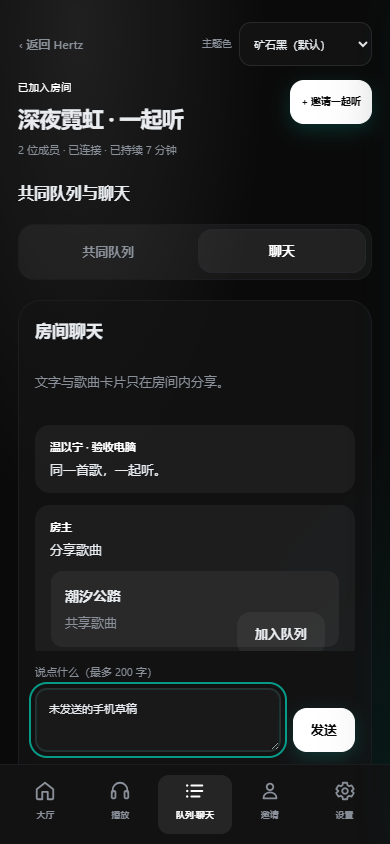
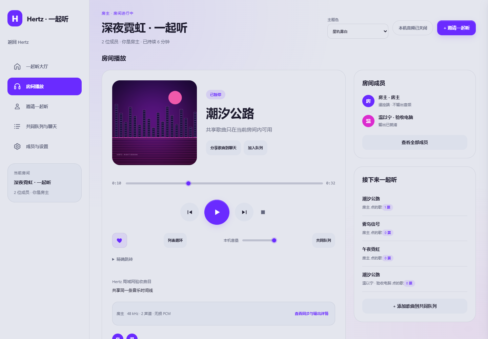

# 局域网一起听：使用与维护

每台电脑运行一份 Hertz 服务，浏览器访问本机界面。房主统一解码、混音和处理本地或在线歌曲，所有收听端通过独立 TLS 音频通道接收同一份浮点 PCM；浏览器关闭后服务继续收听。

## 启动

```powershell
cargo build -p hertz-studio --bin hertz-studio
.\target\debug\hertz-studio.exe --open
```

若这台电脑已经运行另一份 Hertz，使用独立数据目录和空闲端口试用本交付，避免占用原实例：

```powershell
.\target\debug\hertz-studio.exe --data-dir .\output\lan-preview --port 0 --open
```

macOS / Linux 使用 `./target/debug/hertz-studio`，在浏览器打开终端打印的 `ui` 地址；当前 `--open` 自动打开仅支持 Windows。Linux 构建需安装 ALSA、D-Bus 开发库与 pkg-config（Debian/Ubuntu：`sudo apt-get install libasound2-dev libdbus-1-dev pkg-config`）。Standard / Full 使用同一房间实现；加入端不需要复制房主的音乐文件。

Full 版的构建命令为 `cargo build -p hertz-studio --bin hertz-studio --features full`，输出路径与 Standard 相同。

在导航栏选择“一起听”，进入独立工作区。大厅负责发现、创建和加入；进入房间后以听歌现场为主，右侧切换队列、聊天和成员，邀请与点歌用抽屉打开。创建时自动选中唯一局域网接口；多个接口时明确选择朋友所在网络。分享本地歌曲时先导入本地曲库。端口 `0` 由系统分配；需要固定防火墙规则时指定固定端口。只把这个房间 TCP 端口放行给可信局域网，本机管理 API 仍绑定回环地址。主机可以关闭“本机同时收听”，由其它电脑输出音频。

## 分享与加入

也可在本机歌曲右键菜单选择“从这首歌发起一起听”，或在本地歌单详情点击“一起听此歌单”。创建前会明确列出本次选曲范围；创建、分享、入队依次确认，完成后等待点击播放。分享失败保留房间，结果未知只查询原记录，不自动重新分享或入队；可清除本机选曲记录而保留实际已完成的操作。

大厅进入后自动发现附近房间，并默认以卡片展示。设置了封面时展示封面，没有封面或图片不可用时展示房间名称；支持按名称或房间码搜索。点击“申请加入”后，在弹窗内填写昵称和本机收听选项，再核对房主指纹并提交。

房主可以在创建弹窗选择房间封面，也可在“房间设置 → 房间资料”预览、更换或移除，再点击“保存房间封面”。封面与正在播放的歌曲封面分别设置，附近电脑刷新大厅后可查看更新。支持 8 MiB 以内的 PNG、JPG、WebP 图片，界面会自动裁剪为横向缩略图。

房主创建房间后，可返回在线搜索或在线歌单，点击歌曲的“加入一起听”；歌单也可将当前已加载、已筛选的歌曲批量加入。操作会先分享歌曲，再加入共同队列。在线歌单尚未加载的部分不会自动加入。成员从共享曲库点歌，在线与本地歌曲可以混排；“房间设置 → 歌曲分享”可取消在线歌曲的勾选，再更新分享范围。

在线歌曲由房主使用自己的音源与登录状态获取，接收端无需登录相同平台，也无需 Full 版。MP3、FLAC、Ogg 等通常缓冲少量数据后即可开始，完整缓存可直接复用；部分尾部存放元数据的 M4A 仍需等待完整下载。首次等待取决于音源响应、网络和文件格式。界面会显示“正在准备歌曲”，获取失败时由房主检查音源账号或重试。

创建、申请或使用邀请加入时可填写「你的昵称」（1–32 个字符）。房主昵称与房间名称分别设置；成员列表、聊天、弹幕和点歌署名使用填写的昵称。重新加入上次房间时沿用该成员保存的身份。

「邀请一起听」的房间查找码旁有「复制房间码」，一键复制查找码；加入仍须通过申请审批或有效的一次性邀请。

1. 在听歌现场点击“＋ 点歌”，从房间共享曲库加入队列；房主还可在同一抽屉搜索本机歌曲，点击“分享并点歌”，只分享选中的歌曲。已有分享范围保留，未分享的曲目和本地文件路径不会发送给成员。
2. 点击“邀请一起听”，选择“一起点歌”“仅收听”或“共同控制”，再“生成并复制邀请”。默认一起点歌。有效邀请会复用；剪贴板失败时保留原邀请，可再次复制或展开手动复制。倒计时以实际有效期为准，最多五分钟且限一人使用，二维码放在展开项中。
3. 接收电脑打开本机“一起听”，粘贴邀请，核对主机地址与完整指纹后加入。选中“在本机播放音频”才会打开声卡。
4. 查看声音状态：“本机未开启声音”“本机已静音”“正在准备声音”“已加入 · 等待播放”或“可收听”。由房主或获准播控的成员开始播放；“可收听”表示输出条件就绪，不代替扬声器实测。

播放现场的“点歌”抽屉可按歌曲、歌手或专辑搜索房主当前分享的全部歌曲，并继续加载匹配结果。搜索不会读取未分享的曲库；分享范围更新后会重新读取结果。连接旧版房主时仍可分页浏览，完整搜索需房主升级。退出抽屉后继续留在当前播放现场。

附近房间发现使用 mDNS，只负责查找；手工粘贴邀请也能加入。首次信任与授权仍由邀请和证书指纹决定。保存的成员凭据由原生服务存入系统凭据服务；“重新加入上次房间”会重新校验身份并获取当前权限。主动离开或被移除后需要重新授权。

也可以在大厅对附近房间提交入房申请。八位房间查找码仅用于定位，提交前核对完整指纹；房主在现场的申请提示或“成员”页签批准、选择参与方式或拒绝。批准前不能收听、点歌或读取聊天。申请端留在大厅时有界刷新原申请；离开工作区或页面隐藏后停止，返回后继续查询同一申请，也可手动查看。批准后使用一次性授权加入；若连接结果不确定，继续查询状态，只有明确的重试按钮才再次尝试。已消费授权不能靠撤销申请移除成员，需要房主在成员管理中操作。

“邀请一起听”提供复制、二维码和撤销。成员邀请权可单独授予，成员签发的邀请仅包含自己已持有的基础收听及聊天权限。房主可关闭附近发现；配置意图与实际发布状态分别显示。关闭发现后，仍可通过有效邀请加入，现有成员继续连接。

Linux 接收端需要可用的 Secret Service，例如已解锁的 GNOME Keyring 或兼容服务。凭据服务不可用时会返回错误，不会改存明文；无声卡房主可以关闭本机收听。

## 播放、音效与设备

房间播放栏提供播放/暂停、上一首/下一首、进度拖动和本机音量。房间页提供停止、精确跳转、队列重排/移除、循环/随机。并发修改发生冲突时刷新状态后再操作；结果未确认的操作可查询原操作，页面不会自动重放写请求。

同一歌曲重复加入时，每次出现都有独立身份；移除或上移某次出现会保留其它条目的身份与当前播放。网络重连后，同一成员仍能使用“查询操作结果”确认先前的下一首等操作，页面不会重新发送它；换房或换成员后不沿用旧操作。

共同队列展示点歌人和真实票数。获准编辑队列的成员可以投票或取消投票；同一成员对同一队列条目最多一票。房主可切换手动排序和按票数排序。投票排序只改变尚未进入冻结音频前缀的未来歌曲，已经播放或已准备分发的部分不受影响；同票按点歌实例顺序排列。歌曲再次加入会获得新的条目身份，票数不从旧条目继承。

房间音量和房主的 EQ、响度归一化、交叉淡化作用于广播 PCM。本机音量仅作用于该电脑的输出。房主睡眠定时由服务计时，最长八小时，到期安排全房间暂停，不依赖页面定时器。

“本机输出”可以刷新和切换声卡、开关音频、设置音量，以及输入额外延迟补偿。切换设备会清除旧校准绑定；补偿绑定具体设备、后端、采样率和配置。暂停播放并等待时钟就绪后，可播放当前设备的 250 毫秒、440 Hz 测试音。它用于确认输出设备，不是跨机声学延迟测量。

当前实现使用**创建时固定的房间采样率**（44.1 / 48 / 96 / 192 kHz，双声道 f32）。不同源采样率由房主转换到房间格式；接收端将设备格式转换与时钟漂移补偿合并为一次转换。界面显示实际设备采样率。传输不增加有损编码，但经过混音、DSP、重采样或系统混音后不能称为 bit-perfect。设计文档中的“源采样率优先、逐曲切换房间格式”尚未开放，不能把固定格式模式描述为已经支持该能力。

设备时钟缺失、对时过期、PCM 断档或连接失效时先静音，恢复后加入新的未来播放点，避免追播积压。关闭全部音频端后，房间经过宽限暂停；仅关闭浏览器不会触发暂停。离开房间恢复本机队列与位置，并保持暂停。

主动退出房主服务会明确结束房间，接收端收到结束通知后恢复暂停的本地模式，不会继续重连已经结束的房间。仅退出接收端服务会保留最近房间凭据，重启后可手动重新加入。房间线协议现为 v3，所有参与电脑需使用兼容版本；邀请链接中的 v1 标记属于邀请封装版本。

房间标题栏提供退出入口，设置中的“房间会话”也可执行同一操作：成员点击“离开房间”只断开自己，其他成员继续收听；房主点击“结束一起听”会结束房间，所有成员停止收听。确认成功后回到大厅，取消或失败时保留当前房间。单独“返回 Hertz”只返回主界面，继续保持连接。

## 实际界面

房间与 Hertz 主界面共用主题色。可在工作区标题区与主界面一致的调色盘图标按钮打开共用色块菜单，切换内置或已注册的自定义主题；大厅、桌面和窄屏均可操作，选择立即同步到主界面并沿用原有主题保存设置。主界面更换主题也会立即更新房间。桌面播放现场使用封面、歌词、播控与右侧队列／聊天／成员页签。窄屏将页签放到舞台下方，不再使用五项底部导航。队列行主要保留点歌人与支持票数；个人收藏、移动和移除位于“更多”，手动模式支持拖动及键盘操作上移／下移。受限成员的操作按服务器授权禁用。返回 Hertz 保持健康房间连接，并恢复紧凑房间播控；重新进入工作区时隐藏重复播放栏。只有“离开房间”或房主“结束房间”才会结束对应会话。

当前主题入口为与主界面一致的调色盘图标按钮，打开同一份色块菜单。下列较早截图保留作历史记录，最新 UI 证据见 [UI 落地记录](plans/2026-10-27-ui-productization-delivery.md)：



[窄屏截图及其验收范围](images/listening-theme-button/README.md)。以下旧截图保留原构建证据，其中主题文字选择器已经替换为上述图标按钮。

以下为本轮构建中两个独立成员的实际界面，歌曲及封面使用程序生成的测试夹具。小屏截图是桌面浏览器的窄屏布局验收，不代表手机已具备独立连接或原生音频接收能力。网络对时读数不能作为两台扬声器的声学同步误差。











大厅、邀请、个人收藏与窄屏浅色主题的其余截图见 [界面目录](images/listening-workspace-favorites)。邀请截图已遮盖一次性能力与二维码；[上一轮截图](images/listening-workspace)仅保留为历史记录。

用户于 2026-10-25 确认本版支持电脑局域网房间及小屏布局适配；手机独立客户端、远程入口和音频接收不在本版范围，互联网好友／公共目录／异地连接留待后续接入。

## 个人收藏

播放页、共同队列和共享曲库中的红心保存到本机“我的收藏”。房主收藏本地歌曲时复用本地曲库收藏，在线歌曲保留原平台来源；接收端收藏显示“局域网”来源，同一首歌重复点入队列仍只有一份个人收藏。收藏与房间投票相互独立，不会替其他成员收藏或改变票数。

接收端只保存歌曲文字信息和原房主的稳定曲目引用，不下载文件，也不保存临时封面地址或邀请凭据。退出房间、接收服务重启后收藏仍保留。原房主撤销分享后，已收藏的文字信息保留，但不能继续读取歌曲或点歌。

返回 Hertz，在“我的收藏”点击“加入房间队列”：需要已经连接原房主、歌曲仍被分享，并获准编辑共同队列。换到其他房主、离线或被撤权时会说明原因。再次分享同一歌曲后，旧收藏可以重新解析当前资源。“播放收藏”会明确跳过局域网条目；此类歌曲通过当前房间点歌播放。

收藏使用明确的加入／取消目标态，重复提交不会反转。写入结果未确认时会查询实际收藏状态；点歌结果未确认时查询原队列操作，不能另发一次入队来猜测结果。如果原操作记录已不存在，先核对共同队列，再确认“放弃这次待确认队列操作”以恢复编辑；它只清除本机记录，不撤销或重放原操作，也不代表原操作未生效。

## 聊天

普通聊天以纯文本呈现，最多 200 字、800 字节，不执行 HTML 或脚本。播放页、队列和共享曲库的歌曲分享发送结构化歌曲卡片；卡片引用房间获准共享资源，撤销分享后不再显示可操作歌曲信息。卡片加入队列仍需队列权限。发送结果未知时查询原消息操作，不能重复点击另发一份。

房间播放页以舞台展示封面和同步歌词，底部可直接「发送弹幕」，右侧以 Tab 切换成员和队列。舞台与聊天页共用同一输入框、草稿和消息回执；弹幕是已确认的近期文字聊天，刷新、返回舞台或读取历史不会重播。可关闭「显示实时弹幕」；减少动态效果时停止飞行动画，消息仍在聊天中可读。舞台弹幕显示数量有上限，完整消息以聊天记录为准。

读取和发言是独立权限。房主可禁言、删除消息、预览并修改保留策略、清理历史房间。历史默认最多一万条、七天、64 MiB，存储和发送队列独立于音频。空间不足或存储故障会显示错误，不把未保存的消息伪装为已保存。

## 自动验收与故障定位

先构建，再运行两个独立 profile 的控制通道验收：

```powershell
python scripts/check-lan-room.py --binary target/debug/hertz-studio.exe --report output/lan-control.json
```

个人收藏另有三个独立 profile 的真实 HTTP/TLS 验收，覆盖收藏去重、SQLite 持久化、接收服务重启、房间重建、房主隔离、撤销分享和队列权限。该脚本使用 null 后端与测试用进程内凭据，不读取个人账号：

```powershell
python scripts/check-lan-favorites.py --binary target/debug/hertz-studio.exe --report output/lan-favorites.json
```

插件侧车另有真实 EOF 生命周期回归：创建插件 Host、加入独立 HTTP Guest，用第二次发现返回“忙”确认首个请求仍在途，然后关闭 stdin，检查服务退出前发出 End，Guest 恢复静音本地模式并清除失效房间凭据。它使用 null 后端和进程内凭据，不需要声卡或外网：

```powershell
cargo build -p dbx-plugin-hertz
python scripts/check-plugin-room-shutdown.py --plugin target/debug/dbx-plugin-hertz.exe --service target/debug/hertz-studio.exe --report output/lan-e2e/plugin-eof-acceptance-standard.json
cargo build -p dbx-plugin-hertz --features full
python scripts/check-plugin-room-shutdown.py --plugin target/debug/dbx-plugin-hertz.exe --service target/debug/hertz-studio.exe --report output/lan-e2e/plugin-eof-acceptance-full.json
```

CI smoke 在 Standard / Full 侧车构建后各运行一次并保存对应报告。macOS / Linux 命令去掉二进制文件的 `.exe` 后缀。

Windows 原生设备验收会打开默认声卡，并将接收端本机音量设置为零：

```powershell
python scripts/check-lan-room.py --binary target/debug/hertz-studio.exe --native-output --duration 120 --report output/lan-native.json
```

可通过 `--output-device` 指定“本机输出”列出的完整设备名，不修改系统默认设备；显式选择时不会先等待默认声卡就绪：

```powershell
python scripts/check-lan-room.py --binary target/debug/hertz-studio.exe --native-output --output-device '扬声器 (Realtek(R) Audio)' --duration 120 --report output/lan-native-realtek.json
```

Windows 房间输出使用原生 WASAPI 的设备呈现位置与配对 QPC，不再使用 CPAL 0.15 的可写空间时间戳。累计时钟故障代际会撤销旧播放计划；设备实际 Stop/Reset/Start 并恢复时钟后，仍需新的未来 Prepare/Commit 才能出声。旧设备配置的延迟校准不会自动沿用到新后端。其它平台保持各自后端能力门禁。

脚本记录二进制 SHA-256、平台、设备绑定、时钟/缓冲和失败时最后状态，不记录邀请与凭据；观测记录有界。可设置 `--duration 28800` 进行八小时运行。两进程同机通过只说明对应软件和设备路径通过，不能外推为两台电脑或其它操作系统的声学精度结果。

验收状态以实际报告为准：三平台构建矩阵与跨机声学、多通道同钟采集、八端压力、八小时真机长稳是不同项目。虚拟设备长时回归不替代真实设备记录。实际设备排队延迟过大或时间戳无效时，应修正设备配置或换设备，不能通过扩大缓冲、关闭门禁来伪造同步成功。

维护与扩展时先查 [ADR-0011](adr/0011-lan-rendering-and-output-ownership.md)：业务队列、共同渲染、原生设备网格与凭据各有唯一归属。新增传输能力需要升级握手契约，新增设备后端需要提供同样的呈现时钟和取消语义；前端入口不能另建播放器绕过房间裁决。最终构建身份、验收命令与硬件待测项见[本轮主题、收藏与原生时钟交付记录](../evals/lan-sync/favorites-2026-10-25/README.md)；[工作区交付记录](../evals/lan-sync/workspace-2026-10-25/README.md)与[更早交付记录](../evals/lan-sync/delivery-2026-10-25/README.md)保留历史证据。
