# 本地歌曲局域网一起听：桌面端实施方案

日期：2026-10-23。状态：设计提案已批准进入 P0；同日完成 P0 的 Windows 单机部分（见第 14 节实施记录与 [evals/lan-sync/p0](../evals/lan-sync/p0/README.md)），macOS/Linux 与两机测量未做。用户已明确首期优先 Windows / macOS / Linux 电脑。

## 1. 推荐结论

采用 **Hertz 原生房间广播 + Hertz 原生接收端**：主机读取本地音乐并统一渲染，各电脑接收同一音频时间线，按校准后的设备时钟出声。界面继续复用现有 JS/CSS，收音、缓冲和声卡调度由 Rust 执行。

Snapcast 是音频同步的主要技术参考；OpenCode 是服务连接、配对、协议边界和慢客户端治理的参考。保留现有 Rust / Tokio / Axum / Symphonia / CPAL / Rubato，不引入 Node 服务、不要求用户安装 WSL 或 Docker。

首版默认使用二进制 `PCM_F32LE`，逐位保留 Hertz 渲染器输出；不做 MP3/AAC/Opus 二次有损编码。FLAC 作为后续可选整数无损编码，不能用“FLAC 无损”掩盖浮点转整数时的量化。

方案的承诺是：支持范围内无新增有损编码、音质处理透明、同步误差有实测门槛、异常有明确行为。任意网络、任意声卡下绝对同步且永不中断，以及多台独立声卡长期同步同时全部 bit-perfect，均不应作为承诺。

## 2. 源码核查与参考价值

本次仅做静态源码与文档核查，没有构建三个平台的产物，也没有进行听测。Hertz 初稿基线为 `e319e74`，本轮按下列当前提交复核集成边界；外部参考固定版本不变。

| 仓库 | 提交 | 作用 |
| --- | --- | --- |
| Hertz Studio | `c7d0744e597e6374ab5401c15d91601e8941bb0a` | 本轮集成核查基线 |
| OpenCode | `e965774fa0e2a8ffb27bf02827a2c3c6a8c0f45b` | 控制与连接工程参考 |
| Snapcast | `4fed179e177b251c67326e7b62a25c8d8fb2d1a9` | 音频传输、同步及设备输出参考 |

### 2.1 OpenCode：参考控制机制，不依赖其运行时

| 源码 | 已确认事实 | 在 Hertz 中的应用 |
| --- | --- | --- |
| `../opencode/packages/server/src/pairing.ts`（相对仓库根目录） | 随机配对凭据、5 分钟有效期、消费即失效、有界缓存 | 借鉴一次性配对；Hertz 另发可逐设备撤销的受限凭据 |
| `../opencode/packages/server/src/auth.ts` | 配对 session 可用于原密码认证位置，轮换密码撤销全部 session | 不能直接照搬权限：一起听访客不应得到房主的全权接口 |
| `../opencode/packages/server/src/event-feed.ts` | 每个订阅者有界队列；溢出后终止该订阅 | 一个慢设备不能拖住所有接收端，重连走快照恢复 |
| `../opencode/packages/client/README.md`、根 `AGENTS.md` | Schema / Protocol / Core / Server 边界及生成客户端契约 | 共享 Rust 类型和版本握手，避免 HTTP/RPC/接收端各定义一套字段 |
| `../opencode/packages/cli/src/services/server-connection.ts`、`service-registration.ts` | 显式/托管连接、服务身份和版本、发现记录及重连 | 本机服务与远端房间身份分开，拒绝误连旧实例 |

本 checkout 中检索到的 `mdns` 配置位于旧配置测试夹具，不能据此宣称存在可直接复用的当前 LAN mDNS 模块。Hertz 的局域网发现需另行实现。OpenCode 的 SSE 事件流也不是音频播放时钟。

### 2.2 Snapcast：参考同步机制，审慎处理平台与许可

| 源码/文档 | 已确认事实 | 结论 |
| --- | --- | --- |
| `../snapcast/doc/binary_protocol.md` | Hello、CodecHeader、时间同步、带时间戳的音频块 | 借鉴先协商格式再播放、以时间线调度音频的机制 |
| `../snapcast/client/time_provider.cpp` | 持续估算服务端时间偏差并进行中值过滤 | 一次对时不够，需要连续估算及异常样本剔除 |
| `../snapcast/client/stream.cpp`、`README.md` | 使用丢弃/重复样本等方式修正长期漂移 | 可参考误差闭环，但默认音质路线采用平滑异步重采样，不能宣称原样照搬仍逐位一致 |
| `../snapcast/client/player/wasapi_player.cpp` | 查询音频时钟、输出 padding，包含共享/独占输出处理 | 必须测到设备排队与播放时钟，不能只看网络时间 |
| `../snapcast/CMakeLists.txt` 第 105–106 行 | `NOT WIN32` 下提供服务端构建选项，注明 `no Windows server for now` | 当前代码不能当作已有受支持 Windows 服务端；强行打开选项不等于完成移植 |
| `../snapcast/README.md` | 宣称典型偏差低于 0.2ms | 是上游描述，不是 Hertz 的性能保证 |

Snapcast 源文件使用 GPL-3.0-or-later，Hertz 当前为 MIT。建议独立实现协议机制和算法，不将 GPL 实现直接拷贝/链接到现有 MIT 发布物。若将来分发独立 snapserver/snapclient，需要单独处理其许可证、对应源码及修改发布义务；“作为独立进程”不应被简单解释为一切许可问题自动消失。OpenCode 为 MIT，复制代码仍需保留相应许可声明。

### 2.3 Hertz 已具备什么、缺什么

- 已有 `AppState` 队列和播放意图、音频 actor、下一曲预备、双流转场、EQ / ReplayGain / 软限幅、歌词和共享 UI。play/pause/上一首/下一首/seek/volume 已有共享业务入口；stop、队列、模式、DSP、设备操作并未全部经过它们，不能把“六种播控已收敛”当作全部写入口已经隔离。
- 当前链路是源解码 → 重采样到本机设备域 → 回调混音/音效 → 本机输出。它没有可脱离本机声卡工作的公共广播渲染器。
- `cpal_backend.rs::build_stream` 当前忽略 `OutputCallbackInfo`；播放帧计数不是已经准确补偿设备延迟的 DAC 播放位置。
- `resample.rs::Converter` 是固定比例重采样；同率直接复制，构造的相对比例范围为 1.0，没有连续漂移控制接口。不能将它直接当成现成同步器。
- 当前 `/ws` 传状态/频谱等事件，不传声音。仅把服务绑定到局域网不会让其它电脑出声。
- `state/viewers.rs::pause_if_alone` 依据页面连接数量暂停；必须增加经过认证且存活的音频接收端租约。
- 未发现现成的房间聊天/互动弹幕链路；歌词不是用户消息。已有[播放历史条数清理](../crates/hertz-studio/src/history.rs#L67)，但它不保证文件缩小；[主数据库使用 WAL](../crates/vmusic-store/src/lib.rs#L95)，不能直接用正文长度之和代表弹幕磁盘占用。
- 精确 gapless、AAC 延迟裁剪及输入格式已有边界，见 [ADR-0007](adr/0007-playback-transitions-and-intent-ownership.md)、[格式支持](audio-format-support.md)、[重采样说明](audio-resampling.md)。一起听不能扩大未经验证的能力声明。

## 3. 三条路线及选择依据

| 路线 | 收益 | 主要不足 | 选择 |
| --- | --- | --- | --- |
| 文件 HTTP 分发，每端自行解码并通过命令对齐进度 | 开发较快，可保留原文件 | 各端解码、DSP、seek 与时钟不同；频繁校正造成跳变，难以满足同室同步 | 不作为正式同步方案 |
| Hertz 输出 PCM → 外部 snapserver → snapclient | 可快速利用成熟 Linux 多房间生态 | 当前 Windows 服务端缺口；额外进程和许可交付；现有浮点音效链对接仍需改造 | 用作 Linux 对照实验或将来的可选集成 |
| Hertz 统一渲染 → 原生同步接收端 | 三平台一致；保留现有曲库、控制和音效；能定义完整的状态与错误语义 | 需实做时钟、缓冲、设备延迟及三平台验收 | 推荐 |

“兼容全部 Snapcast 客户端”不作为首版目标：这样会被其线协议、整数格式和控制语义约束。协议理念可复用，逐字兼容应在有具体设备需求时单独立项。

## 4. 首版产品范围与完整功能

一台房主电脑、一个活动房间、一份权威队列，最多 8 个音频输出端（包括房主本机）。同一 Hertz 安装可作为房主、接收端或只控制的客户端；一个音频输出实例同时只属于一个房间。

支持 Windows / macOS / Linux 的原生服务进程加现有本地 Web UI。每台收听电脑运行 Hertz；声音由该电脑的 Rust 进程输出，浏览器只是界面。首版不要求开发三个独立的原生 UI。

| 能力 | 首版行为 |
| --- | --- |
| 创建/结束房间 | 房主显式开启 LAN 功能，选择网卡；可以仅广播、不在主机出声 |
| 发现/加入 | mDNS 列表、手工地址、一次性邀请链接/配对码；显示房主、房间及认证状态 |
| 边播边加入 | 获取快照、同步时钟、预缓冲，在未来时间点加入当前节目，不从歌曲开头重播 |
| 完整播控 | 播放/暂停/停止、上一首/下一首、seek、循环/随机、队列增删重排、睡眠定时复用房主的业务规则 |
| 权限 | 房主可管理；控制者按独立权限点歌/改队列/播控/调总音量；分享范围、DSP、睡眠定时及授权管理仅房主可改 |
| 音量 | 房主播放器音量定义为房间总音量；参与者默认操作本机音量，获准后另显总音量；房主本机静音不影响广播 |
| 音效 | 房主统一 EQ / ReplayGain / 交叉淡化；接收端不重复施加全局音效，参数更新按未来渲染边界生效 |
| 信息呈现 | 当前曲目、封面、歌词、队列、来源音质、传输格式、设备输出格式及同步状态 |
| 实时互动弹幕 | 已配对成员通过文字互动，同一消息可在聊天列表与播放器弹幕层显示；房主可禁言/删除，本机可关闭弹幕显示 |
| 弹幕历史与空间 | 默认最近 10,000 条、最长 7 天、总文件配额 64MiB，按服务 profile 跨房间合并限制；条数、天数、空间任一先到即清理最旧记录，房主可调整或仅实时不留档 |
| 设备 | 选择声卡、测试音、延迟补偿、设备上下线、移除/撤权、重新加入 |
| 断线/休眠 | 显示重连；旧音频作废；恢复后同步当前时间线，不继续播缓存中的旧歌 |
| 生命周期 | 关闭 UI 仍有接收端收听时继续运行；主动退出房主服务才结束房间；房主休眠/退出时不选举新房主 |
| 本地播放切换 | 加入房间前暂停本机原队列，保存其恢复点；离开后由用户明确恢复，避免两个声源叠加 |

首版分享房主机器上已支持解码的本地歌曲。参与者可以从房主允许展示的本地目录曲目中点歌；“把参与者电脑中的新文件上传给房主”、手机、网页直接出声、互联网中继、多房间独立队列、自动主机迁移、DSD/DoP 和多声道环绕另列后续范围。

Standard / Full 共用本地一起听能力，不依赖 Full 在线音源。首发验收面是独立形态；DBX 必须验证宿主网络、进程存活和授权约束后再声明可用，不能把 stdio JSON-RPC 当作 PCM 传输管道。

## 5. 架构、数据流与唯一归属

```mermaid
flowchart TD
    UI[房主/参与者界面] --> Control[房间认证与播控门面]
    Control --> State[现有 AppState：队列、意图、提交]
    UI --> Chat[ChatService：发言鉴权、限流、消息序号]
    Chat --> History[独立弹幕库：条数、时长、文件配额]
    Chat --> Feed[低优先级有界弹幕通知]
    Feed --> UI
    State --> Actor[现有音频 Actor：播放与转场调度]
    File[房主本地音乐] --> Decode[Symphonia 解码与下一曲预备]
    Actor --> Decode
    Decode --> Render[公共 RenderCore：混音、EQ、增益、限幅]
    Render --> Frames[带 epoch、帧号和呈现时间的 PCM]
    Frames --> Sender[有界网络分发]
    Frames --> Local[房主本机同步接收器]
    Sender --> Remote[远端同步接收器]
    Local --> Output[设备时钟、漂移校正、声卡输出]
    Remote --> Output
```

### 5.1 拆分当前声卡回调与渲染职责

仅将接收已解码 PCM 的双 deck 混音和 DSP 抽成公共 `RenderCore`，保留原算法顺序和行为测试；源文件 IO、解码和固定比转换仍在生产线程，不因共用渲染器进入单机实时回调。单机模式与房间模式调用同一份混音/DSP 实现，禁止长期保留两套混音器。单机模式维持低延迟；房间模式由独立、有界的生产线程按房间格式渲染，不能由房主本机声卡回调驱动。

房间渲染域与物理声卡域分离；EQ 系数按房间采样率创建。广播提取点位于房间 DSP 后、设备独立音量之前。频谱分析读取有时间标记的块，不在网络发送或声卡实时线程里进行大规模 FFT。

解码/房间生产不能依赖存在默认声卡；将当前 feature 中绑在 `playback` 下的解码和设备输出依赖适当拆开。仅作房主的电脑可以无输出设备继续广播。

主机本地扬声器同样经过缓冲、设备延迟补偿及同一呈现时间调度。可以用进程内队列省掉 TCP，但不能绕开同步过程直接播放。

房间模式的实时回调只从预分配环形队列取样、应用已准备的设备音量并填充输出。网络、TLS、解码、重采样工作缓冲准备、文件读取和内存回收均在回调之外。慢客户端不持有渲染器的锁。

### 5.2 状态归属

| 状态 | 唯一所有者 | 明确限制 |
| --- | --- | --- |
| 曲库、队列、随机选择、播放意图 | 房主现有 AppState | RoomService 不再建一份“真队列” |
| 解码、DSP、渲染帧序列与转场事实 | 音频 actor / RenderCore | 网络层不决定下一首 |
| 房间成员、授权、连接与有界发送 | 新 RoomService | 接收端状态只能作为遥测，不能反向覆盖权威播放状态 |
| 互动消息、发言权限、历史与配额 | RoomService 内的 ChatService；独立弹幕存储 | 独立 chat_seq，不修改播放 revision，不持有音频锁或决定媒体时间线 |
| 呈现时钟与计划中的边界 | actor 内的房间调度组件 | 区分 render head 与 presentation head，不从网络收包时间推导 |
| 本机声卡、缓冲、漂移校正、本机音量 | Receiver | 不修改全局播放进度；不自行在歌曲结束时跳下一首 |
| 歌词/舞台显示 | 对权威时间线的本机投影 | UI 插值不能成为音频时钟 |

提前渲染 1 秒意味着可能已经解码下一曲，但用户仍在听上一曲。AppState 区分已接受的播放意图/计划游标与当前呈现曲目/位置，两者不是两份队列。命令受理可以更新意图及控制 revision；曲名、歌词、实际音质和历史按 `effective_at` 更新呈现事实，不能在生产线程读到 EOF 时就宣布用户已听到下一曲。

后继曲目与随机选择由 AppState 提前预留，actor 只按授权顺序渲染，保存有界转场记录 `(epoch, boundary_id, queue_revision, track_instance_id, effective_at)`。同一曲目重复出现也有不同播放实例 ID；呈现时按边界 ID 顺序、恰好一次提交，不靠“最新解码快照仍是这首”判断，也不在 EOF 再选择一次 next。前瞻内有多首极短曲时仍须完整保留顺序；记录满则停止前瞻并报告缓冲不足，不丢转场事实。已冻结前缀内的边界仍须提交，取消只能影响第 8.2 节规定的可撤销部分。

这不是简单把当前事件延迟一秒：现有 [`play_index_for`](../crates/hertz-studio/src/state.rs#L1435) 会预写乐观 cursor，[`commit_prepared_transition`](../crates/hertz-studio/src/state.rs#L2683) 会核对当前 actor 快照并更新 DSP。房间模式须在渲染边界应用 DSP，在呈现边界提交展示/历史；不能等听到下一曲时才修正已发送 PCM 的增益。

### 5.3 所有入口共享模式门禁

模式切换、命令受理和播放意图作废共用 AppState 提交边界；检查模式必须在任何队列、DSP、持久配置或音频写入之前完成，不能仅在 UI 隐藏按钮。回调、解码、网络等待与历史写入不持有该提交锁。

| 入口/状态 | 单机 | 房主 | 接收/仅控制远端 |
| --- | --- | --- | --- |
| 当前播放器 UI | 原本地门面 | 版本化房间门面 | 本地 Rust 代理远端房间门面，按远端权限裁决 |
| 旧 HTTP/RPC/AI 播放、队列、load/replay/mode、DSP 写接口 | 原契约 | 默认返回 `room_mode_conflict`，不产生副作用 | 同样拒绝修改本地播放；不把全权本机 token 当作远端权限 |
| 声卡、设备音量/静音 | 原本地输出 | 本机 Receiver（若启用） | 本机 Receiver（若启用），不改房间总音量 |
| EOF、睡眠定时、离场暂停等内部动作 | 原 owner | 进入同一房间调度，不直接调用旧 audio 立即停/跳 | 不推进远端队列；离开/本机关闭只作用于该端 |

[`routes.rs`](../crates/hertz-studio/src/routes.rs#L1030) / [`rpc/playback.rs`](../crates/hertz-studio/src/rpc/playback.rs#L76) 的 stop 仍直接操作 audio；既有 AI 门面还会返回明确的 [`applied`](../crates/hertz-studio/src/ai/capability.rs#L1054)。实施时需枚举全部写入口与内部触发器并加门禁，不能把房间的 scheduled 塞进旧 applied 结果。新 UI 明示控制对象与排程状态，房间状态是远端权威投影，不复用本机旧队列/快照伪造播放。

进入远端模式先保存本机队列恢复点并暂停，退出只恢复可供用户继续的本地状态，不自动出声；仅控制客户端也不同时维持另一条本地播放。模式切换失败保持静音并显示失败，禁止旧异步加载迟到后重新夺取声卡。

## 6. 音质契约

### 6.1 分清四层承诺

1. **源文件能力**：支持已验证的 FLAC/WAV/ALAC/MP3/AAC 等现有解码路径；有损来源不会因转成 PCM 而变成无损音源。APE/WMA/Opus 等缺解码器的问题单独处理，不能通过组播解决。
2. **传输无损**：首版 PCM_F32LE 对“渲染器输出的有限 f32 样本”逐位保真，不增加编解码损失。
3. **处理透明**：明确显示 EQ、ReplayGain、crossfade、限幅、重采样和同步校正状态。它们会改变样本，但不等于使用了有损音频编码。
4. **输出真实性**：显示实际设备采样率、格式和共享/独占状态。操作系统混音、声卡自身 DSP 与蓝牙编码不能算作已保证逐位一致的部分。

现有 f32 路径可以精确表示常见归一化 16/24 位整数 PCM，但不能承诺完整保留 32 位整数 PCM 的全部有效位。软限幅即使 EQ 关闭也可能改变大幅度样本，因此“默认播放全链 bit-perfect”不是当前事实。

### 6.2 格式、采样率与转场

- 首版质量验证矩阵覆盖双声道 44.1 / 48 / 88.2 / 96 / 176.4 / 192 kHz，以 44.1 / 48 / 96 为优先；单声道按明确规则复制到双声道。大于此范围或多声道布局明确提示不在首版保证内。
- 默认“原生采样率优先”：房间按源曲采样率渲染；同率曲目的自然衔接复用已有资格判定。换采样率建立新格式代际并预缓冲，允许明确的短暂重配置，不宣传跨率精确 gapless。
- 用户启用“连续混音”时，在起播前选择并锁定房间采样率，例如 48 或 96 kHz；跨率曲目通过 sinc 转换后交叉淡化，界面显示实际转换。运行中修改该配置需重建代际。
- 原生采样率模式中不同采样率的曲目不做跨率 crossfade，UI 明示原因和连续混音选项；同采样率 crossfade 与现有 ReplayGain 等资格限制照旧。不能静默改变用户的质量模式。
- 接收端设备不支持房间采样率时，只对该端使用一次结合“格式转换 + 时钟漂移”的异步重采样，不降低所有人的房间格式。显示例如“源 96k → 房间 96k → 本机 48k”。
- 接收侧重采样可能产生峰值过冲，输出转换前要检测并处理非有限值与越界；最终保护的触发次数进入诊断。设备音量、最终保护和必要的整数转换在设备侧各执行一次，不能把这些修改后的输出宣称为传输 PCM 的逐位副本。
- 解码本就用 f32 的文件、DSP 后样本默认继续用 f32 PCM。可选 FLAC 只在明确的整数 PCM 路径下逐样本验证；浮点量化为 24 位时需正确的最终量化与 dither，并显示这次转换，不能称为浮点链逐位无损。

### 6.3 同步与 bit-perfect 的关系

多台独立声卡的晶振并不等速。长期严格同步需要变速/重采样、增删样本或硬件时钟同步；关闭所有校正会随时间漂移。因此默认选择高质量同步，使用平滑的异步 sinc 重采样，不采用周期性 seek 或粗暴整块丢样。

如未来增加“逐位输出模式”，必须有独占/直通输出、整数或精确格式路径、DSP 与数字音量条件，以及相应数字回录证据；还须明确放弃普通独立声卡间的严格同步保证。它不属于本次同步版的完成条件。

### 6.4 带宽预算

无压缩码率为 `采样率 × 每样本传输位数 × 声道数`，不以原文件压缩大小估计网络。

| 格式 | 每个远端净音频码率 |
| --- | ---: |
| 44.1 kHz / 16 bit / stereo（比较项） | 1.4112 Mbps |
| 48 kHz / f32 / stereo | 3.072 Mbps |
| 96 kHz / f32 / stereo | 6.144 Mbps |
| 192 kHz / 24 bit / stereo（比较项） | 9.216 Mbps |
| 192 kHz / f32 / stereo | 12.288 Mbps |

仅广播房主加 8 个远端，在 96k/f32 下约 49.15 Mbps，192k/f32 下约 98.30 Mbps；房主本机也出声时最多 7 个远端，对应约 43.01 / 86.02 Mbps。进程内本机端不消耗网卡流量。网络预算另留至少 30% 余量，这只是下限，不是 Wi-Fi 准入保证：同一 AP 下无线房主的上行与无线接收端的下行竞争空口，重传和其它设备还会继续消耗容量，不能拿标称协商速率直接比较。

必须按实际接收端数量、持续可用吞吐与尾部交付延迟判断能否接纳，不把“最多 8 台”解释为所有网络都能同时跑 192k。带宽不足先提示、隔离慢端/拒绝新增设备；质量模式不自动降成 AAC/Opus，也不偷偷把整房间降到 16 位。用户可主动选较低房间采样率。

## 7. 时间同步与接收器

### 7.1 三种时钟都要明确

- 媒体时钟：曲目位置与对应源帧。
- 房间时钟：服务实例内的单调时钟，不依赖日期、时区、系统时间手动调整。
- 设备时钟：硬件已播放位置、回调时间戳、输出排队和设备延迟；不能由 TCP RTT 代替。

用四时间戳交换估计服务端相对接收端偏差：`offset = ((t2-t1)+(t3-t4))/2`，`rtt = (t4-t1)-(t3-t2)`。四个时间戳分别位于各自的单调时钟域，通过多次采样建立映射，过滤高 RTT/异常值并估计频率偏差；网络路径不对称仍会产生误差，不能声称算法将网络误差完全消除。

初始做一组快速采样，稳定后周期采样；具体频率通过 P0 测量确定。服务端重启使用新实例 ID，任一端休眠唤醒或时钟突变都重建映射，禁止沿用旧锚点。

### 7.2 呈现时间与输出延迟

每个代际声明 `(anchor_frame, anchor_server_time, sample_rate)`：

`T_present(frame) = anchor_server_time + (frame - anchor_frame) / sample_rate`

这里的 frame 是房间 PCM 帧，不是源文件帧或设备输出帧。先做整数帧差，再以有理数换算时间；不逐块累加四舍五入后的毫秒。接收器维护房间帧到实际设备帧的映射，包含异步转换的相位、前视和暂存；不能在变比后仍按固定输入/输出帧比计算播放位置。

接收器将 `T_present` 映射到本机单调时间，扣除尚未被设备时间戳涵盖的排队/转换延迟和校准值，确定提交期限。驱动已报告的延迟、应用队列和设备额外延迟各计一次；校准值绑定输出设备、后端、采样率及共享/独占配置，任一改变即重新确认。Rubato 的 `output_delay()` 不可直接当作待删静音帧，遵守[现有重采样时钟说明](audio-resampling.md#延迟与时钟)，动态路径另做脉冲定位。

先验证 CPAL 各后端的时间戳语义与精度。若不足，围绕已有输出 owner 增加小型平台实现：Windows WASAPI 音频时钟/排队，macOS CoreAudio 时间戳/设备 latency，Linux ALSA 或 PipeWire 的播放位置与延迟。不能因 Linux CPAL 某配置可用就宣传 PipeWire 原生路径已支持。设备时钟不可测或对时 uncertainty 超出所选同步档位时，不显示“已同步”；拒绝严格档位或明确进入未保证精度的输出状态。

### 7.3 缓冲与漂移控制

初始设计参数：20ms 音频块，默认发送提前量 `H = 1000ms`，可测量后选择 300–2000ms；这些是候选参数，冻结前需实测。H 指 PCM 从可供发送到计划呈现的时间预算，不是要求每端另外攒满 1 秒再播放，也不等于队列容量。接纳条件为 `H ≥ 网络交付预算 + 接收转换前视/处理 + 设备提交提前量 + 安全余量`，各项通过同一时钟映射测量，重叠项不重复计入。

生产线程由房间单调时钟和 H 限速，只渲染到允许的未来水位；不能因无声卡或某端读取很快而把整首歌提前解码、混音和提交。首尾允许不足 20ms 的整帧块，暂停时不靠持续发送假音频推进媒体帧。字节/时长限额只是硬上限，运行水位还必须受 H 约束。

每端独立有界缓冲。晚加入从当前直播窗口选择未来帧，预留转换历史预热但只从指定帧出声，不回补已经过时的全曲缓存，也不改变其它端相位。仅推迟加入不能补救设备所需提前量超过 H；此时拒绝该端并提示原因，只有房主显式同意才全房间重缓冲并重建时间锚点。慢端先静音并重新同步，其余设备继续。

漂移控制以映射后的设备播放相位为主反馈，缓冲占用只用于欠载/越界保护，不把一次网络突发误判成声卡变速。对时估计与重采样变比均平滑更新，稳定播放期间不阶跃修改时间映射。初始试验可限制在 ±500ppm 范围，最终值由声卡与听测确定；超界或积累较大偏差时淡出、重建缓冲、淡入。现有固定比 Converter 保持原契约，新增接收侧可变比转换路径并单独测量。

不同采样率转换和 ppm 校正合为一次接收端转换，避免串联两个不必要的重采样器。无可用音频时输出受控静音，禁止重播上一块、突发追赶或无限扩大队列。

## 8. 最小协议与控制语义

### 8.1 传输与握手

继续使用 Tokio / Axum。同一个专用 TLS listener 上建立两条独立 WSS 连接：控制/对时连接和二进制音频连接，避免大音频队列阻塞暂停、撤权与对时消息。首版采用可靠 TCP/WSS 单播，暂不自造 UDP 重传/FEC 或引入 WebRTC。控制连接优先处理对时/心跳，曲库及大资源分页走 HTTP；两条连接仍共享网卡和链路，不能宣称消除了 TCP 重传或网络拥塞造成的延迟。

握手协商协议主次版本、软件版本、房间/服务实例身份、角色、编码、采样率/声道、设备输出能力、延迟测量能力和缓冲上限。主版本不兼容明确拒绝；软件版本不同并不自动等于协议不兼容。控制握手产生绑定设备、房间、实例的 `session_id`，音频连接用短期一次性票据绑定该会话；同一设备重连替换旧会话，两条连接一起失效/重建，不能多占输出槽或借用另一设备的控制身份。

音频消息包含：`protocol_version, room_id, server_instance_id, session_id, epoch, sequence, frame_index, frame_count, format_id, payload_length`。Format 描述编码、采样率、声道布局和字节序；Plan 描述锚点、媒体位置、旧时间线终点和生效期限。`epoch` 是媒体连续性代际，不等于 AppState 播放意图 generation；`sequence` 在会话/代际内递增，`frame_index` 在同一代际内连续，允许晚加入从非零帧开始。换率必须换 epoch，不能用一个锚点解释两种采样率。

两条 WSS 之间没有到达顺序保证。接收端仅有界暂存当前及一个正在准备的代际；已有未生效 Commit 时，后续 preparing 只保留意图，不向接收端发送第三代 PCM。先到的 PCM 等待匹配 Format/Plan，超时或无匹配则丢弃并重同步。完成格式配置、时钟收敛和预缓冲后发 Ready，新代际仍保持静音，当前代际按已提交计划继续；只有收到匹配且未过提交期限的 Commit 才能将新代际送往声卡，迟到的 Commit 不触发追播。Ready/Commit 均携带 session、epoch 和计划 ID，旧连接上的确认不得复活新会话；修改锚点/格式/边界必须换计划 ID 并重新 Ready，不能在 Commit 中偷偷改期。晚加入的确认仅绑定该成员在既有 epoch/锚点上的未来加入帧，不重建全房间时间线。

整帧对齐、长度、样本数及有限 f32 值在实时回调之外检查；校验 `payload_length = frame_count × channels × 4` 并检查整数溢出。首版双声道 192k/f32 的 20ms 块为 30,720 字节，单音频消息硬上限 64KiB；同时限制 WebSocket 分片重组后的总大小，关闭不必要的消息压缩。控制消息上限 64KiB，超限资源走分页接口；未知必需能力、非法序号/重叠帧和过期代际明确拒绝。涉及 JS 的 64 位帧号/纳秒整数使用十进制字符串；Rust 保留整数精度。

建议的专用网络接口如下；路径均为新协议提案，不能直接挂载到旧全权路由组：

| 接口 | 语义 |
| --- | --- |
| `GET /lan/v1/info` | 只读最小服务身份/协议能力，不公开完整曲库 |
| `POST /lan/v1/pair/consume` | 消费一次性配对信息并签发受限设备凭据 |
| `GET /lan/v1/room` | 授权后的版本化房间快照，含当前呈现与已发布计划，不含全量曲库 |
| `GET /lan/v1/library` | 房主分享集合的分页元数据与不透明曲目 ID；游标绑定分享 revision |
| `GET /lan/v1/queue` | 权威队列的分页投影，绑定 queue revision，不接收磁盘路径 |
| `POST /lan/v1/commands` | 受限命令，带操作 ID、预期 revision；复用 AppState 语义 |
| `GET /lan/v1/operations/{id}` | 只允许调用者或房主管理面查询的播控/发言结果；操作键区分命名空间，过期返回 unknown，不自动重复副作用 |
| `GET /lan/v1/control`（WSS） | 握手、对时、Ready/Commit、状态事件、心跳和遥测；弹幕通知使用独立低优先级有界队列 |
| `GET /lan/v1/audio`（WSS） | 与同一设备会话绑定的二进制音频 |
| `GET /lan/v1/resources/{id}` | 经授权的有界封面/歌词资源，不接受磁盘路径或任意远端 URL |
| `POST /lan/v1/chat/messages` | 经 chat.send 授权发送纯文本，带独立消息操作键，不走播放计划/控制 revision |
| `GET /lan/v1/chat/messages` | 经 chat.read 授权读取当前房间保留历史，按 chat_seq 游标分页，最多 100 条且响应不超过 256KiB |

房间管理与配对邀请签发仍由房主本地管理面执行。房间 API 的 scheduled/applied 结果单独版本化；旧单机 API 的返回契约不直接改成另一种含义。

### 8.2 播放、暂停和 seek

1. 控制请求携带绑定实例/会话的 `operation_id` 和 `expected_revision`，由房主串行裁决；先查同键结果，再检查预期 revision。同身份同键重试不重复执行，不同内容复用操作键返回冲突。控制 revision 只随权威控制状态变化，进度、心跳和设备遥测不使所有命令频繁冲突。
2. 受理后立即回复 `preparing` 与操作 ID；准备文件、格式、候选 Plan 和预缓冲。此阶段尚可被新意图取代，结果为 `superseded`；失败为 `failed`，无动作则 `no_op`，不能全部叫 scheduled。
3. 接收端对具体计划发 Ready，房主在准备完成后原子冻结切换边界并发布 Commit，状态才变为 `scheduled`。生效时间至少覆盖发送、转换、设备提交提前量和安全余量。初次起播至少一个音频输出端 Ready 才能发布；超时不进入 playing。其它端不阻塞房间，迟到/未就绪的端静音后重新加入。
4. Commit 发布后，该前缀视为不可撤销，即使尚未到 `effective_at` 也不再返回 superseded；后续命令安排在其后。到生效点按序提交权威呈现状态并记录 `applied`，各端另报实际输出位置/欠载。applied 证明房主时间线已生效，不证明每台设备或扬声器已真实出声；分区网络下不承诺全体原子起停。

房主冻结边界时停止旧流越界生产，边界不得早于已发布 PCM 的末帧及已发布计划；不能一边继续渲染一边追逐向前移动的 render head。只允许一个未生效的已发布用户控制计划及一个可合并的准备中意图，满载明确返回 busy；自然转场记录另受第 5.2 节的有界限制。准备失败不修改当前可听前缀；无法及时准备后续音频时显式进入缓冲/静音，不把旧音频重放一次填空。

暂停、停止、seek、强制切歌、格式变更和恢复使用代际切换；普通相同格式自然衔接维持连续帧序列。旧流在明确末帧结束，新流从新锚点开始。接收工作线程须在**声卡提交期限之前**分割旧/新 PCM、处理转换历史并按时间写入；不能等到 `effective_at` 才尝试清除驱动里已经排队的旧样本。切换晚到就静音重同步。暂停保留边界处的目标曲目/位置，停止清除可恢复播放位置；短淡出计入切换时间，沿用既有 200ms 行为而非额外叠加一段不计时尾音。

连续 next 按 AppState 的计划游标累计，seek 必须绑定目标 `track_instance_id`，pause 保留当前目标而取消尚未发布的继续播放意图。例如顺序受理 next→next→seek(30s)→pause 且中途没有 Commit，则最终为第二个目标曲目 30s 的暂停计划，不短暂播放两个被取代的目标；若中途已有 Commit，已发布前缀照常呈现，再执行新计划。并发请求 revision 冲突需取快照后由用户决定，不自动重复 next 等相对动作。

总音量、EQ/ReplayGain/crossfade 参数变化也作用于未来渲染边界并带 revision/effective_at，不能把界面新值当作已发送 PCM 的新处理结果。自然结束只在对应呈现边界提交一次队列推进，远端 EOF 不发 next；跨曲淡化的主曲目身份由同一计划确定。

默认 H=1 秒、无前置排程且源文件可及时准备时，受理反馈目标 ≤200ms，可听变化目标 ≤1.5 秒；慢文件、设备重配置或已有已发布计划时显示真实等待原因和预计时刻，不强行承诺该上界。设备本地静音尽快执行；全房间紧急静音走优先控制通道，不宣称能撤回已交付 PCM 或在网络故障下严格同时。

### 8.3 快照、租约与错误

- 可靠状态事件使用独立连续 `event_seq`；快照在一致性边界带水位，先订阅再取快照，丢弃水位前事件，缺口/订阅溢出立即重新取快照。`control_revision` 用于写冲突，`queue_revision` 用于分页，不能混用。快照含已发布计划及其边界，恢复时不能只拿当前曲目而遗漏即将发生的切换。进度/频谱可丢弃，转场和命令终态可查询恢复。
- 操作结果按会话合计保留最近 256 条、最长 10 分钟；操作键含命名空间及其会话内单调递增序号，服务分别保存已受理高水位。已过期且不高于水位的请求返回 `operation_expired/unknown`，不得当作新操作执行；同命名空间并发乱序的低序号新请求明确拒绝，客户端串行受理后再发下一条。实例/会话变化后不重放旧写，先观察快照再重新决定意图。
- 音频接收端独立续租，初始心跳每秒、5 秒未收到则过期；只有认证、控制/音频连接均健康、输出可用的端可续租，纯 UI、浮层及只控制客户端不计入。房主本机 Receiver 同样计入，静音不等于离场。单机仍沿用页面离场规则；房间模式按音频租约决定后台播放，最后一个租约失效后等待现有 3 秒宽限，再在提交边界复核并作废未发布播放意图、排程暂停，即使控制页面还开着也不无限空播。健康租约存在时关闭所有 UI 不触发暂停。
- 每端发送/接收应用缓冲分别限 3 秒 PCM 且不超过 8MiB，当前/准备代际合计计入，不能每代际再领一份；主机共享块保留窗同样有界，发送 PCM 引用的保守全局预算不超过 64MiB。TLS、socket、解码缓冲另列资源预算。按呈现期限丢弃过时块，不能等队列满才处理；写超时或 TCP 中积压旧代际时终止会话重建，不能向旧流继续追加。共享块最后一个引用的释放不发生在实时回调。
- 主机断开后接收端在已检测到会话失效、缓冲耗尽或租约失效中最早的条件下停止，按设备排队能力处理尾音；两连接任一失效都不能让另一条无限维持播放。恢复需重新确认实例/会话、代际、时钟和未来加入点。房主重启不自动发声，恢复队列后等待明确播放。
- 对外错误至少区分：未配对/已撤权、协议不兼容、模式冲突、revision 冲突、操作过期、不支持格式、设备不可用、同步尚未收敛、带宽不足、缓冲欠载、容量已满、主机离线。

### 8.4 实时互动弹幕与历史存储

#### 互动语义与权限

弹幕是房间即时文字交流，不是按歌曲时间永久绑定的评论轨。房主接收并校验后统一分配 `message_id/chat_seq`、服务器接收时间和可信成员身份；可附接收当时的呈现曲目实例作为上下文，不接受客户端伪造发言人或任意播放时间。暂停时仍可聊天，seek/循环不会重新飘出旧弹幕；互动不等待音频 H 缓冲，也不修改播放状态。

同一消息供聊天列表和本机弹幕层使用。房主可关闭互动、禁言成员、删除消息或清空历史；本机可关闭弹幕显示，不因此退房或停播。发言者可以是收听者或仅控制成员，仍计入 16 人成员上限，不能用聊天连接伪造音频租约。消息内容只按纯文本呈现，不执行 HTML/Markdown、链接预览、脚本或自定义样式；首版不接收图片、附件、语音或私聊。

单条正文最多 200 个 Unicode 标量值且 UTF-8 不超过 800 字节；成员显示名最多 32 个标量值/128 字节，完整序列化消息最多 2KiB。默认每成员每秒 1 条、短突发最多 3 条，全房间每秒 10 条、短突发最多 10 条；服务器在存储前限流，超限明确返回 `chat_rate_limited`，房主也不豁免容量限制。发送使用独立于播控的 chat 命名空间操作序号，复用第 8.3 节有界去重与操作结果接口，结果只保存消息 ID/状态而不复制正文。回复丢失先按原操作键查询，断线重连或结果过期不自动重发旧文本。

#### 实时分发与背压

弹幕通知复用控制 WSS，但独立 `chat_seq` 和低优先级队列，不进入可靠播控 `event_seq`。每端待发队列最多 64 条且不超过 128KiB；拥塞先丢最旧弹幕通知并提示历史缺口，不因弹幕排队拖延对时、Commit 或心跳，也不因聊天队列溢出关闭音频连接。存储/清理在独立任务中执行，不持有 AppState 播放锁，不调用音频回调。

前端和接收服务各仅缓存最近 200 条且序列化载荷不超过 512KiB；弹幕层最多同时显示 20 条、待展示 40 条。实时通知延迟超过 5 秒就只进入聊天列表，不补播一屏过时弹幕。历史查询每页最多 100 条/256KiB，返回保留窗口及游标；缺口落在已淘汰区间时明确标记“较早消息已清理”。晚加入/重连的历史只进列表，不自动重新飘屏；仅实时模式不承诺补齐断线期间的消息。

#### 保留与磁盘配额

只由房主服务保存权威历史，接收端和网页默认不落盘，也不将消息复制到 localStorage、诊断日志或曲库备份。配额按**一个服务 profile 内所有活动/已结束房间的弹幕历史合计**计算；新建 room_id 不重置额度，Standard/Full 或不同 DataDir 的独立 profile 分别计费。关闭的房间历史仅房主本地可管理，新房间成员不能读取旧房间历史。

| 配置/指标 | 默认值 | 可调范围与规则 |
| --- | --- | --- |
| 历史条数 `max_messages` | 10,000 条 | 100–50,000 条，按所有房间合计；删除/到期记录不再计作有效消息 |
| 保留时长 `retention_days` | 7 天 | 1–30 天，以服务器接收时间为准，不允许无限期保留 |
| 总文件配额 `disk_quota_mib` | 64MiB | 16–256MiB，含数据库、索引、空闲页、事务日志及本模块临时/侧车文件，不只是正文大小 |
| 历史记录模式 | 开启 | 可显式切为“仅实时不留档”；停写但不暗中删除已有历史，已有记录继续按保留策略清理，清空另行确认 |
| 房主可见统计 | 条数、文件占用/配额、最早保留时间 | 同时显示持久化状态、清理结果与失败原因；不以逻辑删除条数冒充已释放磁盘字节 |

**条数、时长、空间三条约束同时生效，任一先到就淘汰最旧记录**；“保留 7 天/10,000 条”是上限，不保证在高频聊天或小配额下能保留这么久/这么多。新消息入库前先计算容量并清理，提交时不能超过条数或文件预算；不得先无限写入再依赖偶尔清扫兜底。按服务器接收顺序淘汰，同时间以库内递增记录 ID 稳定排序，不让客户端改时间戳保住旧消息。消息淘汰时一并回收不再被引用的房间/成员历史元数据，不能让空房间档案无限增长。

选择独立的 `room-chat.sqlite` 与独立 schema/迁移，不把弹幕表塞进曲库主库。首版使用单写者、短事务、`journal_mode=DELETE`、`synchronous=FULL`、固定 4KiB 页和创建时启用的 `auto_vacuum=INCREMENTAL`；查询有界，临时查询数据留内存，不使用全文索引、附件表或第二份正文缓存。此配置仅作用于弹幕库，不改变主库 WAL 或连接池。

磁盘配额须为写事务预留空间：数据库页上限先按 `floor((配额 - 2MiB) / 2 / 4KiB)` 设置 `max_page_count`，其余保留给最坏回滚日志与文件开销，64MiB 默认档的数据库主体最多 31MiB。实际可保存消息数还受这个页上限约束；每次事务前检查现有文件及最坏增长预约，超额就先清理、无法安全写入则拒绝，不能把 `max_page_count` 当成包含日志的总配额。P2 用实际 SQLite 构建验证日志峰值；若预留不足，收紧页上限，不能超出用户选择的总文件额度。

清理后先复用空闲页，低水位/空闲时做有界 incremental vacuum；**DELETE 不保证数据库文件立即缩小**。不在线执行需要第二份完整库的 VACUUM/备份，也不以 `journal_size_limit` 冒充 WAL 硬上限。减少条数/天数/空间前展示预计淘汰范围并确认；降低磁盘配额时暂停新持久化写入，清理并实际收缩到新页上限和新总预算内才报告生效。失败保留旧配置并说明原因及实际已清理数量，不能承诺恢复已经确认删除的历史。

每次写入、服务启动和运行中每 60 秒触发一次到期/超限清理；已到期消息查询时立即排除，停机期间的到期数据在下次启动开放历史查询前处理。已结束房间与无新消息的房间也清理，不能只在发送时触发。清空历史和删除消息通过房主管理面执行，推进 `history_revision` 并通知在线客户端丢弃缓存；旧分页游标失效，离线客户端重连先清缓存。当前 history_revision 与保留窗口也随房间快照/心跳元数据发送，避免删除通知被丢弃后客户端永久保留旧内容。删除不等于能从恶意客户端、用户手工导出或磁盘快照中远程抹除内容。

#### 成功与失败边界

开启历史记录时，消息先在独立事务内完成淘汰/写入，再回复并广播 `retained=true`；数据库忙、磁盘满、只读或配额无法容纳时返回明确失败，不假装已经保存，也不静默降级到另一种模式。用户显式选择“仅实时不留档”后，消息通过有界内存分发并标记 `retained=false`，界面提示重启后不可恢复；聊天故障始终不暂停音乐。

消息正文不得写入访问/错误日志，重试和去重结果不保留第二份长期正文。崩溃恢复先处理 SQLite 回滚日志，再校验配额和保留窗口；损坏时隔离聊天能力并提示房主，不自动删除唯一历史副本。必须通过“反复建房/关房、持续写入/清理、崩溃重启后文件占用仍有界”的测试，才算存储闭环。

## 9. 发现、授权与生命周期

### 9.1 网络与身份边界

新增仅在“开启一起听”后创建的受限 LAN listener。原本机全权 API 保持其当前用途，不自动扩大绑定地址、CORS 或鉴权范围，也不能把整个旧路由树挂到新 listener。只绑定用户选择的接口地址，覆盖 IPv4/IPv6；接口消失后停止服务并提示，不静默回落到全网卡。防火墙放行只针对该功能与适用网络，不自动开放公网或配置端口映射。

mDNS 服务类型采用 `_hertz-listen._tcp`，TXT 只公布名称、协议版本、房间 ID 和端口，不含令牌与完整曲库。多网卡、访客 Wi-Fi/AP 隔离和禁组播环境提供手工地址，并区分“未发现”和“不可连接”。发现只提供候选地址，不建立信任或自动连接；邀请只解析规定的地址/端口/字段，由 Rust 构造固定协议路径，不跟随跨主机重定向或请求邀请中的任意 URL。

主机证书身份按服务 profile 持久保存；`server_instance_id` 每次服务启动更新，`room_id` 每次显式创建房间更新，连接 `session_id` 每次重连更新，三者不混用。证书指纹变化必须重新核验，不能靠 IP、主机名或 mDNS 覆盖已固定的身份。系统凭据不可用时明确失败，不回退明文存储。

### 9.2 配对、权限与撤销

原生端使用 TLS 与证书指纹绑定。可信邀请包含房间 ID、主机指纹和至少 128 位随机一次性秘密，5 分钟到期、原子消费；秘密不进入普通 URL 查询串、日志或诊断。手工地址/mDNS 路线先展示双方完整指纹供带外核验，再由房主批准对应待配对连接；短码仅用于定位该请求，不单独证明主机身份或授权。首版不自行发明短码密码学协议。

默认授予收听和读取已分享信息的权限；房间互动开启时，已配对成员另有独立 chat.read/chat.send 权限，房主可撤销发言权限而不影响收听。点歌/队列修改、播控、房间总音量分别授权；房间管理、分享范围、全局 DSP、睡眠定时、弹幕管理与保留配置仍限房主。每条请求以房主保存的成员权限为准，不信任客户端声称的角色。凭据由接收端原生层存入现有系统凭据服务，以发行版/profile、主机身份、房间、设备命名隔离；房主只保存高熵令牌的校验摘要与成员授权，不把所有设备秘密明文存进数据库。

撤权同时使该设备的控制/音频连接、资源访问、音频票据及尚未发布的操作失效，不能只在握手时检查权限。已发布、即将呈现的全房间计划不因一端撤权而回滚；尽快关闭该端并要求清空应用缓冲。已经传给接收端的 PCM 不能远程收回，恶意接收端仍可保存，故此功能不是 DRM；诚实端也可能有无法撤销的声卡排队尾音，需测量并如实报告。

配对、未认证连接和成员数均设全局上限，控制者不占音频槽却占成员/连接配额。初始上限为 16 个成员、每个成员一组控制/音频连接、4 个并发未认证握手；握手超时 5 秒，待配对请求最多 16 个并在 5 分钟过期，失败配对按来源与全局限速。秘密正确也不能突破容量；满额明确拒绝，不驱逐已有设备。这些边界在 P2 故障测试后冻结。

### 9.3 本地界面与共享资源

接收端在自己的本地 UI 中粘贴邀请或选择发现的房间，由本机 Rust 服务执行 TLS 验证和远端连接。长期凭据不回传页面；本地加入/转接命令保留本机鉴权与来源检查，LAN listener 不启用浏览器 cookie 会话或宽泛 CORS。首版不要求浏览器直接访问自签名 HTTPS，也不依赖浏览器接受无效证书；系统深链接可在安装包支持后提供。

房主的 token、AI/MCP grant、在线账号、磁盘路径和任意文件读取权限不下发给参与者。默认分享集合为空，由房主显式选择本地曲目范围；房间当前曲目也须在范围内。曲库、队列、封面、歌词和错误文本使用专用白名单投影，不直接序列化含路径/来源 URL 的旧内部对象。点歌、起播、自然后继及 crossfade 预备均校验 ID 仍在分享集合内，拒绝在线虚拟 ID、未分享文件及任意路径；原队列存在不等于允许广播，进入房间起播前须提示房主整理不合格条目。修改分享集合使旧分页游标失效，取消尚未发布的不合格后继；移除当前或已发布前缀内曲目按第 8 节排程停止，不能声称收回已发送内容。

### 9.4 生命周期

关闭房间时停止发现、撤销该 room_id 的全部授权并关闭流；新房间需重新邀请/授权，不凭持久设备名称自动恢复旧权限。主动退出服务明确结束房间。是否阻止主机自动睡眠由用户设置控制，不能假设音乐会穿过系统休眠继续；接收端休眠后先静音重同步。显示防火墙/接口绑定错误，发布包按所选端口处理三平台的可操作安装说明。

## 10. 代码落点与改造顺序

以下是拟新增位置，不是已存在实现。

| 位置 | 计划工作 |
| --- | --- |
| `crates/vmusic-audio/src/cpal_backend.rs`、新 `render.rs` | 提取共享渲染器；拆解声卡与媒体生产耦合；保留单机回归 |
| `crates/vmusic-audio/src/actor.rs` | 带生效时间的计划、渲染/呈现游标、转场与 EOF 唯一提交 |
| `crates/vmusic-audio/src/resample.rs`、新 `clocked_resample.rs` | 固定比例契约保留；增加独立的可变比转换及质量评估 |
| 新 `crates/vmusic-audio/src/output_clock.rs` | 设备时间戳、输出延迟与平台最小实现 |
| `crates/vmusic-core/src/` 下新增房间契约模块 | 版本、格式、帧/时间单位、命令结果、状态、弹幕消息/保留策略和错误类型 |
| 新 `crates/vmusic-lan/` | 传输、对时、发现、连接状态、有界发送/接收、低优先级弹幕通知；不拥有业务队列 |
| 新 `crates/hertz-studio/src/room/` | 认证、成员、权限、播控转接、持久设备配置与房间管理；ChatService 管理发言、限流、去重与清理任务 |
| 新 `crates/vmusic-store/src/room_chat.rs` | 独立弹幕数据库/schema、条数/到期淘汰、文件配额预约、页上限、增量收缩和崩溃恢复；不改变主库配置 |
| `state.rs`、`state/viewers.rs`、`bootstrap.rs` | 既有 owner 接线、接收端租约、纯广播/接收模式生命周期 |
| `routes.rs`、`rpc/` | 通过同一业务门面开放房主和获准控制者操作；局域网专用路由授权 |
| `plugin/ui/` 下新增房间面板及现有播放器状态投影 | 创建/加入、设备列表、权限、质量与同步显示，复用既有队列和歌词；聊天列表、弹幕开关、禁言/删除及空间管理 |
| `evals/` 与现有集成检查 | PCM 保真、动态重采样、时钟仿真、协议状态机、真实设备测量和长稳证据；弹幕限流、消息恢复与磁盘峰值/回收测试 |

新增网络 crate 依赖 core 契约；audio crate 保持不知道 HTTP。由应用装配 audio 与 lan，以有界 PCM 通道交互，不形成 audio ↔ lan 循环依赖。

进入本地、房主、接收三种模式要经过单一切换门面；旧声卡输出必须停止或转接完成才能启用新模式。不得保留一个新同步输出加一个旧本地输出同时出声的默认路径。

## 11. 实施批次与交付门槛

估算为熟悉 Rust 音频的工程师净投入人周；跨平台驱动差异可能扩大投入，P0 后重估。原音频房间估算为 12–19 人周，新增弹幕、独立有界存储与管理闭环另预留 1–2 人周，合计约 13–21 人周；不能将一次“能响/能发消息”的演示当成完整交付。

| 批次 | 估算 | 可交付结果 | 进入下一批的门槛 |
| --- | --- | --- | --- |
| P0 技术验证 | 1–2 人周 | 三平台设备时钟/延迟探针、两机 48k/f32 同步、动态 sinc 小实验、录音测量；只用合成音频 | 确认可获取可靠设备时间；8.2 时序仿真通过；有录音相关性证据；平台缺口先解决，不先做房间 UI |
| P1 公共渲染器 | 2–3 人周 | 单机共用 RenderCore、无声卡定速生产、PCM 分块、全部写入口模式门禁、转场记录 | 既有播放/seek/转场/EQ/重采样及回调零分配回归通过；不会重复 DSP、提前记历史或双重出声 |
| P2 同步与安全骨架 | 3–4 人周 | 先固定版本化协议/仿真，再实现受限 TLS listener、手工可信邀请、最小授权/撤权、接收器/时钟/漂移/Commit/晚加入；验证弹幕库页/日志峰值预算 | 两台不同 OS 实机长播；双连接乱序/断开、撤权、慢读资源上限与旧包隔离通过；未经认证不发送真实歌曲 |
| P3 产品闭环 | 3–5 人周 | mDNS 与配对界面、细分权限、完整播控/队列、受限资源、设备管理、关闭 UI 继续听；实时弹幕、独立历史库、配额/清理管理 | 所有首版功能表均可操作；旧入口不可绕过模式/权限；无音频端与无 UI 分开验收；弹幕条数/天数/磁盘三限额及仅实时模式有效 |
| P4 三平台与质量 | 3–5 人周 | 44.1/48/96 优先，再验证 88.2/176.4/192；输出适配、8 端压力、弹幕满载/磁盘故障、长稳与听测 | 下述发布指标有结果；聊天拥塞/存储失败不破坏音频指标；每个未通过的设备/采样率明确实验性或拒绝，不以改低阈值充作通过 |
| P5 发布 | 1–2 人周 | 三平台包、升级/卸载、许可清单、用户文档、诊断导出 | Standard/Full 本地能力一致；安装后真实端到端验收通过 |

P0 不是批准同步精度的替代品；它先验证最难的前提。P0 网络探针只在明确隔离的测试网络中运行并退出即关闭，不复用全权 API、不随正式包默认开放。若已有 CPAL 时间戳不足，先实现小型原生时钟/输出能力，不以随机延迟补丁或复制 Snapcast 代码绕过问题。

P0 结束时冻结设备提交期限、转换相位映射、H/安全余量、同步测量口径及最小协议状态机，再重估人周；安全骨架不得延后到产品 UI 阶段。三平台时钟或撤销边界尚不可证明时停在实验性探针，不推进完整产品承诺。

## 12. 验收：把“音质和功能完整”变成可检查条件

### 12.1 音频保真和处理

- 同一次房主输出在网络发送前和各端接收后、设备重采样前做测试态 SHA-256/逐位比较，三平台接收结果须与该房主一致；这只证明传输层，不要求不同 CPU/编译选项各自执行浮点 DSP 后仍产生同一个 hash。
- 对旁路链的 16/24 位整数源验证精确样本映射；对启用 DSP 的输入，比较相同实现/参数的离线 RenderCore 输出并预先规定数值容差，不能拿源文件 hash 直接比较混音结果。逐位传输断言仍须精确，不能用 DSP 容差放宽。
- 静态/动态重采样覆盖脉冲、多音、扫频、近 Nyquist、静音、短流、seek/flush、漂移斜坡与格式切换。测频响、混叠、相位连续性、输出帧计数和调制失真；复用已有 resampling eval，并为可变比路径增加独立指标。
- 初始候选质量线：有效通带不超过较低 Nyquist 的 90% 时波动 ≤0.1dB，代表转换组合混叠 ≤−90dBFS；动态 ppm 测试不得出现整块跳变或周期性 click。P0 固定夹具、窗函数和计算口径后冻结阈值，未测通过不声明该档位验收。
- 三平台真实声卡听测：人声、钢琴、打击乐、低音、极高频和长静音；EQ、ReplayGain、crossfade、限幅的行为均与声明一致。整数输出如进入范围，再单独验量化/dither。

### 12.2 同步与连续性

同步指标以同一采集时钟的多通道录音/数字回录做互相关测量；不能用两台未同步录音设备或 UI 日志证明真实出声同步。声学测量固定距离，区分声传播时间与系统误差。多端使用带唯一时间标记的宽带夹具，每秒窗口计算所有端两两绝对误差的最大值，再统计 P95/P99，另报最大误差、收敛耗时和欠载/重同步次数；不能平均掉最差设备，也不能删掉断音窗口后宣称 8 小时稳定。低相关度/静音窗口标为测量无效并计数，重同步期间单列不可用时长。

先验收两端 48k/f32 的稳定链路，再逐项增加采样率、客户端数与无线干扰；记录构建身份、OS/后端、声卡/驱动、设备模式、校准值、缓冲参数和测试拓扑，以便重复测量。

| 场景 | 建议发布门槛 |
| --- | --- |
| 已校准、有线或稳定有线/USB 音频设备，稳定有线 LAN | 启动收敛后相对出声误差 P95 ≤2ms、P99 ≤5ms |
| 已验收的稳定 5GHz Wi-Fi 环境 | P95 ≤5ms、P99 ≤10ms；记录路由器、距离、速率和客户端数 |
| 连续播放 | 8 小时无持续累积漂移、无正常链路下的非预期断音；稳定状态达到对应误差指标 |
| 晚加入 | 已配对且网络正常的设备，目标 3 秒内进入同步播放 |
| 普通播控 | UI 显示受理/准备状态目标 ≤200ms；H=1 秒、无前置计划且文件准备正常时可听生效目标 ≤1.5s |
| 正常链路恢复 | 网络恢复后目标 5 秒内重新加入；失败显示具体状态并可重试 |
| 受限网络/慢设备 | 该端静音/重缓冲，其余端不被拖停；绝不重播旧代际或以慢速追赶旧曲 |

这些是要测出来的发布门槛，不是当前已达到的数字。蓝牙、HDMI 电视及带未知 DSP 的扬声器可提供便捷输出与手动补偿，但稳定延迟与时钟不可确认时标为“同步精度未保证”，不能套用上述严格指标。

### 12.3 功能、权限及故障矩阵

至少覆盖：三种 OS 两两组合；每个 OS 作房主；同机 Standard/Full 两实例；不同采样率与输出设备；暂停/seek/跳曲快速连续操作；并发控制冲突；循环和随机；相同/不同采样率自然切歌；跨曲 ReplayGain；损坏/被删除文件；关闭所有 UI；所有音频端离场但 UI 仍开着；主机无声卡；设备切换/拔插；断网、睡眠唤醒、房主崩溃/重启；证书/凭据变化；版本不兼容；未授权点歌及任意路径访问；退出房间恢复本机播放。

协议与状态机须用可控单调时钟、虚拟设备播放时钟和有界双通道进行确定性交错测试，至少包括：

- PCM 先于 Format/Plan、Commit 迟到或丢连接、Ready 属于旧会话；未收到有效 Commit 不出声，驱动提交期限后不追播。
- H 内连续跨越多首短曲、同曲重复排队、已渲染后继后暂停/改队列；历史/游标按边界只提交一次，旧 PCM 未撤回时对应事件不能被删除。
- next→next→seek→pause 在 Commit 前后分别交错；计划目标、媒体位置和 superseded/applied 终态符合第 8.2 节；已发布计划不可倒退。
- HTTP/RPC/AI/内部定时动作撞上模式切换；旧加载完成与最后租约失效竞争；任何迟到路径不能恢复已撤销的本地或远端输出。
- 回复丢失后的同键重试、结果过期、服务重启、快照屏障期间突发事件；不重复 next，不混用 event_seq 与控制 revision。
- 邀请重复消费、指纹替换、权限变更、关闭后重建房间、钥匙串失败；旧会话/资源 ID/凭据不可越权，日志与分享对象不泄漏路径或秘密。

网络故障注入包含延迟/抖动/丢包导致的 TCP 重传、持续限速、半开连接、只断开控制或音频一条连接、永不读取的客户端和超限分片。检查每端/全局队列上限、CPU、内存、句柄、引用释放及连接清理；房间 producer 连续欠速与单个接收端欠速分别验收，不混为网络问题。2/4/8 端在各音质档位分别测量，不以 2 端结果外推 8 端能力。

遥测至少包括：clock offset/uncertainty、RTT、drift ppm、输出延迟及来源、H 与 render/presentation 水位差、缓冲毫秒、欠载数、重同步次数、epoch/计划 ID、真实格式、发送速率及 PCM 交付超时。诊断导出不含配对秘密、长期令牌或完整本地文件路径。

发布时区分“已验证设备/配置”和“未验证配置”；测试失败必须修复或显式缩小发布支持面。没有真实录音证据，仅通过单元测试/null 后端时，功能只能标记实验性。

### 12.4 弹幕与存储验收

- 正常 LAN、存储正常且无积压时，发送至在线成员显示目标 P95 ≤500ms；发送/禁言/删除权限、恶意文本仅作文本显示、重复提交、断线重连、仅实时模式、关闭弹幕不影响聊天和声音均实测。历史不随 seek/循环/重连重飘。
- 持续写入超过条数上限、推进时间超过保留期、注入较小磁盘配额，验证三条约束分别触发，淘汰顺序稳定；反复建房关闭不能绕过 profile 总额度，新成员不能访问已结束房间。
- 在实际 SQLite 构建上采集**事务进行中**以及清理/收缩/崩溃恢复期间的数据库和日志文件峰值，不能只测事务结束后的正文大小；默认 64MiB 总文件配额与计算出的 31MiB 主体页上限均有效。覆盖 16/64/256MiB、最低/最高条数配置及 200 字多字节正文。
- 验证 DELETE 后空闲页仍计费、重复填满/淘汰不持续长文件、降低配额有实际收缩证据；收缩失败不假报设置生效，清空后旧分页/缓存不会重新显示已删记录。
- 注入磁盘满、只读、数据库忙/损坏、写事务中崩溃、清理中退出；失败不广播 retained=true、不留下无界重试/日志，恢复后不重发旧文本。仅实时模式无新增消息落盘，已有历史仍按原额度管理。
- 同时运行 8 个音频端、16 个互动成员和持续超限发言，验证消息队列、UI 缓存/在屏数量有界，对时/Commit/心跳优先，音频同步指标不被弹幕流或数据库操作拖垮。配额统计、配置修改、清空确认及错误状态需在真实界面验收。

## 13. 已定决策与实施前门槛

本轮结论为**保留原生广播路线，修订时序和安全契约后进入 P0**，不是现有实现通过验收。目标仍是在三种桌面 OS 上按同一时间线播放同一音频内容，不新增有损编码；本次只修改方案，不实施音频或网络功能。

| 设计问题 | 本文固定的选择 |
| --- | --- |
| 提前渲染是否意味着提前改歌名/记历史 | 否；意图先提交，可听事实按呈现边界顺序提交，DSP 必须在渲染前生效 |
| 能否随意取消已经排程的音频 | 否；preparing 可替代，Commit 后前缀不可撤销，不能只删除事件而保留 PCM |
| Ready 是否足以播放 | 否；须匹配会话/计划并在设备提交期限前收到 Commit；applied 不等于所有设备实际出声 |
| 如何避免两份播放器互相覆盖 | AppState 唯一队列与模式门禁，actor 唯一时间线，Receiver 唯一设备输出；旧写入口在房间模式明确拒绝 |
| 延迟不足或网络慢时是否全房间降质 | 否；先隔离/拒绝该端，扩大 H 或改质量模式必须由房主明确决定 |
| 配对是否可等到产品界面再做 | 否；P2 在传真实歌曲前完成受限 TLS、会话绑定与撤权骨架；P3 再补产品交互与弹幕闭环 |
| 弹幕是否随歌曲重播或影响音频时钟 | 否；实时消息独立排序/限流，历史只进聊天列表，弹幕不修改播放代际或维持音频租约 |
| 弹幕是否只按条数限制 | 否；默认 10,000 条、7 天、64MiB 总文件配额同时生效，独立数据库计入日志/空闲页，先清理再写入；错误不拖停音乐 |
| 是否以文档数字替代实机证据 | 否；参数是候选值，未通过的采样率/设备路径标实验性或拒绝，不扩大当前解码与 gapless 声明 |

架构审查要求：`ArchitectureReviewRequired: yes`。实施前按当前 AppState/actor、[ADR-0007](adr/0007-playback-transitions-and-intent-ownership.md)、[格式支持](audio-format-support.md)、[重采样说明](audio-resampling.md)复核基线。设备域渲染迁到房间域、呈现提交、全部入口门禁和音频租约是新契约，不记作原单机实现缺陷。

提取 RenderCore 后删除重复混音/DSP 路径，保留 CPAL 输出与原单机低延迟；网络模块关闭后仍可构建原本地播放器。不得新增独立真队列、用伪页面观众维持存活，或把输出时钟修正在多个层次各做一次。

P0 必须给出设备时钟可用性、实际提交期限、动态 sinc 相位/质量、同步录音与状态机反例证据；随后冻结参数和支持矩阵并重估投入。进入生产实现时为房间时间线、网络权限、模式/租约和版本协议形成正式 ADR，同步 ADR-0007 的转场描述；本提案不提前改写已生效的单机契约。

## 14. P0 实施记录（2026-10-23，Windows 单机）

按第 11 节批次定义实施 P0 的可机器验证部分；证据、命令与 meta 见 [evals/lan-sync/p0](../evals/lan-sync/p0/README.md)。本节只记录事实，不修改上文契约；未列出的门槛项仍未完成。

| 落点 | 内容 | 结果 |
| --- | --- | --- |
| `crates/vmusic-core/src/room.rs` | §8.2 最小协议状态机：操作键去重/顺序水位/revision、preparing→superseded、Ready 门禁、Commit 前缀冻结、effective_at 处 applied 恰好一次；17 项确定性仿真用例（含 next→next→seek→pause 合并、Commit 前后交错） | 全过；P0 门槛「8.2 时序仿真通过」 |
| `crates/vmusic-audio/src/clocked_resample.rs` + `examples/clocked_resample_probe.rs` | 接收侧可变比 sinc（§7.3）：窗 sinc 多相表 + f64 相位累加 + 变比限速 slew；11 项单测 + 质量探针 | 增益 ≤0.001dB、混叠 ≤−135dB、±500ppm 阶跃无 click（候选线 0.1dB / −90dB 均满足，冻结前仍为候选值） |
| `crates/vmusic-audio/examples/device_clock_probe.rs` | §7.2 CPAL `OutputCallbackInfo` 语义探针（静音输出） | WASAPI：`callback`（QPC 锚点）单调且同域 +2.1ppm 可用；`playback` 估算有回归、斜率偏差 −5436ppm **不可作呈现期限**——实证了第 7.2 节预判的缺口 |
| `tools/lan-probe`（独立工作区） | §7.1 四时间戳估计器（中值/MAD、RTT 剔除、频偏回归、阶跃重建）+ `sync-experiment` 回环 TCP 实验 + `wasapi-probe` 原生时钟/回录相关性探针 | 估计器 4 项仿真用例过；回环偏移误差 P95 0.166ms、1100 块 0 迟到 0 超水位；WASAPI 回录 22/23 标记检出、呈现时延常数 −5.74ms（std 0.019ms） |

新增的实证事实（供参数冻结与 P1 参考）：

- Realtek `IAudioClock` 的设备位置按端点内钟计数，实测单位比例 8.00003×（384kHz 对 48k 流）；呈现时间换算必须做位置单位自标定，不能假设位置即流帧。拟合残差 ≤0.095ms、单调。
- cpal 0.15 WASAPI 丢弃设备帧位置、`playback` 按「可写空间」估算；接收端设备提交期限须走原生 `IAudioClock` 位置 + 排队查询路径（本批已给出探针实现）。
- 单机回录的端到端呈现常数（−5.74ms）绑定设备/后端/采样率，是 §7.2 校准值的实测输入，不是可移植规格。

仍未完成（进入 P1 前需补）：macOS/Linux 设备时钟探针、两机真实链路 48k/f32 同步与声学互相关、长稳与断连/休眠故障注入（§12.2/§12.3 对应项）。P0 参数（H=1s、slew、阈值）保持候选值，未冻结。
