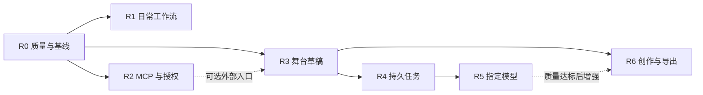

# Hertz Studio 产品路线图

> 编制日期：2026-10-16；VCPChat 补充评估：2026-10-17。性质：面向下一阶段的产品建议与交付计划，尚不代表功能已实现或发布日期已承诺。
>
> 依据：[README](../README.md)、[双发行版说明](./editions.md)、现有源码与 ADR，以及关联聊天「优化 AI 接入设计文档」中的 [AI v3 设计](./research/ai-capability-entrypoints.final.md)。本次核对的提交为 `aa77af10dc3a9693cc646e55e14186cb1a453c8b`，工作树另有进行中的修改。

> 2026-10-17 架构修订：AI 与 MCP 默认采用 Rust，不新增 Node 运行时；完整舞台物化与分享码生成留在现有前端。外部离线完整预置合成移出主线；与原 AI v3 不同的范围以本路线及配套技术方案为准。

> 同日复核：共享播控、草稿基线/预览、收费任务恢复和预算等问题已同步修订，详见[架构复核记录](./architecture-review.md)。阶段编号表示建议交付顺序，MCP 不是应用内 AI 的技术前置。
>
> 配套文档：[技术实施方案](./technical-roadmap.md)、[VCPChat 参考评估](./vcpchat-reference-assessment.md)。AI v3 位于 Git 忽略目录，新克隆仓库可能没有该文件；本组文档保留必要的设计结论，但不会把历史研究稿当作已发布接口。

> 2026-10-20 范围优先级：先完成用户可用的功能闭环。用量与费用统计、价格核对和账单展示为可选能力，不作为 R4/R5 功能交付门槛；价格未知可以跳过。任务同意、请求边界、取消与资源回收、每任务至多派发一次及故障后不自动重放仍是必需行为。

## 1. 建议采取的方向

未来一个主要迭代周期，把 Hertz Studio 做成“日常可依赖的本地音乐工作台，以及可解释、可保存的音乐视觉创作工具”。先补齐日常体验和真实环境验收，再交付受限的外部 AI 操作与前端舞台草稿闭环，最后接入应用内模型生成。

优先级按用户获得的完整结果排序：**听得稳 → 找得到 → 能连接已有 AI 客户端 → 能生成和保存舞台草稿 → 能受控地生成候选 → 能围绕歌曲编排与导出作品**。

不把通用聊天窗口、更多皮肤、更多在线平台作为下一阶段主线。现有能力数量已经充足，新增入口必须减少完成任务的步骤，或解决已有能力的可靠性问题。

### 1.1 三条路线的取舍

| 路线 | 用户最先得到什么 | 主要代价 | 建议 |
| --- | --- | --- | --- |
| 播放与工作流优先，AI 分层接入 | 日常体验先改善；之后每个 AI 阶段都可独立使用 | 需要克制新场景和新平台的数量 | 采用 |
| 先做应用内 AI 助手与聊天页 | 产品展示直观 | 在授权、任务、费用和预览未完善时扩大入口，难以证明实际完成 | 暂缓 |
| 先扩展视效、DSP 和平台数量 | 单点功能吸引人 | 同时扩大音频、GPU、账号协议三个维护面 | 只保留有独立证据的小任务 |

### 1.2 需要守住的产品原则

1. 不开启 AI、不联网，原有本地播放、歌词、曲库、歌单和视觉功能仍可用。
2. Standard 与 Full 同仓库、同提交、同版本演进；能力差异由既有发行版规则决定，不另建产品分支。
3. AI 输出首先是候选。生成、预览、应用、收藏是用户可以辨认的不同动作。
4. 播放控制交给原播放器，视觉状态交给原舞台；AI 无权改文件、接管音频线程或执行任意代码。
5. 任何模型请求都应能查回原任务；网络中断不能诱导用户反复提交。用量/费用查询为可选辅助。
6. 衡量收益以任务完成和真实使用为主，不能用场景数量、工具数量或模型调用次数替代。

## 2. 当前产品位置

### 2.1 已有资产、差距与下一步

| 领域 | 当前可以据此规划的能力 | 需要补齐的边界 | 下一步价值 |
| --- | --- | --- | --- |
| 本地听歌 | 曲库扫描、FTS 搜索、队列、历史、歌单、歌词、备份与恢复 | 13 种扩展名不等于 13 种可解码格式；设备与压缩音频听测仍需独立验收 | 降低“导进来却不能播”和恢复失败的困惑 |
| 在线与 WebDAV | Provider 注册、登录、逐曲降档、缓存、换源、远程导入 | 平台变化和真实账号验收不能由 fixture 替代；会员资料不等于可播权限 | 提升失败解释、重试和来源可见性 |
| 搜索与发现 | 本地检索、在线单源与聚合搜索、每日推荐 | 聚合已有并发和单源预算，不等于首个完成的源能立刻显示 | 缩短从输入到可点播结果的时间 |
| 播客 | 公开目录、地区选择、RSS、订阅、稳定单集身份、续播与已听状态 | 倍速不在当前承诺内；单集收听进度独立于全局队列游标 | 长音频离开后继续收听 |
| 视觉 | 歌词视觉、创意舞台、三维空间、编排、分享码 | 不同舞台有不同 owner 和状态协议；弱机和原生宿主验收范围有限 | 从“很多效果”转向“容易选择、容易保存” |
| 一句成景 | 确定性的离线规则编译器、StageIntent v1、原子应用入口 | 不等于大模型；v1 不支持时序与相对编辑语义 | 先做可校验的草稿产物，再接模型 |
| 导出 | 已有独立形态歌词视频导出、可选系统音频、OBS 只读浮层 | 浏览器能力、系统声音权限、DOM 与画布合成有限制；DBX 不支持同等导出 | 完善能力说明、录制恢复与画面一致性 |
| 分发 | Standard / Full、独立程序 / DBX、跨平台 CI | 构建产物不等于已发布；商店候选不等于完成签名上架 | 建立可复核的发布质量 |
| AI 与 MCP | 已有 v3 设计，包含权限、身份、幂等、任务与费用契约 | 当前没有对应 AI 模块、MCP 适配器和正式 AI API | 从最窄的闭环开始实现 |

这里的“未见”是本次文件核对结论，不代表对全部运行场景做过验收。

### 2.2 先纠正几处容易误读的规划

- README 的 P1–P8 是历史演进记录，后续新增路线采用 R0–R6，避免重新解释旧阶段。
- “录制回放仍在计划内”应拆开：**视频录制导出已有实现，编排操作记录与可重放工程仍是未来能力**。
- “前端零构建”适用于日常 UI 开发和使用；现有 Three.js 舞台开发工具已有 npm 构建。Node 继续只用于已有开发工具和契约导出/CI；新增 AI 与 MCP 均不引入 Node 用户运行时或嵌入式 JS 引擎。
- 双传输共用业务逻辑，不表示外部 MCP 能直接连接 DBX 的 stdio。首发连接范围见第 5 节。
- 部分历史上架说明仍使用旧 tag 示例；发行版命名与候选触发条件以当前 `editions.md` 和 workflow 为准，R0 统一说明。

## 3. 目标用户与核心任务

### 3.1 用户顺序

| 优先级 | 用户 | 首要任务 | 成功体验 |
| --- | --- | --- | --- |
| 第一 | 有本地曲库、希望长期使用的听众 | 导入、找到、连续播放，关闭后能继续 | 不需要了解平台、渲染器或 API 就能听歌 |
| 第二 | 同时使用本地、WebDAV 与在线源的听众 | 知道结果来自哪里、实际播放了什么、失败后怎么办 | 单源故障不阻断其它来源和已有播放 |
| 第三 | 歌词舞台与视频创作者 | 选场景、调氛围、预览、收藏、分享、导出 | 一个作品能在下次打开后继续编辑 |
| 第四 | 已有 AI 客户端的高级用户 | 授权检索、播控与生成草稿 | 明确知道授权范围和操作结果，不交出全权令牌 |

直播用户继续使用现有只读浮层；本阶段不扩展为直播导播软件。多用户家庭服务器和远程 AI 托管需要不同的身份、权限与部署模型，单独规划。

### 3.2 五条产品闭环

| 编号 | 完整用户旅程 | 本轮要减少的阻力 |
| --- | --- | --- |
| J1 | 安装 → 添加目录/配置公开源 → 扫描/检索 → 首次播放 → 退出恢复 | 不可播格式、空状态、错误含义、安装版本选择 |
| J2 | 输入关键词 → 看到来源与部分结果 → 播放/入队 → 来源失效 → 继续听 | 慢源拖延、结果身份混淆、错误抢占界面 |
| J3 | 选择场景 → 输入描述/明确 intent → 查看候选 → 预览 → 应用 → 收藏/分享 | 把“导入即应用”误认为预览、保存覆盖、版本不匹配 |
| J4 | 开启外部接入 → 选操作权限 → 客户端连接 → 查询/播控 → 撤权 | 配置全权 token、错连实例、重复下一首、失败却声称完成 |
| J5 | 选择本地/云模型 → 同意发送数据 → 提交 → 查任务 → 预览/接受草稿 | 状态丢失、重复调用、取消后结果复活 |

## 4. 产品信息架构与交互方案

### 4.1 沿用现有入口，减少新增顶层页面

- **首页**继续服务“接着听”。仍然只有一个主要播放动作，不新增常驻 AI 对话框和自动播放推荐。
- **搜索**明确区分本地、在线与播客。结果统一视觉规则与动作语言，音乐和节目保留各自语义，不把所有结果混成一种可替换曲目。
- **曲库与队列**承担整理和播放顺序。搜索结果不持有第二套播放队列，皮肤也不持有业务状态。已有胶囊与 MediaSession 继续复用，参考 VCP 优化长标题、焦点展开、收起可访问性和生命周期，不重复建设。
- **创意工坊**承接规则草稿、外部分享产物和应用内生成。模型模式作为一个可选生成方式，不另造平行作品库。
- **设置**增加“AI 与外部连接”：连接状态、允许操作、模型与数据说明、撤权与故障处理。密钥仅显示是否配置；用量/费用信息可选。
- **任务入口**在有活动任务或需要处理结果时出现；无活动任务不显示空的全局 AI 面板，不持续轮询。

普通播放页、歌词舞台、三维空间保留不同的使用目的。用一致的设置、退出与返回操作连接它们，近期不整体重写 UI 或替换前端框架。

### 4.2 新增交互的具体规则

| 场景 | 用户应看到的内容 | 必须允许的下一步 |
| --- | --- | --- |
| 本地文件不可解码 | 已入库、当前不支持播放的明确状态 | 查看原因、定位文件；不把失败显示为正在播放 |
| 某来源失败 | 来源、失败类别、是否还有结果 | 只重试该来源；继续使用已有结果 |
| 外部播控超时 | “操作结果暂时无法确认”与当前观察状态 | 查看当前状态；不自动重放 next/previous |
| 外部 intent 草稿 | intent 校验结果与目标版本；工坊物化后展示参数变化和归一化警告 | 复制 JSON → 工坊导入并预览 → 确认后应用/收藏或生成分享码；与现有分享码导入区分 |
| 应用内模型生成中 | 排队/生成中/取消中与可查询任务 | 取消、离开页面、之后回来查看 |
| 生成完成 | 候选说明、预览入口与差异 | 预览、应用、拒绝；收藏另点一次 |
| 当前舞台已被用户修改 | 候选基线过期的提示 | 重新预览；不能用旧候选覆盖新编辑 |
| 用量/费用统计关闭 | 任务功能保持可用 | 继续查询、取消与处理候选 |
| AI 禁用 | 功能关闭、已有任务事实仍可查看 | 官方入口查询、取消、删除凭据；不新发模型请求 |

用户界面描述业务事实，不向普通用户展示 schemaHash、锁文件、CAS 等实现细节；这些留在可展开的诊断信息里。

## 5. 能力分层与首发范围

### 5.1 分三层交付 AI

| 层次 | 用户价值 | 谁提供生成/推理 | 数据与费用 |
| --- | --- | --- | --- |
| A：外部有限能力 | 现有 AI 客户端可检索、播控、查询场景契约与校验 intent；用户导入工坊后生成完整草稿 | 外部客户端推理；Rust 执行领域能力与窄校验，前端负责舞台物化 | Hertz 不调用模型；外部客户端自身的数据与费用另计 |
| B：应用内生成 | 不离开工坊就能从描述创建候选，首期从规范默认基线生成 | 用户显式配置的本地或云 provider，由 Rust 直接调用 | Hertz 管理任务、同意与恢复；用量/费用统计可选；不依赖 MCP 或外部 grant |
| C：增强创作 | 歌曲编排、语义检索、素材辅助 | 按各自任务选择规则/算法/模型 | 分项评估，不继承 B 的自动授权 |

外部客户端使用曲名等数据，意味着这些数据会进入该客户端的信任范围。设置页需要说明：Hertz 没有主动调用云模型，不等于外部客户端不会发送数据。未授权歌曲元数据的连接，只能看到最小播控状态。

与 AI v3 的阶段对应关系：A0（契约与授权）和 A1（只读与播控）归入 R2；A2 在 R3 收敛为场景契约查询、intent 校验和工坊人工导入，不再承诺外部离线合成完整预置。B1（持久任务）归入 R4，B2（指定模型）归入 R5；C 的扩展按 R6 与后续专项分别评审。

### 5.2 两个发行版、两种形态的交付矩阵

| 能力 | Standard 独立 | Full 独立 | Standard / Full DBX |
| --- | --- | --- | --- |
| 原有播放与视觉体验改进 | 同步 | 同步，保留 Full 来源 | 同步，沿用宿主能力边界 |
| 外部 MCP 只读/播控 | A0/A1 首发，限独立服务 IPv4 回环绑定 | 同左，仍需单独授权 | 首发不承诺外部连接；不能共用宿主 stdio |
| 外部场景契约 / intent 校验 MCP | A2 修订，需独立服务在线 | 同左 | 首发不连接 DBX；可人工导入兼容 intent，不代表外部控制宿主 |
| 工坊本地 intent 导入、物化与分享 | R3，不要求模型连接 | 同左 | R3，沿用原前端与宿主能力，不要求外部 MCP |
| 应用内 AI 任务/预览 | B1/B2 | B1/B2 | B1/B2 通过原 RPC 共用应用服务验证 |
| AI 数据与任务 | 本版 DataDir 独立 | 本版 DataDir 独立 | 宿主 DataDir 独立，界面必须标明当前实例 |
| 视频导出 | 保留现有能力并完善 | 同左 | 继续说明沙箱限制，不用模型能力掩盖导出限制 |

Full 的平台账号与平台写操作不会因为 AI 接入自动开放。AI 首发曲库检索只读已有本地/已导入曲库索引，不等于开放所有在线站点搜索、账号资料或私人歌单。

首期所有模型入口共用当前 DataDir 的任务存储、runner 与资源上限，不能通过增加 grant 或入口绕过授权、容量和单次派发规则。token 用量、价格、费用账本和金额预算均为可选能力，不要求统计或配置。AI 只提供“从默认基线创建候选”；对当前舞台做模型编辑需要显式快照和版本契约，暂不承诺。外部客户端人工复制 intent 是首期集成方式，自动投递到工坊不在该闭环中。

## 6. 阶段路线图

### 6.1 排期口径

按 **1 名熟悉项目的全职开发者，每周约 4 个有效工程日**估算。下表是净工程周，串行主线约 26 周；建议另留 25% 集成、反馈与外部环境缓冲，总计划约 33 个自然周。它是容量模型，不是对特定日历日期的承诺。

本次移除 Node 适配器分发和跨运行时物化工作，新增 Rust SDK 验证、CLI 生命周期分流、intent 人工导入与导出一致性验收。暂保留 R2 的 3 周、R3 的 4 周容量及总估算，不将删掉依赖直接折算为提前交付；R2 SDK 试验与 R3 fixture 完成后再据实际工作量重估。离线完整合成不占主线容量。

复核发现共享播控结果、临时预览不落盘、付费派发恢复和搜索总期限都是正式交付的必要工作，不可因排期紧张删掉。26 周仍是初始容量草案，并非逐任务估算后的结论；先各用 1–2 个工程日验证 SDK/启动分流、显式基线物化/临时预览，再结合 R4 fake provider 的崩溃恢复试验重估。依赖阻塞时可优先交付工坊本地闭环，不用等 MCP 兼容性问题解决。

R0/R1 的真实账号、硬件与宿主验收需要有人提供环境或实际操作；等待环境不应被当成开发已经验收。若只有每周 2 个有效工程日，主体开发时间约翻倍；优先保住 R0、R1、R2 和 R3，后续按证据延期。

版本号暂不预占。先用里程碑管理，发布前再按当时软件版本决定 patch/minor，Standard / Full 同步升版。

| 阶段 | 净工程周 | 主线累计 | 可感知交付 | 依赖 |
| --- | --- | --- | --- | --- |
| R0：质量与事实收敛 | 2 | 第 1–2 周 | 能力边界、性能基线、双版本发布清单可信 | 当前版本 |
| R1：找歌与连续聆听 | 4 | 第 3–6 周 | 搜索可渐进使用、来源失败可恢复、状态一致 | R0 |
| R2：外部只读与播控 | 3 | 第 7–9 周 | 标准 MCP 连接、最小授权、可靠结果 | R0；发布合入 R1 稳定基线 |
| R3：舞台草稿闭环 | 4 | 第 10–13 周 | 明确基线的 intent 导入、无副作用物化、临时预览与分享 | 原场景 fixture 与窄契约；不依赖 R2 MCP 发布 |
| R4：应用内任务底座 | 4 | 第 14–17 周 | fake provider 下的生成任务、取消与恢复闭环 | R3 契约；公共身份/锁模块，不依赖外部接入 |
| R5：指定模型试验与发布 | 5 | 第 18–22 周 | 一个明确选择、可受控调用的描述生成入口；质量评测单独决定正式发布 | R4；provider/数据条款；用量费用统计可选 |
| R6：可保存的音乐创作 | 4 | 第 23–26 周 | 创作模板、已有导出链路加固、一个编排试点 | R3；R5 通过才加模型编排 |

图中表示依赖关系，不表示单人能同时完成所有分支。增加第二名开发者时，可把 R1 的搜索工作与 R2/R3 的服务端契约工作分开；仍保留统一集成验收。

### R0：让能力和发布说明可信

**目标：** 用户知道哪一版适合自己，维护者能说明哪些链路已经验证。

交付项：

1. 建立“能力 × 发行版 × 形态 × OS × 验收类型”矩阵，区分自动化、真实画布、真实宿主、实际声音和真实账号。
2. 首次使用与错误说明补充不可解码格式；先如实标示，再单独评估解码器扩展，不能先改支持列表。
3. 统一发布文档的 Standard tag、Full 分发、CLI 固定版本、版本迁移与回滚说明。
4. 用隔离数据跑备份/恢复、队列恢复、设备切换、长时间播放和空间进入退出，记录构建标识与环境。
5. 固定一组基准曲库、压缩音频、WebDAV fixture、RSS fixture、舞台与显示器组合，建立性能基线。

**退出条件：** 新增说明与源码一致；无阻塞级数据或播放问题；至少 Windows 的真实声卡与原生 DBX 核心旅程有当期证据；其它 OS 未验范围如实列出。基线硬件未到位时，不能对外发布性能达标声明。

### R1：让用户尽快找到并持续听到内容

**目标：** 对同一关键词，已有结果先可用；慢源和故障只影响自己。

交付项：

1. 本地/在线/播客入口共用清晰的搜索范围提示，保留来源与媒体类型。
2. 增强在线聚合搜索为按源返回：查询在前端有独立身份，取消/改词后旧结果不能回填；已完成源先展示，失败源独立重试。单源、旧聚合、HTTP/RPC 共享新增的服务端入场额度与单源总期限，不因改接口丢掉原 6 秒保护。
3. 搜索结果保留真实 `source/id/ref`，视觉去重不合并播放权限，不因“看起来同一首”丢掉来源候选。
4. 收藏、入队、立即播放共用原业务动作；列表排序变化不改变已点击曲目的身份与队列归属。
5. 错误区分未配置、未登录、无权限、无结果、超时、不可达与不支持，不把一次取流失败记成永久权益结论。
6. 针对 7 套公开皮肤和空间搜索验证键盘、焦点、窄屏与关闭恢复，不增加新皮肤。

**退出条件：** 慢源不延迟已完成源展示；关闭/换词后无旧结果覆盖；现有在线取流、队列、换源和普通播放无回归；在基准环境记录首个可用结果的 P50/P95，而非把外网延迟伪装成固定保证。

### R2：让外部 AI 获得有限且可证明的能力

**目标：** 用户能把 Hertz 加到已有 MCP 客户端，只授予需要的动作。

交付项：

1. Rust 标准 MCP stdio 适配层，先验证 Rust SDK、MSRV、协议协商与一个真实目标客户端，再冻结版本。
2. “AI 与外部连接”设置页：默认关闭、授权预设、安全摘要、撤销/轮换、实例说明。
3. 只读曲库检索、最小播放快照与六种播控：暂停、继续、上一首、下一首、定位、音量。
4. 启动身份检查、服务端逐操作授权与字段投影、写操作去重、明确 unknown 结果。
5. 通过现有发行版可执行文件的独立 MCP 启动模式与连接指南交付，不新增 Node 安装步骤；该模式只转发到已运行服务，不执行数据迁移、不打开业务库、不启动音频/HTTP 服务、不获取服务端 runner 锁。
6. 将六种播控收敛到共享应用入口，HTTP/RPC/MCP 使用同一份领域结果；未装载 resume 不恢复队列，空队列/被取代不声称“已执行”。变更由服务端 owner 完成收尾，观察者超时或断开不会留下未清理状态。

**退出条件：** pause-only 连接不能 next；不允许曲目信息的连接不能从错误或事件读到标题；重复 next 只执行一次；重启后旧请求拒绝；真实 MCP 客户端在未安装 Node 的环境完成 J4；关闭适配进程不关闭播放器，服务未启动时不拉起第二实例。DBX 外部桥接保持单独后续项。

### R3：让舞台生成结果成为可带走的草稿

**目标：** 同一份 intent 在相同可信默认基线上，经现有前端生成可解释的预置与分享码；服务端只做窄校验，不维护另一套舞台物化逻辑。

交付项：

1. 保留前端场景默认值、物化、背景/手绘规则和分享 codec 的唯一实现，抽出显式基线、无副作用的物化函数；开发/CI 从实际定义导出供 Rust 使用的版本化窄契约。首期 create 模式要求目标场景与默认基线身份，不继承当前用户预置中的隐含参数。
2. 外部客户端经在线独立服务读取场景契约、校验明确 intent，返回带版本/hash 的 JSON 草稿；Rust 校验不等于完整预置校验，不返回完整 preset 或分享码。
3. 工坊新增人工粘贴 intent、重新校验、物化与草稿预览流程，完成后才可分享；不依赖浏览器常驻或外部自动投递。现有“载入分享码即应用”的行为继续准确说明，不默默改义。
4. 原舞台在临时层呈现预览，与已提交预置分开；预览不调用自动保存，不因超过 400ms、切页或刷新留下候选。确认应用才提交持久状态，收藏仍另点一次；任何新编辑先使旧预览失效。过期基线需要重新预览。
5. 提供少量经过视觉验收的创作模板，分别说明场景、氛围、运动强度与适用边界。

**退出条件：** 所有支持的创意场景经过重构前后与各前端入口对照；Rust 契约导出无漂移；旧分享码兼容；未知版本/hash 拒绝静默兼容；intent 导入不执行代码、不自动应用、收藏或调用模型。未打开工坊时外部工具不能声称已生成完整预置或分享码。

### R4：先证明长任务不会丢状态和重复调用

**目标：** 在不依赖真实模型质量的情况下，完整演示 J5。

交付项：

1. fake provider 与持久任务，支持取消、队列期限、执行期限、重启中断、查询恢复与容量限制。
2. 每 DataDir 一个运行者，复用公共身份/内核锁模块；关闭外部 MCP 或未创建 grant 时，官方 UI 仍可独立运行任务。
3. 幂等提交、提案保留、事件通知与查询恢复；关闭页面不丢任务，通知丢失仍可查询。
4. 持久派发标记和故障恢复保证任务最多发起一次；用量/费用账本可保留为可选能力，不要求启用金额预算或统计。
5. Standard / Full、独立 / DBX 的隔离实例验证，官方 UI 可查、可取消、可管理凭据。

**退出条件：** 提交回复丢失不新增 provider 调用；DB 提交与内存输入交接失败可收敛；取消/完成只有一个任务终态，执行许可覆盖本地连接回收；重启不重放模型请求；多 grant、官方入口和同 DataDir 的第二个后端不能绕过任务与授权限制。费用核算不作为退出条件。此阶段只交付任务底座，不宣传模型生成质量。

### R5：以真实效果决定模型是否值得发布

**目标：** 首先支持一个明确 provider/model，用真实语料证明它优于现有规则基线。

交付项：

1. 一个 provider 协议实现与明确模型标识，区分本地和云连接策略；不预设任意“兼容接口”都可用。
2. 首次启用与发送数据清单；设置有限请求和输出上界，密钥进系统凭据库，备份与日志不包含密钥。价格未知不阻挡功能；用量/费用统计可选。
3. 默认只发送描述、选中场景参数和默认基线，不自动带歌曲、歌词、历史、封面。
4. 工坊呈现排队、生成、失败、取消、候选预览与拒绝；费用信息不影响任务功能。
5. 至少 120 条分层评测输入、规则基线、两轮复测与人工语义评分；冻结候选模型后再决定正式开关。

**退出条件：** 权限/非法结构/已知否定反向执行用例零误接受；模型在代表输入上达到冻结的合法率、语义质量、截断率与时延阈值。继续限制请求/输出上界并保持用户明确启用；用量/费用数据可以缺失，不作为功能交付门槛。未达到质量阈值则继续实验开关，保留 R2/R3 的独立价值，不为赶期取消验证或静默换云模型。

### R6：把已有视觉能力组织成可持续创作流程

**目标：** 用户能保存、继续编辑和导出一个作品；优先完善已有链路。

交付项：

1. 统一模板、草稿、当前编排和收藏的动作说明，补充来源与兼容版本信息。
2. 加固已有视频导出：明确实际音轨、格式能力、录制中断、停止后保存、横竖屏构图与歌词一致性。
3. 编排试点先从“手动分段 + 规则模板 + 现有 cue”开始，明确绝对歌曲时间、seek 与暂停语义。
4. 只有在试点收益成立、时间轴契约升级完成后，开放“前奏平静、副歌增强”一类模型编排。
5. 色谱进度条或封面配色绑定可作为独立小任务提前；旋律轨迹需要服务端基频算法评测，不由模型虚构。

**退出条件：** 一个示例作品从创建到重开、修改、分享、导出全程完成；seek/暂停/换曲后编排可重算；不把视频文件当成可编辑工程；不承诺跨 GPU 像素级复现。

## 7. 具体需求池与取舍

| 需求 | 优先级 | 用户收益 | 交付边界 / 决策信号 |
| --- | --- | --- | --- |
| 能力矩阵、格式边界、恢复与发布核验 | P0 / R0 | 降低基本使用失败 | 阻塞后续正式发布的问题先修 |
| 搜索分源渐进展示与局部重试 | P1 / R1 | 提前获得可用结果 | 复用已有 Provider，服务端有界，不引入另一套搜索后端 |
| 权限可见的 MCP 连接 | P1 / R2 | 复用现有 AI 客户端 | 首发独立服务；不开放队列替换、账号写入 |
| 同源舞台草稿与预览 | P1 / R3 | 生成成果可解释、可带走 | 分享 v1 兼容，收藏独立 |
| 持久任务与取消恢复 | P1 / R4 | 断线与取消可恢复 | fake 先验，真实 provider 后接；费用账本可选 |
| 一个经过评测的模型入口 | P1 / R5 | 处理规则覆盖之外的合法描述 | 质量不足就保留实验状态 |
| 视频导出稳定性与模板 | P1 / R6 | 将已有视觉做成作品 | 延续现有浏览器/音轨边界 |
| 播客单集续播、已听状态 | P2 / 已交付 | 改善长音频体验 | 按稳定单集身份独立保存进度，不冒用全局队列游标 |
| 变速不变调 | P2 / 独立音频项目 | 播客听众收益明确 | 先测算法、音质、CPU；不是简单改变播放时钟 |
| 高质量重采样、参数 EQ | P2 / 独立 DSP 项目 | 有设备与听测支撑时提升音质 | S1 先替换解码侧重采样，保留已有设备域六段 EQ/增益/限幅；参数 EQ 与全链重排后置 |
| WASAPI 独占 | P2 / Windows 专项 | 特定发烧用户需求 | 需设备协商、占用失败回退与重采样规则 |
| opus / ape / wma 播放 | P2 / 逐格式评估 | 关闭已知格式缺口 | 核验库、许可、包体、原生平台与坏文件，逐项发布 |
| 语义检索 / 氛围推荐 | P3 / 证据驱动 | 解决关键词不够的任务 | 先用结构化标签/FTS 对照；代表查询显著获益才上 embedding |
| 外部 MCP 连接 DBX | P3 / 独立桥接项目 | DBX 用户也能由外部客户端控制 | 新受限本地 IPC/HTTP 传输，宿主与权限验收完成后开放 |
| 播放器关闭时离线生成完整舞台分享码 | P3 / 主线外验证 | 外部客户端无需打开工坊即可带走成品 | 先证明用户需求，再评估复用方式与成本；不默认新增 Node/JS 运行时或重写 codec |
| 自动收藏、远程视觉 apply | P3 / 独立提交协议 | 减少人工导入步骤 | 先有目标 UI 身份、revision、确认与回执，再讨论自动化 |
| 云同步、多用户、远程 MCP | 暂不进入主线 | 面向不同部署人群 | 需要独立身份、授权、冲突与运营模型 |
| 在线热加载生成 SVG/GLSL/JS | 暂不进入主线 | 新素材空间大 | 首先用于离线制作，经静态与真实绘制评审后随包发布 |

并列的 P2 项不同时启动：依据反馈选择播客或音频专项之一。卷积 IR、真峰值限幅、R128、交叉馈送等完整 DSP 二期在该专项内再排序，不压进 R0–R6 主线。

### 7.1 VCPChat 对照后的增补建议

已核对本机 VCPChat 音乐模块、Rust 引擎、MusicController、歌词候选与语义搜索。它对歌词质量、音频工程和 UI 分层有较高参考价值；Hertz 的音乐 Provider 与账号/音质/缓存链继续作为基础。详细源码依据及限制见[对照评估](./vcpchat-reference-assessment.md)。

| 采用项 | 对本路线的调整 | 容量与决策 |
| --- | --- | --- |
| UI、胶囊与高级设置分层 | 纳入 R1 的现有入口回归；保持主播放与歌词突出，DSP 渐进展开 | 不新增皮肤或播放器，不整体迁移 Electron 布局 |
| 歌词候选与高精度结构 | 新增 **R1-L 歌词质量专项**：格式、候选、人工确认、来源与竞态保护 | 预计 2–3 净工程周；可替换后续等量任务，或单独增加排期，不能塞入原 26 周承诺 |
| 流式 DSP 与重采样 | 新增 **S1 音频质量专项**，在原解码侧替换重采样并验证帧数、延迟、finish/reset，不先建设通用 DSP 图 | 预计 3–4 净工程周；若音质优先可替换 R6 等量容量，其它 DSP 与独占另估 |
| 对话点歌 | 认可已有 AI 客户端完成音乐动作的价值，R2 仍先有限播控 | 稳定身份消歧、原 owner 条件点播与回执完成后，才能新增按歌名播放工具 |
| 规则导演 | R6 先以歌词密度、能量与 cue 模板试点 | 不把每次选镜改成模型调用，不将规则导演计为已完成模型集成 |
| 描述式搜索 | 保留 P3 试点，以稳定 trackId 与 FTS/标签作对照 | 不迁移基于路径文本解析的记忆系统，不预先上传曲库 |

建议先用代表歌曲判断“歌词输入质量”是否为当前舞台最大的短板；若是，优先选择 R1-L，收益可覆盖普通播放、舞台、OBS 与导出。音质专项则先实测重采样误差、CPU 与设备，不由 f64、升频和独占等标签判断声音优劣。

VCP 根许可证为 CC BY-NC-SA 4.0，部分歌词舞台文件标 AGPL-3.0。本方案默认借鉴交互、契约和测试场景后独立实现，不直接复制其代码或素材到 MIT 项目；具体模块直接复用需要先确认许可与授权。

## 8. 如何判断路线有效

### 8.1 指标与采集原则

以下是待建立的验收目标或测量口径，**不是当前项目实测结果**。默认本地汇总，不开启外发遥测。涉及真实用户体验时，经同意访谈或导出脱敏摘要；不记录曲名、路径、描述、歌词和完整模型响应。

| 指标 | 定义与采样 | 初始目标 / 用途 |
| --- | --- | --- |
| 首次播放完成 | 新隔离配置完成 J1，不把空库等待下载算入交互时间 | 5 名代表用户中至少 4 名无需指导完成；记录阻碍点 |
| 重复聆听价值 | 连续 7 天试用后的回访，询问实际使用次数与放弃原因 | 小样本只作方向判断，不宣称总体留存率 |
| 本地播放响应 | 支持格式、设备已就绪，点击至后端首次有效输出；另记 UI 状态 | 基准机 P95 不超过 1 秒，且不比 R0 退化超过 10% |
| 首个搜索结果 | 提交关键词至首个可点击结果，分本地、fixture 在线、真实网络 | 本地 5 万曲基准 P95 ≤ 300ms；可控 200ms 上游下首源 P95 ≤ 1 秒；真实网络只报告分布 |
| 故障隔离 | 慢源/断网/401 fixture 下其它来源与已有播放是否可用 | 关键用例全部通过，不能以整体“部分成功”掩盖播放中断 |
| 创作完成 | J3 从描述/intent 到预览并收藏或分享 | 5 名目标创作者中至少 4 名完成；观察是否混淆应用与收藏 |
| 生成可查回 | 提交回复丢失、UI 重连、漏事件后能否定位原任务 | 固定反例全部通过，无重复模型调用 |
| 模型价值 | 冻结语料上比较规则与模型，记录结构合法、语义评分与反向执行 | 具体发布阈值见技术方案；先冻结，再测候选模型 |
| 性能与资源 | 基准机前台轻量舞台、后台、反复切换与退出 | 目标帧门、实际执行率和占用分开记录；不能用软件 WebGL 替代 GPU 结论 |
| 可维护性 | 每个迭代新增路径是否进入原契约、资源清单、双版检查 | 无重复业务 owner，无 Standard 包误带 Full 模块 |

小样本访谈、自动化 fixture、硬件测量、真实模型评测分别报告。没有用户授权或样本时保持“待收集”，不编造转化率。

### 8.2 评审与止损

- 每阶段结束演示完整用户旅程，附构建标识、环境与失败清单。
- 每两周检查一次容量和风险；超过阶段预算 25% 时，优先缩小新增能力，不取消错误路径、授权与恢复测试。
- R2 如果正式客户端/SDK 兼容不成立，保留内部能力门面，继续解决兼容性，不能发布自制 JSONL 并称为 MCP。
- R3 如果前端物化重构或契约导出导致旧场景变化，停止后续模型工作，先恢复原行为。
- R5 连续两轮未达到冻结指标，暂停扩大 provider 数量；检查 schema、提示词、模型与任务价值，保留实验开关。
- 语义检索、歌曲级自动编排与 DSP 扩展，只有在代表任务或真实用户反馈证明价值后进入下一轮排期。

## 9. 资源与发布方式

建议至少确定三类责任，单人项目可以兼任，但每个交付仍需对应证据：产品/交互负责旅程和取舍，工程负责实现与恢复，验收负责真实客户端、声音、账号和视觉结果。

基础产品继续按现有 MIT 与本地优先方式演进。近期不引入账号注册、订阅计费或自营模型代理。应用内模型优先用户自配 provider；费用界面与用量统计作为可选辅助，不决定生成任务是否可用；任何未来托管服务都另算产品、隐私、运维与商业计划。

发布采用默认关闭的能力开关、隔离预览配置和小范围候选。Standard / Full 同步修复；Rust MCP 模式随所属发行版发布，另记录能力版本与客户端兼容矩阵。双版可同时构建，不代表所有形态必须在同一天开放实验 AI；必须公布清楚实际可用矩阵。

## 10. 可以直接开始的前两周

| 工程日 | 工作 | 可评审产物 |
| --- | --- | --- |
| 第 1–2 日 | 核对 README、双版说明、上架手册和实际 workflow；登记当前能力与缺口 | 能力/验收矩阵、发布说明差异清单、R0 issue 列表 |
| 第 3–4 日 | 固定曲库、音频、WebDAV/RSS fixture 与环境；测现有搜索/播放/舞台 | 可重复命令、原始测量、构建标识与基线摘要 |
| 第 5–6 日 | 验证备份恢复、不可播格式、设备切换、队列恢复；修阻塞问题 | 问题复现、修复与回归证据 |
| 第 7–8 日 | Windows 声音与原生 DBX 核心旅程；评审 R1 搜索取消与 R2 授权契约 | 实际验收记录、未验范围、下阶段可执行任务 |

这是 2 周、每周 4 个有效工程日的工作量。外部设备或真实账号不可得时，先完成其余证据与 fixture 验证，标记阻塞项；不把环境缺失改写为已通过。

## 11. 本轮文档边界

产品路线、技术方案、VCPChat 对照和架构复核记录共同交付路线选择、产品行为、阶段依赖、技术设计、验收与排期建议。本轮没有实现 AI/MCP、调用模型、修改用户数据或进行真实声卡验收。后续实施应按当时源码更新路径和迁移序号，把最终确定的数值约束写入正式 ADR 与契约测试。

技术细节、接口目录、任务与费用状态机、工程拆分和验证命令见[技术实施方案](./technical-roadmap.md)。
