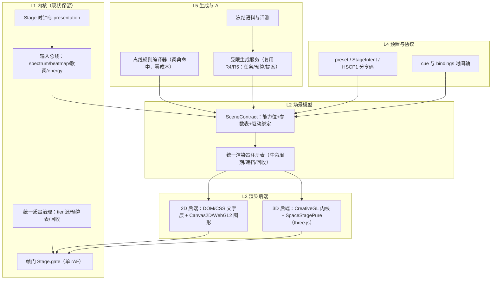
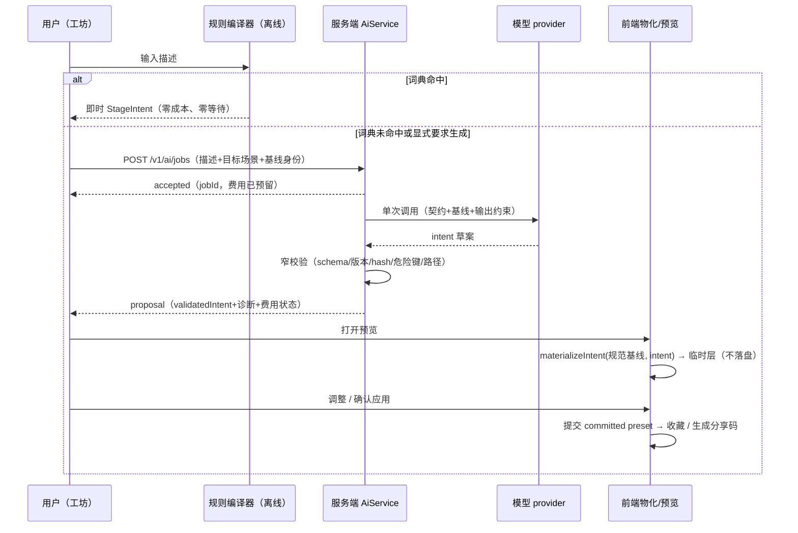

# 舞台引擎自研方案：可行性评估与实现设计

> 编制：2026-10-17。对象：提案——"自研一个舞台引擎，支持 2 维和 3 维渲染模式可供切换，并能对接大模型，根据自然语言或参数输入自动生成所需的舞台效果"。
>
> 依据：当前源码静态核对（HEAD `a3f93d61…`，含并行检索核验的渲染栈事实），以及 [技术实施方案](./technical-roadmap.md)、[产品路线图](./product-roadmap.md)、[架构复核记录](./architecture-review.md) 中已确立的约束。本文是评估与建议设计，未实现任何代码；文中的接口与分期为草案，正式落地以 ADR 与契约测试为准。
>
> 结论先行：**可行，但不建议从零重写。** 本仓库现有舞台体系已经是该引擎的雏形——"自研"事实上已经发生了大半。合理路径是：统一场景契约 + 单一渲染器注册表 + 双渲染后端 + 受限生成管线，增量演进而非推倒重来。核心分期约 10–14 净工程周，AI 底座复用路线图 R4/R5，不重建。

## 1. 可行性评估

### 1.1 逐项目标结论

| 提案目标 | 结论 | 依据与条件 |
| --- | --- | --- |
| 2D 与 3D 双模式渲染 | 可行 | 两类后端均已存在且成熟：3D 有 CreativeGL 自研 WebGL2 内核与 SpaceStagePure（three.js r186），2D 有 DOM/CSS 歌词、Canvas2D 粒子、Pixi 歌词、SVG 手绘、低分辨率背景画布。仓库已有"同一帧状态、双渲染器实现"的先例（`stage-particles.js` 的 Canvas2D/GL 双渲染器）。缺的是统一注册与质量治理，不是能力空白 |
| 两种模式可供切换 | 可行，但切换语义需重新定义 | 全局硬切换不成立：文字排版（歌词可读性）本质上是 2D 的一等公民，3D 文本只能走贴图/图集且质量受限。建议改为"场景声明能力 → 引擎选后端"，用户可见的 2D/3D 切换仅对提供双实现的场景族开放（见 3.2） |
| 对接大模型生成舞台效果 | 分层可行 | **参数空间**（选场景、调参数、生成 intent）在线生成可行且有完整底座设计（路线图 R2–R5：任务、预算、提案、校验、预览）。**代码空间**（新场景的 GLSL/逻辑）只允许走离线评审管线，运行时绝不执行模型生成的代码。这是整个方案最重要的产品边界（见 4.1） |
| 成本与容量 | 单人可分期交付 | 核心分期约 10–14 净工程周；任务/费用/评测底座复用 R4/R5 既有设计，不重复建设 |

### 1.2 自研的正确方式：统一演进，不是从零重写

现有代码已经覆盖了舞台引擎约六成的难题，且都经过真实环境打磨：

- **内核**：`plugin/ui/stage.js` 是唯一时钟 owner（从 WS 快照插值 position），单 rAF 帧门调度器 `Stage.gate(name, fpsFn, tickFn)`（实测刷新率取整除分配预算）、可见性暂停、遮挡让位、三档设备分级（eco/balanced/high）与实测掉帧降档。
- **3D**：`creative-gl.js` 的场景注册表（校验+deep-freeze 的场景定义、参数表、相机规格、分档几何、质量分档）、零顶点缓冲的分析式几何、频谱纹理上传、RGBA8 后处理链；`vendor/space-stage.js`（three.js）的场景目录与独立质量策略。
- **参数模型**：`creative-stage.js` 的扁平可寻址参数表（`cam.*|look.*|stage.*|sc.*`），每次写入过 `specFor/clampTo` 钳制，未知路径拒绝；帧内解析顺序 base→audio bindings→cue/director→clamp 已经是一个完整的驱动管线。
- **生成协议**：StageIntent v1（窄声明补丁）、`creative-prompt.js` 确定性离线规则编译器、HSCP1 分享码 codec、（路线图 R3 的）无副作用物化与窄契约导出设计。
- **数据通路**：Rust 侧 64 频段 FFT（33ms）、`vmusic-beats` 的 STFT 节拍图与 BPM、客户端 `onset.js` 统一节拍定义、`BeatmapReady` 推送与 `stage-cinema.js` 相机驱动。
- **2D 层**：DOM 逐字歌词（`--word-progress` + `background-clip:text`）、`lyric3d.js` Canvas2D 文字图集转 GL 纹理、`backgrounds.js` 低分辨率背景画布、`handdrawn.js` SVG 艺术层、Pixi 系 stanza 渲染器。
- **配套**：皮肤（布局）/主题（颜色）/舞台主题（chrome）三层分离、perf-probe 逐 gate 计数、约 150 个行为检查脚本与 Playwright 评审基建、VideoExport。

从零重写的代价：

| 维度 | 从零重写 | 统一演进 |
| --- | --- | --- |
| 工程量 | 引擎本体即 2–3 倍以上，另需重做音频分析、歌词排版、节拍管线 | 只补缺口（注册表、契约、质量治理、生成闭环） |
| 兼容 | 丢失既有场景、HSCP1 分享码、皮肤体系与全部用户预置 | 旧场景作为"未迁移场景"继续在原 owner 下运行 |
| 验证 | 全部基线从零建立 | 复用 fixture/检查基建与已知坑位清单 |
| 风险 | 双引擎并行的长期维护 | 单线演进，每期有可交付场景族 |

**若该提案面向 Hertz 之外的全新独立项目**：架构结论不变（第 2–5 章同样适用），但歌词排版、音频分析、节拍图、分享协议都需自建，总成本按 2–3 倍估计，且第 1.3 节的资产全部变为待建项。

### 1.3 缺口清单（真正要新建的）

1. **统一场景契约**：一个跨 2D/3D 的场景描述（能力位、参数 schema、驱动绑定、后端实现），现在是 CreativeGL 场景定义、SpaceStagePure catalog、DOM 模式各说各话。
2. **单一渲染器注册表**：切换逻辑目前分散在三处（`stage3d.js` 的 `sceneSource`、SpaceStagePure 的 `catalog/selectScene`、侧栏歌词 `data-mode`），没有统一的生命周期/遮挡/回收语义。
3. **统一质量治理**：三套预算方案并存（creative 的 DPR 探针、stage3d 的像素预算 `sqrt(budget/cssPixels)`、SpaceStagePure 的 auto/low/medium/high），沉浸舞台最多约 6 个 GL context / 9 张画布，需要单一 tier 源、context 上限与切换即回收的 owner。
4. **跨渲染器的相机与 cue 协议**：cue/bindings 时间轴只在 creative preset 内；stage-cinema、SpaceStagePure rig、stage3d 相机是三套实现。
5. **2D 后端的一般化**：现有 2D 渲染器逐模块 ad hoc，没有与 3D 对等的"后端"抽象。
6. **LLM 生成闭环**：R4/R5 的任务、预算、提案、评测均未实现（属路线图计划）；T2 离线创作管线完全未建。

## 2. 引擎架构设计

### 2.1 分层架构



各层职责与现状：

| 层 | 职责 | 现状 |
| --- | --- | --- |
| L0 平台适配 | context 创建、DPR、可见性、context-loss 恢复 | 各模块已有零散实现，随注册表收敛 |
| L1 内核 | 时钟、帧门、输入总线、质量治理 | **基本现成**；质量治理需收敛三套方案 |
| L2 场景模型 | SceneContract 与注册表 | **主要新建点** |
| L3 渲染后端 | 2D/3D 实现 | 各自存在，需按契约包装 |
| L4 预置与协议 | preset/intent/分享/cue | 现成；cue 需最小泛化到跨渲染器 |
| L5 生成与 AI | 规则编译器、生成服务、评测 | 规则编译器现成；服务复用 R4/R5；T2 新建 |

合成器明确**不自研**：沿用现状——各 GL context 输出预乘 alpha，由浏览器合成叠层；文字层压在 GL 层之上由 DOM 顺序保证。自研离屏合成器是典型的过度工程，还会破坏现有 DOM 歌词质量。

### 2.2 设计原则（继承既有纪律，新代码同样受约束）

1. **单一时钟**：Stage 是唯一 position 来源；任何场景/后端不得自带 rAF 或时钟（现有模块头注释已如此约定，注册表要在代码层面强制）。
2. **单一物化 owner**：舞台逻辑只在前端物化；Rust 侧只做窄校验（路线图 R3 已确立）。
3. **窄契约与钳制**：所有参数写入过 schema 钳制，未知路径拒绝，不让死参数留在预置里。
4. **预置与草稿分离**：临时预览不落盘，确认才提交（AR2 语义）。
5. **热路径纪律**：帧回调内不分配、不阻塞、不读文件；频谱走纹理不上传大 uniform；预算在控制线程换好。
6. **模型输出永不直接执行**：模型只产参数（T1）或离线草案（T2），运行时零模型产物执行。
7. **默认值单源**：场景默认值一处定义，契约导出与 fixture 同提交（R3 手法），防止第二份规则。

### 2.3 核心新抽象：SceneContract

```text
SceneContract = {
  id, version, label,
  capabilities: { text: "dom"|"atlas"|"quad", camera, depth, particles,
                  postFx, ownsLyrics, seedable, ... },
  params:   [ [name, label, min, max, step, unit, default], ... ],  // 沿用 CreativeGL 参数表形态
  drivers:  [ { param, source: "agg.0..3"|"pulse"|"energy"|"cue", gain }, ... ],
  backends: { "2d": <Impl2D> | null, "3d": <Impl3D> | null },       // 至少一项
  quality:  { tiers: [...], minPixels, contextClass },              // 供统一治理使用
}
```

要点：

- 参数表是**唯一的生成面**——LLM 与规则编译器只面对 `scene 选择 + params patch + drivers/cues`，永远不面对实现代码。
- `capabilities` 决定后端选择与降级路径；缺某能力时引擎在注册表内找替代场景或降档，而不是让后端硬撑。
- `backends` 允许单实现（大多数场景只实现一边），双实现才对用户开放模式切换。
- 现有 CreativeGL 场景定义（`scene(def)` 已校验+冻结）和 SpaceStagePure catalog 都是向 SceneContract 收敛的现成材料，迁移是包装不是重写。

后端接口（草案）：

```text
StageBackend = {
  attach(host, contract) -> handle        // 创建/复用 context，登记画布层级
  frame(state)                            // state = 时钟+频谱+节拍+歌词+参数快照（已钳制）
  resize(px), setQuality(tier), 
  pause()/resume(), dispose()             // 切换即回收：RT、纹理、程序缓存
}
```

## 3. 2D 与 3D 的渲染能力划分

### 3.1 能力矩阵

| 能力 | 2D 后端 | 3D 后端 | 结论 |
| --- | --- | --- | --- |
| 文字/歌词排版 | 一等公民：DOM+CSS 逐字擦除、字体、可访问性；或 Canvas2D 图集 | 贴图/图集/3D quad，可读性与字体覆盖受限 | **歌词可读性优先 → 文字类效果 2D-first，3D 作背景层**（与现状分层一致：歌词层压在 GL 画布之上） |
| 图层合成 | 浏览器叠层 + CSS 混合模式，零成本 | pass 内合成 + bloom/色调映射 | 各用所长，不做统一合成器 |
| 粒子/氛围 | Canvas2D（量大时切 WebGL2 point-sprite，已有先例） | 分析式顶点几何（零顶点缓冲） | 双实现性价比最高的场景族 |
| 相机/透视/深度 | 无（CSS-3D 有限） | 完整（透视相机、depth、camera layer） | 3D 独占 |
| 光照/后处理 | 有限 | RGBA8 后处理链（bloom/exposure） | 3D 独占 |
| 频谱/节拍驱动 | 同一输入总线 | 同一输入总线（频谱纹理） | 已统一，保留 |
| 分辨率/预算 | CSS 像素为主，成本可控 | DPR×tier 探针 + 分档几何 | 治理策略统一（3.4） |
| 可访问性/缩放 | 好（DOM 文本可选中、缩放） | 差 | 无障碍场景必须 2D |

### 3.2 切换语义：能力位驱动，不做全局开关

三个候选：

- A. 全局 2D/3D 开关 —— 否决：文字质量与无障碍在 3D 无法保证，且多数场景只有单实现。
- B. 每个场景硬指定后端 —— 可用但浪费：同构效果（粒子、频谱、氛围）天然双实现。
- **C.（推荐）场景声明能力位 + 双实现场景族**：引擎按设备/质量/遮挡自动选后端；用户可见的"2D/3D 切换"只对 `backends` 双实现的场景族开放。先例：`stage-particles.js` 的 standard/GL 双渲染器吃同一帧状态，设置项切换渲染器——这就是目标形态的微缩版。

切换规则：

1. 切换发生在**场景边界**或契约声明过的转场点；不做任意 mid-scene 热切换（避免黑帧、资源竞争与状态语义分歧）。
2. 后端不可用（context 丢失、tier 过低、context 数超限）时沿注册表降级：同场景另一实现 → 相邻场景 → 静态封面。
3. 切换即回收：目标后端先预热（沿用 CreativeGL `warmUp()` 预编译思路），源后端释放 RT/纹理/程序缓存；新旧重叠期不得超过一帧门周期。

### 3.3 统一坐标、构图与文字策略

- 逻辑坐标系、安全区、宽高比映射**单源定义**（经验教训：插画类场景的 `art()` 坐标映射必须一处定义，多处复制必然漂移）。
- 文字三条渲染路径各有适用面并写进能力位：DOM（侧栏、overlay、可访问性场景）、Canvas2D 图集→纹理（3D 场景内歌词，`lyric3d.js` 手法：签名去重、分档宽度、CJK 系统字体）、3D quad（舞台内嵌歌词，需 ownsLyrics 声明避免双份歌词）。
- 皮肤/主题零污染：皮肤只管布局、主题只管颜色、场景参数归 preset 的既有铁律不变；新引擎不得让场景定义携带颜色字面量或布局假设。

### 3.4 质量治理与资源生命周期（收敛三套方案）

- 单一 tier 源：`Stage.tier()` 生态/均衡/高配三档继续作为唯一分级输入；三套现存预算（creative DPR 探针、stage3d 像素预算、SpaceStagePure 档位）收敛为一个策略接口，各后端只声明预算表。
- 硬上限：同时活跃 GL context 数设上限（现状约 6 个已是风险位），注册表负责让位与销毁。
- 降档可观测：perf-probe 逐 gate 计数扩展到后端级；实测掉帧降档（现状 <40fps 探针）保留。
- 回收必须显式：教训包括陈旧 render target（`uHasRefl`）与切换后画布残留；dispose 是后端接口的一部分，不是可选项。

## 4. 与大模型对接的接口方式

### 4.1 总边界：参数空间在线，代码空间离线

| 通道 | 内容 | 运行时机 | 安全边界 |
| --- | --- | --- | --- |
| T1 应用内参数生成 | 自然语言/参数 → 场景选择 + StageIntent patch + drivers/cues | 在线（R4/R5 任务底座） | 模型输出是**数据**：过 schema/钳制/危险键检查；永不执行 |
| T2 开发期效果创作 | 新场景草案（参数化模板槽位优先，自由 GLSL 高级模式） | 离线开发管线 | 静态校验 + 无头渲染评审 + 人工视觉验收后随包发布；运行时零热加载 |
| T3 外部 MCP | `stage_capabilities_get` / `stage_intent_validate` | 在线（R2/R3） | 只读契约 + intent 窄校验；完整物化由用户在工坊人工导入完成 |

这条边界与路线图既有决定一致（"在线热加载生成 SVG/GLSL/JS 暂不进入主线"），理由：任意生成代码不可审（安全）、不可移植（驱动矩阵与编译坑）、不可预算（性能）、不可复现（分享码往返）。**模型永远不产出运行时直接执行的代码，是本方案的第一设计约束。**

### 4.2 T1 在线参数生成的接口

- 传输与任务机制完全复用路线图 §7.4：`POST /v1/ai/jobs`（capability=`stage.intent.generate`）→ accepted/jobId → proposal 查询/拒绝；预算、幂等、派发标记、费用结算照 R4/R5，本方案零新增。
- Prompt 构成（服务端组装）：场景窄契约（参数表+范围+默认基线+契约版本/hash）+ 用户描述（**作为不可信数据**）+ 输出约束（StageIntent v1、create 模式、长度上限）。基线取同版本规范默认值，不从当前活动 preset 猜测。
- 输出与校验层次：intent（Rust 窄校验：schema/版本/hash/危险键/跨场景路径）→ 前端 `materializeIntent(基线, intent)`（完整 preset 校验、钳制、归一化警告）→ 分享码往返。`succeeded` 只代表 intent 已验证保存，不宣称"舞台已验证/已应用"。
- 2D/双实现族带来的增量极小：新场景类型只是注册表里的新条目，契约导出材料随场景同提交，Rust 校验逻辑不变。

### 4.3 T2 离线效果创作管线

推荐**参数化模板**优先：把场景内核拆成"经过验证的 GLSL 模板 + 可生成槽位（配色、运动方程系数、形状参数、图层组合）"，模型填槽位而非写代码；自由 GLSL 作为高级模式，产出物同样走管线：

```text
brief → 模型草案（模板槽位/GLSL 草稿）
      → 静态校验：GLSL 保留字、语法、编译矩阵、预算字段、许可证、禁用网络/IO
      → 无头渲染评审：多档 tier 帧率探针、首帧时间、context-loss 注入、长时运行显存
      → 人工视觉验收（多场景、多歌词、多皮肤组合）
      → 入库随包发布 + 契约导出 + 行为 fixture 同提交
```

本仓库的既有经验直接成为管线检查项：GLSL 保留字、`pow` 负底数、`atan` 分支切割、编译报错行回显、Retina 分辨率预算、软件 WebGL 结论不可外推。这些正是"生成代码必须离线评审"的实证依据。

### 4.4 质量评测

沿用路线图 §8.5 方法：冻结语料（120 条起，追加"双实现场景族""接近长度上限的合法 intent""2D 文字类氛围"样本）、阈值先冻结后测候选、schema 合法 ≠ 语义正确 ≠ 视觉美观（视觉美观以人工评分 + 渲染截图评审为准，不给模型自动打分）。两轮未达标保持实验关闭，回退到离线规则编译器需用户显式选择。

## 5. 效果生成的典型流程

### 5.1 T1 在线生成（主流程）



失败语义（继承路线图，不重定义）：任务可取消但可能已产生费用（unknown 状态如实显示）；取消/超时不重放；预览期间任何编辑使旧候选失效；应用前重新核对基线 hash，不匹配要求重新预览。

### 5.2 T2 离线创作（新场景）

见 4.3 管线。产物入库后，对用户而言就是一个新的普通场景——出现在注册表、契约导出与工坊里，可被 T1 生成引用。**T2 是扩大 T1 词汇量的唯一正规途径。**

### 5.3 T3 外部客户端

MCP 客户端读场景契约 → 本地生成/推导 intent → `stage_intent_validate` 窄校验 → 得到带版本/hash 的 JSON 草稿 → 用户复制进工坊导入 → 前端重新校验并物化 → 预览确认。与 5.1 共享全部校验与物化代码。

## 6. 关键技术难点与潜在风险

| # | 难点/风险 | 影响 | 缓解 |
| --- | --- | --- | --- |
| 1 | **统一抽象的泄漏**：SceneContract 若追求"什么都能描述"，会退化为最低公分母引擎，两边都做不好 | 高 | 契约只描述"参数面"，实现细节留在后端；能力位+后端扩展点允许场景绕过通用层；宁加场景类型，不加万能字段 |
| 2 | **文字质量**：歌词可读性是舞台的核心体验，3D 文本先天不足 | 高 | 文字类效果强制 2D-first 分层合成；3D 场景歌词走图集路径；ownsLyrics 声明防双份 |
| 3 | **GLSL 可移植性**：驱动矩阵、保留字、数值边界、编译差异 | 高（仅 T2） | 自由 GLSL 只走离线管线；模板化把模型产出压缩到槽位；固定编译/渲染测试矩阵 + 既有坑位清单进检查项 |
| 4 | **资源碎片化**：多 context、三套预算方案并存，弱机与高 DPI 下劣化 | 高 | 统一 tier 源与预算接口、context 硬上限、切换即回收、perf-probe 后端级观测（§3.4） |
| 5 | **时钟纪律被破坏**：新后端自带 rAF/时钟会造成漂移与竞态 | 中高 | 注册表在代码层强制（attach 即接管调度）；检查脚本加"私建 rAF"静态探针 |
| 6 | **LLM 产出质量与成本**：schema 合法 ≠ 美观；截断、费用对账 | 中高 | 冻结语料+先冻结阈值；复用 R4/R5 预算/派发/结算底座；词典命中的描述永远不付费 |
| 7 | **兼容性**：HSCP1 分享码、既有三套舞台 owner、用户预置 | 中 | 契约版本化+fixture 对照（R3 harness 手法）；旧场景保留原 owner 直至逐个迁移；分享 codec 不动 |
| 8 | **确定性/可复现**：种子、时间轴、跨 GPU 像素差 | 中 | 种子入 preset（seedable 能力位）；延续 R6 结论：不承诺跨 GPU 像素一致 |
| 9 | **切换体验**：黑帧、闪烁、首帧慢 | 中 | 场景边界切换+预热；转场定义在契约内；预算探针把首帧时间纳入验收 |
| 10 | **容量与范围蔓延**：单人项目，"引擎"极易失焦 | 高 | 每期以"一个可交付的双实现场景族"验收，不满足即收缩；与 R 路线并行需排序（§7） |

## 7. 分期实施建议

| 期 | 内容 | 容量（净工程周） | 退出条件 |
| --- | --- | --- | --- |
| M0 探针 | SceneContract 草案 + 以 `stage-particles` 双渲染器为试点改造为注册表形态；验证"同帧状态、双后端、统一质量档" | 2–3 日 | 试点场景在两后端下行为一致、切换无泄漏；容量重估 |
| M1 注册表与质量治理 | 统一注册表接管 stage3d `sceneSource` 与 SpaceStage catalog 的生命周期/遮挡/回收；统一质量策略接口；context 上限 | 3–4 | 既有全部场景经注册表路径运行无回归；三套预算收敛；弱机降档矩阵记录 |
| M2 场景契约与 2D 后端 | SceneContract v1 冻结；1–2 个双实现场景族落地；契约导出+fixture（R3 手法）；cue/bindings 最小跨渲染器泛化 | 4–6 | 双实现族在 2D/3D 下均可被 StageIntent 驱动；旧分享码往返不回归；契约导出进 CI |
| M3 LLM 生成闭环 | 依赖 R4/R5 底座；评测语料扩充双实现族样本；按 §8.5 门槛验收 | （复用 R5 容量） | 冻结阈值两轮达标才开放；否则保持实验开关 |
| M4 离线创作管线 | 模板槽位体系、静态校验、无头渲染评审探针、入库流程与文档 | 3–4 | 一个由管线产出并通过全部评审的新场景随包发布 |

依赖关系：M0→M1→M2 串行；M3 只依赖 R4/R5 与 M2 的契约导出；M4 可与 M3 并行。**与现有 R0–R6 路线的关系**：不冲突、不重排——M 系列建议插在 R3（舞台草稿闭环）之后启动，或按产品路线图 §7.1 的惯例替换 R6 等量容量；R4/R5 的任务、预算、评测底座只复用不重建。单人并行 R 系列与 M 系列会直接超容量，必须排序。

## 8. 评估边界

- 本文基于静态源码核对与既有路线文档，未实现、未测量；渲染栈事实的定位以核验时点（HEAD `a3f93d61…`）为准。
- 容量数字是草案级估算（同产品路线图口径：1 名熟悉项目的开发者，每周约 4 个有效工程日），M0 退出时应重估。
- 接口字段、SceneContract 形态、阈值均为建议草案；正式落地以 ADR、契约导出与行为 fixture 为准。
