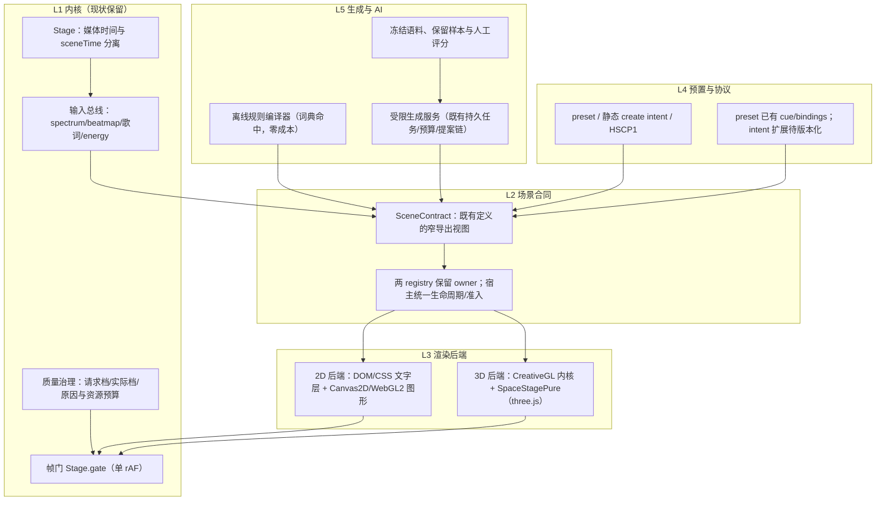
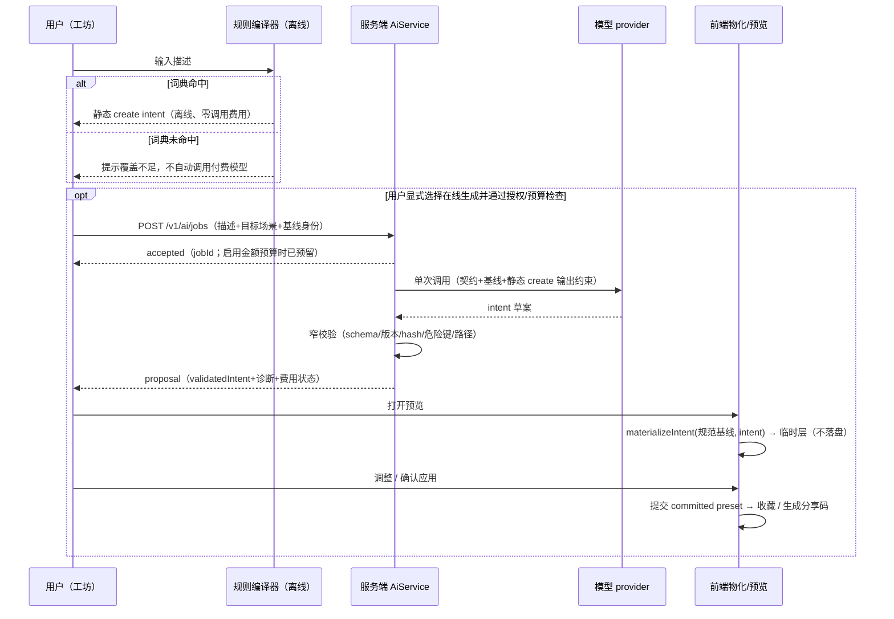

# 舞台引擎自研方案：可行性评估与实现设计

> 编制：2026-10-17；设计复核：2026-10-28（基线 `0330508` 与核查时工作树）；按 [设计与实现审计](./design-implementation-audit.md) 修订未完成增量。对象：提案——"自研一个舞台引擎，支持 2 维和 3 维渲染模式可供切换，并能对接大模型，根据自然语言或参数输入自动生成所需的舞台效果"。
>
> 依据：初稿静态核查基线 `a3f93d61…` 保留为历史证据，当前能力按本轮审计区分；同时继承 [技术实施方案](./technical-roadmap.md)、[产品路线图](./product-roadmap.md)、[架构复核记录](./architecture-review.md) 的约束。本次仅修订设计文档，不新增实现或测量；建议接口与分期须经 ADR、契约测试和实机验收落地。
>
> 结论先行：**可行，但不建议从零重写。** CreativeGL、空间 registry、Stage 时钟与持久 AI 任务链已是可复用基础；缺口是跨宿主生命周期/资源治理、真实 2D/3D 双实现场景族及 M4 离线创作管线。保留两套 registry 的定义 owner，以窄契约和既有宿主入口增量收敛，不新建第二份参数默认值或通用大引擎。按 M0–M4 的证据门槛逐段推进，不给固定总工期。

## 1. 可行性评估

### 1.1 逐项目标结论

| 提案目标 | 结论 | 依据与条件 |
| --- | --- | --- |
| 2D 与 3D 双模式渲染 | 可行，真实双实现族待补 | 3D 有 CreativeGL 自研 WebGL2 内核与 SpaceStagePure（初稿记录 three.js r186）；2D 有 DOM/CSS 歌词、Canvas2D 粒子、Pixi 歌词、SVG 手绘与低分辨率画布。`stage-particles.js` 的 Canvas2D/GL 路径是共享帧状态的合同探针，不因使用 GL 就成为真实 3D，也不证明双实现族已交付 |
| 两种模式可供切换 | 可行，但限定场景族 | 全局硬切换不成立：歌词可读性是 2D 的一等要求。保留现有渲染 owner，只有提供真实 2D/3D 双实现并通过验收的场景族才开放模式切换（见 3.2） |
| 对接大模型生成舞台效果 | 静态参数链可复用，扩展分层推进 | 已有规则编译、契约导出/校验、持久任务、预算、提案与前端物化/预览链。当前 StageIntent 仅静态 create；drivers/cues、非数值空间参数须另做版本化增量。新 GLSL/逻辑只允许离线评审后随包发布，禁止运行时直接执行生成代码（见 4.1） |
| 成本与容量 | 按证据分期，不承诺总工期 | 复用既有任务/费用/评测基础；M0 先测合同与资源基线，之后逐宿主、逐场景族估量剩余工作，不以历史路线图阶段代替当前进度 |

### 1.2 自研的正确方式：统一演进，不是从零重写

可复用的现有资产如下；资产存在不等于跨宿主治理或双实现族已经验收，不按比例估计完成度：

- **内核**：`plugin/ui/stage.js` 是时钟 owner，提供媒体位置投影、sceneTime 与单 rAF 帧门 `Stage.gate(name, fpsFn, tickFn)`，已有可见性暂停、遮挡让位、eco/balanced/high 分级和实测掉帧降档。增量须保持媒体时间与几何时间分离，见 §3.5。
- **3D 与空间**：`creative-gl.js` 的冻结场景定义、参数表、相机规格、分档几何、频谱纹理与 RGBA8 后处理链；SpaceStagePure 的空间 registry、场景目录与质量策略。两 registry 均保留定义 owner，空间首页与舞台既有共享 renderer 路径继续保留。
- **参数模型**：`creative-stage.js` 的扁平参数表（`cam.*|look.*|stage.*|sc.*`），写入经 `specFor/clampTo`，未知路径拒绝；creative preset 已有 base→audio bindings→cue/director→clamp 驱动顺序，但不代表 StageIntent 已能生成 bindings/cues。
- **生成协议与任务**：StageIntent 静态 create、`creative-prompt.js` 离线规则编译器、HSCP1 分享码、无副作用物化与窄契约导出/校验，以及持久 AI 任务、预算/派发/费用、提案和预览确认链均为复用基础，不将 R4/R5 重列为未实现底座。
- **数据通路**：Rust 侧 64 频段 FFT（初稿记录 33ms）、`vmusic-beats` STFT 节拍图与 BPM、客户端 `onset.js`、`BeatmapReady` 与 `stage-cinema.js`。既有输入可复用，缺信号/seek/暂停行为仍须按宿主验收。
- **2D 层**：DOM 逐字歌词（`--word-progress` + `background-clip:text`）、`lyric3d.js` Canvas2D 图集转 GL 纹理、`backgrounds.js`、`handdrawn.js` 与 Pixi 系 stanza 渲染器。
- **配套**：皮肤（布局）/主题（颜色）/舞台主题（chrome）分离、perf-probe、行为检查与 Playwright 评审基建、VideoExport；历史探针结论仅适用于对应构建与环境。

从零重写的代价：

| 维度 | 从零重写 | 统一演进 |
| --- | --- | --- |
| 工程量 | 音频分析、歌词排版、节拍管线与兼容链均需重建 | 只补跨宿主合同、质量治理、真实双实现族与离线创作缺口 |
| 兼容 | 需重新证明既有场景、HSCP1 分享码、皮肤体系与用户预置兼容 | 两 registry 保留原定义 owner，逐宿主接入治理 |
| 验证 | 全部基线从零建立 | 复用 fixture/检查基建与已知坑位清单 |
| 风险 | 双引擎并行的长期维护 | 单线演进，每期以限定范围的退出证据验收 |

**若该提案面向 Hertz 之外的全新独立项目**：第 1.2 节资产不能视为现成，须重新核算歌词、音频分析、节拍与分享协议的建设成本；不套用本仓库的增量估算。

### 1.3 缺口清单（在既有基础上补齐）

1. **跨 registry 窄合同**：由 CreativeGL 与空间 registry 各自导出能力/参数视图，保留定义与默认值 owner；缺统一消费合同，不缺第三个存放定义的总表。
2. **逐宿主生命周期治理**：在现有 `stage3d`、空间首页/舞台、工坊预览与歌词等宿主入口收敛 attach、隐藏/暂停、恢复、交接与真正退出；保留空间首页↔舞台共享 renderer，不以模式切换一律销毁。
3. **资源准入与质量可观测**：统一请求档、实际档与原因，保留各 owner 的 DPR/像素/几何预算算法；测量当前构建的活跃 context、画布、RT/纹理及预热峰值后冻结上限，不引用未当期测量的 context 数。
4. **真实双实现场景族**：先完成一个具有真实平面构图与深度/透视实现的场景族。Canvas2D/GL 同效果路径只用于合同探针，不能代替产品 2D/3D 验收。
5. **生成面的版本化增量**：StageIntent 当前只做静态 create；drivers/cues 与非数值空间参数须有版本化契约、双端校验、分享往返和专项评测。已有 AI 链不重建，新增语义不因旧任务成功率而自动达标。
6. **M4 离线创作管线**：模板优先，补隔离构建、许可核查、多档渲染与人工入库/随包发布，不增加运行时生成代码执行入口。

## 2. 引擎架构设计

### 2.1 分层架构



各层职责与现状：

| 层 | 职责 | 现状 |
| --- | --- | --- |
| L0 平台适配 | context、DPR、可见性、context-loss | 复用现有 owner，逐宿主接入生命周期与资源准入 |
| L1 内核 | 时钟、帧门、输入总线、质量治理 | Stage 基础现成；跨宿主预算与实际档原因待收敛 |
| L2 场景合同 | 既有定义的窄导出视图 | 两 registry 已有，补消费合同，不复制参数默认值 |
| L3 渲染后端 | 真实 2D/3D 实现及宿主接线 | 各种渲染能力已存在，真实双实现族待验收 |
| L4 预置与协议 | preset/静态 create intent/分享 | 现有链复用；intent drivers/cues 与非数值参数是版本化增量 |
| L5 生成与 AI | 规则编译、持久任务、提案、评测 | 已有链复用；补新合同语料与 M4 离线管线 |

合成器明确**不自研**：沿用现状——各 GL context 输出预乘 alpha，由浏览器合成叠层；文字层压在 GL 层之上由 DOM 顺序保证。自研离屏合成器是典型的过度工程，还会破坏现有 DOM 歌词质量。

### 2.2 设计原则（继承既有纪律，新代码同样受约束）

1. **单一调度 owner、分离时间语义**：Stage 提供媒体时间与 sceneTime，前者仅供歌词/cue，后者驱动几何；后端不得自建 rAF/墙钟，暂停和 reduced-motion 冻结 sceneTime（§3.5）。
2. **单一物化 owner**：舞台只在前端物化；Rust 保留窄校验，导出合同必须来自同一版本的场景定义。
3. **窄契约与类型校验**：数值经范围钳制，非数值按显式 schema 校验，未知路径/危险键拒绝，不靠宽泛对象透传。
4. **预置与草稿分离**：临时预览不落盘，确认才提交（AR2 语义）。
5. **热路径纪律**：帧回调内不分配、不阻塞、不读文件；频谱走纹理不上传大 uniform；预算在控制路径换好。
6. **模型输出永不直接执行**：T1 只产数据；T2 草案须离线隔离构建、人工评审与随包发布，应用不执行未入库生成代码。
7. **定义与默认值单源**：CreativeGL 与空间 registry 各自保留 owner，窄导出与 fixture 同提交；宿主治理层不再维护参数表/默认值副本。

### 2.3 窄消费合同：SceneContract（不是第三个定义 registry）

以下仅表达消费面，不新建通用引擎；由两 registry 的既有定义导出只读视图，宿主仍调用原 renderer：

```text
SceneContract = {
  id, version, label, definitionOwner,
  capabilities: <owner 导出的文字、相机、深度、seed 等能力>,
  params: <owner 的版本化 schema 导出，含规范默认值，不独立维护>,
  backends: <既有实现引用与经验证的模式能力；未验证不标 2d/3d 双实现>,
  quality: <owner 的分档预算声明，供宿主准入与实际档回报>,
}
```

要点：

- 当前生成面仅 `scene 选择 + 静态 create 参数补丁`。preset 已有驱动不自动成为 intent 能力；drivers/cues 必须另行版本化、双端校验与分享往返验收。
- `capabilities` 只允许在同一场景已声明实现和档位内选择；失败不擅换相邻场景。无法维持时保留可用旧画面或显示静态封面并报告原因（§3.2）。
- `backends` 可仅有一个实现；Canvas/GL 是实现技术，不等同于 2D/3D 模式。只有真实双实现族开放模式切换。
- CreativeGL 的冻结定义与空间 registry 仍是权威来源；需要消费导出材料时从 owner 生成并校验版本/hash，不手写第二份默认值。

后端生命周期合同（在既有入口收敛的草案）：

```text
StageBackend = {
  attach(host, contract) -> handle        // 原 owner 创建或复用；共享 renderer 不重复创建
  frame(state)                           // Stage 时间投影、输入、已校验参数快照
  resize(px), setQuality(requestedTier)   // 回报 actualTier 与 reason
  pause()/resume()                        // 隐藏/暂停停绘；保留仍需复用的资源
  dispose()                              // 真正退出且无共享使用者时释放资源
}
```

## 3. 2D 与 3D 的渲染能力划分

### 3.1 能力矩阵

| 能力 | 2D 后端 | 3D 后端 | 结论 |
| --- | --- | --- | --- |
| 文字/歌词排版 | 一等公民：DOM+CSS 逐字擦除、字体、可访问性；或 Canvas2D 图集 | 贴图/图集/3D quad，可读性与字体覆盖受限 | **歌词可读性优先 → 文字类效果 2D-first，3D 作背景层**（与现状分层一致：歌词层压在 GL 画布之上） |
| 图层合成 | 浏览器叠层 + CSS 混合模式 | pass 内合成 + bloom/色调映射 | 复用浏览器合成，仍计资源成本，不自研统一合成器 |
| 粒子/氛围 | Canvas2D（量大时切 WebGL2 point-sprite，已有先例） | 分析式顶点几何（零顶点缓冲） | 可优先探索双实现，但需验证真实深度/透视语义 |
| 相机/透视/深度 | 平面构图，不靠 GL 技术标签伪装深度 | 透视相机、depth、camera layer | 真实 3D 实现的验收项 |
| 光照/后处理 | 可由 GL 图形路径提供，视实现声明 | RGBA8 后处理链（bloom/exposure） | 后处理本身不是 2D/3D 判据 |
| 频谱/节拍驱动 | 同一输入总线 | 同一输入总线（频谱纹理） | 复用输入，按 §3.5 补缺信号与时钟验收 |
| 分辨率/预算 | CSS 像素为主，仍须准入 | DPR×tier 探针 + 分档几何 | 请求档/实际档/原因合同统一（3.4） |
| 可访问性/缩放 | DOM 文本可选中、缩放 | 不能依赖纯 3D 文字保障 | 无障碍文字保留 2D 层 |

### 3.2 切换语义：能力位驱动，不做全局开关

三个候选：

- A. 全局 2D/3D 开关 —— 否决：文字质量与无障碍在 3D 无法保证，且多数场景只有单实现。
- B. 每个场景硬指定后端 —— 可用但浪费：同构效果（粒子、频谱、氛围）天然双实现。
- **C.（推荐）场景声明能力位 + 双实现场景族**：在同一场景的已声明能力内按设备/质量/遮挡选择；用户可见的“2D/3D 切换”只对经验证的真实双实现族开放。`stage-particles.js` 的 standard/GL 共享帧状态仅作 M0 合同探针；M2 必须补一个具有平面构图与真实深度/透视语义的双实现族，不能把 GL 点精灵改名为 3D 交付。

切换规则：

1. 切换发生在**场景边界**或契约声明过的转场点；用户请求先记为请求态，目标准备与准入成功后才更新实际实现/档位，不做任意 mid-scene 无合同热切换。
2. 后端不可用（context 丢失、能力不足、预算满额）时，只能使用同场景声明过且获准的降档/另一实现；不存在合格路径则保持可用旧场景或静态封面并显示失败原因。不得擅换相邻场景，也不改用户的请求值伪装成功。
3. 预热复用 CreativeGL `warmUp()` 等既有入口，源/目标同时存活的 context、RT、纹理、程序和首帧成本必须先计入峰值预算。预算不足就串行释放后准备或拒绝切换，准备失败释放目标临时资源；不承诺一帧内完成交接。交接成功后仅释放不再使用的旧场景资源，空间首页↔舞台的共享 renderer 仍由原 owner 复用。

### 3.3 统一坐标、构图与文字策略

- 逻辑坐标系、安全区、宽高比映射**单源定义**（经验教训：插画类场景的 `art()` 坐标映射必须一处定义，多处复制必然漂移）。
- 文字三条渲染路径各有适用面并写进能力位：DOM（侧栏、overlay、可访问性场景）、Canvas2D 图集→纹理（3D 场景内歌词，`lyric3d.js` 手法：签名去重、分档宽度、CJK 系统字体）、3D quad（舞台内嵌歌词，需 ownsLyrics 声明避免双份歌词）。
- 皮肤/主题零污染：皮肤只管布局、主题只管颜色、场景参数归 preset 的既有铁律不变；新引擎不得让场景定义携带颜色字面量或布局假设。

### 3.4 质量治理与资源生命周期（逐宿主收敛）

- 统一质量消费合同，不替换三套成熟预算算法：`Stage.tier()` 提供分级输入，creative DPR 探针、stage3d 像素预算与空间档位在各 owner 内映射。分别暴露**请求档 → 实际档 → 原因**；设备限制、掉帧、遮挡、context-loss 与预算拒绝不能只表现为控件数值悄悄变化。
- 准入按当前构建、宿主组合和弱机/高 DPI 实测冻结 context、像素、RT/纹理等硬上限；统计活跃、隐藏保留与预热资源的合计峰值。不把初稿的 context/画布估计数当作当前测量，也不先给每个 renderer 独立满额再相加。
- 空间首页↔舞台保留共享 renderer 与资源 owner；单个宿主隐藏/遮挡只撤销该宿主绘制需求，不得暂停仍被另一可见宿主使用的共享实例。无可见使用者、播放暂停或 reduced-motion 时暂停帧门/停绘，必要的静态重绘受同一调度控制。恢复不重建第二个循环；真正退出且不再有共享使用者时才 dispose，释放 RT、纹理、程序、监听与失效句柄。
- 每个宿主分别验 attach→隐藏/暂停→恢复→交接→退出、context-loss/恢复及重复进出后的资源基线。失败/超时清理预热资源；共享交接不能误释放仍在使用的 renderer。陈旧 RT（`uHasRefl`）与残留画布的历史反例继续作为回归项。
- 每接管一个宿主，同批移除该入口旧的独立帧调度、重复资源准入与重复质量裁决分支；未迁移入口仍由原 owner 管理，不让新旧治理同时生效。两 registry 的定义和预算算法不因治理接入被复制或删除。
- perf-probe 逐 gate 计数扩展到宿主/后端，保留既有掉帧降档探针（初稿记录 <40fps），同时记录首帧/预热时间、实际档与原因；旧探针阈值不是所有宿主的实机验收结论。

### 3.5 时间、seek 与缺信号合同

- Stage 是唯一调度与时间投影 owner：**媒体时间仅用于歌词定位与 cue 求值，sceneTime 用于几何、粒子与相机连续运动**。音频特征可影响参数，但不能把媒体 position 或 `Date.now()` 当作几何时钟。
- 播放暂停、reduced-motion 或实例无可见宿主使用时冻结 sceneTime 并停连续绘制；恢复从冻结值继续，不补算隐藏/暂停期间的墙钟时长。静态参数/歌词变化可请求一次重绘，不恢复连续动画。
- seek 只重定位歌词/cue 并清除旧媒体点上的待触发 cue；按新位置重算当前值，不补触发跨过的 cue，也不回拨/跳进 sceneTime。暂停中 seek 仍保持几何时间冻结。
- 真正换场在场景边界建立新的实例时间锚点，seed 取已确认 preset；同一实例在空间首页↔舞台交接不算换场，不重置共享 renderer 的 sceneTime。双实现族在声明的转场点从同一实例快照接续，避免双计时或重复 cue。
- 缺失/过期的频谱、beatmap 或媒体信号明确标记不可用：音频驱动回到合同定义的中性值，cue 等待有效媒体定位；未暂停且可见时几何只按 Stage 的 sceneTime 运行。不得伪造节拍、从旧信号无限外推，或另启墙钟绕过暂停/reduced-motion。

以上是跨宿主增量合同，须逐项探针验收；不是宣称所有现有宿主已符合。

## 4. 与大模型对接的接口方式

### 4.1 总边界：参数空间在线，代码空间离线

| 通道 | 内容 | 运行时机 | 安全边界 |
| --- | --- | --- | --- |
| T1 应用内参数生成 | 当前为场景选择 + StageIntent 静态 create 参数补丁；drivers/cues 与非数值空间参数另做版本化增量 | 在线，复用既有持久任务链 | 模型输出是**数据**：过 schema/钳制/危险键检查；不执行代码，不以现有 preset 驱动能力冒充 intent 能力 |
| T2 开发期效果创作 | 新场景草案（参数化模板槽位优先，自由 GLSL 仅高级模式） | M4 待建离线管线 | 隔离构建 + 许可核查 + 多档渲染评审 + 人工入库后随包发布；运行时零生成代码热加载 |
| T3 外部 MCP | `stage_capabilities_get` / `stage_intent_validate` | 复用现有只读/窄校验入口 | 只读版本化契约 + 静态 create 窄校验；完整物化由用户在工坊人工导入，扩展必须同步升级双端合同 |

这条边界继承路线图“在线热加载生成 SVG/GLSL/JS 不进入主线”的决定。原始生成代码不具备可审、跨驱动可用、可预算或可分享的保证。**运行时只消费受校验的数据与已评审随包发布的实现，绝不直接执行模型生成的 JS/GLSL/SVG，是本方案的第一设计约束。**

### 4.2 T1 在线参数生成的接口

- 传输与任务机制复用既有 `POST /v1/ai/jobs`（capability=`stage.intent.generate`）→ accepted/jobId → proposal 查询/拒绝链；授权、资源/并发上限、幂等、单次派发、取消与回收仍为必需合同，不新建另一套任务系统。金额预算、价格与费用账本沿用产品路线的可选边界，仅在启用时执行预留/结算；价格未知不阻断功能交付，也不放宽调用与资源安全门槛。
- Prompt 由服务端组装：同版本场景窄契约（类型/范围/规范默认基线/版本/hash）+ 用户描述（**作为不可信数据**）+ 输出约束（当前 StageIntent 静态 create、长度上限）。默认值来自相应 registry owner，不从当前活动 preset 猜测，也不在服务端复制默认值逻辑。
- 输出与校验层次：intent（Rust 窄校验：schema/版本/hash/危险键/跨场景路径）→ 前端 `materializeIntent(基线, intent)`（完整 preset 校验、钳制、归一化警告）→ 分享码往返。`succeeded` 只代表 intent 已验证保存，不宣称“舞台已验证/已应用”。
- drivers/cues 是未来协议增量，不塞入当前静态 create 字段。启用前定义驱动源、时间语义、数量/长度边界和可写路径，版本化导出、Rust/前端双端校验与分享往返须同批通过；不支持的版本明确拒绝。
- 非数值空间参数（如枚举、布尔或结构化选择）须逐类型声明 schema、规范默认值与长度/集合边界，不能经数值钳制或任意 JSON 透传。两端校验、物化、契约 hash 与分享 codec 一起验证，覆盖合法/非法值、旧版本和导入导出再物化；不能宣称新增场景永远无需改变 Rust 校验。
- 离线词典未命中只提示覆盖不足；用户必须显式选择在线生成并通过现有授权/预算检查才可派发付费任务，不以未命中或失败自动升级到付费调用。

### 4.3 T2 离线效果创作管线

M4 推荐**参数化模板优先**：复用已验证 GLSL 模板，模型只填受限槽位（主题 token、运动系数、形状参数、受支持图层组合）；不因填槽就跳过评审。自由 GLSL 仅开发期高级模式，产物走相同管线，不增加应用运行时编译/执行生成代码的入口：

```text
brief → 模型草案（模板槽位 / GLSL 草稿，记录来源与版本）
      → 隔离构建：固定工具链、无应用凭据、禁网络/任意 IO、CPU/内存/时限边界
      → 静态与编译矩阵：语法/保留字/数值边界/预算字段/来源与许可证核查
      → 多档渲染评审：首帧/预热、帧率、context-loss、长时资源与回收探针
      → 人工视觉与许可验收（歌词/皮肤/弱机组合；不以软件 WebGL 外推实机）
      → 人工批准入原 owner 的 registry，契约导出 + fixture 同提交，随包发布
```

隔离环境只允许构建所需的受限输入输出；不加载生产凭据、用户曲库或任意依赖脚本。来源与第三方素材许可不明、编译/预算失败、视觉未达标均拒绝入库，不能由模型自批。发布后只是普通内置场景，无在线热加载通道。

保留历史检查依据：GLSL 保留字、`pow` 负底数、`atan` 分支切割、编译报错行回显、Retina 分辨率预算，以及软件 WebGL 结论不可外推。它们是离线评审的回归材料，不是 M4 已建成的证据。

### 4.4 质量评测

沿用[技术实施方案 §8.5：模型效果验收](./technical-roadmap.md#85-模型效果验收)门槛：冻结语料（120 条起，追加“双实现场景族”“接近长度上限的合法 intent”“2D 文字类氛围”以及新增类型/时间边界样本），固定开发集与不参与调参的保留样本，阈值先冻结后测候选。区分 schema 合法、语义正确与视觉美观；后两者保留人工评分和渲染截图评审，不以模型自评代替。复用已有评测链跑两轮，报告保留样本、任务失败与资源用量；金额明细仅在启用费用统计且可取得时附上，不作为质量闸门。质量、授权与资源门槛达标才开放对应增量；未达标保持实验关闭，不下调原门槛，回退到离线规则编译器仍需用户显式选择。

## 5. 效果生成的典型流程

### 5.1 T1 在线生成（主流程）



失败语义（继承路线图，不重定义）：任务可取消但可能已产生费用（unknown 状态如实显示）；取消/超时不重放；预览期间任何编辑使旧候选失效；应用前重新核对基线 hash，不匹配要求重新预览。

### 5.2 T2 离线创作（新场景）

见 4.3 管线。生成草案只有经人工入库并随包发布后，才成为原 registry 中可导出契约、可被 T1 引用的普通场景；不能把离线模型输出直接拖进应用执行。人工编写的场景同样遵循既有入库与发布检查。

### 5.3 T3 外部客户端

MCP 客户端读场景契约 → 本地生成/推导静态 create intent → `stage_intent_validate` 窄校验 → 得到带版本/hash 的 JSON 草稿 → 用户复制进工坊导入 → 前端重新校验并物化 → 预览确认。与 5.1 共享校验与物化链；不支持的 drivers/cues 或非数值扩展不能借 MCP 绕过版本门禁。

## 6. 关键技术难点与潜在风险

| # | 难点/风险 | 影响 | 缓解 |
| --- | --- | --- | --- |
| 1 | **统一抽象的泄漏**：SceneContract 若追求“什么都能描述”，会退化为最低公分母引擎 | 高 | 仅导出 owner 的窄参数/能力视图；实现仍归原后端，不复制默认值，不绕过宿主资源准入 |
| 2 | **文字质量**：歌词可读性是舞台的核心体验，3D 文本先天不足 | 高 | 文字类效果强制 2D-first 分层合成；3D 场景歌词走图集路径；ownsLyrics 声明防双份 |
| 3 | **GLSL 可移植性**：驱动矩阵、保留字、数值边界、编译差异 | 高（仅 T2） | 自由 GLSL 只走离线管线；模板化把模型产出压缩到槽位；隔离构建/许可核查 + 编译/渲染矩阵 + 历史坑位检查 |
| 4 | **资源碎片化**：多 context、预算方案并存，弱机与高 DPI 下劣化 | 高 | 请求档/实际档/原因、总量准入与预热峰值；共享 renderer 保留，真正退出释放；perf-probe 宿主级观测（§3.4） |
| 5 | **时钟纪律被破坏**：私有时钟或媒体时间驱动几何造成跳变 | 中高 | 复用 Stage 的媒体时间/sceneTime；静态探针检查私建 rAF，行为探针覆盖暂停/reduced-motion/seek/缺信号 |
| 6 | **LLM 产出质量与成本**：schema 合法 ≠ 美观；截断、费用对账 | 中高 | 冻结语料/阈值、两轮 + 保留样本 + 人工评分；复用既有预算/派发/结算；词典路径不付费，未命中不自动付费 |
| 7 | **兼容性**：HSCP1 分享码、两 registry 定义 owner 与各宿主、用户预置 | 中 | 版本化导出与 fixture 对照；保留 owner；新增类型/驱动双端校验，旧码与新码分享往返回归 |
| 8 | **确定性/可复现**：种子、时间轴、跨 GPU 像素差 | 中 | 种子入 preset（seedable 能力位）；延续 R6 结论：不承诺跨 GPU 像素一致 |
| 9 | **切换体验**：黑帧、闪烁、首帧慢 | 中 | 场景边界与预算内预热，失败清理目标/明确原因；首帧与交接实测，不设一帧交接承诺，不擅换相邻场景 |
| 10 | **容量与范围蔓延**：“引擎”易演变为大重构 | 高 | M0 探针、M1 逐宿主、M2 一个真双实现族，之后再扩生成面与 M4；按退出证据估量，不以固定总工期推进 |

## 7. 分期实施建议（以增量退出证据推进）

| 期 | 限定范围与复用基础 | 退出条件 |
| --- | --- | --- |
| M0 Canvas/GL 合同探针 | 以 `stage-particles` 两条既有路径探测共享帧状态、Stage 时钟/暂停、请求档/实际档/原因、生命周期与资源峰值；只补薄接线，不新建总 registry | 同输入快照下合同可重复；隐藏/reduced-motion/seek/缺信号与失败清理有记录；测出当前构建 context/画布/预热基线。明确这不是 2D/3D 产品交付，据此估量 M1 |
| M1 逐宿主治理 | 在舞台、空间首页↔舞台共享路径、工坊预览及歌词宿主逐个接入生命周期/准入；保留两 registry、原预算算法和共享 renderer | 每个宿主的弱机/高 DPI、暂停恢复、反复进出、context-loss、预热失败与真正退出回收矩阵通过；资源回到基线，总量/峰值不越界；实际档与原因可见，未迁移宿主不冒充已治理 |
| M2 一个真实双实现场景族 | 交付一个具有平面构图与真实深度/透视的家族；共享可解释的参数/seed/时间合同，默认值仍归原 owner；先接现有静态 create 与契约导出/fixture | 两模式语义与歌词可读性人工验收；切换/暂停/reduced-motion/seek/资源回收合格，旧分享往返不回归。需要非数值参数时，版本化 schema、双端校验与分享往返必须先过；不把 Canvas/GL 或自由驱动扩展捆绑冒充完成 |
| M3 复用 AI 链验收增量 | 复用已有持久任务、授权/资源预算、提案、物化与评测；追加真实双实现族语料。drivers/cues 只有独立版本合同就绪才进入候选，不能作为当前能力宣传 | 原质量、安全与资源门槛不降低；两轮评测、未参与调参的保留样本及人工语义/视觉评分全部达标；输出合法、分享往返、取消和未命中不自动付费均有证据；金额预算/结算仅在启用时验收，不以缺少费用统计阻断对应增量 |
| M4 离线创作管线 | 模板槽位优先；隔离构建、来源/许可核查、多档与实机渲染探针、人工视觉验收和入库；复用原 registry/契约/fixture/发布路径 | 至少一个经全管线批准的新场景随包发布；预算/回收/编译矩阵与许可证据齐备；失败不得入库，应用无运行时执行或热加载生成代码的入口 |

依赖关系：M0→逐宿主 M1→M2；M3 在 M2 合同可用后复用已有 AI 链评测，不等待“尚未实现的 R4/R5”，也不重建这些底座。M4 可单独推进管线探针，但发布必须通过相应宿主合同与全部安全/资源门槛。每期依据退出证据再估量下一期，不恢复初稿固定总工期或按历史 R 阶段重排已交付工作；未完成项不得用相邻阶段成果替代。

## 8. 评估边界

- 初稿基线 `a3f93d61…`、驱动/GLSL/资源历史反例保留为证据；当前可复用能力与未完成增量按本轮审计区分。本次仅改文档，未新增代码、构建或实机测量，不能用历史探针宣称当前所有宿主通过。
- 不给完成百分比、固定总工期或未经当期测量的 context 数；容量与资源上限根据 M0/M1 的当前构建、宿主组合和弱机证据冻结。
- `ArchitectureReviewRequired: yes`。窄合同、生命周期、时钟与生成扩展落地前须经架构复核、版本化导出及行为 fixture；保留原安全/预算/评测门槛，不引入新大抽象或第二份默认值 owner。
