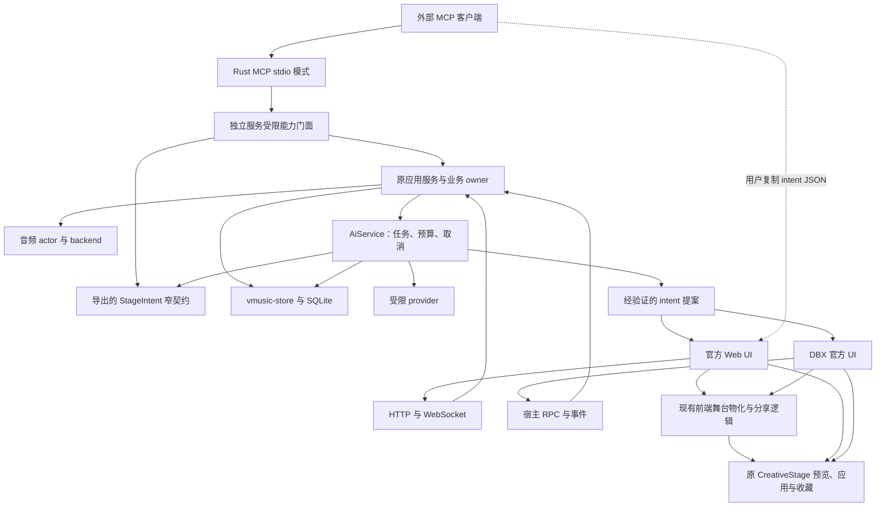
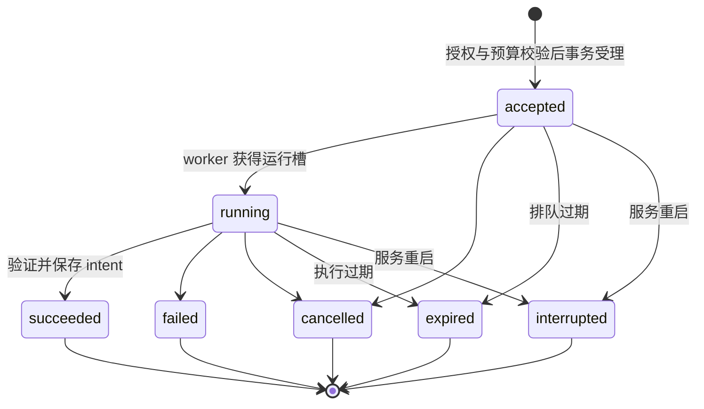

# Hertz Studio 下一阶段技术实施方案

> 编制：2026-10-16；补充 VCPChat 对照：2026-10-17。状态：建议实施设计，文中的新增模块、API、表与测试均未因本文而实现。
>
> 配套：[产品路线图](./product-roadmap.md)、[VCPChat 参考评估](./vcpchat-reference-assessment.md)。Hertz 初次核对提交 `aa77af10dc3a9693cc646e55e14186cb1a453c8b`，后续核对时 HEAD 为 `79b15d48c2e072342e7efac3c5b723e62623de9f`；期间仓库还有独立进行的修改，实施前应再次核对。
>
> AI 依据：关联聊天「优化 AI 接入设计文档」的 [v3 方案](./research/ai-capability-entrypoints.final.md)。该研究目录被 Git 忽略，本文保留实施必须知道的约束；正式落地时，以实际 ADR、契约定义和测试固定决定。旧 v2 DDL 不直接执行。

> 2026-10-17 架构修订：采用 Rust AI 服务与 Rust MCP 传输适配层，新增能力不引入 Node 运行时；完整舞台物化、预览与分享码继续由现有浏览器前端负责。本次修订覆盖 v3 中 Node 适配器与离线完整预置合成的相关设想，其余授权、任务和费用约束继续沿用。

> 同日架构复核：进一步修正共享播控入口、确定性草稿基线、预览落盘、收费派发恢复、资源回收、预算归属和 MCP 依赖方向。修正点与源码依据见[架构复核记录](./architecture-review.md)；发生冲突时以本文修订后的明确约束为准。

## 1. 实施目标与边界

交付三条可以独立验证的技术链路：

1. 现有播放器的质量、搜索、歌词和恢复能力逐步完善，保持 Standard / Full、独立 / DBX 共用业务。
2. 外部 MCP 客户端通过 Rust 传输适配层与受限能力门面检索、播控、查询场景契约和校验 StageIntent。
3. 应用内 Rust provider 通过持久任务生成 StageIntent，经服务端窄校验后交给官方 UI 完整物化与预览；任务和费用可查询恢复。

本轮架构不引入通用 Agent 执行器、远程多租户 MCP、任意代码工具、动态视觉插件或第二个播放器服务。既有 API 不因新增 AI 门面而整体重写；只把新路径需要复用的应用逻辑收敛到明确函数。

### 1.1 设计优先级

| 优先级 | 保证 | 破坏它的典型失败 |
| --- | --- | --- |
| 最高 | 原业务 owner 与单一播放时序 | AI/皮肤/搜索维护另一份队列，迟到结果覆盖新播放 |
| 最高 | 实时音频与视觉时钟不承担推理 | provider、解析、FFT/索引或落盘堵塞音频回调 |
| 最高 | 服务端强制授权与可靠完成语义 | 工具隐藏但仍可直调；收到请求就声称已播放 |
| 高 | 幂等、任务与费用可恢复 | 丢回复后重复 next 或重复收费 |
| 高 | 单一舞台物化与分享实现 | Rust 复制 UI 默认值或分享 codec，形成两套不一致预置 |
| 高 | 发行版、形态和身份隔离 | Standard 泄漏 Full 模块、DBX 错连独立实例 |
| 中 | 易安装和可诊断 | AI/MCP 另需安装 Node 或 JS 引擎；日志包含密钥与完整曲库 |

## 2. 现有架构与目标架构

### 2.1 保留的职责

| 当前 owner | 真实职责 | 本方案如何接入 |
| --- | --- | --- |
| `state.rs` / AppState | 队列、播放意图、事件、持久状态协作 | 能力门面调用原应用入口，不直接写队列字段 |
| `vmusic-audio` actor / backend | 串行播放命令、设备、解码和输出 | 复用已有命令及 reply；无模型、JSON schema 或网络 |
| `online/provider.rs` | 音源描述、操作、音质、账号与就绪策略 | 搜索仍从实际能力表派生；Standard 不加载 Full provider |
| `vmusic-store` | SQLite、设置、覆盖层、歌单、备份 | 新增 AI 仓储函数与事务，不把任务放进 settings 大 JSON |
| `rpc/` | DBX 使用的 JSON 门面，部分处理逻辑仍与 HTTP 重复 | 新播控先下沉到共享应用入口，再由 HTTP/RPC/MCP 各自适配 |
| `CreativeGL` / `CreativeStage` | 创意场景规格、预置、cue、binding 和活状态 | 抽取纯规则，活预置与应用仍由原 owner 管理 |
| `Stage` | 播放时钟消费、统一帧门 | 新视觉、预览、录制与分析结果消费都不创建第二个时钟 |
| `SpaceStagePure` / `Space3D` | 三维空间 renderer、场景 scope、导航、质量策略 | 与创意预置协议分离；不把同名场景混成同一对象 |

### 2.2 新增组件与依赖方向



图中的能力门面是应用内受限入口，不是另一台完整服务器。Rust 仅消费从实际场景定义导出的窄参数表，不执行 JS、不生成完整 preset 或分享码。现有前端是完整物化、规范化与分享编码的唯一执行环境；原 CreativeStage 仍拥有活动舞台。

图中 HTTP/RPC 经同一应用服务是目标形态，不能解读为现有全部处理器已经共用实现。`routes.rs` 和 `rpc/playback.rs` 的 pause/play/seek 等仍有重复；R2 仅将要开放的六种播控收敛到共享应用函数，不整体改写所有路由。权限在入口校验后形成可信调用上下文，共享函数给出有因果关联的结果；各传输只转换 DTO 和错误。

AiService 由两种形态的原 bootstrap 装配，可直接服务官方 HTTP/RPC，不依赖 MCP SDK、外部 grant 或 MCP 开关。场景契约、实例身份与服务端独占锁是可复用的小模块，不由 MCP 适配器拥有；禁止形成“应用内 AI → MCP → HTTP → 原服务”的调用链。R3 的前端闭环、R4 的内部任务可以在 R2 MCP 未发布时开发和验证。

### 2.3 对 AI v3 的增补与范围收敛

- v3 的领域契约、任务、权限、幂等与费用语义沿用；本文不引入另一套冲突数值。
- 实现语言与 A2 交付范围以本修订为准：Rust MCP 替代 TypeScript/Node 适配器；R3 交付 intent 校验、人工导入和前端草稿闭环，不交付播放器未启动时的完整预置/分享码合成。不以 QuickJS、V8 或隐藏 Node sidecar 替代已移除的依赖。
- v3 设想两种形态复用服务端能力。**复用处理器与具备外部可达传输是两件事**：现有 DBX sidecar 只有宿主拥有的 stdio，未启动可供适配器连接的 HTTP listener。A0/A1 正式外部连接先支持独立形态。
- DBX 的应用内 B 阶段继续经原 RPC 共用处理器。将来外部控制 DBX，新增受限回环 listener 或受保护本地 IPC，必须独立评审、限制接口、管理生命周期；不能读发现文件后拿全权令牌，也不能再启动一个后端抢占同一音频与 DataDir。
- 将当前 Standard / Full 发行身份加入发现、健康与 UI 的说明。它是目标核验字段，不替代 `ownerInstanceId/serverInstanceId`。

## 3. R0：质量基线与工程约束

### 3.1 建立四种证据

1. **确定性检查：** 格式边界、参数、分享、数据库、队列、事件与双版本裁剪。
2. **真实 UI：** 使用重建后的内嵌资源验证页面、画布、焦点、窗口和皮肤切换；源文件开发模式仅用于局部调试。
3. **宿主与硬件：** 原生 DBX、真实 WebGL、声卡、设备切换、长时播放分别记录。
4. **外部依赖：** 真实平台、WebDAV 服务、MCP 客户端与指定模型，不能由前三类替代。

基准环境建议记录四核 CPU、8GB RAM、集显、1080p 与目标刷新率；另测高 DPI 和弱机降档。记录 OS、设备、驱动、应用提交、发行版、形态、配置与测量窗口，区分预算帧率和实际执行率。

### 3.2 数据与迁移保护

- 只在隔离 DataDir 做 fixture 与迁移测试，不读取用户实际曲库、Cookie 或模型密钥。
- 每次迁移追加新文件，按当时最大序号命名；不预占 `0014`，不修改已发布 migration。
- 明确 SQLite 外键策略并在生产连接初始化与测试池保持一致；至少两个连接验证并发与唯一约束。
- 备份升级先定义新字段是否包含。AI grants、provider 凭据、原始输入不进通用备份；跨安装恢复任务与费用不属于现有普通备份的隐含能力。
- 正式升级提供导出、验证与恢复步骤；回滚优先同迁移集的功能禁用构建。若确需旧二进制，先测试它是否能读取新增迁移后的库，否则用升级前快照恢复，不能手改迁移账本。
- AI runner 锁只约束 AI，不把它宣传为现有整库多进程共享的安全机制。独立与插件仍按当前规则使用不同 DataDir。

### 3.3 现有 ADR 继续生效

新路径遵守 [后台预算](./adr/0003-background-work-budget.md)、[有界载荷](./adr/0004-persisted-payload-bounds.md)、[意图与播放衔接](./adr/0007-playback-transitions-and-intent-ownership.md)、[分享](./adr/0008-home-actions-and-creative-share.md)、[注册与生命周期](./adr/0009-extension-registries.md)。只有实际实施的新决定才新增 ADR；不得通过“AI 特殊路径”跳过已有规则。

## 4. R1：搜索与日常播放改进

### 4.1 优先采用已有单源 API 的有界分源查询

原 `online::search_all` 并发请求就绪音乐 Provider，最后汇总结果，首个结果可能等整批返回。当前四个 UI 搜索入口已根据 `/v1/online/sources` 发单源查询，每完成一源就提交该源结果；保留既有聚合端点供旧调用者使用。

理由：现有 HTTP 与 DBX 单源搜索均可复用，无须新增搜索任务表、SSE 或另一套可恢复事件协议。若后续确实需要服务端合并排序和共享查询，再引入有期限的查询会话，而不是预先建设。

已在原入口引入小型搜索协调模块，接收注入的 transport 与 capability snapshot，处理：

```text
SearchSession = {
  queryId, normalizedQuery, mediaKind, sourceIds,
  perSourceState, resultsBySource, active, cancelled
}
```

`queryId` 是本页面查询身份，不是持久任务或服务端授权。每源状态为 idle/loading/ready/empty/failed/cancelled；提交前核对 queryId、输入和页面存活。新关键词、换范围、关闭浮层均使旧提交无效。

当前每个页面最多并发 2 个源，同源读不重叠，余下进入最多 64 个等待项的有界队列。服务端共享限制已放在 HTTP、RPC、旧聚合都经过的 `online::search` 应用路径，覆盖实际执行中的搜索；聚合本身不再占一次相同额度。`SearchGate` 当前为 4 个执行槽、16 个等待席位、2 秒入场等待，超出返回 busy。以上仍是候选值；已有[五万曲与受控来源基线](./search-performance.md)、两版六十秒和[三轮各两分钟受控 HTTP/RPC/旧聚合压力](../evals/search/pressure-v2/README.md)，后者含测试进程内存及排队/头/体期限，不能当作生产服务独立 RSS 或四入口有效吞吐/公平性验收。另有两版 release 的五分钟本地曲库 HTTP 查询和实际服务进程工作集/私有提交量采样，但不经过在线 SearchGate；此前Full本地顺序计时未达标，交替/同核诊断对调度条件敏感；随后复用单次分页匹配与窗口总数消除重复工作，两版新产物默认调度复测均通过原本地/受控首结果门槛，见[分页复测](../evals/search/page-v1/README.md)。生产独立进程混合负载 RSS、长期内存及小时级重复稳定性、真实来源与弱机仍待验，最终额度需按 R0 矩阵固定。

当前共享单源调用具有从入场到读完结果的 6 秒总期限，含入场等待；原来仅在 `aggregate::collect` 外层的预算已移入该共享路径，不能仅依赖 HTTP 连接/读空闲超时。UI 作废结果不等于服务端释放额度，许可持续到实际 future 结束或完成本地取消清理。主动搜索优先于预热，所有取流继续遵守原 20 秒取地址期限；取地址期限不是渐进下载或整个换曲动作的总期限。

### 4.2 取消与重试的语义

- HTTP 可用 AbortController 停止等待，但不能据此声称后端/上游必定已取消；服务端入场限制、读超时与总截止仍须生效。
- DBX 宿主若不支持取消 RPC，立即作废结果提交，等待既有有界调用结束，不能再次发同源无界并发。
- 重试只针对当前查询中失败的源。查询已变就新建 session，不回放旧结果。
- 源结果使用稳定 `source + id` 与原 `ref`，合并展示不能修改 Provider 身份。标题相似只可组成候选组，不代表同一录音或同一授权。
- 首期保持来源分组，避免结果陆续到达时持续重排焦点；音乐、专辑、歌手与播客不强行共享一种播放身份。

### 4.3 UI 与回归重点

使用原播放意图、收藏、队列和 MediaSession；胶囊只消费快照。参考 VCP 的标题测量与 focus/inert 细节，补齐现有胶囊与普通播放页的长标题、字体加载、键盘和窄屏回归，不新增同功能播放器。

失败信息区分配置、登录、权限、限流、超时、不可达与无结果，保留机器码与可重试性。用户的当前播放、已选队列和可用来源不能被失败面板覆盖。

## 5. R2：MCP、能力契约与服务端授权

### 5.1 领域 registry 是唯一工具定义来源

每个内置定义包含：

```text
operation, mcpName, inputSchema, outputSchema,
requiredScopes, allowedProjection, effect, budgetClass,
handler, capabilityVersion
```

registry 只登记本轮有限 AI 能力，用 Rust 类型化 DTO、领域校验函数及其 schema 描述保持一致，检查名称唯一、schema 完整、权限和 handler 存在；它不是通用插件框架，也不重新登记全站路由。MCP 工具描述从该定义导出，服务端执行类型与领域校验；HTTP/RPC 仍需显式接线与一致性检查。不给模型一个可传任意 operation/URL 的大工具，不用一份手写 JSON Schema 代替服务端语义检查。

`requestId` 用于追踪，JSON-RPC id 用于关联，`clientOperationId` 用于短写幂等，`idempotencyKey` 用于持久生成。身份、scopes、policyRevision、deadline、取消 token 都来自可信上下文，不从模型 arguments 接受。

### 5.2 工具分批开放

AI v3 的 A0/A1 对应 R2，A2 在 R3 收敛为场景契约查询和 intent 窄校验，B1/B2 分别对应 R4/R5。A0 只交付契约与授权底座，不提前公布尚未实现的工具。

| 阶段 | MCP 工具 | 结果与限制 |
| --- | --- | --- |
| A1 | `library_search` | 只查已授权本地/已导入索引；limit 默认 20、1–50，offset 0–10000；不返回原路径/凭据 |
| A1 | `playback_snapshot_get` | 最小快照；标题/歌手另需 trackMetadata |
| A1 | `playback_pause`、`playback_resume` | 作用于当前已装载曲目；未装载时 resume 明确拒绝，不走旧 play 的会话恢复/加载分支 |
| A1 | `playback_next`、`playback_previous` | 原意图与 owner 执行；每个新动作新 clientOperationId |
| A1 | `playback_seek`、`playback_volume_set` | 定位单位 positionMs；音量 value 0–1；有限数值与真实范围检查 |
| A2 修订 | `stage_capabilities_get` | 从已连接服务读取随版本发布的场景窄契约，支持有界分页 |
| A2 修订 | `stage_intent_validate` | 仅校验显式 intent，返回校验层次、版本、hash 与诊断；不返回完整 preset/shareCode，不写活状态 |
| B | `ai_status_get`、`stage_intent_generate` | 默认关闭；生成快速返回 accepted/jobId，可能收费 |
| B | `ai_job_get`、`ai_jobs_list`、`ai_job_cancel` | 每次核验主体与数据权限，按状态 revision 取消 |
| B | `ai_proposal_get`、`ai_proposal_reject` | 可读/拒绝候选，不提供远程 apply |

queue.replaceAndPlay、平台歌单写入、凭据管理、预算熔断恢复、远程视觉 apply 不注册为模型工具。VCP 的按歌名点歌可作后续需求；先补稳定身份消歧与原 owner 条件命令，再单独开放，不用模糊 `.find()` 选第一首。

### 5.3 MCP 适配器生命周期

在 `crates/hertz-studio/src/ai/mcp/` 实现薄传输适配层，当前采用锁定在 Cargo.lock 的官方 Rust SDK `rmcp`。许可证、Rust 1.88 MSRV、tokio 兼容、stdio、schema/structuredContent、协议协商、取消与背压已有 Windows Standard/Full 检查；官方 SDK 子进程和适配层检查见 [MCP 互操作说明](./mcp-interoperability.md) 与[实施状态](./roadmap-progress.md)。仍需真实目标客户端、其它 OS、长时压力及发布矩阵验收，不把 SDK 互操作结果扩展为这些范围的通过。协议固定支持 MCP `2025-11-25`，真实客户端兼容性仍待逐项核对。

通过同一发行版可执行文件的 `--mcp-stdio` 模式启动适配进程，复用已编译 Rust 代码，不要求用户另装运行时。CLI 已在数据迁移、bootstrap、数据库、音频初始化与 HTTP 监听之前分流；该模式只读显式 DataDir 内的发现信息与专用 grant 文件、认证后转发受限调用，不获取服务端 runner 锁、不执行迁移、不打开业务数据库、不启动播放器或浏览器。SDK 任务运行在此独立适配进程，业务副作用仍由已运行的独立服务执行。退出不关闭播放器；适配进程不得输出普通启动横幅到 stdout。当前证据覆盖 Windows 子进程与受控服务，不替代目标客户端及其它发行环境验收。

`initialize → initialized → tools/list/tools/call`，只声明已实现的 tools；首期不声明 resources、prompts、sampling、elicitation、MCP tasks 或 listChanged。stdout 专属 SDK transport，日志去 stderr；工具 schema、错误、structuredContent 和正常/慢读端背压都进入互操作测试。

`tools/list` 按会话有效授权过滤；`tools/call` 每次再次认证授权。annotations 是提示，不是权限；next/previous 和持久生成保守标记非幂等，不能鼓励客户端自动重试。

连接关闭只取消当前调用的等待与未发步骤。已发播控不能回滚；已持久受理生成继续由服务管理。MCP 协议取消不等于业务 job.cancel，响应结束后也不能拿 progress token 当独立任务流。

首期所有已开放 MCP 业务工具均依赖已运行的独立服务和有效 grant，场景契约查询/校验也通过同一门面认证。未连接时可完成协议握手，但不公布可用业务工具，调用返回明确连接错误，不自动启动第二个播放器实例。播放器关闭时离线生成完整预置或分享码另列后续需求；不为它引入 JS 运行时，也不依赖浏览器常驻。

场景查询与 intent 校验也必须在 registry 中定义独立 scope，受外部接入及 intent 工具开关共同约束；它们不隐含曲库、播控或收费生成授权。首期一条 MCP 会话绑定一次已认证服务身份；服务重启、撤权或从未连接到在线时需显式重新连接，工具目录不在会话中静默扩展。

### 5.4 受限本地能力门面

新增以下服务入口，均为计划接口：

| 路径 | 调用者 | 职责 |
| --- | --- | --- |
| `GET /v1/ai/capabilities/context` | 受限适配器 | 认证后的身份、权限投影与契约版本 |
| `POST /v1/ai/capabilities/call` | 受限适配器 | 执行明确 operation；不是通用 HTTP 代理 |
| `GET/POST /v1/ai/grants` | 官方本机管理 UI | 查询安全摘要、创建授权 |
| `POST /v1/ai/grants/{grantId}/rotate` | 官方本机管理 UI | 轮换专用凭据 |
| `DELETE /v1/ai/grants/{grantId}` | 官方本机管理 UI | 即时撤销新调用权限 |

grant 使用 256 位随机 opaque 凭据；服务端只存摘要、策略、revision 与状态。凭据由服务在固定 DataDir 子目录原子写入受保护文件，返回安全摘要，不返回秘密、不接受任意输出路径。适配器不能读取原 `vmusicd.json` 的全权 token。

受限 AI 凭据不能调用原 `/v1/player/*`、`/v1/settings` 或管理端点。有效权限为服务端 grant、适配器可信配置与操作要求的交集；独立 capability handler 是最终执行点，不能仅依赖 HTTP 中间件。将来 DBX 或 IPC 接入也复用同一校验。

当前 `routes::router` 将大部分 API 挂在全权 require_token 之后，新增受限入口必须使用独立路由组和专用 Authorization header 认证，不能为通过旧中间件给适配器配置全权 token。官方 AI 管理与任务 UI 保留原官方认证，受限门面只接收明确 operation；两组 handler 最终调用同一应用服务。受限凭据不接受 query/cookie 传递，错误不回显凭据。

投影覆盖响应、错误、观察快照、事件和幂等回放。撤权检查在读缓存前执行；不授权元数据时连错误也不能透露曲名、路径。凭据 ACL、父目录、符号链接/重解析点和日志需在 Windows/macOS/Linux 实测。首期信任同一 OS 用户，不宣称抵抗拥有该用户全部文件权限的恶意进程。

### 5.5 身份、发现与多进程

| 字段 | 生命周期 | 校验目的 |
| --- | --- | --- |
| `ownerInstanceId` | 每 DataDir 首次创建，持久 | 任务/授权/预算归属 |
| `serverInstanceId` | 每服务启动随机 UUID | 拒绝旧实例写请求 |
| `policyRevision` | 授权策略变化递增 | 拒绝过期授权上下文 |
| `edition` / `transport` | 构建身份 / 当前入口 | 告知用户所连 Standard/Full、standalone；不提供认证 |

新增 `ai-discovery.json`，version=1，包含 pid、port、protocolVersion、两个实例 ID 和目标信息，不包含 token。文件最大 16 KiB，原子替换；只由具备外部 listener 且获得 AI runner 锁的独立服务发布。

首发复用现有独立 HTTP listener，明确只在实际绑定 IPv4 `127.0.0.1` 时开放并发布外部能力；`0.0.0.0`、具体网卡和 IPv6 listener 不开放此实验入口，并在设置中显示原因。不得一边固定连接 127.0.0.1，一边宣传支持任意 bind；也不得把专用 AI 路由随主服务暴露到局域网。将来支持 IPv6 回环需扩展发现协议与测试；双 listener 或受保护 IPC 只有在有实际部署需求后单独增加。

适配器只读显式配置的 DataDir，固定构造 `127.0.0.1:<port>`，禁环境代理、HTTP 重定向、任意 baseUrl。通过认证 context 再核对实例；每个调用附绑定的 serverInstanceId，服务端在调用原 owner 前检查。不匹配返回 `INSTANCE_CHANGED`，需要可信宿主/用户重新连接，不能自动重放旧写。

PID、端口、token、generation 都不能代替启动 UUID。服务异常退出后即使发现文件残留，也因服务不可达或认证身份不符而失败；文件存在不能作为服务在线证据。

每 DataDir 的服务端 AI 初始化持有一个跨平台内核文件锁，CapabilityService 和 AiService 复用锁的生命周期；官方任务模式即使关闭外部 MCP 也能独立获取锁和恢复任务。适配进程不参与锁竞争。失锁/拿不到锁则 AI 不可用，不做恢复、不发布可用发现。路径规范化、junction/symlink 别名与并发启动必须测试；不使用“文件存在、PID 活着、墙钟租约”模拟排他。

### 5.6 短写幂等与完成事实

去重键为 `(grantId, serverInstanceId, operation, clientOperationId)`，保存 canonical input hash、执行中状态和脱敏结果。先注册再调用 owner；同键同输入合并/回放，异输入冲突。窗口 10 分钟，最多 512 条；执行中和未过期记录不能因表满淘汰。满表在执行前拒绝，避免重复 next。

共享播控入口必须返回本次动作的类型化结果：已提交、明确无操作、被更新意图取代或失败，并关联原播放代际/actor reply；快照只提供随后观察。现有 `step_by_user → step` 会把 `PlayOutcome.committed` 映射成 `()`，空队列等分支也可返回 Ok，旧 RPC 的 200/Ok 不足以证明已换曲。只在原 owner 确认本次提交时返回 applied；无操作、被取代分别返回稳定诊断，不能靠曲目 ID 变化或相同反推。HTTP/RPC 保持兼容应答，MCP 消费共享函数更精确的内部结果。

变更执行由服务端有界操作 owner 持有，去重记录和许可先于执行注册并与其一同保活；适配进程断开或 8 秒等待结束不直接 drop 原播放 future。读取可在短期限取消；已派发变更仍由原 owner 完成或按明确取消协议清理，观察方返回 unknown，同键重查事实不再次执行。R2 必须为整个变更操作定义执行/清理上限并验证 cursor、buffering、预备缓存和播放代际均能收口；原 20 秒只限制取地址，不能拿它充当完整操作上限。不能在原 play_commit 锁内等待网络或对模型的调用。

对 seek，首期只保证请求作用于当前播放器，不保证刚才查询的那首歌仍是当前曲。若要“只修改这首歌”，必须先在 owner 添加条件命令。resume 的共享入口须明确严格模式，不能直接复用旧 play 的恢复队列行为。

统一结果 `outcome/code/message/data/warnings/metrics`，并带协议版本、requestId 与 operation：

| outcome | 允许说明的事实 |
| --- | --- |
| `ok` | 只读查询成功 |
| `draft` | 生成候选，未应用/收藏 |
| `accepted` | 长任务已持久受理 |
| `applied` | 原 owner 确认本次命令已完成；不保证后来没有其它操作 |
| `unknown` | 已发出写入但无法核实完成，不能自动重放 |
| `failed` | 明确失败；生成仍可能已有费用 |

组合动作未来才使用 partial 并逐步返回事实。不能像参考链路那样在发送 UI 事件后就回答“已播放”。后续读取到相似状态只能证明观察，不反证这一次调用完成。

## 6. R3：前端舞台物化与草稿预览

### 6.1 契约导出与最小重构顺序

1. harness 先加载真实 CreativeGL、Backgrounds、HandDrawn 和 CreativeStage，记录原行为 fixture。
2. 在原前端模块内抽出无副作用的 `materializeIntent(basePreset, intent)`：显式输入基线，返回候选、诊断和参数差异；复用原默认值、规范化与校验，禁止调用 setPreset/applyIntent、渲染、发事件或落盘。现有 applyIntent 改为调用该函数再提交，保持旧规则入口语义。
3. 分享 codec 继续由现有前端维护，复用当前分享帧与压缩规则；不要求改造成跨运行时工厂。
4. 从实际场景定义在开发/CI 阶段导出版本化 JSON 窄契约，建议分发目录为 `crates/hertz-studio/src/ai/stage-contract/`。Rust 内嵌该材料用于参数类型、范围和跨场景路径校验；CI 重导出检查差异与 hash，防止手工维护第二份规则。导出可使用现有 Node 开发脚本，发布运行时不执行它。
5. 全场景比较既有规则入口、人工 intent 导入和模型提案入口的前端物化结果，验证旧分享；默认值和场景变化必须同提交更新导出材料与 fixture。

当前已有[历史行为回溯 fixture](../evals/stage/legacy-v1/README.md)：从物化提取前的真实提交冻结十场景20组完整预置与旧 HSCP1.J 分享帧，并重放历史模块核对当前纯物化、规则应用与导入。该记录是事后补齐，不宣称实际开发过程遵循了上述先记录再重构的顺序，也不替代真实 GPU/宿主或全部用户历史预置验收。

现有来源定位：`creative-prompt.js` 是文本→StageIntent 的唯一规则编译器；`creative-stage.js` 是预置和应用 owner；`creative-share-code.js` 只管 codec；`creative-gl.js` 持有场景参数和机位。新模块文件名是规划，不是当前已存在文件。

### 6.2 协议与验证层次

StageIntent v1 为窄声明对象，含 version、scene、patch、director、hand、ruleIds 等既有语义；不含任意 JS、URL、资源路径和时间轴。模型可以选择规则词典以外但 schema 合法的参数，不能被迫只输出规则命中项。

**intent 是相对基线的补丁，不是完整预置。** 现有 applyIntent 从 deep(preset) 起步，同场景不重置 sc/camera，不能承诺同一 intent 在任意当前舞台得到相同结果。首发 AI 与外部导入只提供 `create` 模式：显式目标 scene，加上同版本可信的规范默认基线，物化时从该基线开始。现有规则入口保留对当前舞台的编辑语义；模型“编辑当前舞台”后置，需要显式传入完整、受限基线快照和 revision，不能通过未发送的当前状态猜测。

导入信封包含 artifactVersion、mode=create、intent、schemaVersion/schemaHash/basePresetHash。基线来自前端实际默认值的同源定义，服务端使用同提交导出材料；hash 只是身份校验，不携带全部基线。UI 必须核对并选择对应可信基线，不能把当前活动 preset 临时当作 hash 对应对象；不兼容时明确拒绝。

`schemaVersion/schemaHash/basePresetHash` 分开，使用固定 canonical JSON 与导出清单计算；hash 用于一致性，不是作者签名。Rust 标记 `validationStage=intent`，官方 UI 物化、钳制、完整 preset 校验和 codec 往返后才是完整草稿校验。模型任务 succeeded 只代表 intent 已验证与保存，不能宣传为完整舞台已验证或已应用。

R3 的 `stage_intent_validate` 必须收到明确 intent，不调用模型；返回 `validationStage=intent`、validatedIntent、schemaVersion/schemaHash/basePresetHash、诊断与 `persisted=false/applied=false`，不宣称通过完整 preset 校验。未知版本/hash 返回明确不兼容诊断，不默默按当前版本接受。外部客户端将 intent 与版本/hash 作为有界 JSON 草稿交给用户，用户粘贴导入工坊后由前端重新校验并物化，才产生完整 preset、shareCode、差异和 requested→normalized 警告。导入不执行代码、不加载外部资源、不自动应用或收藏，亦不自动调用模型。

原设想的 `stage_preset_compose`、`stage_preset_explain` 不注册为本轮 MCP 工具；完整预置解释先在工坊本地提供。人工导入不创建 R4 的持久 job/proposal，不依赖服务端等待浏览器回执；自动把外部草稿推送到目标 UI 另立桥接与投递协议。

前端分享延续 `HSCP1.J/G` 和完整版本化预置，解压/载荷最大 131072 字节，分享码粘贴文本最大 180000 字符。新增 intent JSON 导入遵循更窄的 16 KiB/深度 8 业务限制，独立校验版本、hash、危险键、数值与字段白名单；输入超限明确拒绝。外部 MCP 不传完整分享码，不能为模型扩大旧 codec 限制。

### 6.3 官方工坊预览与提交

新增草稿对象与活预置必须分开：生成任务只持有 intent/proposal；原 CreativeStage 负责临时预览、恢复、应用和保存。

建议由原 owner 管理 `previewId/baseRevision/proposalHash`：开始预览时记录可恢复基线并占用同一个活动舞台；取消只在当前预览仍拥有该状态时恢复。用户后来调参、换预置或切目标使旧预览失效，不能盲目恢复旧快照。

临时预览必须与已提交 preset 分开：现有 applyIntent/setPreset 都会调用 saveLocalSoon，不能通过“先 setPreset、取消再设回”实现预览。原 owner 内提供临时呈现层，复用 renderer 和时钟但不写 committed preset、本地存储、收藏或分享快照；开始前确保旧持久化定时器始终序列化已提交对象。后台/切页/刷新/取消只丢弃临时层，确认应用才提交并安排一次保存。首期预览面板不允许并发调参；任何原设置写入先使预览失效，再按普通编辑语义处理，防止把未确认候选混入自动保存。

确认应用前重新校验目标、hash、版本与 baseRevision；不匹配要求重新预览。应用后的收藏继续走原入口，不做外部 GET→合并→PUT 整库写入。

B 首期服务端 proposal 仍没有 applied 状态。官方 UI 的“已应用到本页面”是原 owner 的本地回执，不能据此声称其它客户端已同步；刷新后只能确认提案存在，不能推断当前舞台仍等于该提案。远程 apply 与持久应用回执另立契约。

## 7. R4：任务、提案、事件与恢复

### 7.1 状态机



终态不可复活。取消、超时、成功通过数据库 stateRevision 的 CAS 竞争，只有一个任务终态；provider 迟到 usage 可独立更新 usageRevision，不能重新发布 succeeded。

完整顺序：认证/实例/授权/输入 → 查幂等 → 新 key 时间窗口、容量、当前 provider 和预算就绪 → 事务写 job + 费用预留 → 返回 accepted → worker 消费有界内存输入并复核派发授权 → 事务登记唯一派发标记 → provider 一次调用 → 校验 intent → 事务写提案与终态 → 发布小事件。

官方 UI 的可信主体由原认证生成稳定的本安装 local-owner 身份；它不需要外部 grant。外部调用只有启用相应收费 scope 时才映射为 grant 主体；worker 复核对应身份的实际策略，不能无条件要求 grantId。两条入口最终进入同一个 AiService 和预算 admission。部署/线程数不扩大模型槽位，MCP 只是可选调用入口。

**内存输入交接也属于受理协议。** 先取得排队容量许可、构造有界输入并计算最终请求费用上界，再提交 DB；commit 成功后由服务端拥有输入与许可，不因 HTTP waiter 消失而丢失。取消入口只通知服务端 owner，不能丢弃待执行输入留下 accepted。进程仍活着但交接/worker 异常时将任务收敛为 interrupted 并结算，不能等到下次重启才恢复；提交失败立即释放内存与许可。

已存在任务的合法幂等回放应在当前 provider 就绪检查前，因此删除或更换模型后仍能查询旧事实。只有新任务才要求 provider 当前可用。

### 7.2 不保存原输入时的恢复规则

brief、歌词和完整原始模型响应默认不持久化，输入只在有界内存中。拿到唯一 runner 锁后，重启把 accepted/running 标记 interrupted；不自动再次发送 POST。客户端重连查询原任务，不能因没有成功结果就用旧 key 重开。

仅凭 running 无法判断是否已产生远端费用。发出前必须在短事务写入单向派发标记 `dispatchState=may_have_been_sent`、attemptId 与费用快照；事务提交后才允许调用网络，且一个 job 只允许一个 attempt。真正发出前崩溃也可能被保守计费，这是避免低估的代价。恢复时 `not_dispatched` 可释放预留；`may_have_been_sent` 无可信 usage 时按 unknown 计预留一次，不能因任务改为 interrupted 就释放额度或重新发送。数据库写和远端扣费无法组成原子事务，本方案不承诺远端 exactly-once。

同一 owner/principal/capability 的 key 格式为 `v1.<createdAtUnixMs>.<128-bit-random-hex>`；7 天内同 key 同输入映射原任务，异输入冲突，provider/model/pricing 改变不改变该事实。输入 hash 包含规范化业务输入、能力版本和授权数据范围，配置快照另存。

超过 7 天且没有可回放记录的旧 key 拒绝，不当作新收费动作；未来超过 5 分钟的 key 拒绝。服务器持久化不减小的受理时间水位，明显校时异常暂停新生成与清理，保留历史查询。期限在运行期间使用单调时钟，跨重启保留/展示使用服务端墙钟及水位。

### 7.3 数据模型

以下是逻辑表设计，字段和 SQL 在实施时结合实际迁移确定：

| 表 | 关键字段 / 唯一性 | 主要不变量 |
| --- | --- | --- |
| `ai_instance` | ownerInstanceId、受理时间水位、schemaVersion | 单 DataDir 身份与时间策略稳定 |
| `ai_grants` | grantId、credentialDigest、policy、policyRevision、revoked | 不持久明文凭据；操作与数据投影明确 |
| `ai_jobs` | jobId、owner/principal、capability、key、inputHash、state/stateRevision、dispatchState、attemptId、usageRevision、provider 快照、时间、结果引用 | `(owner,principal,capability,key)` 唯一，终态单向，最多一次派发 |
| `ai_proposals` | proposalId、jobId、validatedIntent、schema/base hashes、revision、expiresAt、状态 | pending→rejected/expired；24 小时可读，应用不归本表 |
| `ai_budget_months` | owner/month、charged、reserved、revision | DataDir 总预算；所有入口共同占用，整数 micro-USD，受理月归属固定 |
| `ai_usage_entries` | jobId、reservation、accountedAmount、usageState、pricingSnapshot、revision | 每笔费用可重入结算与差额调整，不重复计账 |
| `ai_budget_guard` | owner、halted、revision、reason、triggerJob | 安装级熔断跨月、重启、换模型和新增 grant 保留 |

7 天保护期内可以删敏感/大载荷，必须保留最小 key/hash/任务与费用事实。容量满拒绝新任务，不 FIFO 淘汰受保护记录。SQLite 事务通过一个 store helper 使用有界 `BEGIN IMMEDIATE`；短事务内不等待网络、GPU 或模型。

### 7.4 查询与事件

官方 UI 的 HTTP/RPC 接线也必须显式实现，不能因为 MCP tool 存在就视为已有 API。建议入口如下，路径与 payload 在实施时冻结并更新路由生成清单：

| 计划接口 | 作用 |
| --- | --- |
| `GET /v1/ai/status` | 模式、就绪、安全配置摘要、预算与 guard 状态 |
| `POST /v1/ai/jobs` | 明确的 stage.intent.generate 提交，返回持久受理结果 |
| `GET /v1/ai/jobs`、`GET /v1/ai/jobs/{jobId}` | 稳定游标查询与单任务恢复 |
| `POST /v1/ai/jobs/{jobId}/cancel` | expectedStateRevision 下的取消 |
| `GET /v1/ai/proposals/{proposalId}` | 授权内读取未过期提案 |
| `POST /v1/ai/proposals/{proposalId}/reject` | expectedRevision 下拒绝；不提供 apply |
| `PUT/DELETE /v1/ai/provider-credential` | 仅官方管理身份；返回 configured，不返回密钥 |

这些官方入口与受限 capability handler 共用应用服务，但有独立认证上下文；受限 AI 凭据不能借此绕过 capability 门面。

`WsEvent::AiTask { event }` 仅含 ID、状态、revision、validationStage、过期时间，最大 2 KiB，先落库再发布；不携带描述、歌词、密钥或完整 intent。

事件允许丢失、重复、乱序。UI 先订阅再查快照，期间事件作脏标记合并；重连、重新可见、revision 跳号与终态通知后重查。活动任务通常 5 秒查询，长等退避 10–15 秒；无活动任务不轮询。状态快照读取失败时保留错误提示，以 2.5 秒起步、15 秒封顶的退避自动重试；成功后重置退避状态。

两个广播消费端（独立 WS 和 DBX sidecar）若收到 `Lagged`，必须一起恢复非周期边沿状态：按实时值补发 buffering，并发送无数据的 `ai_tasks_resync`，提示 AI 面板在打开时重查受授权过滤的任务快照。该提示不包含任务 ID、brief、歌词或 proposal；客户端不得把事件当状态事实。事件泵的普通背压仍可丢弃频谱帧，不能因某一种非周期事件扩展为全量事件持久化队列。

超过排队+执行预计期限后做最终核对；后端仍非终态就显示延迟并有界退避，只有请求失败才显示“状态暂时无法确认”。UI 不自行宣布后台成功，也不自动新建任务。

`jobs.list` 用稳定 `(createdAt,jobId)` 游标，服务端每次强制 owner/principal/权限过滤。游标签名不能代替授权；事件和提案读取也不能越过同样边界。短输入无效、未授权、容量不足、conflict 与 runner 不可用要有稳定机器码。

## 8. R5：provider、隐私、费用与评测

### 8.1 provider 接口

服务端 `ModelProvider` 负责就绪、严格结构化输出能力、一次请求、取消、usage 解析、价格上界和 origin 策略。一次任务最多一次模型调用，不自动修复、不自动重试 POST；DB 事务重试不得包住外部模型调用。

任务终态与资源结束分开。cancelled/expired 可以先成为 UI 事实，执行 owner 仍持有模型许可、连接和 usage 观察责任，直到本地网络 future 确认结束或被中止并完成回收；不能一写终态就释放槽位再派发下一次。清理必须有界，失控时停止新生成并显式诊断，不持续 spawn 脱管任务。关闭连接不能证明远端停止推理，单并发只保证本地受管请求数；远端费用继续按派发标记与 unknown 处理。

本地 Ollama 已按此边界接入任务取消信号：终态事务提交后才通知 adapter，发送前与整个 HTTP 等待均可停止；worker 不另起脱管清理，也不在外层取消时丢弃仍需清理/计量的 provider owner。adapter 退出后才归还执行槽，未知计量不因连接关闭变成零计量。真实云 adapter 仍需单独实现并验证自己的取消、连接回收与 usage 语义。

系统提示只给必要的场景定义、默认值、版本和输出约束，描述作为不可信数据；模型返回不能改变能力、权限、目标 endpoint 或读取文件。未知字段、危险键、重复 JSON 键、非有限数值、跨场景路径、深度和长度超限在受控入口拒绝。

排队后派发前再次检查 enabled、对应主体策略/policyRevision、凭据代际与预算 guard；派发标记通过 running/stateRevision 的事务条件提交，取消已经赢得终态的任务不能再派发。撤权、删除凭据或禁用使 not_dispatched 任务取消并释放预留；may_have_been_sent 的请求尽力取消，费用仍按实际/未知状态处理。派发标记是本地派发线性化点，不是远端已收请求的证明；其后仍在发出前发现撤权时应停止网络步骤，但没有可信事实不能在崩溃恢复时乐观释放费用。

cloud 仅显式配置的 HTTPS origin，复用 public_net 的 URL/DNS 地址检查规则，但使用专用无 cookie 客户端；首期关闭自动重定向与环境代理，凭据仅用于该 origin。现有 public_net 客户端允许跨公网重定向，online 客户端也不持有模型策略，不能直接拿来发付费 POST。local 仅明确允许的回环地址，亦禁代理和重定向。每条响应包括失败响应都按实际流式累计字节限额读取，不能仅信 Content-Length 或先 bytes() 再检查；总期限覆盖读取、解析与本地校验。local 失败不会自动切 cloud。

模型凭据复用已有 secrets::SecretBackend 与发行版钥匙串 service，新增绑定 owner/provider/originHash 的 key；不平行封装第二套 keyring。API key 不进 settings、前端资源、浏览器持久存储、工具 arguments 或备份；官方管理页输入仅用于提交，成功后清空输入且查询只回 configured。钥匙串读写在有界阻塞执行器中进行，不占音频/async 热路径；缺钥匙串时明确显示不可用，不静默改存明文。无密钥的本地 provider 可按自身能力工作。

凭据准备已实现存储与任务绑定：同一 `:cred` 记录绑定版本、作用域、随机代际与密钥，每次保存（含相同值）更换代际，旧原始密钥首次读取原位迁移；不把代际分放到非事务的 `:device` 字段。任务只冻结非秘密身份，派发前重新匹配并持读租约到派发标记提交；保存/删除在生命周期写锁下先事务性取消绑定任务，再变更钥匙串，等待者离开不丢弃管理 owner。凭据查询和变更均要求持有 DataDir 唯一 AI runner 锁，避免第二进程绕过进程内生命周期锁；生成同意开关独立。Windows 两版系统钥匙串的合成条目持久/隔离/删除已实际验证；其它 OS 与锁定/拒绝访问、真实云 adapter 的网络协作取消和费用边界仍待验，不代表云调用可用；见[凭据说明](./ai-provider-credential.md)。

### 8.2 发送数据与开关

首期只发送 brief、选定场景参数、默认基线、版本与输出要求；不自动取当前歌曲、历史、歌词、封面或音频。云启用需要单独同意与可靠价格快照。扩展到歌词/音频必须新增具体授权与数据说明，不能沿用“已同意 AI”的笼统开关。

建议功能拆成 `externalCapabilitiesEnabled`、`stageIntentToolsEnabled`、`inAppGenerationEnabled` 与 provider 模式，均默认关闭。前两者分别控制外部接入和契约查询/intent 校验工具；官方本地草稿导入不依赖外部连接开关。底层禁用不破坏本地规则编译器；已认证官方 UI 仍可查询事实、取消未完成任务与删除凭据，不能发新模型请求。

### 8.3 预算数值：沿用 v3，集中定义

这些是初始候选限制，**不是当前已实现或真实成本承诺**。实施时单一常量定义并进入 ADR，调整需同步测试、文案和评测。

| 分类 | 初始约束 | 语义 |
| --- | --- | --- |
| 受限能力槽 | 每 DataDir 2 读、1 变更 | 多适配器共享，由唯一运行者执行 |
| 短调用 | 观察者总等待 8 秒；只读内部 6 秒、本地只读 HTTP 单次 ≤2 秒 | 最多 1 次只读重试；变更 POST 不套 2 秒读超时、不自动重试；执行 owner 有独立的操作及清理上限 |
| 输入与输出 | 业务 JSON 16 KiB、深度 8；HTTP 流 256 KiB；领域结果 64 KiB；MCP 帧 256 KiB | 字符限制与字节限制分别验证，取更严格者 |
| 短写幂等 | 10 分钟、最多 512 条 | 执行中不按 TTL 淘汰，未过期满表拒绝新写 |
| 模型并发 | 每 DataDir 1 个受管执行 + 最多 8 等待 | 清理中的调用仍占执行槽；不是每客户端一份，不保证远端推理已取消 |
| 排队 / 执行 | 60 秒 / 30 秒 | 分别从 accepted / running 起算 |
| job 与持久幂等 | 7 天、完整 job 最多 500；最小保护记录保留至窗口结束 | 不能为腾出新任务清掉未过期保护 |
| proposal | 24 小时、intent ≤16384 字符 | 传输仍有独立字节限制 |
| AI 逻辑数据 | 总 20 MiB | 含提案、幂等元数据；不承诺 DB/WAL 物理大小 |
| 账本保留 | 13 个月 | 独立于 job/提案清理 |
| 模型输出 | 512 output tokens 初值 | 必须核对 provider 的计量/推理 token 语义和截断率 |
| 单任务费用 | 50000 micro-USD（0.05 USD） | 可靠的最坏费用上界；无法上界时不启用 cloud |
| 月预算 | 每 DataDir 总额 5000000 micro-USD（5 USD） | 官方 UI 与所有 grant 共用；固定受理月，不是整个设备跨发行版共享上限 |

若 512 tokens 与合法产物的实际需要冲突，先评测输出协议、模型与价格，再评审调整。不能通过截断 preset、隐式多轮调用或虚构成本来“满足”表格。

### 8.4 费用结算

受理时固定 provider/model/pricingVersion 与价格快照，按最终请求中的系统提示、场景契约、基线、用户描述及输出/推理上限计算可靠费用上界；不能只估用户输入，也不能将字符数除以 4 当作跨语言可靠上界。需使用指定模型适配的计数器或经验证的保守上界，无法覆盖计量语义时拒绝 cloud。预算公式为 `charged + reserved + newReservation <= limit`；数额用整数 micro-USD，费率计算向上取整。建议月键统一按 UTC 自然月，由服务端生成并在 UI 标明预算周期，避免切换系统时区重置额度；旧任务始终记回受理月。

该公式首先作用于 owner/month 的 DataDir 总账，创建/轮换 grant、换模型或切官方 UI 都不获得另一份月额度。首期 principal 只用于授权、查询过滤和归因，不建立每主体独立资金池；未来若增加 grant 子限额，必须与总额同时通过，而非替代总额。

| 事实 | 原子账务处理 | usageState |
| --- | --- | --- |
| 派发标记仍为 not_dispatched 就取消/失败 | 释放预留，新增已用为 0 | released |
| 返回可信 usage | 去预留，按快照记录实际金额 | reported |
| may_have_been_sent 且 usage 未知，含崩溃恢复 | 去预留，按预留金额计入已用一次 | unknown |
| 迟到实际 usage | 实际与已记估算的差额更新原月份，usageRevision+1 | reported |
| 24 小时仍未知 | 保留估算并停止自动对账，不再加账、不释放为可花余额 | estimated_final |

取消/非法输出/失败仍可能收费，task state 与 usage state 分开。重复 callback 和重启清理不能重复收费，CAS 同时调整 entries、month 与 revision。

迟到对账只依赖已存在的受管响应，或指定 provider 确实支持、可按 attempt/request ID 关联的只读 usage 查询；没有该接口时显示估算状态，不承诺靠重试生成或通用轮询拿到实际账单。24 小时是停止自动尝试的上限，不能据此推断 provider 已结清；之后获得可验证实际记录仍可做幂等差额校正。

实际金额超过承诺上界，记录真实金额并触发持久 guard，停止新 cloud 受理；翻月、换 provider、重启都不自动解除。官方管理 `POST /v1/ai/budget-guard/reset` 带 expectedRevision、已生效价格与配置指纹；确认无旧调用在飞、账本满足限制后原子恢复并留脱敏审计。模型工具不能调用它。

### 8.5 模型效果验收

先用至少 120 条输入形成冻结集，覆盖：合法常用描述、词典外参数、否定、冲突、未知场景、数值边界、跨场景参数、长文本、提示注入、时间顺序和相对编辑。至少包含 20 条否定/冲突，20 条非法/注入/范围反例；记录样本分类和人工评分规则。评测输入不包含用户私人歌词。

比较离线规则与候选模型：schema 合法率、语义匹配、错误接受/拒绝、截断率、P50/P95、实际与估算费用、失败分类和样本量。schema 通过不等于语义正确；不支持的 v1 时序需求应明确拒绝，不能按静态参数假装完成。

建议候选发布门槛：结构合法率 ≥98%、支持范围内人工语义通过率 ≥90%、截断率 ≤1%、P95 在 30 秒执行期限内；对已知否定反向执行、权限越界与非法结构零误接受，费用全部满足可靠预留上界。**这些是建议阈值**：指定模型与代表语料试验后先冻结正式阈值，再在独立保留样本和第二轮运行上验收，不能测完降低门槛。

两轮未通过保持实验关闭，分析模型、提示词、schema 与任务价值；不得静默退回可能反向理解的离线结果，fallback 需要用户明确选择并重新预览。

## 9. VCPChat 借鉴的专项设计

具体依据与未验范围见[参考评估](./vcpchat-reference-assessment.md)。这部分不直接迁移代码，原因是 VCP 根 CC BY-NC-SA 和部分 AGPL 派生文件与 Hertz MIT 的许可来源不同。

### 9.1 歌词专项 R1-L：候选与结构化导入

已在原 `vmusic-lyrics` 增加本地 LRC/受控 TTML 解析，在 `hertz-studio` 新增共用候选应用服务。Full 在线检索复用既有 Provider 的显式能力门，选择后取词、预览后单独应用，Standard 不带这些协议。当前范围与验证边界见[歌词导入](./lyric-import.md)；许可、严格自动采纳及真实环境验收仍未完成。

| 接口 | 输入 | 输出与边界 |
| --- | --- | --- |
| `POST /v1/tracks/{id}/lyrics/candidates` | 本地：content、format、expectedMetadataRevision、expectedLyricsRevision | 有界候选 ID、来源、格式、真实时间精度、行/词数与短预览 |
| `POST /v1/tracks/{id}/lyrics/candidates/search` | source、query?、expectedMetadataRevision、expectedLyricsRevision | 至多三份服务端保存的候选；曲名/歌手/专辑/时长/版本证据，不自动应用 |
| `POST /v1/tracks/{id}/lyrics/candidates/prepare-online` | candidateId、expectedLyricsRevision | 选择后读取并检查歌词、返回预览；不写覆盖层，不延长原候选期限 |
| `POST /v1/tracks/{id}/lyrics/candidates/apply` | candidateId、expectedLyricsRevision | 在同一事务核验目标与候选后写歌词覆盖层；冲突不覆盖 |

HTTP/RPC 复用同一服务函数。candidateId 绑定目标 trackId、元数据指纹、过期时间和已解析内容；不能把用户输入的文件路径作为写入目标。自动和手动获取复用候选管线，自动应用额外需要更严格匹配与可证明未被手工修改。

统一文档保持整数毫秒、行/词边界、来源、格式、译文/罗马音与 timingPrecision，真实逐字与按句摊分必须可区分。现有 LyricDocument 的字段扩展保持可选和向后兼容；offset 只在原时钟边界应用一次。

解析前限制字节和结构，TTML 禁外部实体与网络访问，仅接受白名单子集。网络、解析、候选数量和缓存均有界，具体数字由实际样本定标再入 ADR。失败、切歌和候选过期都不影响当前播放。写入使用原覆盖层，不默认覆盖用户 `.lrc`。

验收包括同名异曲、翻唱/live、长标题、缺歌手/时长、伪 TTML、坏时间轴、手选胜过迟到自动结果、旧候选不能套用新曲，以及三个歌词视觉入口与导出同源呈现。Standard 必须不带 Full 歌词协议；来源可用性和许可逐项确认。

### 9.2 音频专项 S1：流式契约优先

Hertz 的高质量重采样先在原 decoder/backend 接缝实施，保留 actor 和输出回调的控制归属。参考 VCP 处理协议，定义：

```text
process(input, output) -> consumedFrames / producedFrames / state
finish(output) -> producedFrames / state
reset(discontinuity) -> 清理旧历史与尾部
latency(sampleRateDomain), tail(finite/unknown), format
```

有限输入可以分块消费，输出不足时允许零消费/零产出但不能无限无进展。finish 可重复调用直至终态，终态后不再产出；seek/load/设备切换必须明确 reset。latency 和 tail 带采样率域，不能直接把输入帧与输出帧相加。

重采样系数、FFT plan、缓存与新 DSP 链在控制/解码线程准备；热回调不分配、不释放堆对象、不阻塞、不读文件。旧链由控制端回收。参数快照在块边界交换，音量/EQ/设备切换有平滑或受控重建策略，不能争用时跳过音频处理。

S1 先替换现有解码线程中的 Resampler 接缝，保留“源域解码 → 重采样/声道映射 → 设备域缓冲与 crossfade → 既有六段 EQ/增益/软限幅 → 输出”的行为。现有 EQ 在设备域处理，不应为了采用 VCP 的概念框架先搬到源域；S1 不要求先实现通用 DSP 插件图、卷积或整数输出。只建立重采样实际需要的 consumed/produced、延迟、flush/reset 契约。

以后参数 EQ、卷积与真峰值进入专项时，再验证全链顺序、两路 crossfade 的各自滤波状态与延迟补偿，以及实时/离线一致性；不能从一张候选 DSP 图推断已有正确接线。现有 cpal 路径选择 float32 输出，整数 dither/noise shaping 等有明确整数输出需求后再讨论。

不强制全链 f64、不默认升频、不以独占宣称 bit-perfect。当前已在该接缝落地固定参数 `rubato = 0.16.2`（MIT，关闭默认 FFT 特性），提供上述流式契约、同率直接复制、有界 finish 和 seek/reset。44.1/48/96kHz 离线质量/长度/时钟与分配检查及 Windows MSRV 编译已有增量证据，细节与可复现测量见[音频重采样](./audio-resampling.md)；其它 OS、实际声卡与完整发布验收仍待补。VCP 中依赖号不等于 Hertz 已验证可用版本，也不以代码落地代替完整 S1 验收。

S1 验证必须覆盖 44.1/48/96kHz、不整块输入、单/双声道、极短与损坏音频、flush/reset/seek、输出长度和延迟、跨块一致性、混叠与通带、CPU/分配，以及长时间真实声卡听测。压缩延迟和 gapless 继续遵守 ADR-0007，不推断 AAC 已精确无缝。

### 9.3 描述式检索与规则编排

语义试点返回稳定 trackId、score、reasons、indexVersion。索引是可重建衍生物，删除曲目要删除对应索引，模型/维度改变做版本迁移；原始曲库和用户标签仍归 store。先比较 FTS + 标签，再评估本地 embedding，不移植 MusicDiary 路径文本解析或 VCP 全局记忆运行时。

导演仍运行在 Stage 原帧门，消费歌词密度、标点、频段与段落线索，可增加防频繁切换约束与可解释理由。无须把每帧规则判断变成模型调用。模型仅离线生成候选 cue 轨，不直接驱动实时渲染。

## 10. R6：编排工程与导出

当前 VideoExport 已能录制，后续先加固能力检测、实际音轨、停止/异常保存、资源回收与可重复 UI。音频来自服务端声卡，不在网页 audio 元素里；浏览器画布录制不自动获得声音，DOM 歌词也不会自动被 captureStream 捕获。

因此区分三类产物：

| 产物 | 事实与方案 |
| --- | --- |
| 分享预置 | 现有完整 preset + v1 codec；不包含媒体文件或账号 |
| 可编辑工程 | 未来版本化 preset + cue 轨 + 选定媒体身份/指纹 + 可选种子；不包含绝对私有路径或音频秘密 |
| 视频文件 | 现有实时画面/歌词合成与可选系统音频；不承诺可编辑或跨机像素一致 |

时间轴新版本先定义歌曲绝对时间、参数插值、冲突顺序、seek 重算、暂停冻结、换曲失效、缺分析数据和镜头预算，再新增 cues 生成。StageIntent v1 不能通过提示词升级为时序协议。

服务端基频轨迹复用有界后台分析策略，缓存键包含曲目内容身份、算法和版本；预热不排队，用户显式请求有期限。没有有效基频时展示无结果或规则视觉，不能从音量曲线伪造旋律。

原生 DBX 导出若要追平，必须另验宿主媒体与权限；不能因为 B 任务可在 RPC 运行，就声称浏览器录屏能力也已可用。

## 11. 工程任务拆分与验收产物

建议按下表建立任务，单项优先控制在 1–3 个工程日可评审；复杂项继续拆分，每项都带行为和失败用例。新文件为建议落点，不要求大规模重排现有源码。

| 阶段 / 任务包 | 主要修改面 | 先交付的证据 | 完成时的用户结果 |
| --- | --- | --- | --- |
| R0-Q | README/editions/发布文档、基准 fixture、现有回归入口 | 双版/形态矩阵与当期真实声音/宿主记录 | 能力与发布说明可信 |
| R1-S | 搜索协调模块、Online/TopSearch/空间搜索、原 API | 迟到/取消/单源失败、排序焦点、单源局部重试 | 已完成源先可用 |
| R2-C | 小型能力 registry/DTO、共享播控应用入口 | HTTP/RPC/MCP 同源、no-op/被取代/严格 resume、非法输入/字段投影 | 内部有限能力可被测试 |
| R2-G | grants、发现、context、OS lock、store | 撤权、父目录权限、错实例、双进程 | 安全创建与关闭连接 |
| R2-M | `src/ai/mcp/`、CLI 早期分流、Cargo.lock、连接指南 | Rust SDK/MSRV、正式客户端握手、schema、背压、stdout；不迁移/开库/启动音频或 HTTP | 无新增运行时的标准 MCP |
| R2-P | 原播放服务、有界执行 owner、短写去重 | 重复 next、容量满、观察者取消、完整执行/清理期限、超时 unknown | 可证明的六种播控 |
| R3-F | 抽取前真实场景 harness | 正确加载背景/手绘后的基准 fixture | 旧行为有对照 |
| R3-K | 无副作用的显式基线物化、版本化窄契约导出 | 不同当前预置下 create 产物一致、Rust 窄校验、CI 导出一致、旧分享往返 | intent 导入后可预览与分享 |
| R3-U | committed preset 与临时预览层 | 400ms 保存定时器、刷新/退出、编辑/切页/取消竞争 | 未确认预览不落盘，应用与收藏分开 |
| R4-J | 独立 AiService、store 迁移、fake provider | MCP 关闭、输入交接/派发前后崩溃、取消/清理、容量/7 天窗口/校时 | 任务可恢复查询 |
| R4-B | DataDir 总账、usage entries、guard、管理 API | 多 grant/官方入口共用额度、跨月、unknown、重复/迟到 usage | 费用不重复且可解释 |
| R4-E | WS/RPC 事件、查询、官方任务 UI | 漏事件/乱序/重连/终态查询 | 离开后可回来看结果 |
| R5-P | 指定 provider、keyring、origin、数据同意 | 真实价格与最坏费用、取消与无重试 | 可控调用模型 |
| R5-E | 冻结语料与评测报告 | 两轮数据、人工评分、独立保留样本 | 决定正式发布或继续实验 |
| R6-W | 模板、工程协议试点、现有 VideoExport | 重开编辑/seek/导出/停止与回收 | 一个作品完成全程 |

先做 R2 的内部能力和负向测试，再让 Rust 适配器接入；先做 R4 fake 再 R5 真实 provider；先做 R3 fixture 再做必要重构。按依赖交付，不先造 UI 假数据冒充闭环。

## 12. 验证清单与运行方式

### 12.1 核心反例

| 范围 | 必测反例 | 通过标准 |
| --- | --- | --- |
| 搜索 | 源超时、关闭重开、同词不同 session、DBX 不支持取消 | 当前结果不被旧请求覆盖，源故障不清空其它结果 |
| 搜索入场 | 多页/HTTP/RPC/旧聚合并发、持续慢响应、等待队列满 | 共用实际执行额度，单源总期限有效，取消后无脱管请求 |
| 发行版 | Standard 构建、Full 构建、同名产物、不同 DataDir | 同提交与版本；Standard 不含 Full 协议；身份不混用 |
| MCP | 初始化前调用、未知工具、坏 schema、慢读端、大响应 | 标准错误与完整帧，只有已实现工具可见 |
| MCP 发行与生命周期 | 无 Node 环境、只读 DataDir、播放器未启动、适配进程退出 | 独立握手与已运行播放器调用可用；不迁移、开业务库、起音频/HTTP 或抢 runner 锁；未连接明确失败 |
| 本地门面 | 旧全权中间件、0.0.0.0/具体网卡/IPv6 bind、关闭外部 MCP | 专用凭据只通过独立受限路由组；不支持绑定不发布入口；应用内任务仍可用 |
| 舞台边界 | 非法/未知版本 intent、手工导入、前端版本变化、无浏览器 | Rust 只确认窄校验；完整草稿只由前端验证；无浏览器不等待远程物化，不伪造分享码 |
| 授权 | pause-only 调 next/原路由；撤权读幂等缓存 | 无副作用，无禁用字段泄漏 |
| 实例 | 同 PID/port、generation 更大、发送前一刻重启 | 服务端在原 owner 前拒绝旧 serverInstanceId |
| 短写 | 同键并发 next、异输入、512 条未过期后再写 | 原 owner 同窗口最多一次，满表不丢保护 |
| 播控事实 | 空队列、未装载 resume、新意图取代旧换曲、8 秒后仍在准备 | 不把 Ok/200 当 applied；waiter 消失不破坏 cursor/缓冲清理 |
| 草稿 | 错场景/路径/hash、过大分享、目标版本未知 | 无活状态写入，完整往返或明确拒绝 |
| 预览 | 不同当前基线、保存定时器在途、预览超 400ms、用户调参/切目标/刷新 | create 结果确定，未确认候选不进 localStorage，不覆盖较新编辑 |
| 任务 | DB commit/内存交接失败、派发标记前后崩溃、成功/取消竞争、第二 runner | 单终态、原任务可查、不重复 POST、可能已发出的费用不释放 |
| 资源 | cancelled 已终态而 provider 尚未退出、慢清理、连续取消 | 槽位覆盖执行和回收，无脱管任务；不假称远端停止 |
| 费用 | 未发取消、发出未知、重复 usage、迟到实际、跨月/重启 | reserved/charged 不双计；旧月差额一次；guard 持续 |
| 预算归属 | 多 grant、轮换 grant、官方 UI 与 MCP 交替提交、长系统提示 | 总额不会按主体倍增，最终请求全部计入可靠上界 |
| 时间 | 墙钟回跳、休眠、排队过期 | 不重开旧 key，不把 UI 超时当服务端终态 |
| provider | 非法输出、截断、HTTP 超时、无价格/推理费上界 | 无 apply、无 POST 自动重试、cloud 无上界即拒绝 |
| 音频/视觉 | 进入退出、换曲/seek、长时运行、硬件降档 | 原时钟与资源 scope 正确，无新循环/回调阻塞 |

### 12.2 现有检查的执行入口

以下是**实施与候选发布时**应运行的现有命令，本轮仅编辑文档，没有声称运行通过：

```powershell
# 在 Hertz 仓库根目录；null 仅验证控制与确定性时序
$env:VMUSIC_BACKEND = 'null'
node scripts/check-frontend.js
node scripts/check-editions.js
cargo test --locked --workspace
cargo test --locked --workspace --features hertz-studio/full,dbx-plugin-hertz/full

# 按对应发行版构建 sidecar 后验证实际产物
cargo build --locked -p dbx-plugin-hertz
node scripts/check-plugin-sidecar.js
cargo build --locked -p dbx-plugin-hertz --features full
$env:HERTZ_EDITION = 'full'
node scripts/check-plugin-sidecar.js
Remove-Item Env:HERTZ_EDITION

# 重建独立服务后的端到端烟测
pwsh -File scripts/smoke.ps1 7899
```

以上 Node 命令是仓库现有开发/CI 检查，不是播放器或 MCP 的运行要求。新增契约导出检查也仅在开发/CI 执行。发布验收另需在未安装 Node 的环境运行 Rust MCP 与播放器完整链路。

双版先后构建同名产物时应使用分开的 target-dir 或明确顺序，避免拿 Full 二进制验证 Standard；不能用 all-features 代替 Standard 校验。fmt 使用当前 CI 逐包名单，避免重排 vendored SDK。

新增 AI/搜索/歌词/DSP 检查要进入现有 CI 聚合与真实候选记录，不能只新增脚本不执行。迁移、fake provider、MCP 客户端与原生宿主各有单独验证环境。null 后端、jsdom 和软件 WebGL 的结论不扩大到实际声音/GPU 性能。

### 12.3 观测、开关与回滚

本地诊断只记 operation、可信非敏感 ID、状态、revision、耗时、容量、预算与错误码；不记 prompt、歌词、原响应、Cookie、密钥、签名流 URL。聚合指标标签不用 requestId、曲名等无界值。默认不外发遥测。

观察拒绝/接受、槽位、队列、取消、unknown、schema 错误、usage unknown/estimated、重连查询和迟到结果，区分 provider、契约、授权、存储和 UI 故障。

候选发布默认关闭新能力，明确矩阵并使用隔离实例。撤权/禁用拒绝新操作；非终态任务尽力取消并如实结算已发费用；确认事实仍可从官方 UI 查询。故障回滚按第 3.2 节的数据兼容规则执行。

## 13. 尚待实测、但不阻止当前文档落地的事项

| 事项 | 应在哪阶段固定 | 未解决时的处理 |
| --- | --- | --- |
| Rust MCP SDK 版本、MSRV、协议协商、客户端与 OS 发行矩阵 | R2-M | 阻止 MCP 正式发布，保留内部契约验证，不自动回退 Node |
| Windows ACL、内核锁库、路径别名 | R2-G / R4-J | 阻止外部授权/持久 runner 正式开放 |
| 窄契约导出一致、人工导入和全场景前端物化兼容 | R3 | 阻止草稿入口发布，不复制默认值与 codec |
| 播放器关闭时离线合成完整预置/分享码 | 主线外另评估 | 未证实用户需求前不新增执行环境，不计入 R0–R6 |
| 指定模型、价格上界、数据条款、质量阈值 | R5 | 仅 fake/local 实验，cloud 关闭 |
| DBX 外部 MCP 本地桥接 | 单独后续项目 | A0/A1 不宣传支持 DBX 外部连接 |
| 单曲点播/队列替换、原子收藏、远程视觉应用 | 对应扩展实施前 | 不提前登记模型工具 |
| VCP 具体模块的复用授权 | 选择直接迁移前 | 继续独立实现设计与测试场景，不复制源码/素材 |
| 真实声卡、GPU、账号与弱机 | R0 及每次相关候选发布 | 标明未验范围，不用 fixture 推导通过 |

本方案已经明确实施顺序、边界与失败语义；以上事项是相应功能的发布条件，不能被省略，也不需要为了撰写或评审这份路线先行执行真实账号、付费模型或外部分发动作。
